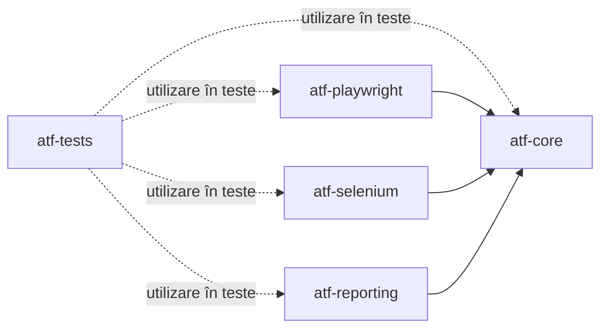
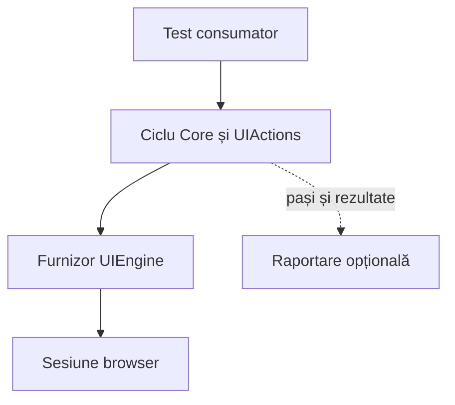
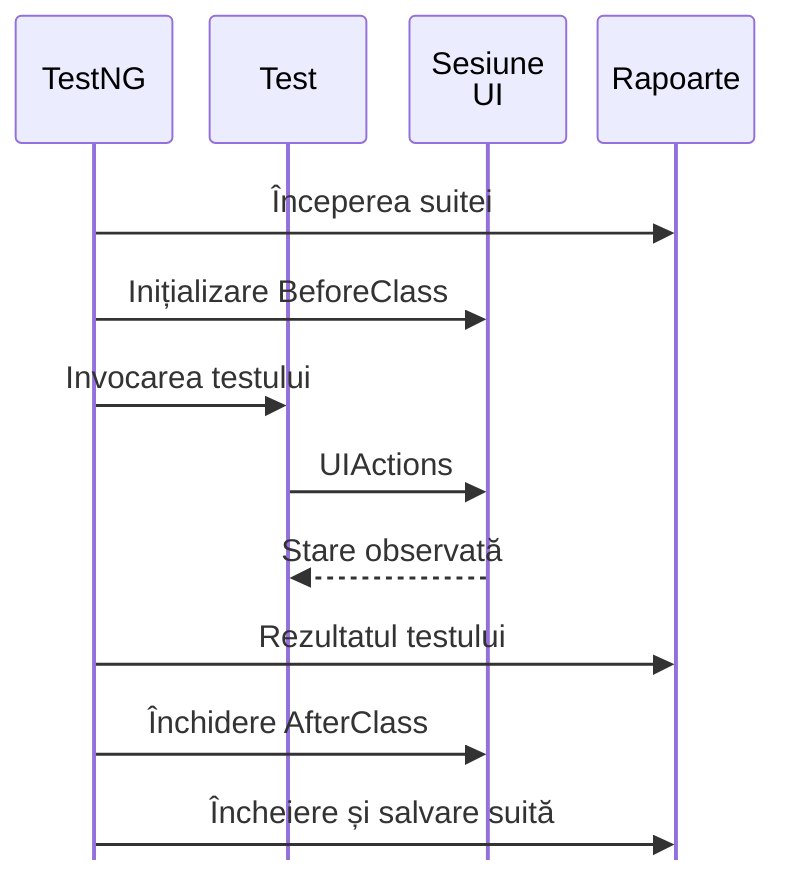

<a id="atf--ui-and-api-test-automation"></a>
# ATF — automatizarea testelor UI și API

Framework Java pentru testarea UI și a API-urilor REST, organizat în cinci module Maven.
Proiectul părinte este `com.ai:atf-parent:1.0.0`; bibliotecile țintesc Java 11.

<a id="at-a-glance"></a>
## Pe scurt

| Modul | Responsabilități | Întrebarea cititorului |
|---|---|---|
| [atf-core](atf-core/README.md) | Contracte UI/API neutre, configurație, ciclu de viață, pași și SPI pentru raportare | Ce poate reutiliza un consumator fără SDK-urile furnizorilor? |
| [atf-playwright](atf-playwright/README.md) | Furnizorul Playwright și implementarea browserului | Cum rulează contractul UI comun prin Playwright? |
| [atf-selenium](atf-selenium/README.md) | Furnizorul Selenium și implementarea browserului | Cum rulează contractul UI comun prin Selenium? |
| [atf-reporting](atf-reporting/README.md) | Ciclul raportării TestNG, Extent, Allure și publicarea agregată | Cum sunt publicate rezultatele și atașamentele? |
| [atf-tests](atf-tests/README.md) | Guvernanță, regresii, suport pentru produs și scenarii de aplicație selectate explicit | Ce verifică framework-ul și limitele sale? |



Săgețile continue indică dependențe între biblioteci; cele punctate indică utilizarea în teste.
Core nu expune tipuri din SDK-urile Selenium, Playwright, Extent sau Allure.
[Ghidul de arhitectură](docs/Architecture.md) definește limitele dependențelor și ale surselor;
README-urile modulelor descriu punctele publice de intrare și verificările locale.

Zona separată de documentație [atf-atlas](atf-atlas/README.md) leagă capabilitățile
existente de contracte, teste și limitele dovezilor. Este în afara reactorului
Maven și nu introduce o implementare de execuție.

<a id="execution-architecture"></a>
## Arhitectura execuției

[BaseTestUI](atf-core/src/main/java/com/ai/ui/core/runtime/BaseTestUI.java)
gestionează inițializarea și închiderea la nivel de clasă prin DriverManager, asociat firului de execuție.
[UIEngineFactory](atf-core/src/main/java/com/ai/ui/core/engine/UIEngineFactory.java)
încarcă opțiunile tipizate și selectează un
[UiEngineProvider](atf-core/src/main/java/com/ai/ui/core/engine/UiEngineProvider.java) instalat.
Testele aplicației folosesc aceeași interfață
[UIActions](atf-core/src/main/java/com/ai/ui/support/actions/UIActions.java)
cu oricare dintre adaptoare.



Săgețile continue arată execuția UI; fabrica selectează furnizorul prin Java SPI.
Săgeata punctată arată raportarea prin fațadele neutre Core și ascultătorul TestNG.
Testele exclusiv API folosesc
[BaseTestAPI](atf-core/src/main/java/com/ai/api/core/BaseTestAPI.java)
fără o sesiune UI. Harta dependențelor de mai sus și acest flux de execuție
răspund unor întrebări diferite.

<details>
<summary>Ciclul de viață al sesiunii UI și al raportării</summary>



Diagrama arată responsabilitățile, fără a enumera toate apelurile TestNG.
Sesiunea UI reunește BaseTestUI/DriverManager, motorul selectat și browserul său:
BeforeClass creează sesiunea, iar AfterClass o închide. Limitele dintre fabrică,
furnizor și browser sunt explicate în
[Arhitectură](docs/Architecture.md#provider-composition). Rapoartele reprezintă ascultătorul Core
și implementarea opțională; Core poate funcționa fără o implementare de raportare.

</details>

Consultă ghidurile
[Playwright](atf-playwright/README.md#consumer-example) și
[Selenium](atf-selenium/README.md#consumer-example) pentru configurația specifică
furnizorului și verificările concrete din depozit.

<a id="start"></a>
## Pornire

Folosește JDK 17+ și Maven; compilarea țintește Java 11. Pregătește o copie
temporară de validare conform ghidului [Dezvoltare](docs/Development.md), apoi rulează
din rădăcina reactorului:

<details>
<summary>Rulează comenzile: Pornire</summary>

```powershell
mvn -B -ntp test
mvn -B -ntp -Pbrowser test
mvn -B -ntp -Paggregate test
```

</details>

Execuția implicită rulează verificările native ale modulelor și regresiile locale de framework și guvernanță.
Profilul browser selectează fixture-uri locale de browser în atf-tests și necesită
executabile de browser pregătite. Profilul aggregate publică și dovezi Extent și
Allure. [Testare](docs/Testing.md) descrie pregătirea, comenzile selective și
locațiile rezultatelor.

Pentru scenariile de aplicație păstrate, folosește
[selecția E2E Playwright/Selenium](docs/Testing.md#retained-product-ui-audit).
Aceleași scenarii verifică oricare dintre furnizori; verificările de browser ale
framework-ului au limite diferite ale dovezilor. [Principiile vii](docs/Living_Architecture_UI_API_doc_v1_0.md#retained-principles)
leagă responsabilitățile pentru acțiuni, așteptări, validare, ciclu de viață și
audit de proprietarii lor.

<a id="consumer-migration"></a>
## Migrarea consumatorilor

Pentru un consumator existent, înlocuiește `com.ai:test-framework` cu
`com.ai:atf-core:1.0.0`, adaptorul de browser necesar și, opțional,
`com.ai:atf-reporting:1.0.0`. Ambele coordonate de adaptor folosesc același grup și
aceeași versiune. Core poate rula fluxuri API fără browser sau implementare de raportare.
Proiectul părinte coordonează construcția; atf-tests conține verificările depozitului și
fixture-urile aplicației, fără a furniza un API de framework pentru producție.

<a id="configuration"></a>
## Configurație

[framework.properties](atf-core/src/main/resources/framework.properties)
furnizează valorile implicite din classpath. Proprietățile JVM suprascriu setările individuale.
Setarea JVM `framework.properties` poate selecta un fișier existent, furnizat de
consumator, în locul acelei resurse. [Testare](docs/Testing.md#explicit-configuration)
arată cum se rezolvă calea o singură dată, înainte ca Maven să intre în module.
Selectează un furnizor UI instalat prin `ui.engine` și formatul raportului prin
`reporting.engine`.

Scenariile aplicației sunt selecții explicite în atf-tests. Configurează mediul
și credențialele potrivite înainte de rulare; scenariile pot crea date în aplicație.
Nu este inclus niciun token pentru operațiile API de scriere.

<a id="shared-ui-example"></a>
## Exemplu UI comun

Acesta este un test ilustrativ pentru consumator, nu o clasă de test suplimentară
în acest depozit. Adaugă Core și adaptorul ales în classpath-ul consumatorului;
adaugă atf-reporting când sunt necesare dovezi publicate în Extent/Allure. Setează `ui.engine`
înainte de pornirea TestNG. Pagina este un fixture local de date și nu face
cereri către aplicație sau rețea.

```java compile
import com.ai.ui.core.runtime.BaseTestUI;
import com.ai.ui.core.runtime.DriverManager;
import com.ai.ui.support.actions.UIActions;
import org.testng.Assert;
import org.testng.annotations.Test;

import java.net.URLEncoder;
import java.nio.charset.StandardCharsets;

public class SharedUiExampleTest extends BaseTestUI {
    @Test
    public void displaysTheEnteredName() {
        String html = "<!doctype html><html lang='en'><body>"
                + "<label for='name'>Name</label><input id='name'>"
                + "<button id='show' onclick=\"document.getElementById('result').textContent="
                + "document.getElementById('name').value\">Show name</button>"
                + "<p id='result' aria-live='polite'></p></body></html>";
        String page = "data:text/html;charset=UTF-8,"
                + URLEncoder.encode(html, StandardCharsets.UTF_8).replace("+", "%20");
        DriverManager.getEngine().open(page);
        UIActions.type("#name", "Name input", "Reader");
        UIActions.click("#show", "Show name");
        Assert.assertEquals(UIActions.getText("#result", "Displayed name"), "Reader");
    }
}
```

Metodele de ciclu de viață moștenite creează și închid motorul. Testul verifică valoarea
observată în pagină; nu construiește un rezultat reușit din datele de intrare.
Exemplele complete `java compile` sunt verificate față de API-ul public curent
al framework-ului prin guvernanța documentației.

<a id="language-and-review-contract"></a>
## Reguli de limbă și revizuire

Ramura main este ediția engleză. Ramura main_RO oferă toate documentele Markdown menținute și HTML-ul Living în română,
la aceleași căi din proiect. Exemplele executabile, sursele și comentariile
rămân în engleză în ambele ediții; [guvernanța edițiilor](docs/governance/Readme_Editions.md)
protejează ierarhia, legăturile, faptele tehnice și revizia integrală legată de surse.

Identificatorii din surse, comentariile, textele jurnalelor și mesajele de aserțiune
sau diagnostic **TREBUIE scrise în engleză** în ambele ramuri. Documentația și
etichetele diagramelor sunt în engleză pe main, cu ediția completă declarată a documentației pe main_RO.
Datele literale ale produselor externe și fixture-urile intenționat invalide păstrează
textul necesar contractului lor. Urmează
[politica pentru cod și documentație](docs/governance/Code_And_Documentation_Policy.md)
și [cazurile de regresie ale scanerului de surse](atf-tests/src/test/java/com/ai/atf/governance/JavaSourceScannerTest.java).

<a id="continue-by-question"></a>
## Continuă în funcție de întrebare

| Întrebare | Ghid responsabil |
|---|---|
| Cum se compun modulele și furnizorii? | [Arhitectură](docs/Architecture.md) |
| Ce verificări rulez și ce demonstrează? | [Testare](docs/Testing.md) |
| Cum modific, validez și sincronizez în siguranță? | [Dezvoltare](docs/Development.md) |
| Ce face codul, testele și documentația ușor de revizuit? | [Guvernanță](docs/governance/README.md) |
| Unde sunt explicate în profunzime ciclul de viață și contractele UI/API? | Arhitectura vie în [Markdown](docs/Living_Architecture_UI_API_doc_v1_0.md) și [HTML](docs/Living_Architecture_UI_API_doc_v1_0.html) |
| Ce teste existente protejează o capabilitate și ce rămâne nedemonstrat? | [Harta de acoperire Atlas](atf-atlas/Coverage_Map.md) și [feedback](docs/feedback/README.md) |
| Unde este harta completă a documentației? | [Indexul documentației](docs/README.md) |
| Unde se păstrează rapoartele și cum poate Atlas inspecta alt proiect? | [Artefacte și analiza proiectelor](artifacts/README.md) |

Dezvoltarea folosește main. Copia live primește puncte de control verificate;
implementarea anterioară rămâne pe main_mcp. Dovezile rulărilor stau în afara
copiei de surse și își păstrează sursa și limitele execuției în feedback.
