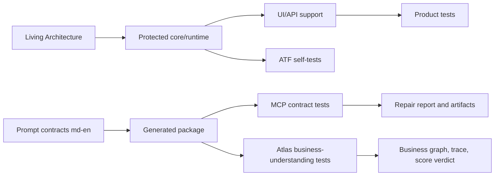
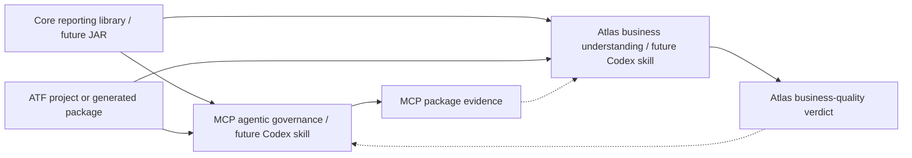
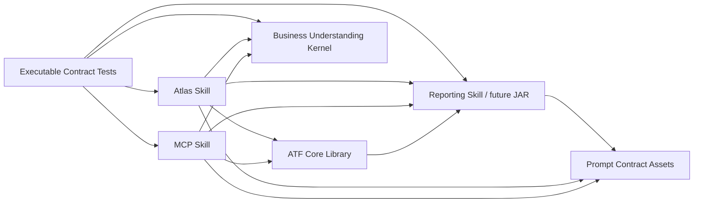
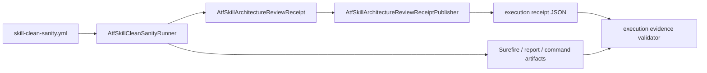
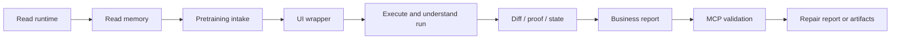
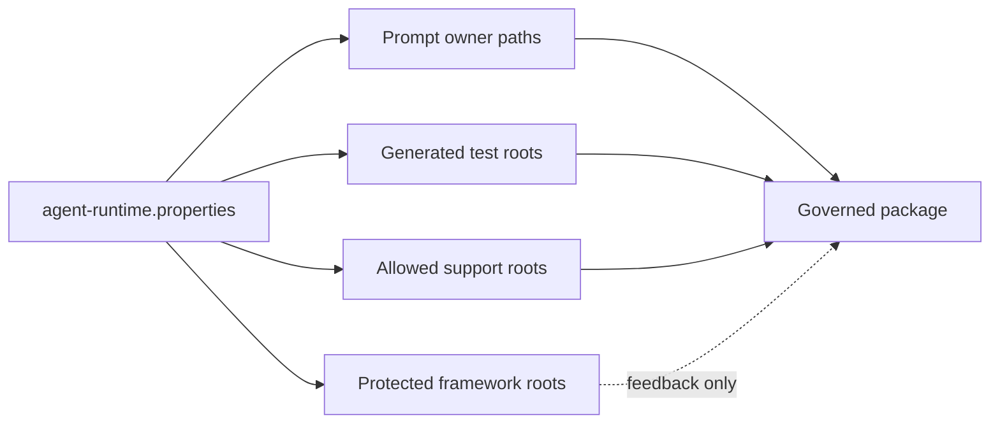

# Test Automation Framework

Java ATF for `UI + API + reporting`, evolved through governed AI-assisted runs, Maven validation, and MCP contract tests.

This repository is not a place for ad hoc generated tests. It is a controlled framework-hardening workspace. A good change should either prove that the existing ATF already supports the target behavior, or expose a reusable gap and improve the framework layer that owns it.

<details open>
<summary>One-page map</summary>

```text
Human / Agent intent
  -> Living Architecture
     -> ATF code layers
        -> product tests + framework tests

Governed package work
  -> prompt contracts
     -> generated tests + allowed support
        -> artifacts
           -> final business report
              -> MCP package close-out
```

| Question | Read first | What decides |
| --- | --- | --- |
| Where should code live? | [Living Architecture](docs/Living_Architecture_UI_API_doc_v1_0.md) | framework layering, OOP, ownership |
| What may an agent change? | [agent-runtime.properties](docs/prompts/md-en/agent-runtime.properties) | generated test roots, support roots, protected roots |
| How does a run close? | [orchestrate-iterative-runs.md](docs/prompts/md-en/orchestrate-iterative-runs.md) | slots, legality, final MCP profile |
| How is proof saved? | [execute-and-understand-run.md](docs/prompts/md-en/execute-and-understand-run.md) | diff, Extent, XML, state, feedback |
| What must the final report show? | [reporting.md](docs/prompts/md-en/reporting.md) | business report, artifact links, MCP close-out |
| Is the package publishable? | `testng-mcp-package-closeout.xml` | final MCP report with 0 failures, 0 errors, 0 skipped |
| Is it html-ex/teacher-grade? | `testng-mcp-candidate.xml` | separate promotion over publishability |

<!-- /table -->

</details>

## Start Here

<details open>
<summary>90-Second Mental Model</summary>

| Plane | Owner | Decides | Does not decide |
| --- | --- | --- | --- |
| Framework plane | [docs/Living_Architecture_UI_API_doc_v1_0.md](docs/Living_Architecture_UI_API_doc_v1_0.md) + `src/main/java` | how UI/API/core/reporting code is layered | package legality or final package score |
| Agent workflow plane | [docs/prompts/md-en](docs/prompts/md-en) + [agent-runtime.properties](docs/prompts/md-en/agent-runtime.properties) | how a governed agent run reads, spends, freezes, reports, and learns | framework implementation patterns by itself |
| MCP audit plane | `com.endava.ai.skills.mcp.*` | whether a generated package is auditable against executable contracts | which business frontier the agent should choose |
| Atlas understanding plane | `com.endava.ai.skills.atlas.*` | whether business graphs, scores, source trace, and report meaning are evidence-backed | package close-out or MCP artifact truth |
| Core reporting plane | `com.endava.ai.core.reporting.*` | reusable reporting, Extent, diagnostics, runtime audit, and aggregate report infrastructure | MCP/Atlas-specific business or package rules |
| Business understanding plane | `com.endava.ai.skills.business.*` | shared semantic language for business objects, flow stories, proof chains, score rationale, and limits | package publishability, Atlas artifact ownership, or report shell rendering |

<!-- /table -->

Read it like this:

- `Living Architecture` = how the framework is built.
- `md-en` prompt contracts = how the agent must work.
- `agent-runtime.properties` = active values and paths for the current package.
- `MCP tests` = executable shadow; they catch structural lies, missing artifacts, bad links, inflated score, and report drift.
- `Atlas tests` = business-understanding shadow; they catch invented business graphs, weak source trace, stale score truth, and report-quality drift.
- `Business Understanding` = shared semantic kernel; MCP and Atlas consume it, but they still own their own gates and artifacts.
- `Core reporting` = shared library-like infrastructure; it should stay generic enough to become a JAR or standalone skill/library.
- `html-ex` readiness = higher bar than MCP-green; it also needs business substance and strong report pedagogy.
- final report shape = Executive Context, Score Cards, Score Overview, Business Flow Graph open by default, Proof Mapping, Artifact Index, Close-Out.

</details>

<details>
<summary>5-Minute Green Path</summary>

Use this when you only need to prove the workspace is alive:

```bash
mvn test-compile
mvn "-Dtest=com.endava.ai.atf.*" test
mvn "-Dtest=com.endava.ai.api.tests.PositiveUserTests" test
mvn "-Dtest=com.endava.ai.skills.mcp.tests.latest.McpLatestPackageArtifactAuditTest" "-Dmcp.package.root=latest" test
```

Then inspect:

- `target/reports/ExtentReport_<timestamp>.html`
- `docs/out/<timestamp>/`
- `docs/out/README.md`

</details>

<details>
<summary>If You Are...</summary>

| Role | First move |
| --- | --- |
| new user | run `5-Minute Green Path`, then read `Architecture Map` |
| framework maintainer | read [docs/Living_Architecture_UI_API_doc_v1_0.md](docs/Living_Architecture_UI_API_doc_v1_0.md), then inspect the impacted layer |
| agent | read [docs/prompts/md-en/orchestrate-iterative-runs.md](docs/prompts/md-en/orchestrate-iterative-runs.md) and [agent-runtime.properties](docs/prompts/md-en/agent-runtime.properties) |
| reviewer | run package audit / package close-out checks, then inspect artifact spine and report links |
| report author | read [docs/prompts/md-en/reporting.md](docs/prompts/md-en/reporting.md), graph rubric, and score reference |

<!-- /table -->

</details>

<details>
<summary>Artifact Roots</summary>

| Root | Meaning |
| --- | --- |
| `docs/out/<timestamp>` | live generated package: report, run artifacts, state, feedback |
| `C:/work/ex/java/MCP/html-ex/*` | external html-ex calibration library referenced by runtime properties |
| `target/reports/*` | Maven / Extent runtime reports |
| `target/allure-results` | Allure raw results |
| `docs/prompts/md-en/*` | agent-readable workflow contracts |
| `docs/prompts/html_EN/{mcp,atlas,shared}` | English HTML prompt family split by MCP / Atlas / Shared ownership |
| `docs/prompts/html-contract-ownership.yml` | logical MCP / Atlas / Shared ownership for prompt contracts |
| `docs/prompts/mcp` | visible MCP prompt-skill ownership index |
| `docs/prompts/atlas` | visible Atlas prompt-skill ownership index |
| `docs/prompts/shared` | shared report/graph/score prompt primitive ownership index |

<!-- /table -->

</details>

<details>
<summary>Entry Links</summary>

| Need | Open |
| --- | --- |
| framework architecture | [docs/Living_Architecture_UI_API_doc_v1_0.md](docs/Living_Architecture_UI_API_doc_v1_0.md) |
| governed AI run | [docs/prompts/md-en/orchestrate-iterative-runs.md](docs/prompts/md-en/orchestrate-iterative-runs.md) |
| active runtime values | [docs/prompts/md-en/agent-runtime.properties](docs/prompts/md-en/agent-runtime.properties) |
| UI business discovery | [docs/prompts/md-en/ui-business-frontier-adapter.md](docs/prompts/md-en/ui-business-frontier-adapter.md) |
| run artifact production | [docs/prompts/md-en/execute-and-understand-run.md](docs/prompts/md-en/execute-and-understand-run.md) |
| final report shape | [docs/prompts/md-en/reporting.md](docs/prompts/md-en/reporting.md) |
| graph rubric | [docs/prompts/md-en/business-flow-graph-rubric.md](docs/prompts/md-en/business-flow-graph-rubric.md) |
| score rubric | [docs/prompts/md-en/score-overview-reference.md](docs/prompts/md-en/score-overview-reference.md) |
| business atlas skill contract | [docs/prompts/md-en/business-test-atlas-reference.md](docs/prompts/md-en/business-test-atlas-reference.md) |
| generated test code review | [docs/prompts/md-en/generated-test-code-review-reference.md](docs/prompts/md-en/generated-test-code-review-reference.md) |
| MCP close-out contract | [orchestrate-iterative-runs.md](docs/prompts/md-en/orchestrate-iterative-runs.md) for execution semantics; [reporting.md](docs/prompts/md-en/reporting.md) for final-report publication; [html_EN/mcp](docs/prompts/html_EN/mcp) for the HTML rendering of the same contract family |

<!-- /table -->

</details>

<details>
<summary>Minimum Commands</summary>

Compile first:

```bash
mvn test-compile
```

Run a narrow product test:

```bash
mvn "-Dtest=com.endava.ai.api.tests.PositiveUserTests" test
```

Run Core skill sanity after architecture, reporting, receipt or profile changes:

```bash
mvn -q "-Dsurefire.suiteXmlFiles=src/test/resources/atf/core/suites/core/testng-atf-core-sanity.xml" "-DforkCount=0" test
```

Run the generated-package MCP pre-closeout audit for fast local work:

```bash
mvn -q "-Dsurefire.suiteXmlFiles=src/test/resources/skills/mcp/testng-mcp-package-audit.xml" "-Dmcp.package.root=latest" "-Dmcp.project.root=<PROJECT_ROOT>" "-DforkCount=0" test
```

Run the final MCP close-out before publication, against the exact package timestamp:

```bash
mvn -q "-Dsurefire.suiteXmlFiles=src/test/resources/skills/mcp/testng-mcp-package-closeout.xml" "-Dmcp.package.root=docs/out/YYYY-MM-DD_HH.mm.ss" "-Dmcp.project.root=<PROJECT_ROOT>" "-DforkCount=0" test
```

Run the full MCP sweep only as secondary health evidence:

```bash
mvn -q "-Dsurefire.suiteXmlFiles=src/test/resources/skills/mcp/testng-mcp-full.xml" "-Dmcp.package.root=latest" "-Dmcp.project.root=<PROJECT_ROOT>" "-DforkCount=0" test
```

Run the ATF-core aggregate audit as one final reporting artifact:

```bash
mvn test "-Dsurefire.suiteXmlFiles=src/test/resources/atf/core/suites/core/testng-atf-core.xml" "-Datf.core.aggregate.report.engine=extent"
```

Generate both aggregate Extent and Allure raw results:

```bash
mvn test "-Dsurefire.suiteXmlFiles=src/test/resources/atf/core/suites/core/testng-atf-core.xml" "-Datf.core.aggregate.report.engine=both"
```

Inspect reports:

- Extent: `target/reports/ExtentReport_<timestamp>.html`
- ATF-core aggregate: `target/atf-core-aggregate-report/README.md`
- Allure: `mvn allure:serve`
- governed package output: `docs/out/<timestamp>/`

</details>

## Framework Layers

<details>
<summary>Architecture Map</summary>

| Layer | Main package / file | Owns | Must not own |
| --- | --- | --- | --- |
| ATF core | `com.endava.ai.core` | config, listeners, reporting hooks, shared lifecycle | product business assertions |
| API core/runtime | `com.endava.ai.api.core` + API runtime packages | API clients, actions, schemas, payloads, API lifecycle | UI/browser mechanics |
| UI core/runtime | `com.endava.ai.ui.core` + `com.endava.ai.ui.engine` | browser lifecycle, engines, waits, shared UI mechanics | product-specific business shortcuts |
| UI support | `com.endava.ai.ui.support` | reusable product-facing pages, services, validations, factories | engine/core behavior |
| API support | `com.endava.ai.api.support` | reusable product-facing clients, services, validations, factories | API core behavior |
| Product API tests | `com.endava.ai.api.tests` | API product behavior | framework contract validation |
| Product UI tests | `com.endava.ai.ui.tests` | UI product behavior | framework self-tests |
| ATF self-tests | `com.endava.ai.atf.*` | lifecycle, reporting, engine, smoke, regression contracts | product business coverage |
| MCP validation | `com.endava.ai.skills.mcp.*` | generated-package contract validation | choosing business frontier |
| Atlas validation | `com.endava.ai.skills.atlas.*` | business-understanding, graph, trace, score, and report-quality validation | MCP package close-out |

<!-- /table -->

Composable validator principle:

| Component | Must run alone | Can compose when present | Long-term packaging direction |
| --- | --- | --- | --- |
| MCP | yes | may link Atlas verdicts and Core reporting outputs | Codex skill / agentic governance package |
| Atlas | yes | may consume MCP artifacts as optional evidence | Codex skill / business-understanding analyzer |
| Core reporting | yes, as a reusable library | used by MCP, Atlas, ATF and future validators | shared JAR, or reporting skill/library |
| ATF framework | yes | can host all validators in one repository | Java/TestNG/Playwright automation framework |

MCP and Atlas must not require each other at runtime. If both exist in the same project, they should exchange evidence through files, links, report anchors, JSON/YAML manifests, and shared reporting primitives. The dependency direction is optional composition, not hard coupling.

Visible flow:

`Living Architecture -> protected core/runtime -> product support -> product tests + framework tests`

`Prompt contracts md-en -> generated package -> MCP contract tests -> repair report/artifacts`

`Atlas -> business graph/source trace/score truth -> optional quality verdict linked from MCP or final report`

<details>
<summary>Mermaid architecture flow</summary>



</details>

<details>
<summary>Composable MCP / Atlas / Core Reporting</summary>



| Rule | Meaning |
| --- | --- |
| MCP remains independently useful | It can validate generated-package legality, artifacts, Extent provenance, links, runtime constants, close-out, and report shape without Atlas. |
| Atlas remains independently useful | It can validate business graph quality, source-to-business trace, score truth, proof strips, and report pedagogy without MCP. |
| Core reporting stays generic | It provides reporting primitives, adapters, aggregate writers, diagnostics, and runtime audit without MCP/Atlas business rules. |
| Integration is file/report based | Cross-links use artifacts, manifests, anchors, JSON/YAML metadata, and report sections instead of mandatory Java imports. |
| Shared code is minimal | Reuse loaders, report primitives, CSS/report shell contracts, and diagnostics; avoid circular dependencies between validators. |

</details>

<details open>
<summary>Skills-Based OOP Architecture</summary>

ATF_name is intentionally moving toward a skills-based architecture: each major capability should be independently useful, independently testable, and still composable when it lives in the same repository.

The canonical executable ownership map is `src/main/resources/atf-core/contracts/skills/skill-architecture.yml`, guarded by `AtfSkillArchitectureContractTest`. Treat it as the top-level routing contract before adding new MCP, Atlas, Core, prompt or close-out flows.

Prefer a small executable contract over another long explanatory document. The feedback board in `docs/out/README.md` keeps only open architectural feedback; durable rules belong in Java tests, YAML contracts, prompt assets, or generated artifacts.



| Skill / module | Correct role | Long-term direction |
| --- | --- | --- |
| `Core` | Neutral runtime library for configuration, lifecycle, listeners, and the support kernel | shared framework JAR |
| `Reporting` | Neutral library for reporting primitives, Extent aggregation, diagnostics, runtime audit, shared HTML shell contracts, and reusable CSS/report rules | shared JAR, standalone reporting skill, or both |
| `Business Understanding` | Shared semantic kernel for business objects, business flow graphs, proof strips, source/evidence trace vocabulary, and comprehension axes | shared semantic skill/library consumed by MCP and Atlas |
| `MCP` | Agentic governance skill for generated-package legality, run evidence, artifact spine, Extent provenance, final close-out, and candidate-quality checks | Codex skill / agentic validation package |
| `Atlas` | Business-understanding skill for Business Flow Graph, source-to-business trace, business evidence, score honesty, and report pedagogy | Codex skill / business-understanding analyzer |
| `Prompt contract assets` | Human-readable and agent-readable contract assets split by MCP, Atlas, Reporting/Shared ownership; not an independent prompt skill | skill-owned prompt source, with explicit ownership manifest |
| `Executable contract tests` | The enforceable shadow of the Markdown/HTML/YAML contracts | regression guard for future agents and maintainers |

Execution evidence belongs to the same architecture. A review can claim high confidence only when the supporting commands leave reopenable evidence.



| Execution component | Owns | Must not own |
| --- | --- | --- |
| `AtfSkillCleanSanityRunner` | sequential command execution from `skill-clean-sanity.yml`, including stop-after-failure behavior | Maven profile design, report rendering, or skill architecture policy |
| `AtfSkillArchitectureReviewReceipt` | receipt state: command owner, status, exit code, duration, artifact links, failure summary | filesystem publishing or process execution |
| `AtfSkillArchitectureReviewReceiptPublisher` | Markdown/JSON rendering of a receipt | deciding command truth |
| execution receipt validator | rejecting unverifiable `PASS` claims | running the clean chain itself |

Canonical flow map:

| Use-case | Primary skill | Required profile route | Stop condition |
| --- | --- | --- | --- |
| Generated package close-out | `MCP` | `testng-mcp-sanity.xml` -> `testng-mcp-run-preflight.xml` -> `testng-mcp-package-audit.xml` -> `testng-mcp-package-closeout.xml` -> `testng-mcp-post-sync-smoke.xml` -> `testng-mcp-final-report-closeout.xml` -> `testng-mcp-langgraph-final-report.xml` | no source changes after package close-out; only final report/link sync before final-report close-out and only semantic report repair before LangGraph final report validation |
| Business understanding audit | `Atlas` | `testng-atlas-sanity.xml` -> `testng-atlas.xml` | Atlas explains business meaning without deciding MCP package publishability |
| Core library change | `Core` | `testng-atf-core-sanity.xml` -> `testng-atf-core.xml` | Core stays generic; MCP/Atlas-specific rules remain outside Core |
| Shared business-understanding change | `Business Understanding` | `testng-business-understanding-sanity.xml` -> MCP/Atlas consumer sanity where impacted | shared semantics remain independent from MCP publishability and Atlas artifact ownership |
| Reporting library/skill change | `Reporting` | `testng-atf-core-sanity.xml` -> `testng-atf-extent.xml` | shared report shell stays generic; MCP/Atlas vocabulary remains in MCP or Atlas contracts |

Canonical read order:

| Use-case | Read first | Then |
| --- | --- | --- |
| Generated package close-out | `docs/prompts/md-en/orchestrate-iterative-runs.md` | `execute-and-understand-run.md`, then `reporting.md` only for final publication |
| Business understanding audit | `docs/prompts/md-en/business-test-atlas-reference.md` | Atlas sanity, then full Atlas profile |
| Shared business-understanding change | `src/main/java/com/endava/ai/skills/business/README.md` | `skills/business/contracts/semantic-pipeline.yml`, then business-understanding sanity |
| Core library change | `src/main/java/com/endava/ai/core/README.md` | Core sanity, then deeper Core profile |

`AtfSkillArchitectureContractTest` enforces this routing: every use-case starts with the primary skill sanity profile, declares its prompt/readme source, and keeps candidate/html-ex promotion outside generated-package close-out.

Design rule:

- MCP and Atlas may both consume Core/Reporting.
- MCP and Atlas may both consume shared Business Understanding semantics.
- MCP and Atlas must not require each other at runtime.
- Shared reporting code must stay domain-neutral.
- Shared business-understanding code must stay orchestration-neutral: it may define business objects, flow nodes, evidence traces, proof strips, and comprehension axes, but it must not decide MCP package publishability or Atlas artifact ownership.
- Cross-skill collaboration should happen through files, links, report anchors, JSON/YAML manifests, and stable artifacts.
- If a rule is useful for both MCP and Atlas report rendering, move it toward Core/Reporting instead of duplicating it in one validator.
- If a rule is useful for both MCP and Atlas business meaning, move it toward the Business Understanding kernel instead of hiding it inside MCP or Atlas.
- Skill flow/profile changes must update `skill-architecture.yml`, the affected TestNG profile, and the owning README in the same change.
- Execution-governance changes must keep planned receipts and execution receipts distinct: planned commands may say `NOT_EXECUTED_BY_RECEIPT`; executed commands must carry status, exit code, duration and evidence links.
- Any command marked `PASS` in an execution receipt must have a reopenable Surefire, report or command-result artifact.

Shared Business Understanding kernel:

MCP and Atlas share more than Reporting. Reporting is shared presentation; Business Understanding is shared semantics. MCP validates that a generated package and final report present business meaning truthfully. Atlas reconstructs and scores business meaning from source-backed evidence. Those are different responsibilities, but they should speak the same semantic language.

| Shared concept | Currently visible in MCP | Currently visible in Atlas | Candidate shared owner |
| --- | --- | --- | --- |
| Business Flow Graph semantics | `McpBusinessGraphAssertions`, `BusinessGraphReportRule` | `AtlasBusinessGraphParser`, `AtlasGraph*Rule` | `Business Understanding` |
| Business evidence/proof | `BusinessEvidenceTraceRule`, `McpBusinessEvidenceAssertions` | `AtlasSourceTrace*Rule`, `AtlasProofStripParser` | `Business Understanding` |
| Business object durability | `DurableBusinessObjectRule` | `AtlasBusinessObjectCenteredRule` | `Business Understanding` |
| Proof strip vocabulary | proof mapping and artifact links | node proof strip and source-to-business trace | `Business Understanding` |
| Comprehension score axes | MCP score wall and business-substance cards | Atlas score cards and score motivation | shared axes in `Business Understanding`; final formulas stay skill-owned |
| Source-backed trace | source evolution and package evidence | source-to-business trace and layer path evidence | shared trace model; source readers stay skill-owned |

Extraction status and next order:

1. Done: define the input-agnostic semantic path in `skills/business/contracts/semantic-pipeline.yml`.
2. Done: add package-shape and boundary tests for the shared semantic kernel.
3. Started: neutral value objects exist for `BusinessObject`, `BusinessClaim`, and `BusinessProofChain`; continue migrating duplicated vocabulary toward `BusinessFlow`, `BusinessEvidence`, `ProofStrip`, `ComprehensionAxis`, and `BusinessUnderstandingLimit`.
4. Keep MCP-specific rules in MCP: package legality, run iteration, delta quality, generated tests, final report close-out, and LangGraph final report validation.
5. Keep Atlas-specific rules in Atlas: source-only analysis, atlas artifact shape, source-to-business trace depth, atlas score calculation, and candidate graph quality.
6. Let MCP and Atlas integrate with the shared kernel through contracts and stable models, not direct runtime dependence on each other.

Scorecard for the architectural options:

| Option | Score | Verdict |
| --- | ---: | --- |
| Keep only MCP + Atlas + Reporting | 87 | Works, but business semantics remain duplicated and can drift. |
| Add shared `Business Understanding` semantics with MCP/Atlas specialization | 95 | Cleanest shape: shared meaning, separate orchestration and artifact ownership. |
| Move all business understanding into Atlas and let MCP consume Atlas | 82 | Too coupled; MCP would depend conceptually on Atlas. |
| Move business understanding into Reporting | 65 | Wrong boundary; Reporting should render, not decide business meaning. |

OOP direction:

| Concern | Preferred shape |
| --- | --- |
| report shell validation | small validators for document chrome, visual shell, sections, toolbar, CSS, artifact links |
| generated-package validation | MCP rule/catalog/profile model |
| shared business-understanding semantics | neutral value objects and contracts for business object, flow, proof strip, evidence trace, comprehension axis, and understanding limit |
| Atlas business-understanding validation | Atlas rules grouped by graph, trace, score, structure, evidence |
| shared report rendering | adapters and writers behind Core/Reporting facades |
| configuration/contract data | YAML for external governance, Java records/value objects for internal immutable models |

This keeps the repository useful today as one ATF workspace, while preserving the option to extract `MCP`, `Atlas`, `Business Understanding`, and `Core Reporting` later as independent skills or libraries.

</details>

</details>

<details>
<summary>Protected vs Generated Surfaces</summary>

The agentic/generated package has a small legal playground. It may create tests and extend product-specific support when the test genuinely needs it. It must not modify framework roots to make one package pass.

| Surface | Runtime key | Status | Rule |
| --- | --- | --- | --- |
| UI tests | `UI_TEST_ROOT` | generated-owned | may add/refactor tests inside the declared package |
| API tests | `API_TEST_ROOT` | generated-owned | may add/refactor tests inside the declared package |
| UI support | `UI_SUPPORT_ROOTS` | product support | may extend surgically for reusable pages/services/validations/factories |
| API support | `API_SUPPORT_ROOTS` | product support | may extend surgically for reusable clients/services/validations/factories |
| ATF core | `ATF_CORE_ROOT` | protected | do not modify from a generated package |
| MCP engine | `MCP_ROOT` | protected | do not patch the validator to pass the current package |
| Atlas engine | `ATLAS_ROOT` | protected | do not hardcode one business context |
| UI core | `UI_CORE_ROOT` | protected | do not add business shortcuts |
| API core | `API_CORE_ROOT` | protected | do not add product rules |
| UI engine | `UI_ENGINE_ROOT` | protected | do not hide test/reporting problems in engine behavior |

<!-- /table -->

If a protected root really needs a change, stop treating it as package work. Report it as framework feedback, explain the generic use case, and validate it as framework evolution.

</details>

<details>
<summary>Repository Map</summary>

| Path | Meaning |
| --- | --- |
| `src/main/java/com/endava/ai/core` | reusable Core runtime library: listener, lifecycle, support kernel, reporting library and skill facades |
| `src/main/java/com/endava/ai/core/support` | shared low-level support kernel, including `core.support.config`, YAML contracts, annotations and small HTML primitives |
| `src/main/java/com/endava/ai/core/reporting` | reusable reporting implementation library |
| `src/main/java/com/endava/ai/skills/business` | shared Business Understanding semantic skill consumed by MCP and Atlas |
| `src/main/java/com/endava/ai/skills/reporting` | Reporting skill facade; implementation stays in `core.reporting` |
| `src/main/java/com/endava/ai/api` | API runtime layers |
| `src/main/java/com/endava/ai/ui` | UI runtime layers |
| `src/main/java/com/endava/ai/skills/mcp` | reusable MCP validation engine |
| `src/main/java/com/endava/ai/skills/atlas` | reusable Atlas business-understanding validator |
| `src/test/java/com/endava/ai/api/tests` | product/API tests |
| `src/test/java/com/endava/ai/ui/tests` | product/UI tests |
| `src/test/java/com/endava/ai/atf` | framework self-tests |
| `src/test/java/com/endava/ai/atf/core/reporting` | Reporting skill / Core reporting contract tests |
| `src/test/java/com/endava/ai/skills/business/tests` | Business Understanding skill contract tests |
| `src/test/java/com/endava/ai/skills/mcp` | executable MCP skill contract tests |
| `src/test/java/com/endava/ai/skills/atlas` | executable Atlas skill contract tests |
| `src/main/resources/atf-core/contracts/architecture/test-architecture.yml` | executable test-lane ownership map for product tests, framework tests and skill tests |
| `docs/prompts/md-en` | English Markdown prompt contracts, best default for agents |
| `docs/prompts/html_EN` | English HTML prompt family, split by MCP / Atlas / Shared ownership |
| `docs/prompts/html-contract-ownership.yml` | prompt ownership map for MCP skill, Atlas skill, and shared report primitives |
| `docs/prompts/mcp` | MCP skill prompt ownership index; links to English Markdown and HTML owner files |
| `docs/prompts/atlas` | Atlas skill prompt ownership index; links to the business atlas contract |
| `docs/prompts/shared` | common report primitive index for shared shell, score, graph and artifact-linking contracts |
| `docs/out` | generated package runs, reports, feedback, and calibration memory |

<!-- /table -->

</details>

<details>
<summary>Design Patterns To Preserve</summary>

| Concern | Preferred pattern | Concrete examples |
| --- | --- | --- |
| common test lifecycle | Template Method | `BaseTestAPI`, `BaseTestUI` keep concrete tests thin |
| engine creation | Factory | `UIEngineFactory` chooses the UI engine; data factories create repeatable inputs |
| shared runtime state | Manager | `ConfigManager`, `DriverManager`, `ReportingManager` centralize lifecycle access |
| UI interaction | Page Object + service | pages own selectors; services/actions drive visible behavior |
| assertions | Validation Object | `*Validation` classes own assertion meaning and failure language |
| cross-cutting hooks | Listener | `TestListener` owns test lifecycle hooks |
| reporting boundary | Adapter / facade | `StepLogger` and `ReportingManager` hide report-engine details |
| MCP checks | Rule / validator | `McpDefaultRules`, `McpValidationRule`, `McpPackageAuditValidation` keep contract checks reusable |

<!-- /table -->

Keep this separation:

- tests orchestrate behavior;
- services drive actions;
- pages own selectors;
- validations own assertion meaning;
- reporting stays behind framework contracts;
- MCP tests validate generated-package structure, not application business choices.

Anti-patterns:

- fat tests mixing selectors, waits, assertions, and reporting;
- recorder-shaped UI code kept as final code;
- API-only tests created when the governed run asked for UI business coverage;
- direct report adapter calls from product tests;
- green MCP used as proof of high business score.

</details>

<details>
<summary>Code Placement Map</summary>

| If you add | Put it in | Keep out |
| --- | --- | --- |
| product API test | `src/test/java/com/endava/ai/api/tests` | browser logic, UI screenshots, MCP assertions |
| product UI test | `src/test/java/com/endava/ai/ui/tests` | raw API contract testing, direct reporting adapters |
| UI page mechanics | `src/main/java/com/endava/ai/ui/.../pages` | business assertions |
| UI business action | `src/main/java/com/endava/ai/ui/.../services` or actions | selectors and low-level waits in tests |
| assertion meaning | validation classes | mixed helper/test classes |
| framework lifecycle test | `src/test/java/com/endava/ai/atf` | product business claims |
| low-level config/support primitive | `src/main/java/com/endava/ai/core/support` | MCP/Atlas/package-specific behavior |
| runtime config key or config loader | `src/main/java/com/endava/ai/core/support/config` | top-level `core.config` package |
| shared business-understanding semantic primitive | `src/main/java/com/endava/ai/skills/business` | MCP gate decisions, Atlas artifact ownership, reporting shell rules |
| shared reporting skill facade | `src/main/java/com/endava/ai/skills/reporting` | Extent implementation details, MCP/Atlas domain decisions |
| reusable reporting implementation | `src/main/java/com/endava/ai/core/reporting` | MCP publishability, Atlas business meaning |
| generated-package validator | `src/main/java/com/endava/ai/skills/mcp` | site-specific business expectations |
| MCP executable test | `src/test/java/com/endava/ai/skills/mcp` | brittle checks tied to one current application story |
| Atlas executable test | `src/test/java/com/endava/ai/skills/atlas` | MCP package publishability |
| Business Understanding executable test | `src/test/java/com/endava/ai/skills/business/tests` | report presentation and package gate decisions |

<!-- /table -->

Good generated code should look like it belongs to the current ATF. If it looks like a second framework, refactor it before keeping it.

</details>

<details>
<summary>Runtime Lifecycle Card</summary>

| Stage | Owner | What must stay true |
| --- | --- | --- |
| TestNG starts a test | `testng.xml`, Surefire, `TestListener` | lifecycle hooks stay centralized |
| Base test prepares context | `BaseTestAPI` / `BaseTestUI` | concrete tests stay thin |
| Test calls framework layer | services, actions, pages, validators | no direct selector/assert/report mix in tests |
| Step is logged | `StepLogger` / `ReportingManager` | reporting remains engine-agnostic |
| Adapter writes output | `ExtentAdapter` / `AllureAdapter` | report engine details stay behind adapter |
| Listener closes lifecycle | `TestListener` / internal lifecycle classes | screenshots, failures, and flushes are consistent |

<!-- /table -->

If a change bypasses this lifecycle, treat it as framework drift.

</details>

<details>
<summary>Console And Report Logging Rule</summary>

Console output is allowed, but it has one owner. Use the framework logging path so console, Extent, Allure, and contract tests stay aligned.

| Need | Use | Do not use |
| --- | --- | --- |
| business/test step | `StepLogger.startStep`, `logDetail`, `pass`, `fail` | raw `System.out.println` in tests |
| console publishing | `ConsoleLogger` through framework publishers | misspelled duplicates or ad-hoc console utilities |
| report engine output | `ReportingManager` and `ReportLogger` implementations | direct Extent/Allure calls from product tests |
| scoped step lifecycle | `StepScope` when a block needs automatic closure | open-ended step state in helpers |

<!-- /table -->

The console should keep telling the reader what happens during a test, but the route stays framework-owned. If a message is useful enough for the console, it is usually useful enough to pass through `StepLogger` or the reporting lifecycle.

</details>

## Governed Agent Workflow

<details>
<summary>Prompt Family Layers</summary>

Use the Markdown set under [docs/prompts/md-en](docs/prompts/md-en) as the default agent-readable contract.

| Owner document | Owns | Reads / delegates |
| --- | --- | --- |
| [orchestrate-iterative-runs.md](docs/prompts/md-en/orchestrate-iterative-runs.md) | package legality, run window, same-package vs fresh ROOT_RUN, MCP executable shadow | delegates pretraining, wrapper, execution, reporting |
| [pretraining-reference.md](docs/prompts/md-en/pretraining-reference.md) | source reading order, intake card, anti-copy, calibration artifact | feeds cold intake back to orchestrator |
| [ui-business-frontier-adapter.md](docs/prompts/md-en/ui-business-frontier-adapter.md) | one UI run wrapper, actor/intent/object discovery, visible proof | hands slot material to execution |
| [execute-and-understand-run.md](docs/prompts/md-en/execute-and-understand-run.md) | artifacts, diff, proof, state files, learning MDs | hands frozen truth to reporting |
| [reporting.md](docs/prompts/md-en/reporting.md) | final business-first HTML, proof links, render/link audit | reads only frozen truth |
| [business-flow-graph-rubric.md](docs/prompts/md-en/business-flow-graph-rubric.md) | application map, package overlay, business node rules | supports reporting |
| [score-overview-reference.md](docs/prompts/md-en/score-overview-reference.md) | Score Overview, `Overall`, cap, candidate threshold | supports reporting and MCP candidate judgment |
| [business-test-atlas-reference.md](docs/prompts/md-en/business-test-atlas-reference.md) | read-only atlas of business already covered by a test package | supports understanding and refactor decisions |
| [generated-test-code-review-reference.md](docs/prompts/md-en/generated-test-code-review-reference.md) | OOP / cohesion / package split review for generated tests | supports surgical reorganization before rerun |

<!-- /table -->

Runtime values are not hardcoded in the prompt text. They are read from [docs/prompts/md-en/agent-runtime.properties](docs/prompts/md-en/agent-runtime.properties).

</details>

<details>
<summary>Operational Flow For An Agent</summary>

Visible flow:

`runtime -> memory -> pretraining -> UI wrapper -> execute -> diff/proof/state -> report -> MCP -> repair`

<details>
<summary>Mermaid operational flow</summary>



</details>

The package should preserve this cold chain:

```text
1. read Living Architecture for code-layer constraints
2. read orchestrate-iterative-runs.md
3. read agent-runtime.properties live
4. perform pretraining intake
5. spend one governed UI slot through the wrapper
6. execute and save diff / proof / state / feedback
7. publish langgraph-business-understanding.html
8. run MCP tests
9. after any report/state/diff edit, rerun MCP; otherwise the gate is stale
10. repair report or artifacts until current MCP truth is published
11. write feedback for the next run
```

The package must keep these truths separate:

- tests produced vs runs consumed;
- MCP-green vs `html-ex` ready;
- report polish vs business substance;
- UI proof vs API helper step;
- package overlay vs application business map.

</details>

<details>
<summary>Runtime Values That Matter Most</summary>

| Runtime value | Meaning |
| --- | --- |
| `RUN_EXPECTED_DELTA_QUALITY` | 0-100 threshold used for run quality and `html-ex` candidate judgment |
| `ROUND_TARGET_TEST_COUNT` | active target of good auditable tests per run |
| `META_ITERATION_COUNT` | active target of governed runs per package |
| `PROMPT_ROOT` | root of the live prompt family |
| `ORCHESTRATE_RUNS_PATH` | orchestrator owner path |
| `PRETRAINING_REFERENCE_PATH` | source-reading and intake owner path |
| `UI_ADAPTER_PATH` | UI business frontier adapter path |
| `RUN_EXECUTION_PATH` | run execution and artifact owner path |
| `REPORTING_PATH` | final reporting owner path |
| `BUSINESS_GRAPH_RUBRIC_PATH` | graph and business-node rubric |
| `SCORE_OVERVIEW_REFERENCE_PATH` | score overview and candidate threshold rubric |
| `HTML_EX_LIBRARY_ROOT` | comparative example library |
| `AUDIT_OUTPUT_ROOT` | generated package output root |
| `UI_TEST_ROOT` / `API_TEST_ROOT` | generated test roots |
| `UI_SUPPORT_ROOTS` / `API_SUPPORT_ROOTS` | product support roots that can be extended surgically |
| `ATF_CORE_ROOT`, `MCP_ROOT`, `ATLAS_ROOT`, `UI_CORE_ROOT`, `API_CORE_ROOT`, `UI_ENGINE_ROOT` | protected framework roots |

<!-- /table -->

Do not reinterpret these values locally. Read them live and publish their effect in the package artifacts.

<details>
<summary>Runtime flow diagram</summary>



</details>

</details>

<details>
<summary>Configuration Ownership</summary>

| File | Owns | Used by | Do not use it for |
| --- | --- | --- | --- |
| `src/main/resources/framework.properties` | framework runtime: URLs, engines, waits, reporting backend, screenshots | Java framework and tests | governed package scoring or prompt ownership |
| [docs/prompts/md-en/agent-runtime.properties](docs/prompts/md-en/agent-runtime.properties) | agent package runtime: targets, prompt paths, artifact paths, quality threshold | prompts, generated package, MCP tests | browser engine behavior or framework internals |
| `pom.xml` | dependencies, plugins, Maven lifecycle | build and test execution | package score or business verdict |
| `docs/prompts/md-en/*` | agent workflow contracts | agents and reviewers | low-level Java runtime configuration |
| [docs/prompts/html-contract-ownership.yml](docs/prompts/html-contract-ownership.yml) | logical ownership of prompt contract families | future MCP skill, Atlas skill, shared report-library extraction | changing English HTML prompt files without the matching owner manifest entry |

<!-- /table -->

Cold rule:

- Tests must not override config values just to pass.
- Do not change values such as browser zoom, reporting engine, runtime targets, or prompt paths from inside generated tests.
- If a config value is wrong, fix the owner file and mention the change in the package artifacts.
- If a generated package needs a runtime value, read it from `agent-runtime.properties`, not from memory or local prose.

Examples of forbidden local drift:

| Drift | Correct response |
| --- | --- |
| changing `ui.page.zoom.percent` in a test to hide layout issues | fix the owner config or document why the environment requires a config change |
| switching `reporting.engine` to make a report pass | fix reporting artifacts against the configured engine |
| changing `ROUND_TARGET_TEST_COUNT` or `META_ITERATION_COUNT` locally | read runtime live; document blocker if the target cannot be met |
| patching prompt paths in test code | fix `agent-runtime.properties` or the referenced prompt file |

<!-- /table -->

</details>

<details>
<summary>Before A Fresh Run: Code Quality Review</summary>

A fresh run is valuable only after the generated code is reasonably shaped. Do not spend a new package run just to discover that tests are still mixed by run number, helpers are copied, or assertions are sitting in the wrong layer.

| Check | Good enough to run | Needs refactor first |
| --- | --- | --- |
| class cohesion | each class has one business object or close family | one class mixes unrelated support/profile/admin/checkout flows |
| package structure | packages reflect UI/API area and business object | packages reflect `run_01`, `run_02`, agent history, or mechanical batches |
| test thickness | tests orchestrate and read clearly | tests contain selectors, waits, direct assertions, and reporting plumbing |
| support reuse | repeated behavior is in allowed `ui.support` / `api.support` layers | repeated behavior is copied between tests or pushed into protected core |
| validation | assertion meaning lives in validation classes | assertions are scattered through tests and helpers |
| framework boundary | protected roots are untouched | package success depends on changes in core, MCP, atlas, ui.core, api.core, or ui.engine |

<!-- /table -->

Helpful order:

```text
business atlas -> generated test code review -> surgical refactor in generated/support roots -> narrow tests -> MCP package audit -> MCP package close-out
```

</details>

## MCP Contract Tests

<details>
<summary>MCP Contract Tests - executable shadow, not the center of the framework</summary>

MCP tests are the executable shadow of part of the HTML/Markdown requirements. They do not replace the prompts. They enforce that a generated package leaves enough evidence to be reopened cold.

| MCP area | Checks |
| --- | --- |
| runtime | active paths, targets, and prompt references |
| package spine | `package-state.json`, `execution-gate-card.md`, root diff, close-out |
| run spine | `run-state.json`, run diff, Extent/XML/command proof, feedback |
| final report | collapsible structure, graph default state, Score Overview, Proof Mapping, links |
| diagnostics | expected contract, observed validator result, cold verdict, repair hint |
| candidate quality | `RUN_EXPECTED_DELTA_QUALITY`, cap, business trace, `html-ex` readiness |
| architecture | UI tests extend framework layers and avoid direct bypasses |

<!-- /table -->

For status meaning, use `MCP Profiles And Candidate Meaning` below.

<details>
<summary>MCP Profiles And Candidate Meaning</summary>

| Stage | Suite | Meaning | Can produce final `validation/mcp/ExtentReport.html`? |
| --- | --- | --- | --- |
| MCP self health | `src/test/resources/skills/mcp/testng-mcp-self.xml` | validator health and internal contracts | no |
| Run preflight | `src/test/resources/skills/mcp/testng-mcp-run-preflight.xml` | run evidence plus runtime/package accounting before package audit | no |
| Full sweep | `src/test/resources/skills/mcp/testng-mcp-full.xml` | broad diagnostic / secondary confidence | no |
| Package audit | `src/test/resources/skills/mcp/testng-mcp-package-audit.xml` | pre-closeout package audit | no |
| Final close-out | `src/test/resources/skills/mcp/testng-mcp-package-closeout.xml` | publishability gate for the generated package | **yes: 0 failures, 0 errors, 0 skipped** |
| Post-sync smoke | `src/test/resources/skills/mcp/testng-mcp-post-sync-smoke.xml` | fast sync check after final artifacts or links are copied/regenerated | no |
| Final report close-out | `src/test/resources/skills/mcp/testng-mcp-final-report-closeout.xml` | last-only validation of final report links, counts, graph and browser-render evidence | no |
| Candidate/html-ex | `src/test/resources/skills/mcp/testng-mcp-candidate.xml` | separate teacher-grade promotion after close-out and final-report checks | no |

<!-- /table -->

Do not sell `MCP-green` as `html-ex-ready`. MCP close-out validates publishability; candidate quality also needs business depth, graph realism, score honesty, and reusable report pedagogy.

Operational rule:

- `testng-mcp-package-closeout.xml` is the final profile for the published `validation/mcp/ExtentReport.html`;
- `testng-mcp-post-sync-smoke.xml` checks that frozen MCP artifacts, command provenance, counts and final report links still agree after copying or link edits;
- `testng-mcp-final-report-closeout.xml` runs last, after the final report is composed and no source/test changes remain planned;
- `testng-mcp-full.xml` is health evidence only and may have profile-gated skips when documented;
- `testng-mcp-candidate.xml` may fail legitimately when the package is auditable but not teacher-grade;
- if candidate fails, document why and whether the package is still useful as local learning;
- after any report/state/diff edit, rerun the relevant MCP profile and republish the linked artifacts.

Example: a package can be useful local learning at `88 / 100` or `92 / 100`, pass package close-out, and still fail candidate promotion because it is not reusable teacher-grade.

```text
self health -> run preflight -> package audit -> package close-out -> post-sync smoke -> final-report close-out -> publishable
                                                                                                      \
                                                                                                       -> candidate/html-ex -> promotion only
```

</details>

<details>
<summary>How To Run MCP Audit</summary>

Preferred for serious audit: use the explicit package timestamp and the canonical TestNG profile.

Pre-closeout package audit:

```bash
mvn -q "-Dsurefire.suiteXmlFiles=src/test/resources/skills/mcp/testng-mcp-package-audit.xml" "-Dmcp.package.root=docs/out/YYYY-MM-DD_HH.mm.ss" "-Dmcp.project.root=<PROJECT_ROOT>" "-DforkCount=0" test
```

Final package close-out, the one that may publish `validation/mcp/ExtentReport.html`:

```bash
mvn -q "-Dsurefire.suiteXmlFiles=src/test/resources/skills/mcp/testng-mcp-package-closeout.xml" "-Dmcp.package.root=docs/out/YYYY-MM-DD_HH.mm.ss" "-Dmcp.project.root=<PROJECT_ROOT>" "-DforkCount=0" test
```

Full sweep, secondary diagnostic only:

```bash
mvn -q "-Dsurefire.suiteXmlFiles=src/test/resources/skills/mcp/testng-mcp-full.xml" "-Dmcp.package.root=docs/out/YYYY-MM-DD_HH.mm.ss" "-Dmcp.project.root=<PROJECT_ROOT>" "-DforkCount=0" test
```

Post-sync smoke after copying/regenerating frozen MCP artifacts or report links:

```bash
mvn -q "-Dsurefire.suiteXmlFiles=src/test/resources/skills/mcp/testng-mcp-post-sync-smoke.xml" "-Dmcp.package.root=docs/out/YYYY-MM-DD_HH.mm.ss" "-Dmcp.project.root=<PROJECT_ROOT>" "-DforkCount=0" test
```

Final report close-out after `analysis/langgraph-business-understanding.html` is composed:

```bash
mvn -q "-Dsurefire.suiteXmlFiles=src/test/resources/skills/mcp/testng-mcp-final-report-closeout.xml" "-Dmcp.package.root=docs/out/YYYY-MM-DD_HH.mm.ss" "-Dmcp.project.root=<PROJECT_ROOT>" "-DforkCount=0" test
```

Candidate/html-ex promotion:

```bash
mvn -q "-Dsurefire.suiteXmlFiles=src/test/resources/skills/mcp/testng-mcp-candidate.xml" "-Dmcp.package.root=docs/out/YYYY-MM-DD_HH.mm.ss" "-Dmcp.project.root=<PROJECT_ROOT>" "-DforkCount=0" test
```

Do not rely on `latest` for final publication if multiple timestamps exist. Freeze the exact `docs/out/<timestamp>` that the report claims.

Useful IntelliJ settings:

| Setting | Value |
| --- | --- |
| Test type | TestNG suite |
| Working directory | project root |
| Suite for pre-closeout | `src/test/resources/skills/mcp/testng-mcp-package-audit.xml` |
| Suite for final close-out | `src/test/resources/skills/mcp/testng-mcp-package-closeout.xml` |
| Suite for post-sync smoke | `src/test/resources/skills/mcp/testng-mcp-post-sync-smoke.xml` |
| Suite for final report close-out | `src/test/resources/skills/mcp/testng-mcp-final-report-closeout.xml` |
| Explicit package | `-Dmcp.package.root=docs/out/YYYY-MM-DD_HH.mm.ss` |
| Explicit project | `-Dmcp.project.root=<project-root>` |

<!-- /table -->

If MCP fails:

- repair the generated package, report, or artifacts;
- rerun MCP;
- save the real generated MCP Extent report, not a copied or synthesized placeholder;
- update `langgraph-business-understanding.html` with the current MCP status and link the final `validation/mcp/ExtentReport.html`.

</details>

<details>
<summary>Expected MCP Diagnostic Style</summary>

Every meaningful MCP failure should be readable as:

| Diagnostic field | Meaning |
| --- | --- |
| Expected contract | which prompt rule or package contract was expected |
| Observed validator result | what the validator actually found |
| Cold verdict | pass / fail / partial without cosmetic language |
| Repair hint | what artifact or section must be fixed |

<!-- /table -->

This keeps MCP tests useful for agents, not just for humans reading stack traces.

</details>

<details>
<summary>MCP Rule Architecture</summary>

| Layer | Example | Responsibility |
| --- | --- | --- |
| profile | `McpProfile` | groups rules by intent: latest, report, candidate, negative, core |
| rule catalog | `McpDefaultRules` | exposes reusable rule sets without hardcoding checks in tests |
| rule contract | `McpValidationRule` | keeps each validation small, explainable, and composable |
| validation facade | `McpPackageAuditValidation` | applies selected rules to a generated package context |
| rule result | `McpRuleResult` | reports per-rule status, evidence artifact, cold reason, and repair hint |
| aggregate result | `McpPackageValidationResult` | aggregates package-level violations |
| public violation | `McpPackageViolation` | carries blocker / warning / recommendation code, message, severity, and path |

<!-- /table -->

Good MCP evolution:

- add a small rule;
- attach it to the right profile;
- keep it generic across generated packages;
- make the failure diagnostic readable by an agent.

</details>

<details>
<summary>Anti-Patterns MCP Should Catch Or Expose</summary>

| Anti-pattern | Why it matters |
| --- | --- |
| fake or stale Extent report | UI proof cannot be trusted |
| XML result without real Java `@Test` method | countability is synthetic |
| inflated `Overall` above business substance | report sells polish as product truth |
| altered shared CSS or inline styling drift | report shape is not reusable |
| duplicated run diffs | iteration history becomes hard to learn from |
| nice Business Flow Graph without proof row | graph becomes prose, not evidence |
| package README not synchronized with MCP status | next agent starts from false memory |

<!-- /table -->

</details>

</details>

## Setup And Usage

<details>
<summary>Local Setup</summary>

Required:

- Java 17+ or Java 21;
- Maven;
- Node.js and `npx`;
- IntelliJ IDEA or equivalent;
- browser dependencies if using Playwright MCP.

Project config:

- `src/main/resources/framework.properties`;
- `ui.engine=selenium` or `ui.engine=playwright`;
- `reporting.engine=extent` or `reporting.engine=allure`;
- `auth.token` for API write scenarios.

Playwright/Codex setup:

- [docs/playwright_mcp_codex_java_guide.md](docs/playwright_mcp_codex_java_guide.md)

</details>

<details>
<summary>Run Product Tests</summary>

API tests should use:

- `BaseTestAPI`;
- API steps/services/actions;
- factories;
- validators;
- no browser logic.

UI tests should use:

- `BaseTestUI`;
- page objects;
- services;
- validations;
- framework reporting and screenshots;
- no direct selector/assert/report plumbing inside fat tests.

Examples:

```bash
mvn "-Dtest=com.endava.ai.api.tests.PositiveUserTests" test
mvn "-Dtest=com.endava.ai.ui.tests.*" test
```

</details>

<details>
<summary>Run Framework / Contract Tests</summary>

Use `com.endava.ai.atf.*` for framework behavior:

- lifecycle ordering;
- screenshot contracts;
- reporting adapter behavior;
- payload attachment rules;
- engine contracts;
- smoke/regression checks.

Use `com.endava.ai.skills.mcp.tests` for generated-package validation:

- package artifact spine;
- final report contract;
- MCP diagnostic quality;
- candidate quality threshold;
- architecture alignment.

For a single final audit surface across all framework contract tests, run the dedicated TestNG suite explicitly. This keeps `pom.xml` generic and makes the same command usable from Maven CLI or IntelliJ TestNG suite run configuration:

```bash
mvn test "-Dsurefire.suiteXmlFiles=src/test/resources/atf/core/suites/core/testng-atf-core.xml" "-Datf.core.aggregate.report.engine=extent"
mvn test "-Dsurefire.suiteXmlFiles=src/test/resources/atf/core/suites/core/testng-atf-core.xml" "-Datf.core.aggregate.report.engine=allure"
mvn test "-Dsurefire.suiteXmlFiles=src/test/resources/atf/core/suites/core/testng-atf-core.xml" "-Datf.core.aggregate.report.engine=both"
```

Final artifacts:

| Engine | Official aggregate artifact |
| --- | --- |
| `extent` | `target/atf-core-aggregate-report/extent/ATFCoreAggregateExtentReport.html` |
| `allure` | `target/atf-core-aggregate-report/allure-results/` raw results |
| `both` | both artifacts above |

<!-- /table -->

Render Allure HTML from the aggregate raw results with absolute paths so the Allure Maven plugin does not resolve `target/` twice:

```powershell
$results=(Resolve-Path 'target/atf-core-aggregate-report/allure-results').Path
$report=(Join-Path (Resolve-Path 'target/atf-core-aggregate-report').Path 'allure-report')
mvn allure:report "-Dallure.results.directory=$results" "-Dallure.report.directory=$report"
```

`target/reports/*`, `target/allure-*`, and other adapter-local outputs may still exist because some tests validate reporting adapters in isolation. Treat them as support evidence. The aggregate folder is the final ATF-core audit surface.

</details>

<details>
<summary>Failure Triage</summary>

| Failure type | Usually means | First response |
| --- | --- | --- |
| compile failure | Java/API/UI/framework code is inconsistent | fix code or dependencies before judging the package |
| product test failure | behavior, data, environment, or proof changed | inspect the narrow report and impacted layer |
| reporting failure | lifecycle, adapter, screenshot, or report artifact drift | inspect `StepLogger`, `ReportingManager`, adapter, and Extent/Allure output |
| MCP package-audit failure | generated package is not ready for final close-out | repair artifact/report/state and rerun package audit |
| MCP package-closeout failure | generated package is not publishable yet | repair artifact/report/state and rerun package close-out |
| MCP candidate failure | package may be valid but not teacher-grade | lower/cap score or document why it is local learning only |
| render/link failure | final report cannot be audited cold | fix report publication before score claims |

<!-- /table -->

Do not fix failures by changing unrelated config. Fix the owner layer.

</details>

## Generated Package Expectations

<details>
<summary>Artifact Spine</summary>

A governed package under `docs/out/<timestamp>` should leave:

| Artifact | Purpose |
| --- | --- |
| `analysis/langgraph-business-understanding.html` | final business-first report |
| `analysis/canonical-render-check.png` | render proof |
| `review/local-link-check.txt` or equivalent | hyperlink audit |
| `review/root-source-thin-no-index.diff` | compiled package mutation |
| `review/package-state.json` | package state and close-out truth |
| `review/execution-gate-card.md` | run vector and gate status |
| `runs/run_##/review/run-state.json` | per-run state |
| `runs/run_##/review/thin-no-index.diff` | per-run mutation |
| `runs/run_##/validation/*` | Extent/XML/command proof |
| feedback MD files | cold learning for the next agent |

<!-- /table -->

What is not saved on disk cannot safely guide the next run.

</details>

<details>
<summary>Final Report Shape</summary>

The report should be business-first:

- application map before package overlay;
- Business Flow Graph is the only major section open by default;
- Score Overview uses canonical axes and one `Overall`;
- Proof Mapping links claim -> run -> diff/state -> execution proof -> cold verdict;
- Artifact Index links every important artifact;
- Close-Out separates tests produced, runs consumed, same-package legality, and fresh ROOT_RUN legality;
- MCP status is reported honestly;
- the latest real `validation/mcp/ExtentReport.html` is linked when MCP was run.

</details>

<details>
<summary>Quality Gates Before Publish</summary>

| Gate | Minimum command or artifact |
| --- | --- |
| compile | `mvn test-compile` |
| narrow product proof | impacted API/UI test class |
| generated-package pre-closeout audit | `testng-mcp-package-audit.xml` against explicit `docs/out/<timestamp>` |
| final MCP close-out | `testng-mcp-package-closeout.xml` against explicit `docs/out/<timestamp>`, with 0 failures / 0 errors / 0 skipped |
| render proof | `analysis/canonical-render-check.png` |
| link audit | `local-link-check.txt` or equivalent |
| state sync | `package-state.json`, `execution-gate-card.md`, package README |
| MCP publication | real package-closeout `validation/mcp/ExtentReport.html`, XML/result, origin/hash, method ledger and gate result linked from the final report |

<!-- /table -->

Do not publish after editing report/state/diff until the relevant gate was rerun and the result is reflected in the package.

</details>

## Reference Notes

<details>
<summary>Source Of Truth Priority</summary>

For framework extension, use this order:

1. `src/main/java`;
2. `src/test/java`;
3. [docs/Living_Architecture_UI_API_doc_v1_0.md](docs/Living_Architecture_UI_API_doc_v1_0.md);
4. `src/main/resources/framework.properties`;
5. `pom.xml`;
6. [docs/prompts/md-en](docs/prompts/md-en), only if the workflow contract must change.

For governed package execution, use this order:

1. [docs/prompts/md-en/agent-runtime.properties](docs/prompts/md-en/agent-runtime.properties);
2. [docs/prompts/md-en/orchestrate-iterative-runs.md](docs/prompts/md-en/orchestrate-iterative-runs.md);
3. the specific owner document under [docs/prompts/md-en](docs/prompts/md-en);
4. generated artifacts under `docs/out/<timestamp>`;
5. MCP test results.

Do not invent a parallel framework if an equivalent component already exists.

</details>

<details>
<summary>Older Task-Specific Prompts</summary>

These are still useful for narrow tasks, but they are not the primary governed lane:

- [docs/prompts/api-framework-evolution.md](docs/prompts/api-framework-evolution.md);
- [docs/prompts/ui-recording-to-atf-tests.md](docs/prompts/ui-recording-to-atf-tests.md);
- [docs/prompts/atf-framework-test-evolution.md](docs/prompts/atf-framework-test-evolution.md);
- [docs/playwright_mcp_codex_java_guide.md](docs/playwright_mcp_codex_java_guide.md).

If a task is iterative, audit-sensitive, or expected to produce `docs/out/<timestamp>`, use the governed prompt family first.

</details>

<details>
<summary>Final Rule</summary>

Good changes here are:

- layered;
- small enough to validate;
- aligned with Living Architecture;
- governed by the prompt owners when AI-assisted;
- proven through narrow Maven runs;
- auditable through artifacts and MCP tests.

If generated code looks like a parallel framework, recorder output, or a report-only cosmetic fix, refactor before accepting it.

</details>
