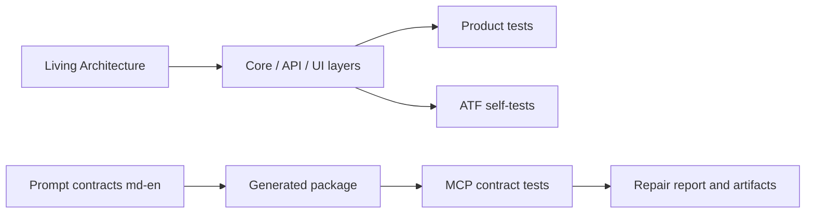
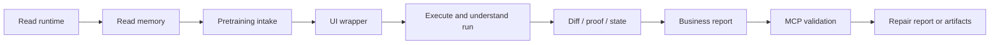

# Test Automation Framework

Java ATF for `UI + API + reporting`, evolved through governed AI-assisted runs, Maven validation, and MCP contract tests.

This repository is not a place for ad hoc generated tests. It is a controlled framework-hardening workspace. A good change should either prove that the existing ATF already supports the target behavior, or expose a reusable gap and improve the framework layer that owns it.

## Start Here

<details open>
<summary>90-Second Mental Model</summary>

| Plane | Owner | Decides | Does not decide |
| --- | --- | --- | --- |
| Framework plane | [docs/Living_Architecture_UI_API_doc_v1_0.md](docs/Living_Architecture_UI_API_doc_v1_0.md) + `src/main/java` | how UI/API/core/reporting code is layered | package legality or final package score |
| Agent workflow plane | [docs/prompts/md-en](docs/prompts/md-en) + [agent-runtime.properties](docs/prompts/iterativ/agent-runtime.properties) | how a governed agent run reads, spends, freezes, reports, and learns | framework implementation patterns by itself |
| MCP audit plane | `com.endava.ai.mcp.*` | whether a generated package is auditable against executable contracts | which business frontier the agent should choose |

<!-- /table -->

Read it like this:

- `Living Architecture` = how the framework is built.
- `md-en` prompt contracts = how the agent must work.
- `agent-runtime.properties` = active values and paths for the current package.
- `MCP tests` = executable shadow; they catch structural lies, missing artifacts, bad links, inflated score, and report drift.
- `html-ex` readiness = higher bar than MCP-green; it also needs business substance and strong report pedagogy.
- final report shape = Executive Context, Score Cards, Score Overview, Business Flow Graph open by default, Proof Mapping, Artifact Index, Close-Out.

</details>

<details>
<summary>5-Minute Green Path</summary>

Use this when you only need to prove the workspace is alive:

```bash
mvn test-compile
mvn "-Dtest=com.endava.ai.atf.*" test
mvn "-Dtest=com.endava.ai.api.tests.PositiveUserTests" test
mvn "-Dtest=com.endava.ai.mcp.tests.latest.McpLatestPackageArtifactAuditTest" "-Dmcp.package.root=latest" test
```

Then inspect:

- `target/reports/ExtentReport_<timestamp>.html`
- `docs/out/<timestamp>/`
- `docs/out/README.md`

</details>

<details>
<summary>If You Are...</summary>

| Role | First move |
| --- | --- |
| new user | run `5-Minute Green Path`, then read `Architecture Map` |
| framework maintainer | read [docs/Living_Architecture_UI_API_doc_v1_0.md](docs/Living_Architecture_UI_API_doc_v1_0.md), then inspect the impacted layer |
| agent | read [docs/prompts/md-en/orchestrate-iterative-runs.md](docs/prompts/md-en/orchestrate-iterative-runs.md) and [agent-runtime.properties](docs/prompts/iterativ/agent-runtime.properties) |
| reviewer | run MCP latest/full checks, then inspect artifact spine and report links |
| report author | read [docs/prompts/md-en/reporting.md](docs/prompts/md-en/reporting.md), graph rubric, and score reference |

<!-- /table -->

</details>

<details>
<summary>Artifact Roots</summary>

| Root | Meaning |
| --- | --- |
| `docs/out/<timestamp>` | live generated package: report, run artifacts, state, feedback |
| `docs/html-ex/*` | local examples / frozen calibration references when present |
| `target/reports/*` | Maven / Extent runtime reports |
| `target/allure-results` | Allure raw results |
| `docs/prompts/md-en/*` | agent-readable workflow contracts |
| `docs/prompts/html_EN/*` | visual English prompt contracts |
| `docs/prompts/iterativ/*` | project-local prompt source family and runtime properties |

<!-- /table -->

</details>

<details>
<summary>Entry Links</summary>

| Need | Open |
| --- | --- |
| framework architecture | [docs/Living_Architecture_UI_API_doc_v1_0.md](docs/Living_Architecture_UI_API_doc_v1_0.md) |
| governed AI run | [docs/prompts/md-en/orchestrate-iterative-runs.md](docs/prompts/md-en/orchestrate-iterative-runs.md) |
| active runtime values | [docs/prompts/iterativ/agent-runtime.properties](docs/prompts/iterativ/agent-runtime.properties) |
| UI business discovery | [docs/prompts/md-en/ui-business-frontier-adapter.md](docs/prompts/md-en/ui-business-frontier-adapter.md) |
| run artifact production | [docs/prompts/md-en/execute-and-understand-run.md](docs/prompts/md-en/execute-and-understand-run.md) |
| final report shape | [docs/prompts/md-en/reporting.md](docs/prompts/md-en/reporting.md) |
| graph rubric | [docs/prompts/md-en/business-flow-graph-rubric.md](docs/prompts/md-en/business-flow-graph-rubric.md) |
| score rubric | [docs/prompts/md-en/score-overview-reference.md](docs/prompts/md-en/score-overview-reference.md) |

<!-- /table -->

</details>

<details>
<summary>Minimum Commands</summary>

Compile first:

```bash
mvn test-compile
```

Run a narrow product test:

```bash
mvn "-Dtest=com.endava.ai.api.tests.PositiveUserTests" test
```

Run the generated-package MCP audit:

```bash
mvn "-Dtest=com.endava.ai.mcp.tests.latest.McpLatestPackageArtifactAuditTest" "-Dmcp.package.root=latest" test
```

Run the full MCP sweep when preparing a package for publication:

```bash
mvn "-Dtest=com.endava.ai.mcp.tests.*" "-Dmcp.package.root=latest" test
```

Inspect reports:

- Extent: `target/reports/ExtentReport_<timestamp>.html`
- Allure: `mvn allure:serve`
- governed package output: `docs/out/<timestamp>/`

</details>

## Framework Layers

<details>
<summary>Architecture Map</summary>

| Layer | Main package / file | Owns | Must not own |
| --- | --- | --- | --- |
| Core | `com.endava.ai.core` | config, listeners, reporting hooks, shared lifecycle | product business assertions |
| API runtime | `com.endava.ai.api` | API clients, services, actions, schemas, payloads | browser/UI mechanics |
| UI runtime | `com.endava.ai.ui` | engines, pages, actions, waits, UI services | API request contracts |
| Product API tests | `com.endava.ai.api.tests` | API product behavior | framework contract validation |
| Product UI tests | `com.endava.ai.ui.tests` | UI product behavior | framework self-tests |
| ATF self-tests | `com.endava.ai.atf.*` | lifecycle, reporting, engine, smoke, regression contracts | product business coverage |
| MCP validation | `com.endava.ai.mcp.*` | generated-package contract validation | choosing business frontier |

<!-- /table -->

Visible flow:

`Living Architecture -> Core/API/UI layers -> product tests + framework tests`

`Prompt contracts md-en -> generated package -> MCP contract tests -> repair report/artifacts`

<details>
<summary>Mermaid architecture flow</summary>



</details>

</details>

<details>
<summary>Repository Map</summary>

| Path | Meaning |
| --- | --- |
| `src/main/java/com/endava/ai/core` | shared config, listener, reporting, and lifecycle infrastructure |
| `src/main/java/com/endava/ai/api` | API runtime layers |
| `src/main/java/com/endava/ai/ui` | UI runtime layers |
| `src/main/java/com/endava/ai/mcp` | reusable MCP validation engine |
| `src/test/java/com/endava/ai/api/tests` | product/API tests |
| `src/test/java/com/endava/ai/ui/tests` | product/UI tests |
| `src/test/java/com/endava/ai/atf` | framework self-tests |
| `src/test/java/com/endava/ai/mcp/tests` | executable MCP contract tests |
| `docs/prompts/md-en` | English Markdown prompt contracts, best default for agents |
| `docs/prompts/html_EN` | English visual prompt contracts |
| `docs/prompts/iterativ` | project-local prompt source family and `agent-runtime.properties` |
| `docs/out` | generated package runs, reports, feedback, and calibration memory |

<!-- /table -->

</details>

<details>
<summary>Design Patterns To Preserve</summary>

| Concern | Preferred pattern | Concrete examples |
| --- | --- | --- |
| common test lifecycle | Template Method | `BaseTestAPI`, `BaseTestUI` keep concrete tests thin |
| engine creation | Factory | `UIEngineFactory` chooses the UI engine; data factories create repeatable inputs |
| shared runtime state | Manager | `ConfigManager`, `DriverManager`, `ReportingManager` centralize lifecycle access |
| UI interaction | Page Object + service | pages own selectors; services/actions drive visible behavior |
| assertions | Validation Object | `*Validation` classes own assertion meaning and failure language |
| cross-cutting hooks | Listener | `TestListener` owns test lifecycle hooks |
| reporting boundary | Adapter / facade | `StepLogger` and `ReportingManager` hide report-engine details |
| MCP checks | Rule / validator | `McpDefaultRules`, `McpValidationRule`, `McpPackageAuditValidation` keep contract checks reusable |

<!-- /table -->

Keep this separation:

- tests orchestrate behavior;
- services drive actions;
- pages own selectors;
- validations own assertion meaning;
- reporting stays behind framework contracts;
- MCP tests validate generated-package structure, not application business choices.

Anti-patterns:

- fat tests mixing selectors, waits, assertions, and reporting;
- recorder-shaped UI code kept as final code;
- API-only tests created when the governed run asked for UI business coverage;
- direct report adapter calls from product tests;
- green MCP used as proof of high business score.

</details>

<details>
<summary>Code Placement Map</summary>

| If you add | Put it in | Keep out |
| --- | --- | --- |
| product API test | `src/test/java/com/endava/ai/api/tests` | browser logic, UI screenshots, MCP assertions |
| product UI test | `src/test/java/com/endava/ai/ui/tests` | raw API contract testing, direct reporting adapters |
| UI page mechanics | `src/main/java/com/endava/ai/ui/.../pages` | business assertions |
| UI business action | `src/main/java/com/endava/ai/ui/.../services` or actions | selectors and low-level waits in tests |
| assertion meaning | validation classes | mixed helper/test classes |
| framework lifecycle test | `src/test/java/com/endava/ai/atf` | product business claims |
| generated-package validator | `src/main/java/com/endava/ai/mcp` | site-specific business expectations |
| MCP executable test | `src/test/java/com/endava/ai/mcp/tests` | brittle checks tied to one current application story |

<!-- /table -->

Good generated code should look like it belongs to the current ATF. If it looks like a second framework, refactor it before keeping it.

</details>

<details>
<summary>Runtime Lifecycle Card</summary>

| Stage | Owner | What must stay true |
| --- | --- | --- |
| TestNG starts a test | `testng.xml`, Surefire, `TestListener` | lifecycle hooks stay centralized |
| Base test prepares context | `BaseTestAPI` / `BaseTestUI` | concrete tests stay thin |
| Test calls framework layer | services, actions, pages, validators | no direct selector/assert/report mix in tests |
| Step is logged | `StepLogger` / `ReportingManager` | reporting remains engine-agnostic |
| Adapter writes output | `ExtentAdapter` / `AllureAdapter` | report engine details stay behind adapter |
| Listener closes lifecycle | `TestListener` / internal lifecycle classes | screenshots, failures, and flushes are consistent |

<!-- /table -->

If a change bypasses this lifecycle, treat it as framework drift.

</details>

## Governed Agent Workflow

<details>
<summary>Prompt Family Layers</summary>

Use the Markdown set under [docs/prompts/md-en](docs/prompts/md-en) as the default agent-readable contract.

| Owner document | Owns | Reads / delegates |
| --- | --- | --- |
| [orchestrate-iterative-runs.md](docs/prompts/md-en/orchestrate-iterative-runs.md) | package legality, run window, same-package vs fresh ROOT_RUN, MCP executable shadow | delegates pretraining, wrapper, execution, reporting |
| [pretraining-reference.md](docs/prompts/md-en/pretraining-reference.md) | source reading order, intake card, anti-copy, calibration artifact | feeds cold intake back to orchestrator |
| [ui-business-frontier-adapter.md](docs/prompts/md-en/ui-business-frontier-adapter.md) | one UI run wrapper, actor/intent/object discovery, visible proof | hands slot material to execution |
| [execute-and-understand-run.md](docs/prompts/md-en/execute-and-understand-run.md) | artifacts, diff, proof, state files, learning MDs | hands frozen truth to reporting |
| [reporting.md](docs/prompts/md-en/reporting.md) | final business-first HTML, proof links, render/link audit | reads only frozen truth |
| [business-flow-graph-rubric.md](docs/prompts/md-en/business-flow-graph-rubric.md) | application map, package overlay, business node rules | supports reporting |
| [score-overview-reference.md](docs/prompts/md-en/score-overview-reference.md) | Score Overview, `Overall`, cap, candidate threshold | supports reporting and MCP candidate judgment |

<!-- /table -->

Runtime values are not hardcoded in the prompt text. They are read from [docs/prompts/iterativ/agent-runtime.properties](docs/prompts/iterativ/agent-runtime.properties).

</details>

<details>
<summary>Operational Flow For An Agent</summary>

Visible flow:

`runtime -> memory -> pretraining -> UI wrapper -> execute -> diff/proof/state -> report -> MCP -> repair`

<details>
<summary>Mermaid operational flow</summary>



</details>

The package should preserve this cold chain:

```text
1. read Living Architecture for code-layer constraints
2. read orchestrate-iterative-runs.md
3. read agent-runtime.properties live
4. perform pretraining intake
5. spend one governed UI slot through the wrapper
6. execute and save diff / proof / state / feedback
7. publish langgraph-business-understanding.html
8. run MCP tests
9. after any report/state/diff edit, rerun MCP; otherwise the gate is stale
10. repair report or artifacts until current MCP truth is published
11. write feedback for the next run
```

The package must keep these truths separate:

- tests produced vs runs consumed;
- MCP-green vs `html-ex` ready;
- report polish vs business substance;
- UI proof vs API helper step;
- package overlay vs application business map.

</details>

<details>
<summary>Runtime Values That Matter Most</summary>

| Runtime value | Meaning |
| --- | --- |
| `RUN_EXPECTED_DELTA_QUALITY` | 0-100 threshold used for run quality and `html-ex` candidate judgment |
| `ROUND_TARGET_TEST_COUNT` | active target of good auditable tests per run |
| `META_ITERATION_COUNT` | active target of governed runs per package |
| `PROMPT_ROOT` | root of the live prompt family |
| `QUALITY_LOOP_PATH` | orchestrator owner path |
| `ORCHESTRATION_PATH` | run execution owner path |
| `DISCOVERY_PATH` | UI business frontier adapter path |
| `REPORTING_PATH` | final reporting owner path |
| `HTML_EX_LIBRARY_ROOT` | comparative example library |
| `AUDIT_OUTPUT_ROOT` | generated package output root |

<!-- /table -->

Do not reinterpret these values locally. Read them live and publish their effect in the package artifacts.

</details>

<details>
<summary>Configuration Ownership</summary>

| File | Owns | Used by | Do not use it for |
| --- | --- | --- | --- |
| `src/main/resources/framework.properties` | framework runtime: URLs, engines, waits, reporting backend, screenshots | Java framework and tests | governed package scoring or prompt ownership |
| [docs/prompts/iterativ/agent-runtime.properties](docs/prompts/iterativ/agent-runtime.properties) | agent package runtime: targets, prompt paths, artifact paths, quality threshold | prompts, generated package, MCP tests | browser engine behavior or framework internals |
| `pom.xml` | dependencies, plugins, Maven lifecycle | build and test execution | package score or business verdict |
| `docs/prompts/md-en/*` | agent workflow contracts | agents and reviewers | low-level Java runtime configuration |

<!-- /table -->

Cold rule:

- Tests must not override config values just to pass.
- Do not change values such as browser zoom, reporting engine, runtime targets, or prompt paths from inside generated tests.
- If a config value is wrong, fix the owner file and mention the change in the package artifacts.
- If a generated package needs a runtime value, read it from `agent-runtime.properties`, not from memory or local prose.

Examples of forbidden local drift:

| Drift | Correct response |
| --- | --- |
| changing `ui.page.zoom.percent` in a test to hide layout issues | fix the owner config or document why the environment requires a config change |
| switching `reporting.engine` to make a report pass | fix reporting artifacts against the configured engine |
| changing `ROUND_TARGET_TEST_COUNT` or `META_ITERATION_COUNT` locally | read runtime live; document blocker if the target cannot be met |
| patching prompt paths in test code | fix `agent-runtime.properties` or the referenced prompt file |

<!-- /table -->

</details>

## MCP Contract Tests

<details>
<summary>MCP Contract Tests - executable shadow, not the center of the framework</summary>

MCP tests are the executable shadow of part of the HTML/Markdown requirements. They do not replace the prompts. They enforce that a generated package leaves enough evidence to be reopened cold.

| MCP area | Checks |
| --- | --- |
| runtime | active paths, targets, and prompt references |
| package spine | `package-state.json`, `execution-gate-card.md`, root diff, close-out |
| run spine | `run-state.json`, run diff, Extent/XML/command proof, feedback |
| final report | collapsible structure, graph default state, Score Overview, Proof Mapping, links |
| diagnostics | expected contract, observed validator result, cold verdict, repair hint |
| candidate quality | `RUN_EXPECTED_DELTA_QUALITY`, cap, business trace, `html-ex` readiness |
| architecture | UI tests extend framework layers and avoid direct bypasses |

<!-- /table -->

For status meaning, use `MCP Profiles And Candidate Meaning` below.

<details>
<summary>MCP Profiles And Candidate Meaning</summary>

| Profile / status | Means | Can still fail because |
| --- | --- | --- |
| `fullContract` | package artifacts are structurally auditable and should pass for a publishable package | business learning is shallow |
| `uiContract` | UI proof, XML/Extent, architecture, and countability are coherent | report graph or score is weak |
| `htmlReportContract` | final report follows the required structure | package is not teacher-grade |
| `htmlExampleCandidateContract` | package is close to library-example quality | can fail legitimately when `Overall` or cap falls below `RUN_EXPECTED_DELTA_QUALITY` |
| `MCP-green` | current executable checks pass | not enough business substance for `html-ex` |

<!-- /table -->

Do not sell `MCP-green` as `html-ex-ready`. MCP validates the spine; candidate quality also needs business depth, graph realism, score honesty, and reusable report pedagogy.

Operational rule:

- latest/full package contracts should pass before treating a package as publishable;
- candidate/html-ex tests may fail legitimately when the package is auditable but not teacher-grade;
- if candidate fails, document why and whether the package is still useful as local learning.

Example: a package can be useful local learning at `88 / 100` or `92 / 100` and still fail `htmlExampleCandidateContract` because it is not reusable teacher-grade.

</details>

<details>
<summary>How To Run MCP Audit</summary>

Preferred for serious audit: use the explicit package timestamp.

```bash
mvn "-Dtest=com.endava.ai.mcp.tests.*" "-Dmcp.package.root=docs/out/YYYY-MM-DD_HH.mm.ss" test
```

Use `latest` only for fast local work:

```bash
mvn "-Dtest=com.endava.ai.mcp.tests.latest.McpLatestPackageArtifactAuditTest" "-Dmcp.package.root=latest" test
```

Do not rely on `latest` for final publication if multiple timestamps exist. Freeze the exact `docs/out/<timestamp>` that the report claims.

Useful IntelliJ settings:

| Setting | Value |
| --- | --- |
| Test class | `com.endava.ai.mcp.tests.latest.McpLatestPackageArtifactAuditTest` |
| Working directory | project root |
| Latest package | `-Dmcp.package.root=latest` |
| Explicit package | `-Dmcp.package.root=docs/out/YYYY-MM-DD_HH.mm.ss` |
| Explicit project | `-Dmcp.project.root=C:\work\ex\java\demo\atf6\test-framework` |

<!-- /table -->

If MCP fails:

- repair the generated package, report, or artifacts;
- rerun MCP;
- save the real generated MCP Extent report, not a copied or synthesized placeholder;
- update `langgraph-business-understanding.html` with the current MCP status and link the final `validation/mcp/ExtentReport.html`.

</details>

<details>
<summary>Expected MCP Diagnostic Style</summary>

Every meaningful MCP failure should be readable as:

| Diagnostic field | Meaning |
| --- | --- |
| Expected contract | which prompt rule or package contract was expected |
| Observed validator result | what the validator actually found |
| Cold verdict | pass / fail / partial without cosmetic language |
| Repair hint | what artifact or section must be fixed |

<!-- /table -->

This keeps MCP tests useful for agents, not just for humans reading stack traces.

</details>

<details>
<summary>MCP Rule Architecture</summary>

| Layer | Example | Responsibility |
| --- | --- | --- |
| profile | `McpProfile` | groups rules by intent: latest, report, candidate, negative, core |
| rule catalog | `McpDefaultRules` | exposes reusable rule sets without hardcoding checks in tests |
| rule contract | `McpValidationRule` | keeps each validation small, explainable, and composable |
| validation facade | `McpPackageAuditValidation` | applies selected rules to a generated package context |
| rule result | `McpRuleResult` | reports per-rule status, evidence artifact, cold reason, and repair hint |
| aggregate result | `McpPackageValidationResult` | aggregates package-level violations |
| public violation | `McpPackageViolation` | carries blocker / warning / recommendation code, message, severity, and path |

<!-- /table -->

Good MCP evolution:

- add a small rule;
- attach it to the right profile;
- keep it generic across generated packages;
- make the failure diagnostic readable by an agent.

</details>

<details>
<summary>Anti-Patterns MCP Should Catch Or Expose</summary>

| Anti-pattern | Why it matters |
| --- | --- |
| fake or stale Extent report | UI proof cannot be trusted |
| XML result without real Java `@Test` method | countability is synthetic |
| inflated `Overall` above business substance | report sells polish as product truth |
| altered shared CSS or inline styling drift | report shape is not reusable |
| duplicated run diffs | iteration history becomes hard to learn from |
| nice Business Flow Graph without proof row | graph becomes prose, not evidence |
| package README not synchronized with MCP status | next agent starts from false memory |

<!-- /table -->

</details>

</details>

## Setup And Usage

<details>
<summary>Local Setup</summary>

Required:

- Java 17+ or Java 21;
- Maven;
- Node.js and `npx`;
- IntelliJ IDEA or equivalent;
- browser dependencies if using Playwright MCP.

Project config:

- `src/main/resources/framework.properties`;
- `ui.engine=selenium` or `ui.engine=playwright`;
- `reporting.engine=extent` or `reporting.engine=allure`;
- `auth.token` for API write scenarios.

Playwright/Codex setup:

- [docs/playwright_mcp_codex_java_guide.md](docs/playwright_mcp_codex_java_guide.md)

</details>

<details>
<summary>Run Product Tests</summary>

API tests should use:

- `BaseTestAPI`;
- API steps/services/actions;
- factories;
- validators;
- no browser logic.

UI tests should use:

- `BaseTestUI`;
- page objects;
- services;
- validations;
- framework reporting and screenshots;
- no direct selector/assert/report plumbing inside fat tests.

Examples:

```bash
mvn "-Dtest=com.endava.ai.api.tests.PositiveUserTests" test
mvn "-Dtest=com.endava.ai.ui.tests.*" test
```

</details>

<details>
<summary>Run Framework / Contract Tests</summary>

Use `com.endava.ai.atf.*` for framework behavior:

- lifecycle ordering;
- screenshot contracts;
- reporting adapter behavior;
- payload attachment rules;
- engine contracts;
- smoke/regression checks.

Use `com.endava.ai.mcp.tests` for generated-package validation:

- package artifact spine;
- final report contract;
- MCP diagnostic quality;
- candidate quality threshold;
- architecture alignment.

</details>

<details>
<summary>Failure Triage</summary>

| Failure type | Usually means | First response |
| --- | --- | --- |
| compile failure | Java/API/UI/framework code is inconsistent | fix code or dependencies before judging the package |
| product test failure | behavior, data, environment, or proof changed | inspect the narrow report and impacted layer |
| reporting failure | lifecycle, adapter, screenshot, or report artifact drift | inspect `StepLogger`, `ReportingManager`, adapter, and Extent/Allure output |
| MCP latest/full failure | generated package is not publishable yet | repair artifact/report/state and rerun MCP |
| MCP candidate failure | package may be valid but not teacher-grade | lower/cap score or document why it is local learning only |
| render/link failure | final report cannot be audited cold | fix report publication before score claims |

<!-- /table -->

Do not fix failures by changing unrelated config. Fix the owner layer.

</details>

## Generated Package Expectations

<details>
<summary>Artifact Spine</summary>

A governed package under `docs/out/<timestamp>` should leave:

| Artifact | Purpose |
| --- | --- |
| `analysis/langgraph-business-understanding.html` | final business-first report |
| `analysis/canonical-render-check.png` | render proof |
| `review/local-link-check.txt` or equivalent | hyperlink audit |
| `review/root-source-thin-no-index.diff` | compiled package mutation |
| `review/package-state.json` | package state and close-out truth |
| `review/execution-gate-card.md` | run vector and gate status |
| `runs/run_##/review/run-state.json` | per-run state |
| `runs/run_##/review/thin-no-index.diff` | per-run mutation |
| `runs/run_##/validation/*` | Extent/XML/command proof |
| feedback MD files | cold learning for the next agent |

<!-- /table -->

What is not saved on disk cannot safely guide the next run.

</details>

<details>
<summary>Final Report Shape</summary>

The report should be business-first:

- application map before package overlay;
- Business Flow Graph is the only major section open by default;
- Score Overview uses canonical axes and one `Overall`;
- Proof Mapping links claim -> run -> diff/state -> execution proof -> cold verdict;
- Artifact Index links every important artifact;
- Close-Out separates tests produced, runs consumed, same-package legality, and fresh ROOT_RUN legality;
- MCP status is reported honestly;
- the latest real `validation/mcp/ExtentReport.html` is linked when MCP was run.

</details>

<details>
<summary>Quality Gates Before Publish</summary>

| Gate | Minimum command or artifact |
| --- | --- |
| compile | `mvn test-compile` |
| narrow product proof | impacted API/UI test class |
| generated-package audit | full MCP sweep against explicit `docs/out/<timestamp>` |
| render proof | `analysis/canonical-render-check.png` |
| link audit | `local-link-check.txt` or equivalent |
| state sync | `package-state.json`, `execution-gate-card.md`, package README |
| MCP publication | real `validation/mcp/ExtentReport.html`, XML/result, and gate result linked from the final report |

<!-- /table -->

Do not publish after editing report/state/diff until the relevant gate was rerun and the result is reflected in the package.

</details>

## Reference Notes

<details>
<summary>Source Of Truth Priority</summary>

For framework extension, use this order:

1. `src/main/java`;
2. `src/test/java`;
3. [docs/Living_Architecture_UI_API_doc_v1_0.md](docs/Living_Architecture_UI_API_doc_v1_0.md);
4. `src/main/resources/framework.properties`;
5. `pom.xml`;
6. [docs/prompts/md-en](docs/prompts/md-en), only if the workflow contract must change.

For governed package execution, use this order:

1. [docs/prompts/iterativ/agent-runtime.properties](docs/prompts/iterativ/agent-runtime.properties);
2. [docs/prompts/md-en/orchestrate-iterative-runs.md](docs/prompts/md-en/orchestrate-iterative-runs.md);
3. the specific owner document under [docs/prompts/md-en](docs/prompts/md-en);
4. generated artifacts under `docs/out/<timestamp>`;
5. MCP test results.

Do not invent a parallel framework if an equivalent component already exists.

</details>

<details>
<summary>Older Task-Specific Prompts</summary>

These are still useful for narrow tasks, but they are not the primary governed lane:

- [docs/prompts/api-framework-evolution.md](docs/prompts/api-framework-evolution.md);
- [docs/prompts/ui-recording-to-atf-tests.md](docs/prompts/ui-recording-to-atf-tests.md);
- [docs/prompts/atf-framework-test-evolution.md](docs/prompts/atf-framework-test-evolution.md);
- [docs/playwright_mcp_codex_java_guide.md](docs/playwright_mcp_codex_java_guide.md).

If a task is iterative, audit-sensitive, or expected to produce `docs/out/<timestamp>`, use the governed prompt family first.

</details>

<details>
<summary>Final Rule</summary>

Good changes here are:

- layered;
- small enough to validate;
- aligned with Living Architecture;
- governed by the prompt owners when AI-assisted;
- proven through narrow Maven runs;
- auditable through artifacts and MCP tests.

If generated code looks like a parallel framework, recorder output, or a report-only cosmetic fix, refactor before accepting it.

</details>
