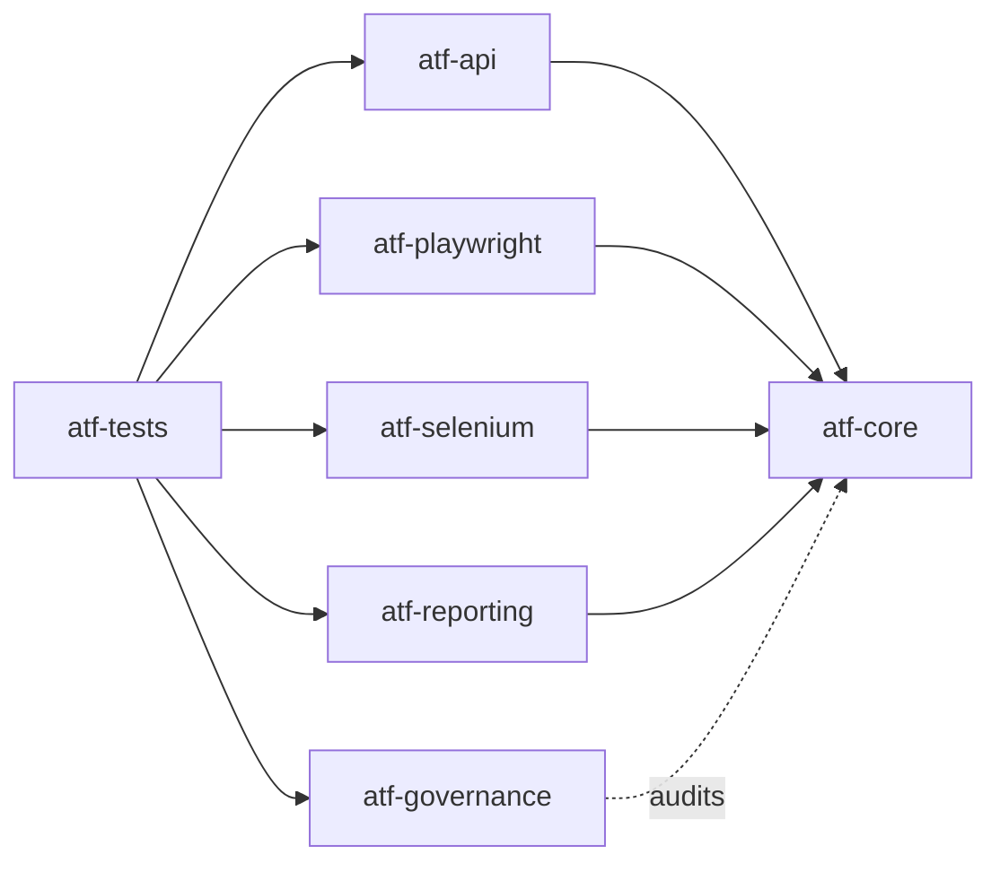
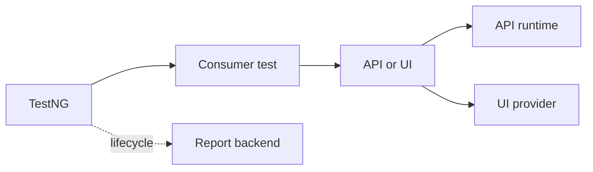

# ATF — UI and API test automation

ATF runs REST API and browser UI tests in Java. Seven Maven modules separate shared contracts, REST execution, browser adapters, reporting, governance and checks. The parent is `com.ai:atf-parent:1.0.0`; compiled libraries target Java 11.

## The design in one view

A consumer test states what it observes. Core owns configuration, UI contracts and neutral reporting; atf-api owns REST execution.

Browser adapters implement the UI contract and reporting is optional. Repository tests protect these boundaries.

| Module | Responsibility |
|---|---|
| [atf-core](atf-core/README.md) | Configuration, UI contracts, lifecycle and reporting SPI |
| [atf-api](atf-api/README.md) | Reusable REST Assured execution, retries and response assertions |
| [atf-playwright](atf-playwright/README.md) | Playwright implementation of the UI contract |
| [atf-selenium](atf-selenium/README.md) | Selenium implementation of the UI contract |
| [atf-reporting](atf-reporting/README.md) | TestNG reporting adapters and aggregate publication |
| [atf-governance](atf-governance/README.md) | Source, dependency and documentation rules with independent contracts |
| [atf-tests](atf-tests/README.md) | Framework/product helpers in main; existing annotated checks in test |



<details>
<summary>Legend: relationships and proof boundary</summary>

Solid arrows show selected compile dependencies; dotted arrows show source inspection. Governance also has test-scoped runtime dependencies for its own contracts, omitted here. Core exposes no REST Assured, Playwright, Selenium or reporting SDK types. [Atlas](atf-atlas/README.md) is documentation-only, outside Maven, and maps source to tests and their evidence limits.

</details>

## How a check runs

Choose REST API when no browser is needed. Choose UI when checks use a browser provider through Core's shared actions. Reporting can publish TestNG lifecycle evidence through an optional backend.



<details>
<summary>Legend: relationships and proof boundary</summary>

Solid arrows show the active contract path. Dotted arrows show optional TestNG lifecycle reporting. The API path has no browser session; the UI provider is selected before setup. Product pages and assertions stay with the consumer. [Architecture](docs/Architecture.md) explains the contracts in depth.

</details>

## How to choose a consumer route

- **REST API:** add `atf-api`; the API base and client do not require a browser provider.
- **Browser UI:** add one adapter and set `ui.engine` before TestNG setup. Use the concrete [Playwright](atf-playwright/README.md#consumer-example) or [Selenium](atf-selenium/README.md#consumer-example) example.
- **Extent reports:** add `atf-reporting` when the consumer needs HTML reporting.

The consumer examples live with their provider guides. This root page stays focused on framework composition and the reader's next decision.

<a id="start"></a>
## Build and verify

Use JDK 17+ and Maven; output targets Java 11. Prepare an isolated validation copy with [Development](docs/Development.md), then run from its reactor root.

<details>
<summary>Run the default, browser and aggregate selections</summary>

```powershell
mvn -B -ntp test
mvn -B -ntp -Pbrowser test
mvn -B -ntp -Paggregate test
```

</details>

Default runs native module checks and existing framework/governance regressions.

- Browser selects local fixtures and requires prepared binaries; aggregate also publishes Extent.
- [Testing](docs/Testing.md) lists prerequisites, selective commands and evidence limits.
- Existing product journeys remain opt-in; this guide adds none.

<a id="configuration"></a>
<a id="consumer-migration"></a>
## Configure and migrate

[framework.properties](atf-core/src/main/resources/framework.properties) supplies classpath defaults; individual JVM properties override them. The JVM property `framework.properties` can point to an existing consumer-owned file. Set `ui.engine` and `reporting.engine`; [Core configuration](atf-core/README.md#configuration) lists the options.

Replace historical `com.ai:test-framework` with `com.ai:atf-core:1.0.0`, `com.ai:atf-api:1.0.0` for REST, any required browser adapter and optional `com.ai:atf-reporting:1.0.0`. API flows need no browser or reporting module. `atf-tests` holds repository checks and product fixtures; it is not a consumer runtime API.

## Read by task

| Need | Continue with |
|---|---|
| Understand module and provider boundaries | [Architecture](docs/Architecture.md) |
| Select checks and interpret their proof | [Testing](docs/Testing.md) |
| Configure a consumer browser | [Playwright](atf-playwright/README.md) · [Selenium](atf-selenium/README.md) |
| Review a code, test or documentation change | [Governance](docs/governance/README.md) · [Failure hints](docs/governance/Failure_Diagnostics.md) |
| Understand detailed UI/API lifecycle contracts | Living architecture in [Markdown](docs/Living_Architecture_UI_API_doc_v1_0.md) · [HTML](docs/Living_Architecture_UI_API_doc_v1_0.html) |
| Trace capabilities or preserve reports | [Atlas coverage map](atf-atlas/Coverage_Map.md) · [Artifacts](artifacts/README.md) |
| Browse the complete documentation map | [Documentation index](docs/README.md) |
