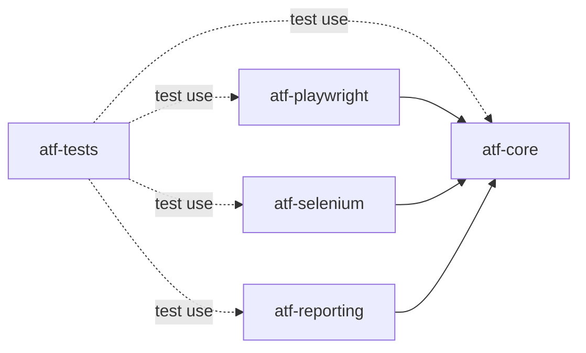
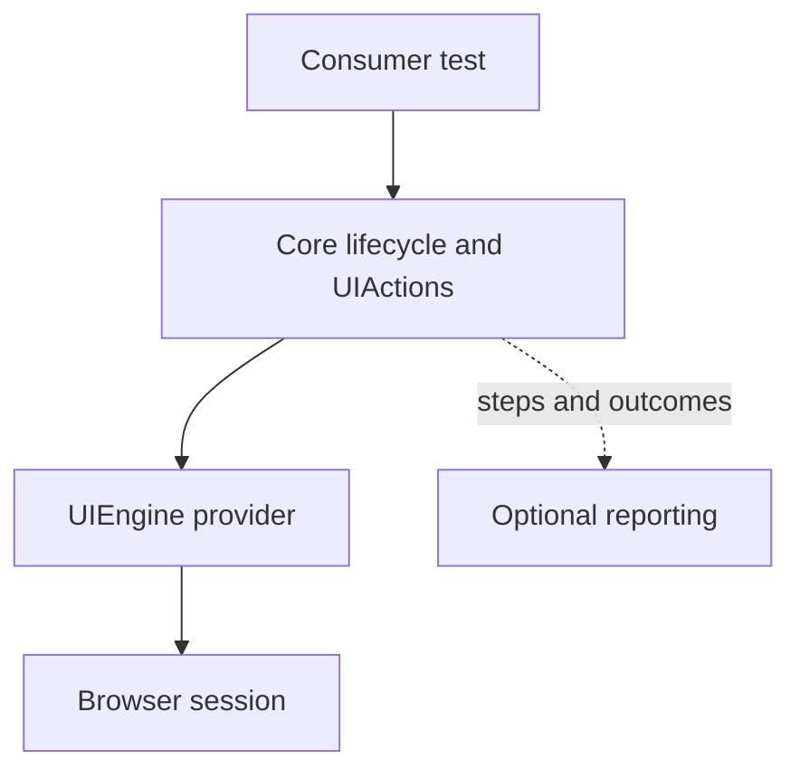
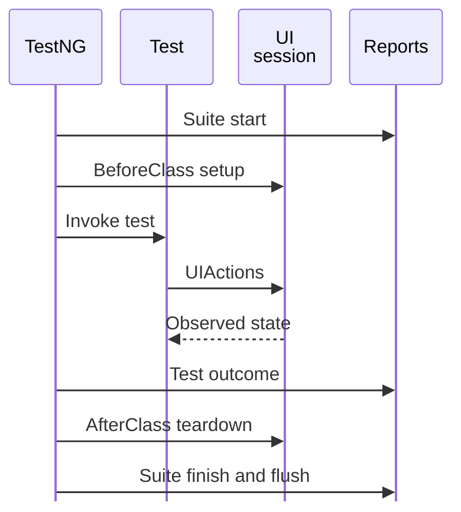

# ATF — UI and API test automation

Java framework for UI and REST API testing, organized as five Maven modules.
The parent is `com.ai:atf-parent:1.0.0`; libraries target Java 11.

## At a glance

| Module | Owns | Reader's question |
|---|---|---|
| [atf-core](atf-core/README.md) | Neutral UI/API contracts, configuration, lifecycle, steps and reporting SPI | What can a consumer reuse without vendor SDKs? |
| [atf-playwright](atf-playwright/README.md) | Playwright provider and browser implementation | How does the shared UI contract run through Playwright? |
| [atf-selenium](atf-selenium/README.md) | Selenium provider and browser implementation | How does the shared UI contract run through Selenium? |
| [atf-reporting](atf-reporting/README.md) | TestNG reporting lifecycle, Extent, Allure and aggregate publication | How are outcomes and attachments published? |
| [atf-tests](atf-tests/README.md) | Governance, regressions, product support and opt-in application journeys | What verifies the framework and its boundaries? |



Solid arrows mean library dependency; dotted arrows mean test-scoped use.
Core exposes no Selenium, Playwright, Extent or Allure SDK types.
The [architecture guide](docs/Architecture.md) owns the dependency and source
boundaries; module READMEs own their public entry points and local checks.

The separate [atf-atlas](atf-atlas/README.md) documentation area maps existing
capabilities, contracts, tests and proof boundaries. It is outside the Maven
reactor and introduces no runtime implementation.

## Execution architecture

[BaseTestUI](atf-core/src/main/java/com/ai/ui/core/runtime/BaseTestUI.java)
owns class-scoped setup/teardown through the thread-owned DriverManager.
[UIEngineFactory](atf-core/src/main/java/com/ai/ui/core/engine/UIEngineFactory.java)
loads typed options and selects an installed
[UiEngineProvider](atf-core/src/main/java/com/ai/ui/core/engine/UiEngineProvider.java).
Application tests use the same
[UIActions](atf-core/src/main/java/com/ai/ui/support/actions/UIActions.java)
surface with either adapter.



Solid arrows show UI execution; the factory selects the provider through Java
SPI. The dotted arrow shows reporting through Core's neutral facades and TestNG
listener. API-only
tests use [BaseTestAPI](atf-core/src/main/java/com/ai/api/core/BaseTestAPI.java)
without a UI session. The dependency map above and this runtime flow answer
different questions.

<details>
<summary>UI session and reporting lifecycle</summary>



The diagram shows responsibility boundaries, not the complete TestNG callback
order. UI session combines BaseTestUI/DriverManager, the selected engine and its
browser: BeforeClass creates that owned session and AfterClass quits it. The
factory/provider and browser boundaries are detailed in
[Architecture](docs/Architecture.md#provider-composition). Reports means the Core
listener and optional backend; Core can operate without a reporting implementation.

</details>

See the
[Playwright](atf-playwright/README.md#consumer-example) and
[Selenium](atf-selenium/README.md#consumer-example) guides for provider-specific
configuration and concrete repository checks.

## Start

Use JDK 17+ and Maven; compilation targets Java 11. Prepare a disposable
validation copy as described in [Development](docs/Development.md), then run
from its reactor root:

<details>
<summary>Run Start commands</summary>

```powershell
mvn -B -ntp test
mvn -B -ntp -Pbrowser test
mvn -B -ntp -Paggregate test
```

</details>

The default runs native module checks and local framework/governance regressions.
The browser profile selects local browser fixtures in atf-tests and requires
prepared browser binaries. The aggregate profile also publishes Extent and
Allure evidence. [Testing](docs/Testing.md) owns setup, selective commands and
output locations.

For the retained application journeys, use the explicit
[Playwright/Selenium E2E selection](docs/Testing.md#retained-product-ui-audit).
The same scenarios exercise either provider; framework browser checks have a
different proof boundary. The [living principles](docs/Living_Architecture_UI_API_doc_v1_0.md#retained-principles)
map action, wait, validation, lifecycle and audit responsibilities to their owners.

## Consumer migration

For an existing consumer, replace `com.ai:test-framework` with
`com.ai:atf-core:1.0.0`, the required browser adapter and optionally
`com.ai:atf-reporting:1.0.0`. Both adapter coordinates use the same group and
version. Core can run API flows without a browser or report implementation.
The parent coordinates the build; atf-tests holds repository verification and
application fixtures rather than a production framework API.

## Configuration

[framework.properties](atf-core/src/main/resources/framework.properties)
supplies classpath defaults. JVM properties override individual settings.
The `framework.properties` JVM setting can select an existing consumer-supplied
file instead of that resource. [Testing](docs/Testing.md#explicit-configuration)
shows how to resolve its path once before Maven enters individual modules.
Select an installed UI provider with `ui.engine` and a report format with
`reporting.engine`.

Application journeys are explicit selections in atf-tests. Configure the intended
environment and credentials before running them; they can create application
data. No API write token is bundled.

## Shared UI example

This is an illustrative consumer test, not an additional test class in this
repository. Add Core and the chosen adapter to the consumer classpath; add
atf-reporting when published Extent/Allure evidence is required. Set `ui.engine`
before TestNG starts. The page is a local data fixture and makes no application
or network request.

```java compile
import com.ai.ui.core.runtime.BaseTestUI;
import com.ai.ui.core.runtime.DriverManager;
import com.ai.ui.support.actions.UIActions;
import org.testng.Assert;
import org.testng.annotations.Test;

import java.net.URLEncoder;
import java.nio.charset.StandardCharsets;

public class SharedUiExampleTest extends BaseTestUI {
    @Test
    public void displaysTheEnteredName() {
        String html = "<!doctype html><html lang='en'><body>"
                + "<label for='name'>Name</label><input id='name'>"
                + "<button id='show' onclick=\"document.getElementById('result').textContent="
                + "document.getElementById('name').value\">Show name</button>"
                + "<p id='result' aria-live='polite'></p></body></html>";
        String page = "data:text/html;charset=UTF-8,"
                + URLEncoder.encode(html, StandardCharsets.UTF_8).replace("+", "%20");
        DriverManager.getEngine().open(page);
        UIActions.type("#name", "Name input", "Reader");
        UIActions.click("#show", "Show name");
        Assert.assertEquals(UIActions.getText("#result", "Displayed name"), "Reader");
    }
}
```

The inherited hooks create and close the engine. The test asserts the value
observed from the page; it does not construct a successful result from input.
The complete `java compile` examples are checked against the current public
framework API by documentation governance.

## Language and review contract

The main branch is the English edition. The main_RO branch provides every
maintained Markdown and the Living HTML at the same project paths in Romanian. Executable examples, source and
comments remain in English in both editions; [edition governance](docs/governance/Readme_Editions.md)
protects hierarchy, links, technical facts and source-bound whole-text review.

Source identifiers, comments, log text and assertion/diagnostic messages
**MUST be written in English** in both branches. Documentation and diagram
labels are English on main, with the declared complete documentation edition on main_RO. Literal
external product data and deliberately invalid test fixtures retain the text
needed by their contract. Follow the
[code/documentation policy](docs/governance/Code_And_Documentation_Policy.md)
and its [source scanner regression cases](atf-tests/src/test/java/com/ai/atf/governance/JavaSourceScannerTest.java).

## Continue by question

| Question | Owning guide |
|---|---|
| How do modules and providers fit together? | [Architecture](docs/Architecture.md) |
| Which checks should I run, and what do they prove? | [Testing](docs/Testing.md) |
| How do I edit, validate and synchronize safely? | [Development](docs/Development.md) |
| What makes code, tests and documentation reviewable? | [Governance](docs/governance/README.md) |
| Where are lifecycle and UI/API design contracts explained in depth? | Living architecture in [Markdown](docs/Living_Architecture_UI_API_doc_v1_0.md) and [HTML](docs/Living_Architecture_UI_API_doc_v1_0.html) |
| Which existing tests protect a capability, and what remains unproven? | [Atlas coverage map](atf-atlas/Coverage_Map.md) and [feedback](docs/feedback/README.md) |
| Where is the complete reading map? | [Documentation index](docs/README.md) |
| Where are reports preserved, and how can Atlas inspect another project? | [Artifacts and project intake](artifacts/README.md) |

Development uses main. The live checkout receives verified checkpoints; the
previous implementation remains on main_mcp. Run evidence belongs outside the
source checkout and retains its source and execution scope in feedback.
