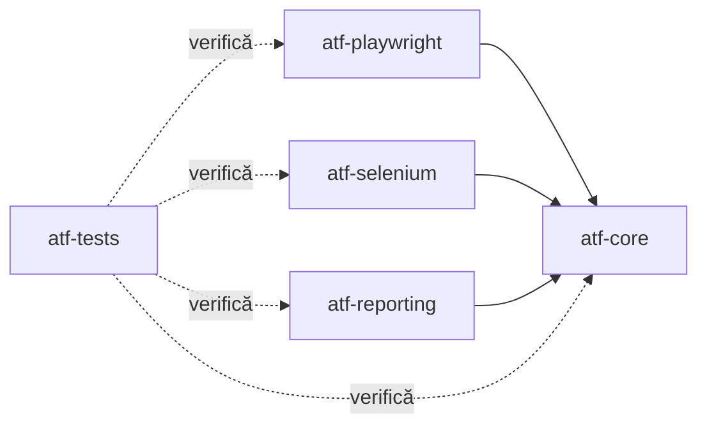
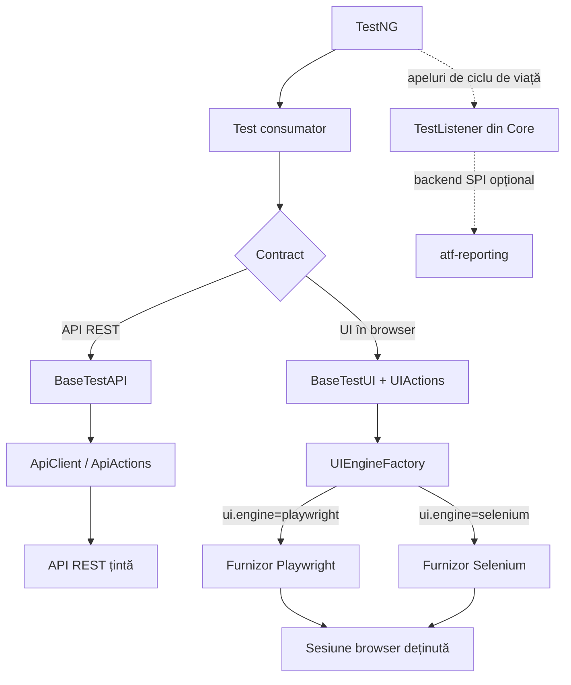

<a id="atf--ui-and-api-test-automation"></a>
# ATF — automatizarea testelor UI și API

ATF rulează teste API REST și UI în browser, scrise în Java. Cele cinci module Maven separă contractele comune, adaptoarele de browser, raportarea și verificarea. Proiectul părinte este `com.ai:atf-parent:1.0.0`; bibliotecile compilate țintesc Java 11.

<a id="the-design-in-one-view"></a>
## Designul într-o singură imagine

Un test consumator declară ce observă. Core deține contractele API/UI comune și ciclul de viață. Adaptoarele implementează contractul UI; raportarea este opțională. Testele depozitului protejează aceste limite.

| Modul | Responsabilitate |
|---|---|
| [atf-core](atf-core/README.md) | Contracte API/UI neutre, configurare, ciclu de viață și SPI de raportare |
| [atf-playwright](atf-playwright/README.md) | Implementarea contractului UI prin Playwright |
| [atf-selenium](atf-selenium/README.md) | Implementarea contractului UI prin Selenium |
| [atf-reporting](atf-reporting/README.md) | Adaptoare de raportare TestNG și publicare agregată |
| [atf-tests](atf-tests/README.md) | Regresii existente ale framework-ului, guvernanță și verificări selectate ale produsului |



Săgețile continue indică dependențe între biblioteci; cele punctate indică verificarea în teste. Core nu expune tipuri din SDK-urile Playwright, Selenium sau de raportare. [Atlas](atf-atlas/README.md) este exclusiv documentație, în afara Maven, și leagă sursele de teste și limitele dovezilor.

<a id="how-a-check-runs"></a>
## Cum rulează o verificare

Alege API REST când nu este necesar un browser. Alege UI când verificările folosesc un furnizor de browser prin acțiunile comune Core. Raportarea poate publica ciclul de viață TestNG printr-un backend opțional.



Săgețile continue arată calea contractului ales. Cele punctate arată raportarea opțională a ciclului de viață TestNG. Calea API nu pornește un browser; furnizorul UI se alege înainte de inițializare. Paginile și aserțiunile produsului aparțin consumatorului. [Arhitectura](docs/Architecture.md) explică detaliile contractelor.

<a id="how-to-choose-a-consumer-route"></a>
## Cum alegi calea consumatorului

- **API REST:** adaugă `atf-core`; baza și clientul API nu necesită un furnizor de browser.
- **UI în browser:** adaugă un adaptor și setează `ui.engine` înaintea inițializării TestNG. Folosește exemplul concret [Playwright](atf-playwright/README.md#consumer-example) sau [Selenium](atf-selenium/README.md#consumer-example).
- **Rapoarte Extent sau Allure:** adaugă `atf-reporting` când consumatorul are nevoie de aceste formate de publicare.

Exemplele consumatorului se află în ghidurile furnizorilor. Această pagină rădăcină rămâne axată pe alcătuirea framework-ului și următoarea decizie a cititorului.

<a id="start"></a>
<a id="build-and-verify"></a>
## Construiește și verifică

Folosește JDK 17+ și Maven; rezultatul țintește Java 11. Pregătește o copie izolată de validare conform [Dezvoltării](docs/Development.md), apoi rulează din rădăcina reactorului.

<details>
<summary>Rulează selecțiile implicite, browser și agregare</summary>

```powershell
mvn -B -ntp test
mvn -B -ntp -Pbrowser test
mvn -B -ntp -Paggregate test
```

</details>

Selecția implicită rulează verificări native ale modulelor și regresiile existente de framework și guvernanță. Profilul browser selectează fixture-uri locale și necesită binare pregătite; profilul aggregate publică și dovezi Extent și Allure. [Testare](docs/Testing.md) descrie precondițiile, comenzile selective și limitele dovezilor. Scenariile existente ale produsului rămân opționale; acest ghid nu adaugă scenarii.

<a id="configuration"></a>
<a id="consumer-migration"></a>
<a id="configure-and-migrate"></a>
## Configurează și migrează

[framework.properties](atf-core/src/main/resources/framework.properties) furnizează valorile implicite din classpath; proprietățile JVM le suprascriu individual. Proprietatea JVM `framework.properties` poate indica un fișier existent, deținut de consumator. Setează `ui.engine` și `reporting.engine`; [configurația Core](atf-core/README.md#configuration) enumeră opțiunile.

Înlocuiește vechiul `com.ai:test-framework` cu `com.ai:atf-core:1.0.0`, adaptorul de browser necesar și opțional `com.ai:atf-reporting:1.0.0`. Fluxurile API nu au nevoie de browser sau modul de raportare. `atf-tests` conține verificările depozitului și fixture-urile produsului; nu este un API runtime pentru consumatori.

<a id="documentation-and-language"></a>
## Documentație și limbă

`main` este în engleză; `main_RO` oferă documentația întreținută în română, la aceleași căi. Sursele, comentariile, diagnosticele și exemplele executabile rămân în engleză. Consultă [contractul edițiilor](docs/governance/Readme_Editions.md) și [politica pentru cod și documentație](docs/governance/Code_And_Documentation_Policy.md).

<a id="read-by-task"></a>
## Citește în funcție de sarcină

| Nevoie | Continuă cu |
|---|---|
| Înțelegerea limitelor modulelor și furnizorilor | [Arhitectură](docs/Architecture.md) |
| Selectarea verificărilor și interpretarea dovezilor | [Testare](docs/Testing.md) |
| Configurarea unui browser pentru consumator | [Playwright](atf-playwright/README.md) · [Selenium](atf-selenium/README.md) |
| Revizuirea unei schimbări de cod, test sau documentație | [Guvernanță](docs/governance/README.md) · [Indicii de depanare](docs/governance/Failure_Diagnostics.md) |
| Înțelegerea contractelor detaliate de ciclu de viață UI/API | Arhitectura vie în [Markdown](docs/Living_Architecture_UI_API_doc_v1_0.md) · [HTML](docs/Living_Architecture_UI_API_doc_v1_0.html) |
| Trasarea capabilităților sau păstrarea rapoartelor | [Harta de acoperire Atlas](atf-atlas/Coverage_Map.md) · [Artefacte](artifacts/README.md) |
| Consultarea hărții complete a documentației | [Indexul documentației](docs/README.md) |
