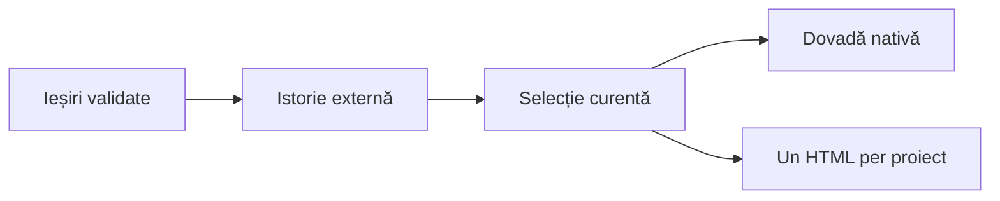

<a id="atf-artifacts"></a>
# Artefacte ATF

<a id="overview"></a>
## Prezentare generală

Această zonă prezintă rapoartele curente selectate și artefactele de înțelegere a proiectelor.

- Rulările complete, eșecurile, intrările de analiză și investigațiile temporare aparțin istoricului extern.
- Ghidurile și șabloanele menținute sunt surse; publicațiile generate sunt dovezi.
- Construiește și colectează din copii izolate de validare.

| Necesitate | Responsabil | Rezultat produs |
|---|---|---|
| Păstrarea rapoartelor ATF, resurselor, jurnalelor și provenienței | [Rapoarte](reports/README.md) | Un pachet cu căi relative la sursă, cataloage pe categorii și manifest SHA-256 |
| Înțelegerea unui proiect ales de apelant | [Protocol Atlas](atlas/README.md) | O hartă de proiect bazată pe dovezi, cu necunoscute explicite |
| Înțelegerea comportamentului ATF existent și a limitelor dovezilor | [Atlasul framework-ului](../atf-atlas/README.md) | Trasabilitate între surse, teste și contracte |



<details>
<summary>Legendă: relații și limita dovezii</summary>

Săgețile arată păstrarea și selecția explicită. Colectarea, mutarea și verificările
publicației nu execută teste și nu certifică rezultatele lor. Un raport de test
eșuat rămâne eșuat după colectare.

</details>

<a id="ownership"></a>
## Responsabilități

Ghidul rapoartelor gestionează colectarea imuabilă.

- Atlas gestionează protocolul reutilizabil și șablonul hărții.
- Guvernanța surselor protejează aceste fișiere urmărite și traducerile README-urilor lor.
- Datele curente generate sunt ignorate de Git.
- Un director artifacts dintr-un arbore propriu de surse/resurse rămâne guvernat.

```text
artifacts/
  README.md
  publication.json
  atlas/
    README.md
    Project_Map_Template.md
    current/
      README.md
      index.html
      project-id/atlas.html
  reports/
    README.md
    current/
      README.md
      index.html
      selected original XML, TAP and provenance
      e2e/playwright/ExtentReport.html
      e2e/selenium/ExtentReport.html
      per-engine native XML, source manifest and audit JSON
```

O copie curată a surselor poate conține numai cele patru ghiduri/șabloane urmărite.
O publicație completată are un inventar publication.json care leagă fiecare
fișier curent și fiecare README/index generat de calea relativă, dimensiune și
SHA-256. Înregistrările Atlas identifică proiectul și revizia sursei capturate.

Selecția UI păstrată, opțională, gestionează exact un document Extent nativ și trei fișiere de dovezi pentru fiecare motor.

- Manifestul său leagă motorul, ID-ul rulării, revizia sursei și referințele XML/sursă/audit; nu este o excepție HTML generică.
- Curent înseamnă selectat pentru cititori; o captură mai veche nu devine cel mai recent Git HEAD.
- Identitatea originală a surselor și limitele execuției rămân vizibile.

<a id="publication-lifecycle"></a>
## Ciclul de viață al publicației

1. Produce și validează rezultatele în rădăcina externă de lucru.
2. Păstrează rulările originale complete, eșecurile și intrările analizei într-un
   instantaneu unic de istoric extern. Păstrează arborele relativ și indexurile originale.
3. Selectează un HTML Atlas independent pentru fiecare proiect și dovezile native
   ale testelor/surselor necesare rezumatului curent. Rolul explicit al selecției
   UI păstrate poate selecta și un document Extent original pentru fiecare motor,
   împreună cu trei fișiere de dovezi legate. Păstrează în istoric redările
   intermediare, celelalte site-uri complete de raportare, capturile duplicate
   și controalele sintetice de corupere.
4. Pregătește în staging selecția curentă și cele patru documente README/index generate.
   Leagă octeții și reviziile lor originale în publication.json.
5. Validează staging-ul, arhivează selecția anterioară și înlocuiește setul curent
   ca întreg. Reverifică hash-urile și legăturile înainte de a consemna finalizarea în feedback.

Punctele de intrare live sunt artifacts/atlas/current/index.html și artifacts/reports/current/index.html.

- Structurile brute atlas/runs și reports/runs aparțin analizei/istoricului extern, nu publicației live.
- Directoarele temporare, de construcție, versiuni publicate și investigații rămân în afara perimetrului publicației.
- Un JAR/ZIP este dovadă de construcție până când un proces autorizat separat îl califică drept versiune publicată.
- Colectarea însăși nu creează niciodată o versiune publicată.

Păstrarea urmează rolul: un Atlas selectat pentru fiecare proiect, o selecție
explicită de dovezi curente și istoricul original intact în exterior. Nu există
ștergere automată după vechime. Eliminarea ulterioară necesită o decizie explicită a responsabilului.

<a id="verification"></a>
## Verificare

Rulează verificarea publicației, numai prin citire, din rădăcina proiectului:

```powershell
$artifactRoot = Join-Path (Get-Location).Path 'artifacts'
node tools/collect-artifacts.mjs --check-layout "$artifactRoot"
node --test tools/collect-artifacts.test.mjs
```

ARTIFACT-PUBLICATION identifică calea observată, responsabilul, remedierea și
reverificarea focalizată. Verificatorul acceptă structura numai cu surse sau
structura curentă completă și respinge istoricul vechi live, fișierele orfane,
proiectele duplicate, HTML-urile nedeclarate, fișierele modificate ori lipsă,
legăturile și căile care ies din perimetru. Nu mută și nu șterge niciodată dovezi.

Folosește [ghidul de testare](../docs/Testing.md) pentru selecțiile Java/de guvernanță și [verificările colectorului](reports/README.md#verification) pentru comportamentul sistemului de fișiere.

- Folosește [verificatorul de consistență Atlas](atlas/README.md#verification) pentru hărțile generate.
- Guvernanța surselor protejează aceste ghiduri, iar verificatorul separat leagă analiza generată de octeții surselor și de dovezile executate declarate.
- Inspectează împreună manifestul, rezultatele originale, resursele și dovezile.
- O categorie goală, un raport copiat sau o inspecție Atlas a surselor nu reprezintă o nouă rulare de teste.
