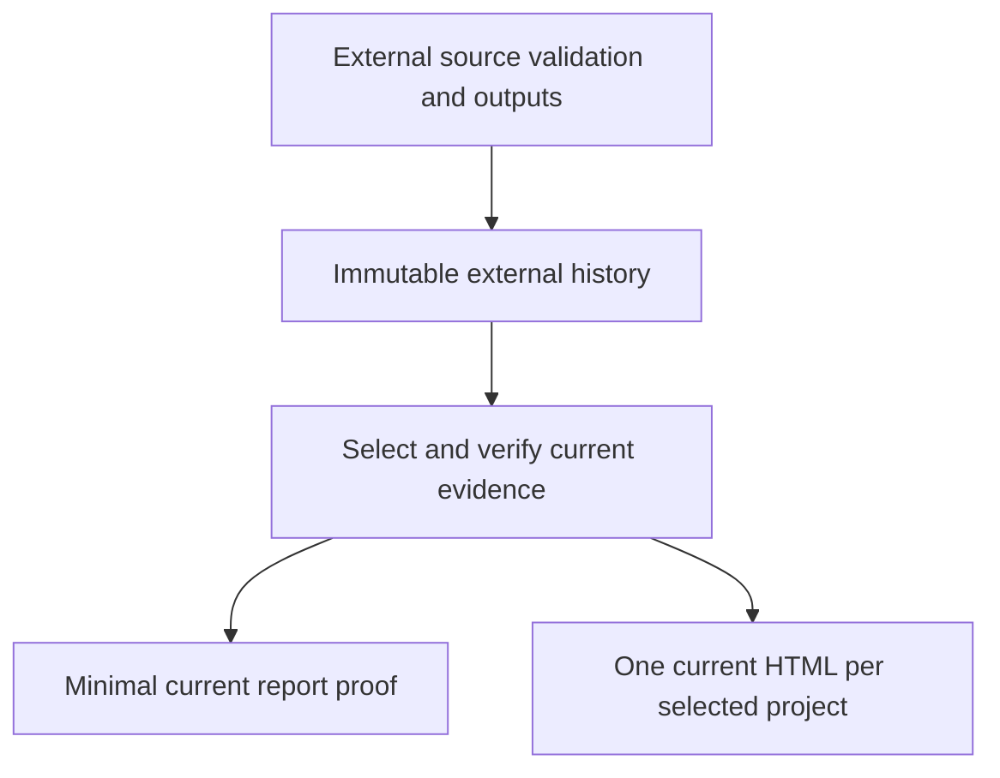

# ATF artifacts

## Overview

This area presents selected current reports and project-understanding artifacts.
Complete runs, failures, analysis inputs and temporary investigations belong in
external history. Maintained guides/templates are source; generated publications
are evidence. Build and collect from isolated validation copies.

| Need | Owner | Produced result |
|---|---|---|
| Preserve ATF reports, assets, logs and provenance | [Reports](reports/README.md) | A source-relative bundle, category catalogs and SHA-256 manifest |
| Understand a caller-selected project | [Atlas intake](atlas/README.md) | An evidence-backed project map with explicit unknowns |
| Understand existing ATF behavior and proof limits | [Framework Atlas](../atf-atlas/README.md) | Source/test/contract traceability |



Arrows show preservation and explicit selection. Collection, relocation and
publication checks do not execute tests or certify their outcomes. A failed
test report remains failed after collection.

## Ownership

The reports guide owns immutable collection. Atlas owns the reusable intake and
map template. Source governance protects these tracked files and their README
translations. Generated current data is ignored by Git. An artifacts directory
inside an owned source/resource tree remains governed.

```text
artifacts/
  README.md
  publication.json
  atlas/
    README.md
    Project_Map_Template.md
    current/
      README.md
      index.html
      project-id/atlas.html
  reports/
    README.md
    current/
      README.md
      index.html
      selected original XML, TAP and provenance
      e2e/playwright/ExtentReport.html
      e2e/selenium/ExtentReport.html
      per-engine native XML, source manifest and audit JSON
```

A clean source checkout may contain only the four tracked guides/template.
A populated publication has one publication.json inventory binding every
current payload and generated README/index to its relative path, byte count and
SHA-256. Atlas records identify their project and captured source revision.

The optional retained-UI selection owns exactly one native Extent reader and
three proof files per engine. Its manifest binds the engine, run ID, source
revision and XML/source/audit references; it is not a generic HTML exception.
Current means selected for readers; an older capture does not become the latest
Git HEAD. Original source identities and execution limits stay visible.

## Publication lifecycle

1. Produce and validate outputs in the external work root.
2. Preserve complete original runs, failures and analysis inputs in a unique
   external history snapshot. Keep their relative tree and original indexes.
3. Select one standalone Atlas HTML per project and the native test/source proof
   needed for the current summary. The explicit retained-UI role may also select
   one original Extent reader per engine, together with three bound proof files.
   Keep intermediate renders, other complete report sites, duplicate captures
   and synthetic corruption controls in history.
4. Prepare the current selection and four generated README/index documents in
   staging. Bind their original bytes and revisions in publication.json.
5. Validate staging, archive the previous selection, and replace the current set
   as a unit. Recheck hashes and links before recording completion in feedback.

The live entry points are artifacts/atlas/current/index.html and
artifacts/reports/current/index.html. Raw atlas/runs and reports/runs layouts
belong to external analysis/history, not the live publication. Temporary, build,
release and investigation folders are outside this publication perimeter.
A JAR/ZIP is build evidence until a separately authorized process qualifies a
release. Collection itself never creates a release.

Retention is by role: one selected Atlas per project, one explicit current proof
selection, and intact original history externally. There is no automatic
age-based deletion. Later disposal requires an explicit owner decision.

## Verification

Run the read-only publication check from the project root:

```powershell
$artifactRoot = Join-Path (Get-Location).Path 'artifacts'
node tools/collect-artifacts.mjs --check-layout "$artifactRoot"
node --test tools/collect-artifacts.test.mjs
```

ARTIFACT-PUBLICATION identifies the observed path, owner, repair and focused
recheck. The checker accepts source-only or complete current layout and rejects
legacy live history, orphan files, duplicate projects, undeclared HTMLs, changed or
missing payloads, links and escaping paths. It never moves or deletes evidence.

Use the [testing guide](../docs/Testing.md) for Java/governance selections and
[collector checks](reports/README.md#verification) for filesystem behavior.
Use the [Atlas consistency checker](atlas/README.md#verification) for generated
maps. Source governance protects these guides, while the separate checker binds
generated analysis to source bytes and declared execution evidence.
Inspect the manifest, original verdicts, assets and evidence together. An empty
category, copied report or Atlas source inspection is not a new test run.
