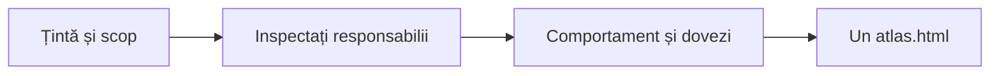

<a id="reusable-project-atlas"></a>
# Atlas reutilizabil pentru proiecte

<a id="overview"></a>
## Prezentare generală

Folosește acest protocol pentru a înțelege orice proiect ales de apelant pornind de la sursele sale reale.

- Este independent de Java, Maven, module ATF sau un anumit executor de teste.
- Responsabilul analizei furnizează accesul la surse, revizia și aria; [șablonul hărții de proiect](Project_Map_Template.md) face explicite dovezile și necunoscutele.
- [Contractul raportului complet](../../atf-atlas/Report_Contract.md) definește artefactul pentru cititor al țintei, iar [baza de cunoștințe](../../atf-atlas/Knowledge_Base.md) furnizează politici citate pentru redactare.

[Atlasul framework-ului](../../atf-atlas/README.md) mapează comportamentul și testele existente ale ATF.

- Această zonă gestionează protocolul mai larg de înțelegere a proiectelor și publicația selectată pentru cititori.
- Intrările complete ale analizei aparțin istoricului extern.
- Niciuna dintre zone nu introduce POM, servicii Java, endpoint MCP, registru de skill-uri sau o afirmație automată de înțelegere completă.

<a id="ownership"></a>
## Responsabilități

Responsabilul care invocă analiza gestionează ținta, aria și dovezile.

- Responsabilii codului și documentației proiectului țintă rămân autoritativi.
- Analizează implicit arborele numai prin citire; modificările și execuția urmează cererea apelantului.
- Nu presupune un sistem de construcție, nu inventa comenzi lipsă și nu trata documentația depozitului ca dovadă că testele au trecut.

Produce intrările complete și capturile imuabile în afara copiei live.

- Selectează un HTML independent verificat pentru fiecare proiect la atlas/current/project-id/atlas.html, folosind [contractul publicației](../README.md).
- Curent înseamnă instantaneul selectat pentru publicare: păstrează revizia sa capturată, fără a afirma că o mutare sau un commit exclusiv de documentație i-a reînnoit analiza surselor.
- Păstrează intrările originale, indexurile surselor, dependențele dovezilor și redările eșuate în istoricul extern.
- Directorul curent nu conține JSON de analiză suplimentar, fișiere auxiliare sau capturi istorice în directorul cititorului unui proiect.



<details>
<summary>Legendă: relații și limita dovezii</summary>

Săgețile arată secvența analizei. Fiecare concluzie factuală trimite la o sursă
observată sau la un rezultat de execuție păstrat. Necunoscutele rămân vizibile,
fără a fi completate din arhitectura unui proiect fără legătură.

</details>

<a id="invoke-the-protocol"></a>
## Invocarea protocolului

Folosește această cerere cu un responsabil de analiză sau un asistent care poate citi proiectul ales:

> Aplică `artifacts/atlas/README.md` proiectului `<project-root>` la revizia `<revision>`.
> Inspectează `<requested-scope>` folosind `artifacts/atlas/Project_Map_Template.md`.
> Selectează o rădăcină externă pentru artefacte. Salvează `project-map.md`, `source-index.json`
> și `open-questions.md` sub
> `<artifact-root>/atlas/runs/<project-id>/<analysis-id>/`.
> Publică exact un HTML complet de înțelegere pentru acest proiect selectat la
> `<artifact-root>/atlas/runs/<project-id>/<analysis-id>/delivery/atlas.html`.
> După verificare, promovează HTML-ul neschimbat în publicația live selectată
> la `artifacts/atlas/current/<project-id>/atlas.html` și actualizează publication.json.
> Identifică faptele din surse, dovezile executate, concluziile deduse și necunoscutele.
> Păstrează fișierele țintă și nu rula sau modifica nimic în afara cererii primite.

Produce și README.md, architecture.md, testing-and-governance.md și analysis.json,
care leagă hash-urile documentelor, o singură identitate a țintei, citatele și
intervalele exacte de linii, referințele guvernanței și dovezile păstrate. Indexul
surselor distinge componentele și documentele de referință revizuite semantic de fișierele capturate numai
pentru identitatea stării. Înregistrează starea reală a modificărilor locale;
commit-ul singur nu identifică sursele necomise sau bibliotecile binare selectate.

Începe cu documentația de intrare și declarațiile reale de construcție/pachete.

- Mapează punctele de intrare, modulele, dependențele, responsabilitatea stării/resurselor, contractele publice, configurația, căile de eșec, selecțiile existente de teste și locațiile rezultatelor.
- Pentru proiecte non-ATF, folosește responsabilii și uneltele detectate, nu numele acestui reactor.
- Înregistrează căi relative și referințe utile la linii, împreună cu revizia.

Indexul generat al surselor înregistrează fiecare cale inspectată, rolul și limitele dovezii.

- Explică un comportament existent susținut, obiectul, rezultatul observabil și criteriul din test printr-o diagramă legată de sursă.
- Dacă nu găsești un astfel de criteriu, înregistrează aria căutată și lipsa explicită.
- Păstrează separat harta modulelor/dependențelor și explică-i sensul.
- Ambele diagrame au legende și legături declarate către surse/afirmații.
- O singură componentă/stare poate să nu aibă săgeți dacă limita este explicită.
- Întrebările deschise identifică faptul lipsă și responsabilul; nu sunt cereri automate de teste noi de produs/E2E.
- Timpul analizei și timpul execuției sunt separate.

<a id="declared-review-units-and-seven-facets"></a>
## Unități declarate și șapte perspective de revizuire

Capturile publice noi folosesc renderVersion 5 și analysis.understanding cu schemaVersion 1.

Metadatele publicării curente declară împreună readerVersion 5 și audience BUSINESS_PROJECT_UNDERSTANDING. Colectorul verifică structura HTML selectată și identitatea; acceptanța completă cere în continuare auditul adiacent original, randarea canonică și revizuirea sensului. Capturile istorice fără versiune păstrează politica inițială.

- Declară aria PROJECT sau SELECTED, scopeStatement și inventoryClaimIds pornind de la declarațiile reale ale pachetelor, construcției, intrărilor și responsabilităților.
- Enumeră unitățile conform responsabilităților reale ale componentelor și documentelor sursă.
- Aria PROJECT aliniază inventarul unităților cu arhitectura declarată; nu certifică fiecare linie indexată.
- Aria SELECTED precizează zonele inspectate și excluderile.
- Evită un număr fix de module sau fluxuri: un proiect simplu poate avea în mod legitim o singură componentă.

Pentru fiecare unitate, înregistrează scopePaths relative la sursă, claimIds proprii, sharedClaimIds explicite, flowIds existente și limite.

- Revizuiește scopul, structura, comportamentul, datele, configurația, eșecul și verificarea.
- Fiecare perspectivă declară REVIEWED, PARTIAL, UNKNOWN sau NOT_APPLICABLE, claimIds și o explicație.
- Perspectivele revizuite/parțiale necesită dovezi sursă; comportamentul revizuit necesită un flux existent urmărit.
- Nodurile de dependență leagă unitId, fluxurile leagă unitIds, iar flowIds ale unităților trimit înapoi.
- [Șablonul](Project_Map_Template.md) și [contractul](../../atf-atlas/Report_Contract.md#declared-understanding-breadth) descriu câmpurile exacte.
- Numărul fișierelor capturate nu stabilește profunzimea revizuirii.

O afirmație EXECUTED folosită de un comportament sau criteriu furnizează executionSubjects pentru fiecare rulare referită: testClass/testName exacte din XML sau testName din TAP plat, evidenceId și sourcePath deja citată de afirmație.

- Păstrează rezultatele reale ale cazurilor, contoarele suitei și identitatea surselor executate.
- Prezența unui fișier într-o rulare reușită nu dovedește executarea criteriului său.
- Proiectele verificate doar din surse/fără teste păstrează statutul real și lipsa explicită a criteriului, cu aria căutată.

O evaluare opțională folosește EVIDENCE_BOUND_REVIEW, cu responsabilul numit, aria, limitele și axele ponderate.

- Păstrează separat calitatea proiectului și calitatea Atlas.
- Fiecare axă citează afirmațiile revizuite din surse, dovezile executate păstrate, justificarea și limitele.
- Nota urmează 40% corectitudine, 30% verificare și 30% claritate; ponderile axelor totalizează 100 în fiecare grup.
- Fără revizuire, afișează NOT_ASSESSED.
- Schema exactă și protecțiile aparțin contractului raportului.

<a id="existing-cases-and-negative-observations"></a>
## Cazuri existente și observații negative

Fiecare flux declară caseAnalysis schemaVersion 1: entryNodeId, pathScope REPRESENTATIVE sau ALL_DECLARED_EDGES, negativeScope și cases.

- Săgețile au ID-uri stabile și unice.
- Fiecare nod de comportament este accesibil de la intrare și poate ajunge la un OUTCOME; fiecare rezultat declarat are un caz martor legat de sursă.
- Modulele de dependență nu necesită o intrare comună inventată.

Pentru fiecare caz POSITIVE/NEGATIVE existent, înregistrează precondiția, declanșatorul, observația așteptată, nodeIds/edgeIds ordonate, claimIds locale, oracleClaimId/oracleStatus, fragmentele sourceRefs selectate prin oracleRefIndices, aserțiunea și limitele.

- NOT_FOUND folosește o afirmație UNKNOWN și oracleGap cu dovezi ale căutării revizuite. negativeScope înregistrează cazurile revizuite sau lipsa după căutare/zona nerevizuită.
- O afirmație negativă din altă parte nu acoperă o diagramă numai pozitivă.
- Nu adăuga un scenariu E2E pentru o lipsă din documentație.

Un caz finit poate include un ciclu susținut.

- ALL_DECLARED_EDGES acoperă doar setul declarat de săgeți, nu fiecare ramură a implementării sau succesiune de bucle.
- Sensul sursei rămâne o obligație de revizuire.
- Vezi [șablonul cazurilor](Project_Map_Template.md#behavior-case-witnesses) și [contractul](../../atf-atlas/Report_Contract.md#behavior-cases-and-negative-observations).

<a id="reader-delivery-and-knowledge"></a>
## Livrarea pentru cititor și cunoștințele

Fiecare invocare, inclusiv redactarea asistată de recuperarea cunoștințelor, selectează exact un proiect și produce exact un HTML complet de înțelegere.

- Directorul pentru cititor conține un singur HTML recursiv: delivery/atlas.html.
- Păstrează Markdown, manifestele de intrare, rapoartele istorice și dovezile de verificare/redare în afara delivery/.
- Combinarea unor identități distincte de proiect ori un index cu mai multe pagini nu îndeplinește acest contract final.
- Folosește limbajul, construcția și structura surselor reale ale proiectului ales.
- Absența testelor, metadatelor Git sau dependențelor declarate rămâne explicită.

Publicarea încorporează CSS-ul canonic, SVG, toate documentele Markdown declarate,
datele sursă/analiză și conținutul original XML/TAP/de proveniență declarat.
Navigarea internă și secțiunile native pliabile rămân utilizabile când copiezi doar HTML-ul.

Selectează documente suplimentare menținute ale țintei prin sourceDocuments, legate
de indexul surselor, astfel încât ghidurile, arhitectura, testarea și utilizarea
să rămână disponibile integral în acel artefact. Comanda understand este un alias
pentru publish; ambele consumă o analiză revizuită pornind de la sursă și aplică
politicile obligatorii, fără a deduce automat proiectul printr-un model de limbaj.

Recuperarea politicilor returnează înregistrări citate și digestul corpusului;
cerințele obligatorii se aplică și unei întrebări fără legătură. Sursele selectate
și criteriile reale de verificare, nu un fragment de politică recuperat, stabilesc
faptele proiectului.

<a id="verification"></a>
## Verificare

Verifică harta față de indexul surselor.

- Fiecare săgeată trebuie să corespundă unei dependențe declarate sau unui apel observat; fiecare comandă trebuie să corespundă configurației reale de construcție/testare.
- O afirmație bazată doar pe surse nu trebuie reetichetată drept dovadă executată.
- Păstrează observațiile contrare și limitele ariei.

Guvernanța existentă a documentației protejează acest README și șablonul, verifică
legăturile/limba/paritatea edițiilor și respinge materialele Atlas executabile în zona menținută.
Numai datele declarate pentru publicație/istoric de la rădăcină sunt în afara
guvernanței surselor; un director artifacts din surse rămâne guvernat. Protocolul se bazează
pe revizuire susținută de dovezi; nu pretinde un test universal de analiză semantică.

Înaintea publicării, rulează verificatorul opțional de mentenanță Node 20+ din
rădăcina reactorului ATF_AI. Git trebuie să fie disponibil pentru ținte cu metadate Git:

```powershell
$targetRoot = (Resolve-Path -LiteralPath $env:ATLAS_SOURCE_ROOT -ErrorAction Stop).Path
$analysisRoot = (Resolve-Path -LiteralPath $env:ATLAS_ANALYSIS_ROOT -ErrorAction Stop).Path
$artifactRoot = (Resolve-Path -LiteralPath $env:ATF_ARTIFACT_ROOT -ErrorAction Stop).Path
node tools/verify-atlas.mjs --source "$targetRoot" --analysis "$analysisRoot" --artifacts "$artifactRoot"
node tools/atlas-report.mjs publish --source "$targetRoot" --analysis "$analysisRoot" --artifacts "$artifactRoot"
node --test tools/verify-atlas.test.mjs tools/atlas-report.test.mjs tools/atlas-presentation.test.mjs tools/atlas-knowledge.test.mjs tools/atlas-bundle.test.mjs tools/atlas-execution.test.mjs tools/atlas-understanding.test.mjs tools/atlas-behavior.test.mjs
```

[Verificatorul](../../tools/verify-atlas.mjs) respinge deriva surselor/documentelor
declarate, citatele sau intervalele schimbate, mapările de guvernanță lipsă, căile
care ies din rădăcină și afirmațiile executate legate de alt proiect sau alți
octeți sursă. Afirmațiile EXECUTED cer rezultate Surefire XML ori Node TAP plat,
contoare/verdict și manifestul original al surselor; HTML-ul ori un rezultat
istoric/omis nu sunt suficiente. O execuție eșuată rămâne eșuată chiar dacă dovada
ei trece verificarea de consistență.

Verificarea raportului complet respinge și
secțiunile lipsă, CSS-ul canonic schimbat, referințele nesusținute către
comportament/diagramă/criteriu, dependențele externe, identitatea mixtă a țintei
și un HTML suplimentar în directorul pentru cititor. Eșecurile păstrează ID-ul
regulii, dovada observată, sensul, indicația de remediere, responsabilul și comanda focalizată de reverificare.

Identitatea exactă a octeților este implicită.

- Normalizarea CRLF_LF declarată poate lega text UTF-8 echivalent numai când indexul live și manifestul execuției au hash-urile normalizate verificate.
- Hash-urile brute live detectează în continuare deriva.
- Artefactele JAR/POM publicate în lib rămân exacte la nivel de octet.

Verificatorul validează consistența declarată, nu adevărul dedus din cuvinte-cheie sau înțelegerea semantică completă.

- Responsabilul verifică fiecare afirmație, săgeată și limită față de surse.
- Păstrează întrebările nerezolvate.
- Un proiect care interzice hărți de context în documentația menținută poate fi analizat aici: păstrează rezultatul generat în rădăcina de artefacte a apelantului, în afara zonei docs/lib a proiectului.
- Nu slăbi guvernanța acelui proiect pentru a găzdui o hartă.

<a id="reader-projection-and-construction-dossier"></a>
### Proiecția pentru cititor și dosarul de construire

Redactează analysis.reader din scopul, responsabilii și cazurile proiectului real.
Folosește [contractul actual](../../atf-atlas/Report_Contract.md#source-bound-business-projection),
nu o copie a unui alt proiect. Păstrează justificările semantice și excluderile
strict tehnice în analiza originală.

- Publicarea produce delivery/atlas.html și atlas-audit.json adiacent, în afara delivery/.
- Citește HTML-ul fără fișiere auxiliare; verifică-l cu auditul original, stilul canonic și geometria nativă.
- Nu afișa comenzi, verificări de fișiere, amprente sau JSON brut în cititor, nici în elemente ascunse.
- Numerotarea, cazurile negative și limitele sunt verificate înaintea selecției în current/.
