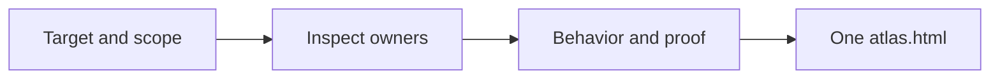

# Reusable project Atlas

## Overview

Use this intake protocol to understand any caller-selected project from its actual sources.

- It is independent of Java, Maven, ATF modules or a particular test runner.
- The reviewer supplies source access, revision and analysis scope; the [project-map template](Project_Map_Template.md) makes evidence and unknowns explicit.
- The [complete report contract](../../atf-atlas/Report_Contract.md) defines the target-specific reader deliverable, and the [knowledge base](../../atf-atlas/Knowledge_Base.md) supplies cited authoring policy.

The [framework Atlas](../../atf-atlas/README.md) maps ATF's existing behavior and tests.

- This area owns the broader project-understanding protocol and the selected reader publication.
- Full analysis inputs belong in external history.
- Neither area introduces a POM, Java service, MCP endpoint, skill registry or automatic claim of complete understanding.

## Ownership

The invoking reviewer owns the target/scope and evidence.

- The target project's code and documentation owners remain authoritative.
- Analyze the supplied tree read only by default; changes and execution follow the caller's task.
- Do not assume a build system, invent missing commands or treat repository prose as proof that tests passed.

Produce full intakes and immutable captures outside the live checkout.

- Select one verified standalone HTML per project for atlas/current/project-id/atlas.html, using the [publication contract](../README.md).
- Current means the selected published snapshot: preserve its captured revision instead of claiming that a move or a documentation-only commit refreshed its source analysis.
- Keep original intakes, source indexes, evidence dependencies and failed renders in external history.
- The current directory has no additional analysis JSON, sidecars or historical captures inside a project's reader directory.



<details>
<summary>Legend: relationships and proof boundary</summary>

Arrows show the analysis sequence. Every factual conclusion routes to observed
source or a preserved execution result. Unknowns remain visible instead of being
filled from an unrelated project's architecture.

</details>

## Invoke the protocol

Use this request with a reviewer or assistant that can read the selected project:

> Apply `artifacts/atlas/README.md` to `<project-root>` at `<revision>`.
> Inspect `<requested-scope>` using `artifacts/atlas/Project_Map_Template.md`.
> Select an external artifact root. Save `project-map.md`, `source-index.json`
> and `open-questions.md` under
> `<artifact-root>/atlas/runs/<project-id>/<analysis-id>/`.
> Publish exactly one complete understanding HTML for this selected project as
> `<artifact-root>/atlas/runs/<project-id>/<analysis-id>/delivery/atlas.html`.
> After verification, promote its unchanged HTML to the live selected publication
> at `artifacts/atlas/current/<project-id>/atlas.html` and update publication.json.
> Identify source facts, executed evidence, inferred conclusions and unknowns.
> Preserve target files and do not run or change anything beyond the requested task.

Also produce README.md, architecture.md, testing-and-governance.md and analysis.json,
which bind document hashes, one target identity, exact
source quotes/line ranges, governance references and retained evidence. The
source index distinguishes semantically reviewed owners from files captured only
for state identity. Record the actual dirty worktree; a commit ID alone does not
identify uncommitted code or selected binary dependencies.

Start with the entry documentation and actual build/package declarations.

- Map entry points, modules, dependencies, state/resource ownership, public contracts, configuration, failure paths, existing test selections and output locations.
- For non-ATF projects, use the detected owners and tools rather than this reactor's names.
- Record relative source paths and useful line references with their revision.

The generated source index records each inspected path, role and evidence scope.

- Explain supported existing behavior, object, observable outcome and test oracle with a source-bound behavior graph.
- If no oracle is found, record the searched scope and explicit gap.
- Keep the module/dependency map separate and label its meaning.
- Both graphs have legends and declared source/claim links.
- A single component/state may have no edges when its limitation is explicit.
- Open questions identify the missing fact and its owner; they are not automatic requests to add product/E2E tests.
- Analysis time and execution time are separate.

## Declared review units and seven facets

New public captures use renderVersion 4 and analysis.understanding schemaVersion 1.

- Declare scope PROJECT or SELECTED, scopeStatement and inventoryClaimIds from the actual package/build/entry/ownership declarations.
- Enumerate units using their real source owners.
- A PROJECT scope keeps its unit inventory and declared architecture aligned; it does not certify every indexed line.
- A SELECTED scope states the inspected area and exclusions.
- Avoid a fixed number of modules or flows: a simple project may legitimately have one component.

For every unit, record source-relative scopePaths, owned claimIds, explicit sharedClaimIds, existing flowIds and limits.

- Review purpose, structure, behavior, data, configuration, failure and verification.
- Each facet declares REVIEWED, PARTIAL, UNKNOWN or NOT_APPLICABLE, claimIds and an explanation.
- Reviewed/partial facets need source evidence; reviewed behavior needs a traced existing flow.
- Dependency nodes link unitId, flows link unitIds, and unit flowIds link back.
- The [template](Project_Map_Template.md) and [contract](../../atf-atlas/Report_Contract.md#declared-understanding-breadth) describe the exact fields.
- A captured file count does not establish review depth.

An EXECUTED claim used by a behavior or oracle supplies executionSubjects for every referenced run: exact XML testClass/testName or flat TAP testName, evidenceId and a sourcePath already quoted by that claim.

- Preserve actual case outcomes, suite counters and executed-source identities.
- A file present in a passing run is not proof that its oracle executed.
- Source-only/no-test projects retain their real status and explicit searched-scope oracle gap.

An optional assessment uses EVIDENCE_BOUND_REVIEW with named reviewer, scope, limits and weighted axes.

- Keep project quality and Atlas quality separate.
- Each axis cites reviewed source claims, any retained execution evidence, a reason and limits.
- Its score follows 40% correctness, 30% verification and 30% clarity; axis weights total 100 within each group.
- Without a review, show NOT_ASSESSED.
- The exact schema and safeguards belong to the report contract.

## Existing cases and negative observations

Every flow declares caseAnalysis schemaVersion 1: entryNodeId, pathScope REPRESENTATIVE or ALL_DECLARED_EDGES, negativeScope and cases.

- Edges have stable unique IDs.
- Every behavior node is reachable from entry and can reach an OUTCOME; every declared outcome has a source-bound case witness.
- Dependency modules need no invented common runtime entry.

For each existing POSITIVE/NEGATIVE case, record precondition, trigger, expected observation, ordered nodeIds/edgeIds, local claimIds, oracleClaimId/oracleStatus, selected oracle sourceRefs through oracleRefIndices, assertion and limits.

- NOT_FOUND uses an UNKNOWN claim and oracleGap with reviewed search evidence. negativeScope records reviewed cases or the searched/unreviewed gap.
- A negative claim elsewhere does not cover a positive-only graph.
- Do not add an E2E scenario to fill a documentation gap.

A finite case can include a supported cycle.

- ALL_DECLARED_EDGES covers only the declared edge set, not every implementation branch or loop schedule.
- Source meaning remains a review obligation.
- See the [case template](Project_Map_Template.md#behavior-case-witnesses) and [contract](../../atf-atlas/Report_Contract.md#behavior-cases-and-negative-observations).

## Reader delivery and knowledge

Every invocation, including retrieval-assisted authoring, selects exactly one project and emits exactly one complete understanding HTML.

- The reader directory contains one HTML recursively: delivery/atlas.html.
- Keep Markdown, input manifests, historical reports and verification/render evidence outside delivery/.
- Combining separate project identities or presenting a multi-page index does not satisfy this final contract.
- Use the selected project's actual language, build and source layout.
- Absent tests, Git metadata or declared dependencies remain explicit.

The publisher embeds canonical CSS, inline SVG, all declared Markdown,
source/analysis data and original declared XML/TAP/provenance payloads. Internal
navigation and native disclosure remain usable when the HTML is copied alone.

Select additional maintained target documents through sourceDocuments, bound to
the source index, so entry guides, architecture, testing and usage details remain
fully available in that one artifact. The understand command is an alias for
publish; both consume a source-reviewed intake and apply mandatory knowledge,
rather than automatically inferring a project through a language model.

Policy retrieval returns cited contract records with a corpus digest; mandatory
requirements still apply to an unrelated query. The selected source and existing
oracles, rather than a retrieved policy fragment, establish project facts.

## Verification

Check the map against its source index.

- Every diagram arrow must match a declared dependency or observed call; every command must resolve against actual build/test configuration.
- A source-only statement must not be relabeled as executed proof.
- Retain contrary observations and scope limits.

Existing documentation governance protects this README and the template, checks
links/language/edition parity and rejects executable Atlas material in the owned
area. Only declared root publication/history data is outside source governance;
an artifacts directory nested inside source remains governed. The protocol relies
on evidence-backed review; no universal semantic-analysis test is claimed.

Before publication, run the optional Node 20+ maintenance checker from the ATF_AI
reactor root. Git must be available when the selected source has Git metadata:

```powershell
$targetRoot = (Resolve-Path -LiteralPath $env:ATLAS_SOURCE_ROOT -ErrorAction Stop).Path
$analysisRoot = (Resolve-Path -LiteralPath $env:ATLAS_ANALYSIS_ROOT -ErrorAction Stop).Path
$artifactRoot = (Resolve-Path -LiteralPath $env:ATF_ARTIFACT_ROOT -ErrorAction Stop).Path
node tools/verify-atlas.mjs --source "$targetRoot" --analysis "$analysisRoot" --artifacts "$artifactRoot"
node tools/atlas-report.mjs publish --source "$targetRoot" --analysis "$analysisRoot" --artifacts "$artifactRoot"
node --test tools/verify-atlas.test.mjs tools/atlas-report.test.mjs tools/atlas-presentation.test.mjs tools/atlas-knowledge.test.mjs tools/atlas-bundle.test.mjs tools/atlas-execution.test.mjs tools/atlas-understanding.test.mjs tools/atlas-behavior.test.mjs
```

The [checker](../../tools/verify-atlas.mjs) rejects declared source/document drift,
changed quotes/ranges, missing governance mappings, escaping paths and execution
claims tied to another project or different source bytes. EXECUTED claims require
preserved Surefire XML or flat Node TAP outcomes, counters/verdict and the original source manifest; HTML or
a historical/skipped result alone is insufficient. A failed execution remains a
failed execution even when its evidence passes consistency checks.

The complete
report guard also rejects missing sections, changed canonical CSS, unsupported
behavior/graph/oracle references, external dependencies, mixed target identity
and an extra HTML in the reader directory. Failures preserve their rule ID,
observed evidence, meaning, repair hint, owner and focused recheck command.

Exact byte identity is the default.

- A declared CRLF_LF source normalization may bind equivalent UTF-8 text only when both the live index and the preserved execution manifest provide their verified normalized hashes.
- Raw live hashes still detect drift.
- Published library JAR/POM files in lib remain byte-exact.

The checker validates declared consistency, not truth inferred from keywords or complete semantic understanding.

- A reviewer still verifies each claim, diagram edge and proof boundary against the source.
- Preserve unresolved questions.
- A project that forbids context maps in maintained docs can still be analyzed here: keep the generated result in the caller-selected artifact root, outside that project's source-owned docs/lib perimeter.
- Do not weaken its governance to host a map.
