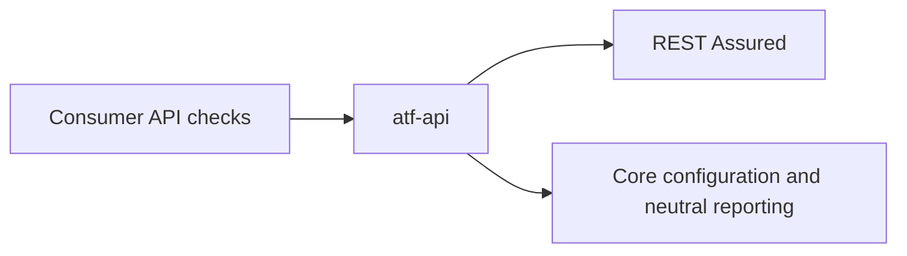

# atf-api

## Overview

A reusable REST API library: request execution, bounded retries, response assertions
and API test lifecycle. Coordinates: `com.ai:atf-api:1.0.0`; Java packages remain
`com.ai.api.core`. Existing behavior and public class names are preserved.



<details>
<summary>Legend: dependencies and reusable boundary</summary>

Solid arrows show library use. API owns HTTP execution and response contracts;
Core supplies configuration and neutral reporting. Browser adapters and Extent
are independent choices. Product endpoints and business fixtures belong to the consumer.

</details>

## Ownership

| Area | Existing entry point |
|---|---|
| Request execution | [ApiClient](src/main/java/com/ai/api/core/client/ApiClient.java), executor and runtime options |
| Observable API steps | [ApiActions](src/main/java/com/ai/api/core/client/ApiActions.java), request/result reporting |
| Assertions | [validation](src/main/java/com/ai/api/core/validation), status, body, headers and schema |
| Data and waits | [utils](src/main/java/com/ai/api/core/utils), JSON data and bounded polling |
| TestNG lifecycle | [BaseTestAPI](src/main/java/com/ai/api/core/BaseTestAPI.java), explicit access prerequisites |

REST Assured and its JSON Schema validator are declared here. Gson is a direct
JSON dependency; Selenium declares its own Gson use instead of receiving it from Core.
The API JAR contains no product services, Selenium, Playwright or Extent implementation.

## Consumer integration

Make the qualified parent, Core and API artifacts available in the consumer Maven repository. Add this dependency to another Java test framework; Maven brings Core transitively.
Choose `atf-reporting` separately when HTML reporting is required.

<details>
<summary>Dependency coordinates</summary>

```xml
<dependency>
  <groupId>com.ai</groupId>
  <artifactId>atf-api</artifactId>
  <version>1.0.0</version>
</dependency>
```

</details>

Configuration still uses the [shared configuration owner](../atf-core/README.md#configuration).
Use consumer-owned endpoints and data; repository examples live in
[atf-tests main sources](../atf-tests/src/main/java/com/ai/api/support).
A completed request supplies an observation; response assertions decide acceptance.

For another test runner, reuse the client and validators with a caller-owned lifecycle. BaseTestAPI retains its existing TestNG hooks.

## Verification

The [existing API subset](../atf-tests/src/test/resources/suites/framework-api.xml)
and local cross-module contracts remain in atf-tests. Source ownership is checked
by [atf-governance](../atf-governance/README.md).

<details>
<summary>Run module packaging and existing local API checks</summary>

```powershell
mvn -B -ntp -pl atf-api -am -DskipTests package
mvn -B -ntp -pl atf-tests -am "-Datf.test.suite=src/test/resources/suites/framework-api.xml" test
```

</details>

These local contracts do not establish remote API authorization or application writes.
See [Testing](../docs/Testing.md) for selection and evidence boundaries.
