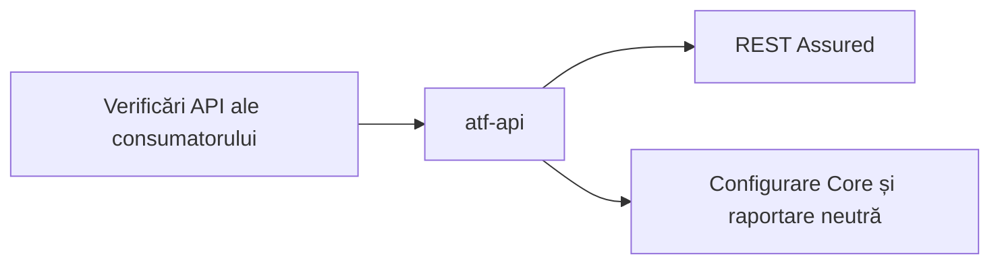

# atf-api

<a id="overview"></a>
## Prezentare generală

Bibliotecă REST API reutilizabilă: execuția cererilor, reîncercări limitate, aserțiuni
asupra răspunsurilor și ciclul de viață API. Coordonate: `com.ai:atf-api:1.0.0`;
pachetele rămân `com.ai.api.core`. Comportamentul și clasele publice existente sunt păstrate.



<details>
<summary>Legendă: dependențe și limita reutilizării</summary>

Săgețile continue arată utilizarea bibliotecilor. API deține execuția HTTP și
contractele răspunsurilor; Core oferă configurarea și raportarea neutră. Adaptoarele
de browser și Extent sunt opțiuni independente. Endpoint-urile și datele de produs aparțin consumatorului.

</details>

<a id="ownership"></a>
## Responsabilități

| Zonă | Punct de intrare existent |
|---|---|
| Execuția cererilor | [ApiClient](src/main/java/com/ai/api/core/client/ApiClient.java), executor și opțiuni de execuție |
| Pași API observabili | [ApiActions](src/main/java/com/ai/api/core/client/ApiActions.java), raportarea cererii și rezultatului |
| Aserțiuni | [validation](src/main/java/com/ai/api/core/validation), status, corp, antete și schemă |
| Date și așteptări | [utils](src/main/java/com/ai/api/core/utils), date JSON și verificare repetată limitată |
| Ciclul de viață TestNG | [BaseTestAPI](src/main/java/com/ai/api/core/BaseTestAPI.java), precondiții explicite de acces |

REST Assured și validatorul său JSON Schema sunt declarate aici. Gson este o
dependență JSON directă; Selenium declară propria utilizare Gson în loc să o primească din Core.
JAR-ul API nu conține servicii de produs sau implementări Selenium, Playwright ori Extent.

<a id="consumer-integration"></a>
## Integrarea consumatorului

Asigură artefactele calificate pentru părinte, Core și API în depozitul Maven al consumatorului. Adaugă această dependență altui framework Java de testare; Maven include Core tranzitiv.
Alege separat `atf-reporting` când este necesară raportarea HTML.

<details>
<summary>Coordonatele dependenței</summary>

```xml
<dependency>
  <groupId>com.ai</groupId>
  <artifactId>atf-api</artifactId>
  <version>1.0.0</version>
</dependency>
```

</details>

Configurarea folosește în continuare [responsabilul comun](../atf-core/README.md#configuration).
Endpoint-urile și datele aparțin consumatorului; exemplele depozitului sunt în
[sursele main atf-tests](../atf-tests/src/main/java/com/ai/api/support).
O cerere finalizată oferă o observație; aserțiunile răspunsului decid acceptanța.

Pentru un alt motor de testare, reutilizează clientul și validatorii cu un ciclu de viață definit de consumator. BaseTestAPI păstrează hook-urile TestNG existente.

<a id="verification"></a>
## Verificare

[Subsetul API existent](../atf-tests/src/test/resources/suites/framework-api.xml)
și contractele locale între module rămân în atf-tests. Responsabilitatea surselor
este verificată de [atf-governance](../atf-governance/README.md).

<details>
<summary>Rulează împachetarea modulului și verificările API locale existente</summary>

```powershell
mvn -B -ntp -pl atf-api -am -DskipTests package
mvn -B -ntp -pl atf-tests -am "-Datf.test.suite=src/test/resources/suites/framework-api.xml" test
```

</details>

Contractele locale nu stabilesc autorizarea API la distanță sau scrierea în aplicație.
Vezi [Testare](../docs/Testing.md) pentru selecție și limitele dovezilor.
