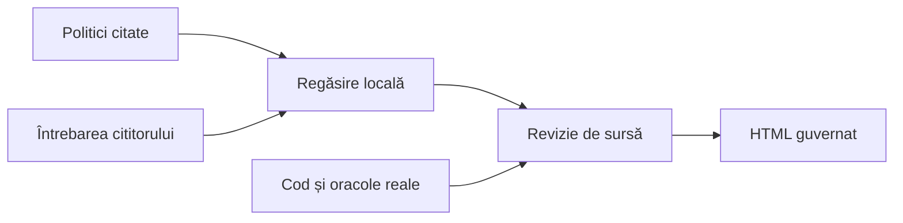
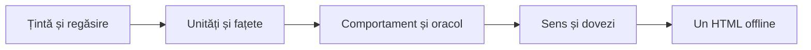

<a id="atlas-knowledge-and-retrieval"></a>
# Cunoștințe și regăsire Atlas

<a id="scope"></a>
## Domeniu

[Înregistrările contractului](knowledge/atlas-contracts.json) formează o mică bază
locală de cunoștințe pentru un revizor care lucrează pe dovezi. Înregistrările conțin
ID-uri stabile, termeni tematici, cerințe, citări arhivate și extrase citate exacte.
Regăsirea întoarce înregistrări relevante cu un digest al corpusului și o ordonare
deterministă. Fiecare înregistrare obligatorie rămâne aplicabilă chiar dacă are o
poziție slabă pentru interogare. O invocare asistată de cunoștințe produce în continuare
exact un HTML de înțelegere pentru singurul proiect selectat, conform
[contractului raportului complet](Report_Contract.md).

Aceasta oferă etapa de regăsire a unui flux de redactare de tip RAG. Revizorul
folosește cerințele regăsite împreună cu sursa reală a țintei, construiește analiza
și verifică rezultatul. Nu se introduce o bază vectorială, execuția unui model de
limbaj, un serviciu de execuție sau o afirmație automată de completitudine semantică.
Regăsirea lexicală nu promite recuperare semantică sau între limbi; folosește
contractul obligatoriu și inspectează explicit subiectele omise.



<details>
<summary>Legendă: relații și limita dovezii</summary>

Săgețile arată utilizarea cunoștințelor și validarea. Regăsirea oferă context de
politică, niciodată dovezi de execuție. O cerință veche citată nu poate certifica
actualul cod al proiectului.

</details>

<a id="adaptation-rules"></a>
## Reguli de adaptare

- Păstrează stilul dedicat, secțiunile pliabile și diagramele inline minimale.
- Explică comportamentul existent al domeniului sau framework-ului; separă hărțile dependențelor.
- Leagă observațiile, fragmentele sursă, aserțiunile, verdictele și limitele dovezii.
- Declară revizuirea întregului proiect sau a unui domeniu selectat, cu unitățile
  responsabile reale și toate cele șapte fațete; distinge dovezile inspectate de octeții indexați.
- Leagă afirmațiile despre comportament și criterii executate de subiecții exacți ai cazurilor păstrate.
- Încorporează intrările complete ale analizei și dovezile originale declarate fără trunchiere.
- Livrează exact un HTML specific țintei în directorul său separat de lectură.
- Adaptează-te oricărei limbi/sistem de construire și declară absența testelor sau a metadatelor Git.
- Folosește engleza canonică și CSS-ul controlat în surse, încorporat în HTML-ul final.
- Păstrează fișierele țintei numai pentru citire și rezultatele în artefactele ignorate alese de apelant.
- Tratează onest intrările observate ale scorurilor și întrebările nerezolvate.
- Păstrează eșecul original și oferă o cale delimitată de remediere.

Căile arhivei și digest-urile blob identifică proveniența. Nu sunt instrucțiuni
active de execuție. Nu se restaurează vreun registru vechi, plan de execuție sau
scor automat. Testul provenienței citește commit-ul arhivei locale păstrate; dacă
lipsește, eșecul îndrumă responsabilul să restaureze explicit referința. Testele nu
preiau depozite și nu contactează servicii externe. O referință de arhivă absentă
este un eșec de proveniență, nu o afirmație tacită că citarea a fost verificată.

<a id="invocation-and-maintenance"></a>
## Invocare și mentenanță

```powershell
node tools/atlas-report.mjs retrieve --query "complete HTML behavior evidence stylesheet"
```

Revizuiește ID-urile, cerințele, extrasele și înregistrările obligatorii întoarse.
Inspectează ținta și consemnează necunoscutele explicite. Revizorul urmează apoi
[contractul raportului](Report_Contract.md) pentru a produce documentul complet.
Modificările cunoștințelor necesită o citare arhivată sau o decizie curentă de contract
identificată clar, diagnostice corespunzătoare și controale negative relevante.

<a id="progressive-authoring-gates"></a>
## Porți progresive de redactare

Cerințele curente includ obligatoriu KB-BREADTH și KB-EXECUTION-SUBJECT.
KB-BREADTH cere un inventar al unităților susținut de dovezi și o stare explicită
pentru scop, structură, comportament, date, configurație, eșec și verificare.
KB-EXECUTION-SUBJECT cere identitatea cazului păstrat, responsabilul sursei citate
și rezultatul original pentru un comportament sau criteriu executat. Proiectele
numai cu sursă/fără teste rămân valide cu lacuna declarată. KB-ASSESSMENT opțional
descrie axe de revizuire umană cu domeniu explicit; absența evaluării rămâne NOT_ASSESSED.



<details>
<summary>Legendă: relații și limita dovezii</summary>

Săgețile arată porți succesive de revizuire, nu apeluri de execuție. Un eșec păstrează
dovada observată și calea delimitată de remediere. Repară declarația sau corespondența
cu sursa absentă, apoi rerulează controlul înainte de selecția completă. Creșterea
numărului de fișiere, fluxuri sau a scorului lexical nu stabilește o înțelegere
mai profundă. Fațetele PARTIAL/UNKNOWN oneste rămân rezultate utile.

</details>

Dovada regăsirii se verifică integral față de regăsirea canonică, inclusiv înregistrările
opționale, ordinea/clasarea, citările și identitatea sursei. Pachetul final păstrează
integral octeții sursei cunoștințelor. Astfel, o cerință adăugată sau o citare schimbată
nu poate împrumuta un digest autentic al corpusului. Citările contractului curent
guvernează adaptările; extrasele arhivate fixate rămân neschimbate.

<a id="behavior-cases-before-an-understanding-claim"></a>
## Cazuri comportamentale înaintea unei afirmații de înțelegere

Independența criteriului de verificare respinge orice suprapunere din același fișier
cu intervalele implementării selectate, inclusiv fragmente ușor deplasate. Subiecții
criteriului executat identifică sourceRefIndices reale și acoperă fiecare fragment
selectat de caz. O fațetă de eșec REVIEWED necesită un martor negativ într-un flux
propriu, nu o afirmație izolată despre sursă. Orice nod comportamental valid poate
fi intrarea reală; nu inventa un nod de intenție. Buclele comportamentale finite
acceptate rămân valide cu ieșire spre rezultat și randare clară; buclele unei
dependențe către sine rămân invalide.

Politicile obligatorii pentru cazuri și accesibilitate se aplică versiunilor renderVersion 3 și ulterioare.
Revizuiește cazurile reale pozitive și negative cu precondiții, declanșatori,
observații așteptate, parcursuri contigue de noduri/muchii și fragmentele selectate
ale criteriilor existente. Fiecare rezultat declarat are un martor de caz; toate
nodurile comportamentale sunt accesibile de la intrare și pot ajunge la un rezultat.
Parcursurile ciclice finite acceptate rămân valide. Hărțile dependențelor păstrează
semantica separată a modulelor neconectate.

Domeniul negativ consemnează cazurile revizuite sau o lacună explicită a căutării,
susținută de sursă. Nu cere inventarea testelor de aplicație. Criteriile NOT_FOUND
folosesc afirmații UNKNOWN cu dovezi revizuite ale căutării. Tipul cazului este
declarat după revizuirea sursei, nu dedus dintr-un nume de fișier sau un cuvânt al
aserțiunii. Selecția exactă a sursei/criteriului și limitele execuției păstrate se aplică în continuare.

Folosește invariante focalizate de traversare/caz, mutații metamorfice ale modelelor
valide și fixture-uri generice ale componentei de publicare. Păstrează eșecurile
intenționate și reparațiile reușite. Dovezile autentice și clasarea lexicală sunt
separate de înțelegerea proiectului. O interogare fără potriviri lexicale păstrează
politica obligatorie; clasarea sa nu poate stabili corectitudinea sursei sau
completitudinea semantică.

Înregistrarea recuperată KB-STYLE oferă contextul designului arhivat. Aplică
[contractul curent de prezentare](Report_Contract.md#reader-presentation-and-render-review)
și controalele de componentă/randare înaintea publicării. Un extras recuperat
despre stil nu înlocuiește cerințele actuale și nu demonstrează lizibilitatea
vizuală. Publicarea nouă folosește versiunea 4; regulile păstrate ale versiunii 3
pentru cazuri și accesibilitate continuă să se aplice.

ID-urile cunoștințelor și valorile SHA-256 arhivate sunt șiruri JSON. Tablourile sau obiectele convertibile la text potrivit trebuie respinse înaintea clasării sau construirii dovezii; duplicatele sunt verificate pe șiruri validate. Aceasta este guvernanța tipurilor de intrare, separată de verificarea octeților arhivați reali și revizuirea semantică a sursei.

JSON-ul original al corpusului, analizei, inventarului, provenienței și conținutului
HTML trebuie să aibă nume de membri unice în fiecare obiect, inclusiv după decodarea
escapărilor. Membrii repetați sunt respinși chiar dacă valorile lor sunt identice;
obiecte independente pot reutiliza aceeași cheie. Șirurile și valorile JSON valide
rămân neschimbate. Diagnosticul păstrează regula, responsabilul, indicația și reverificarea.
