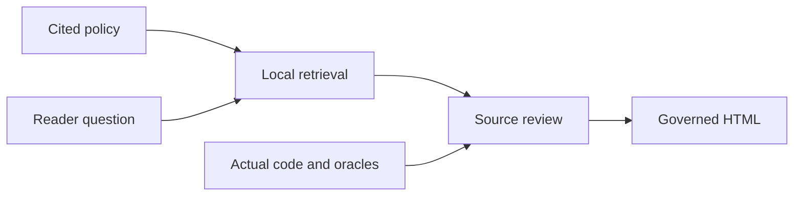
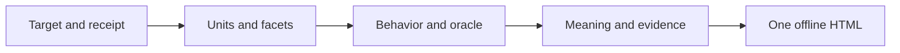

# Atlas knowledge and retrieval

## Scope

The [contract records](knowledge/atlas-contracts.json) are a small local knowledge
base for an evidence-grounded reviewer. Records contain stable IDs, topic terms,
requirements, archived citations and exact citation excerpts. Retrieval returns
relevant records with a corpus digest and deterministic ranking. Every mandatory
record remains applicable even when its query rank is low. A knowledge-assisted
invocation still produces exactly one understanding HTML for its one selected
project, under the [complete report contract](Report_Contract.md).

This provides the retrieval stage of a RAG-style authoring workflow. The reviewer
uses the retrieved requirements with the actual target source, builds the
analysis and checks the result. No vector database, language-model execution,
runtime service or automatic semantic-completeness claim is introduced. Lexical
retrieval has no promised cross-language or semantic recall; use the mandatory
contract and inspect missed topics explicitly.



<details>
<summary>Legend: relationships and proof boundary</summary>

Arrows show knowledge use and validation. Retrieval is policy context, never
execution evidence. A cited old requirement cannot certify today's project code.

</details>

## Adaptation rules

- Remove exact repeated business sentences; review similar meanings manually.
- Group capability-review detail once, keep unknown failure scope distinct from
  partial review, and measure real diagram clearances rather than CSS padding.
- Preserve dedicated styling, collapsible sections and minimal inline diagrams.
- Explain existing domain or framework behavior; keep dependency maps separate.
- Bind observations, source fragments, assertions, verdicts and proof limits.
- Declare whole-project or selected review scope with actual owner units and all
  seven understanding facets; distinguish inspected evidence from indexed bytes.
- Bind executed behavior and oracle claims to exact retained testcase subjects.
- Embed complete analysis inputs and original declared evidence without truncation.
- Deliver exactly one target-specific HTML in its separate reader directory.
- Adapt to any language/build system and disclose absent tests or Git metadata.
- Use canonical English and source-controlled CSS embedded into the final HTML.
- Keep target files read only and outputs in caller-selected ignored artifacts.
- Treat observed score inputs and unresolved questions honestly.
- Preserve an original failure and give a bounded repair route.
- Apply current no-scroll diagram governance: consistent measured scale and two
  closed local disclosures with source-specific legends and original references.
  Use [the component owner](governance/README.md) for a wide-view repair.

Archive paths and blob digests identify provenance. They are not active runtime
instructions. No old registry, execution plan or automatic score is restored.
The provenance test reads the retained local archive commit; if it is unavailable,
the failure instructs the owner to restore that reference explicitly. Tests do
not fetch repositories or contact external services. A missing archive reference
is a provenance failure, not a silent claim that the citation was verified.

## Invocation and maintenance

```powershell
node tools/atlas-report.mjs retrieve --query "complete HTML behavior evidence stylesheet"
```

Review the returned IDs, requirements, excerpts and mandatory records. Inspect the
target and record explicit unknowns. A reviewer then follows the
[report contract](Report_Contract.md) to produce the complete document. Changes to
knowledge require an archived citation or a clearly identified current contract
decision, matching diagnostics and meaningful negative controls.

## Progressive authoring gates

The current requirements include mandatory KB-BREADTH and KB-EXECUTION-SUBJECT.
KB-BREADTH requires an evidence-backed unit inventory and explicit status for
purpose, structure, behavior, data, configuration, failure and verification.
KB-EXECUTION-SUBJECT requires the retained case identity, quoted source owner
and original outcome for an executed behavior or oracle. Source-only/no-test
projects remain valid with a disclosed gap. Optional KB-ASSESSMENT describes
scoped human review axes; absence of an assessment remains NOT_ASSESSED.



<details>
<summary>Legend: relationships and proof boundary</summary>

Arrows show successive review gates, not runtime calls. A failure keeps its
observed evidence and bounded repair route. Repair the missing declaration or
source correspondence, then rerun that control before the full selection.
Increasing file counts, flow counts or a lexical score does not establish deeper
understanding. Honest PARTIAL/UNKNOWN facets remain useful output.

</details>

The retrieval receipt is checked in full against canonical retrieval, including
optional records, order/ranking, citations and source identity. The final bundle
retains complete knowledge-source bytes. This prevents an appended requirement
or changed citation from borrowing a genuine corpus digest. Current contract
citations govern these adaptations; pinned archived excerpts remain unchanged.

## Behavior cases before an understanding claim

Oracle independence rejects every same-file overlap with selected implementation
ranges, including slightly shifted slices. Executed oracle subjects identify
their actual sourceRefIndices, and cover every fragment selected by the case.
A REVIEWED failure facet requires a negative witness in an owned flow, rather
than an isolated source claim. Any valid behavior node may be the actual entry;
do not invent an intent node. Finite supported behavior self-loops remain valid
with an outcome escape and clear rendering; dependency self-loops stay invalid.

Mandatory case and reachability policies apply to renderVersion 3 and later captures.
Review actual positive and negative cases with preconditions, triggers, expected
observations, contiguous node/edge walks and selected existing oracle fragments.
Every declared outcome has a case witness; all behavior nodes are reachable from
entry and can reach an outcome. Supported finite cycle walks remain valid.
Dependency maps keep their separate disconnected-module semantics.

Negative scope records reviewed cases or an explicit source-backed search gap.
It does not require inventing application tests. NOT_FOUND oracles use UNKNOWN
claims with reviewed search evidence. Case kind is declared after source review,
not guessed from a filename or assertion word. Exact source/oracle selection and
retained execution scope still apply.

Use focused traversal/case invariants, metamorphic mutations of valid models and
generic publisher component fixtures. Preserve intended failures and successful
repairs. Authentic receipts and lexical ranking are separate from project
understanding. A query without lexical matches still retains mandatory policy;
its ranking cannot establish source correctness or semantic completeness.

The retrieved KB-STYLE record supplies the archived design context. Apply the
current [reader presentation contract](Report_Contract.md#reader-presentation-and-render-review)
and its component/render controls before publication. A retrieved styling excerpt
does not replace current requirements or establish visual readability. New
publication uses version 5 with a business projection and adjacent technical audit;
retained case and reachability rules still apply.

Knowledge IDs and archived SHA-256 values are JSON strings. Arrays or objects that coerce to matching text must fail before ranking or receipt construction; duplicate identity checks use validated strings. This is typed input governance, separate from verifying actual archived bytes and semantic source review.

Original corpus, analysis, inventory, provenance and embedded HTML JSON must use
unique member names within each object, including after escape decoding. Repeated
members fail even when their values agree; independent objects may reuse a key.
Valid JSON strings and values remain unchanged. The diagnostic retains its rule,
owner, repair hint and recheck selection.

Mandatory KB-BUSINESS-READER keeps the business audience, adjacent audit and
hierarchical numbering in every retrieval, including unrelated questions.
KB-COMPLETE now requires complete understanding in the reader and complete
technical evidence in the audit, with no hidden HTML bundle. History retains its captured policy.

The current profile includes `BUSINESS_REFERENCE_V2`: an open primary map,
closed support, facet-bound maturity and goal–question–measure score rationale.
Current V4 also requires `CONCISE_READING_V1`: short owned answers, comparative
tables and optional depth, while fitted graphs keep two closed local disclosures.
Historical V1/V2/V3 declarations retain their original assessment. A passing
result never becomes an automatic grade.

## Artifact calibration

Fresh `understand` authoring retrieves the existing mandatory records and applies
the source and presentation [current profiles](Report_Contract.md#current-source-bound-authoring-profiles).
The corpus extends the same case, graph, evidence and breadth records; adding a
new policy topic does not require another overlapping record.

- Compare the actual oracle subject with its independent criterion, supported
  relation and mismatch meaning. Descriptions of compared state are not invented
  runtime actuals; a matching generic assertion sentence proves no correspondence.
- Render at least three meaningful nodes and two real distinct relationships.
  Use `TEXT_ONLY` with a substantive reason for a compact idea; preserve its audit
  graph and cases without adding decorative nodes or artificial dependencies.
- Preserve actual clean or dirty Git capture, exact leading porcelain spaces and
  the complete indexed source. Explain unpublished-source limits to the reader.
- Separate local source from selected consumed contracts. Preserve raw selected
  JAR/POM pairs and absent producer oracles instead of borrowing source ownership.

Legacy `publish` preserves the assessment of its original capture; it does not
upgrade history to the current profiles. Missing Git or producer source is a
declared boundary. Never invent identity, a local module or a passing gate to
make a source-only project appear fully qualified.

The reader explains business purpose, project architecture and behavior. Architecture views preserve actual relationships using reader capability names; behavior maps stay in closed disclosures with adjacent legends.

- Compare the actual artifact with live implementation owners and project documents.
- Follow delegation to the operation; do not broaden detail masking into a guarantee for all screenshots or messages.
- Keep the observed verdict separate from the expected scenario outcome and expose partial review depth.
- Exercise navigation from closed sections, native screenshots, readability and the identity of selected bytes.

The [contract](Report_Contract.md) defines the schema and limits; the [calibration component](../tools/atlas-calibration.mjs) explains failures and repair routes. Axis ratings remain reasoned review judgments, not test pass rates.

Semantic qualification uses distinct facet observations, owned source and independent oracles, with visible remaining limits. Atlas identity stays compact; review date belongs with confidence. See the [semantic contract](Report_Contract.md#semantic-review-and-compact-identity).
