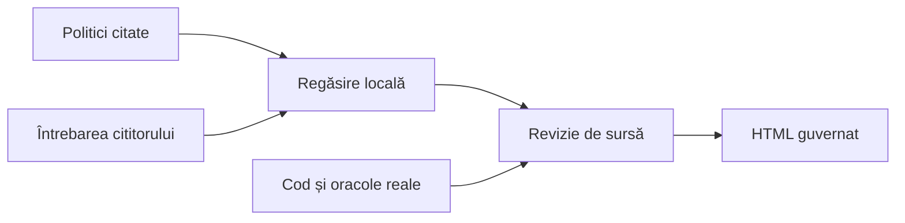
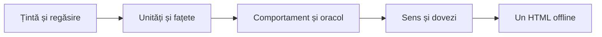

<a id="atlas-knowledge-and-retrieval"></a>
# Cunoștințe și regăsire Atlas

<a id="scope"></a>
## Domeniu

[Înregistrările contractului](knowledge/atlas-contracts.json) formează o mică bază
locală de cunoștințe pentru un revizor care lucrează pe dovezi. Înregistrările conțin
ID-uri stabile, termeni tematici, cerințe, citări arhivate și extrase citate exacte.
Regăsirea întoarce înregistrări relevante cu un digest al corpusului și o ordonare
deterministă. Fiecare înregistrare obligatorie rămâne aplicabilă chiar dacă are o
poziție slabă pentru interogare. O invocare asistată de cunoștințe produce în continuare
exact un HTML de înțelegere pentru singurul proiect selectat, conform
[contractului raportului complet](Report_Contract.md).

Aceasta oferă etapa de regăsire a unui flux de redactare de tip RAG. Revizorul
folosește cerințele regăsite împreună cu sursa reală a țintei, construiește analiza
și verifică rezultatul. Nu se introduce o bază vectorială, execuția unui model de
limbaj, un serviciu de execuție sau o afirmație automată de completitudine semantică.
Regăsirea lexicală nu promite recuperare semantică sau între limbi; folosește
contractul obligatoriu și inspectează explicit subiectele omise.



<details>
<summary>Legendă: relații și limita dovezii</summary>

Săgețile arată utilizarea cunoștințelor și validarea. Regăsirea oferă context de
politică, niciodată dovezi de execuție. O cerință veche citată nu poate certifica
actualul cod al proiectului.

</details>

<a id="adaptation-rules"></a>
## Reguli de adaptare

- Corelează deciziile business cu metodele concrete și cazurile originale ale fluxului;
  păstrează codul detaliat în harta colapsată, cu limitele dovezii explicite.
- Folosește formatul regulă–observație–hint–reverificare din arhiva MCP ca reper;
  raportul Extent derivat trebuie să păstreze identitatea rezultatelor curente.
- Păstrează margini întunecate simetrice; folosește lățimea interioară pentru fiecare diagramă.
- Prezintă domeniul și limita revizuirii într-un tabel scurt; proveniența curată stă
  în detaliul dedicat. Avertizarea despre modificări nepublicate rămâne vizibilă.
- Rezervă hărții principale o bandă pe toată lățimea și măsoară desenul SVG real.
- Păstrează rezumatul deasupra, suportul dedesubt și limitele în secțiunile dedicate;
  elimină subsolul/instrucțiunile generice și păstrează textul principal uniform.
- Elimină propozițiile business identice; revizuiește manual sensurile apropiate.
- Grupează o singură dată detaliile revizuirii, păstrează domeniul necunoscut al
  eșecurilor distinct de cel parțial și măsoară distanțele reale din diagrame.
- Păstrează stilul dedicat, secțiunile pliabile și diagramele inline minimale.
- Explică comportamentul existent al domeniului sau framework-ului; separă hărțile dependențelor.
- Leagă observațiile, fragmentele sursă, aserțiunile, verdictele și limitele dovezii.
- Declară revizuirea întregului proiect sau a unui domeniu selectat, cu unitățile
  responsabile reale și toate cele șapte fațete; distinge dovezile inspectate de octeții indexați.
- Leagă afirmațiile despre comportament și criterii executate de subiecții exacți ai cazurilor păstrate.
- Încorporează intrările complete ale analizei și dovezile originale declarate fără trunchiere.
- Livrează exact un HTML specific țintei în directorul său separat de lectură.
- Adaptează-te oricărei limbi/sistem de construire și declară absența testelor sau a metadatelor Git.
- Folosește engleza canonică și CSS-ul controlat în surse, încorporat în HTML-ul final.
- Păstrează fișierele țintei numai pentru citire și rezultatele în artefactele ignorate alese de apelant.
- Tratează onest intrările observate ale scorurilor și întrebările nerezolvate.
- Păstrează eșecul original și oferă o cale delimitată de remediere.
- Aplică guvernanța curentă fără scroll: scară măsurată consecventă și două
  secțiuni locale închise, cu legende specifice sursei și referințe originale.
  Folosește [responsabilul componentei](governance/README.md) pentru vederi prea ample.

Căile arhivei și digest-urile blob identifică proveniența. Nu sunt instrucțiuni
active de execuție. Nu se restaurează vreun registru vechi, plan de execuție sau
scor automat. Testul provenienței citește commit-ul arhivei locale păstrate; dacă
lipsește, eșecul îndrumă responsabilul să restaureze explicit referința. Testele nu
preiau depozite și nu contactează servicii externe. O referință de arhivă absentă
este un eșec de proveniență, nu o afirmație tacită că citarea a fost verificată.

<a id="invocation-and-maintenance"></a>
## Invocare și mentenanță

```powershell
node tools/atlas-report.mjs retrieve --query "complete HTML behavior evidence stylesheet"
```

Revizuiește ID-urile, cerințele, extrasele și înregistrările obligatorii întoarse.
Inspectează ținta și consemnează necunoscutele explicite. Revizorul urmează apoi
[contractul raportului](Report_Contract.md) pentru a produce documentul complet.
Modificările cunoștințelor necesită o citare arhivată sau o decizie curentă de contract
identificată clar, diagnostice corespunzătoare și controale negative relevante.

<a id="progressive-authoring-gates"></a>
## Porți progresive de redactare

Cerințele curente includ obligatoriu KB-BREADTH și KB-EXECUTION-SUBJECT.
KB-BREADTH cere un inventar al unităților susținut de dovezi și o stare explicită
pentru scop, structură, comportament, date, configurație, eșec și verificare.
KB-EXECUTION-SUBJECT cere identitatea cazului păstrat, responsabilul sursei citate
și rezultatul original pentru un comportament sau criteriu executat. Proiectele
numai cu sursă/fără teste rămân valide cu lacuna declarată. KB-ASSESSMENT opțional
descrie axe de revizuire umană cu domeniu explicit; absența evaluării rămâne NOT_ASSESSED.



<details>
<summary>Legendă: relații și limita dovezii</summary>

Săgețile arată porți succesive de revizuire, nu apeluri de execuție. Un eșec păstrează
dovada observată și calea delimitată de remediere. Repară declarația sau corespondența
cu sursa absentă, apoi rerulează controlul înainte de selecția completă. Creșterea
numărului de fișiere, fluxuri sau a scorului lexical nu stabilește o înțelegere
mai profundă. Fațetele PARTIAL/UNKNOWN oneste rămân rezultate utile.

</details>

Dovada regăsirii se verifică integral față de regăsirea canonică, inclusiv înregistrările
opționale, ordinea/clasarea, citările și identitatea sursei. Pachetul final păstrează
integral octeții sursei cunoștințelor. Astfel, o cerință adăugată sau o citare schimbată
nu poate împrumuta un digest autentic al corpusului. Citările contractului curent
guvernează adaptările; extrasele arhivate fixate rămân neschimbate.

<a id="behavior-cases-before-an-understanding-claim"></a>
## Cazuri comportamentale înaintea unei afirmații de înțelegere

Independența criteriului de verificare respinge orice suprapunere din același fișier
cu intervalele implementării selectate, inclusiv fragmente ușor deplasate. Subiecții
criteriului executat identifică sourceRefIndices reale și acoperă fiecare fragment
selectat de caz. O fațetă de eșec REVIEWED necesită un martor negativ într-un flux
propriu, nu o afirmație izolată despre sursă. Orice nod comportamental valid poate
fi intrarea reală; nu inventa un nod de intenție. Buclele comportamentale finite
acceptate rămân valide cu ieșire spre rezultat și randare clară; buclele unei
dependențe către sine rămân invalide.

Politicile obligatorii pentru cazuri și accesibilitate se aplică versiunilor renderVersion 3 și ulterioare.
Revizuiește cazurile reale pozitive și negative cu precondiții, declanșatori,
observații așteptate, parcursuri contigue de noduri/muchii și fragmentele selectate
ale criteriilor existente. Fiecare rezultat declarat are un martor de caz; toate
nodurile comportamentale sunt accesibile de la intrare și pot ajunge la un rezultat.
Parcursurile ciclice finite acceptate rămân valide. Hărțile dependențelor păstrează
semantica separată a modulelor neconectate.

Domeniul negativ consemnează cazurile revizuite sau o lacună explicită a căutării,
susținută de sursă. Nu cere inventarea testelor de aplicație. Criteriile NOT_FOUND
folosesc afirmații UNKNOWN cu dovezi revizuite ale căutării. Tipul cazului este
declarat după revizuirea sursei, nu dedus dintr-un nume de fișier sau un cuvânt al
aserțiunii. Selecția exactă a sursei/criteriului și limitele execuției păstrate se aplică în continuare.

Folosește invariante focalizate de traversare/caz, mutații metamorfice ale modelelor
valide și fixture-uri generice ale componentei de publicare. Păstrează eșecurile
intenționate și reparațiile reușite. Dovezile autentice și clasarea lexicală sunt
separate de înțelegerea proiectului. O interogare fără potriviri lexicale păstrează
politica obligatorie; clasarea sa nu poate stabili corectitudinea sursei sau
completitudinea semantică.

Înregistrarea recuperată KB-STYLE oferă contextul designului arhivat. Aplică
[contractul curent de prezentare](Report_Contract.md#reader-presentation-and-render-review)
și controalele de componentă/randare înaintea publicării. Un extras recuperat
despre stil nu înlocuiește cerințele actuale și nu demonstrează lizibilitatea
vizuală. Publicarea nouă folosește versiunea 5, cu proiecție business și audit adiacent; regulile păstrate ale versiunii 3
pentru cazuri și accesibilitate continuă să se aplice.

ID-urile cunoștințelor și valorile SHA-256 arhivate sunt șiruri JSON. Tablourile sau obiectele convertibile la text potrivit trebuie respinse înaintea clasării sau construirii dovezii; duplicatele sunt verificate pe șiruri validate. Aceasta este guvernanța tipurilor de intrare, separată de verificarea octeților arhivați reali și revizuirea semantică a sursei.

JSON-ul original al corpusului, analizei, inventarului, provenienței și conținutului
HTML trebuie să aibă nume de membri unice în fiecare obiect, inclusiv după decodarea
escapărilor. Membrii repetați sunt respinși chiar dacă valorile lor sunt identice;
obiecte independente pot reutiliza aceeași cheie. Șirurile și valorile JSON valide
rămân neschimbate. Diagnosticul păstrează regula, responsabilul, indicația și reverificarea.

Politica obligatorie KB-BUSINESS-READER păstrează publicul business, auditul adiacent
și numerotarea ierarhică în orice regăsire, inclusiv când întrebarea nu are legătură
cu prezentarea. KB-COMPLETE cere acum înțelegere completă în cititor și dovezi
tehnice complete în audit, fără pachet ascuns în HTML. Istoricul își păstrează politica capturată.

Profilul curent include `BUSINESS_REFERENCE_V2`: hartă principală deschisă,
suport închis, maturitate legată de fațete și note cu obiectiv–întrebare–măsură.
V4 curent cere și `CONCISE_READING_V1`: răspunsuri scurte cu surse, tabele
comparative și detalii la cerere; grafurile păstrează două secțiuni locale închise.
Declarațiile istorice V1/V2/V3 își păstrează evaluarea originală. Un rezultat
trecut nu devine niciodată o notă automată.

<a id="artifact-calibration"></a>
## Calibrarea artefactului

Redactarea nouă prin `understand` regăsește înregistrările obligatorii existente și
aplică profilurile de sursă și prezentare [profile curente](Report_Contract.md#current-source-bound-authoring-profiles).
Corpusul extinde aceleași înregistrări pentru cazuri, grafuri, dovezi și amploare;
un subiect de politică nou nu cere încă o înregistrare suprapusă.

- Compară subiectul real al oracolului cu criteriul său independent, relația
  susținută și sensul nepotrivirii. Descrierile stării comparate nu sunt valori
  observate inventate; o frază generică nu dovedește corespondența.
- Randează cel puțin trei noduri cu sens și două relații reale distincte.
  Folosește `TEXT_ONLY` cu un motiv concret pentru o idee compactă; păstrează graful
  și cazurile în audit fără noduri decorative sau dependențe artificiale.
- Păstrează captura Git reală, curată sau modificată, spațiile inițiale exacte ale
  stării porcelain și inventarul complet. Explică cititorului limitele sursei nepublicate.
- Separă sursa locală de contractele consumate selectate. Păstrează perechile
  JAR/POM originale și lipsa oracolelor producătorului fără să împrumuți responsabilitatea sursei.

Compatibilitatea `publish` păstrează evaluarea capturii originale; nu promovează
istoricul la profilele curente. Lipsa Git sau a sursei producătorului este o limită
declarată. Nu inventa identitate, modul local sau poartă trecută pentru a prezenta
un proiect numai cu sursă ca fiind complet calificat.

Cititorul explică scopul business, arhitectura și comportamentele proiectului. Hărțile arhitecturii păstrează relațiile reale și folosesc denumiri pentru cititor; hărțile comportamentale stau în secțiuni colapsabile, cu legende adiacente.

- Compară artefactul efectiv cu implementările live și documentele proiectului.
- Urmărește delegarea până la operație; nu extinde mascarea detaliilor la toate capturile sau mesajele.
- Păstrează verdictul observat separat de rezultatul așteptat al scenariului și afișează revizia parțială.
- Verifică navigarea din secțiuni închise, capturile native, lizibilitatea și identitatea octeților selectați.

[Contractul](Report_Contract.md) definește schema și limitele; [componenta de calibrare](../tools/atlas-calibration.mjs) explică eșecurile și calea de reparație. Notele pe axe rămân evaluări motivate, nu rate de teste.

Revizia semantică folosește observații distincte, surse responsabile și criterii independente pentru fiecare fațetă, cu limite vizibile. Identitatea Atlasului rămâne compactă; data aparține încrederii. Vezi [contractul semantic](Report_Contract.md#semantic-review-and-compact-identity).
