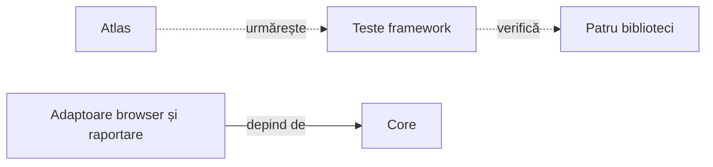
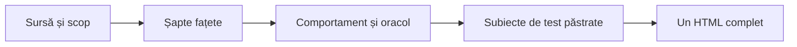
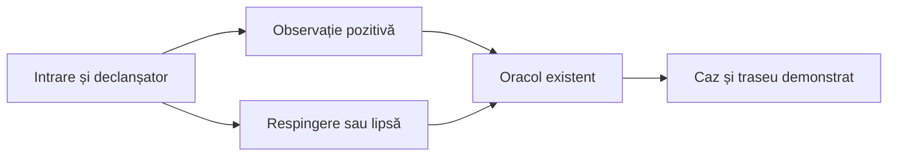

<a id="atf-atlas"></a>
# Atlas ATF

<a id="overview"></a>
## Prezentare generală

Atlas este o zonă de documentație și guvernanță pentru înțelegerea comportamentului
reprezentat de testele existente. Începe cu [harta de acoperire](Coverage_Map.md),
apoi inspectează sursa, criteriul de verificare și suita menținută indicate înainte
de a afirma o acoperire.

Pentru alt proiect sau limbaj, folosește separat
[protocolul reutilizabil de analiză](../artifacts/atlas/README.md) și șablonul său de dovezi.
Această hartă rămâne specifică framework-ului ATF; analiza generată aparține
rădăcinii de artefacte selectate.

Această zonă de documentație gestionează [contractul raportului complet](Report_Contract.md), [baza de cunoștințe](Knowledge_Base.md) și [CSS-ul dedicat](assets/atlas.css).

- Uneltele opționale de mentenanță verifică și publică analiza revizuită.
- Ele nu execută teste de produs și nu oferă servicii Java de execuție.
- HTML-ul generat aparține rădăcinii de artefacte selectate.
- Reactorul Maven rămâne format din cele cinci module descrise în [Arhitectură](../docs/Architecture.md).

<a id="ownership"></a>
## Responsabilități

Responsabilul documentației framework-ului menține harta; responsabilii sursei și
testelor fiecărei capabilități răspund în continuare pentru contract și acceptanță.
[indexul de guvernanță](../docs/governance/README.md) trimite documentele
menținute la responsabilii lor dedicați și explică înregistrarea în suite.



<details>
<summary>Legendă: relații și limita dovezii</summary>

Săgețile continue sunt dependențe între biblioteci. Cele punctate reprezintă
trasabilitatea documentației sau utilizarea în teste; Atlas nu introduce dependențe Maven.

</details>

<a id="traceability-contract"></a>
## Contract de trasabilitate

Pentru un flux de aplicație, identifică actorul, intenția, acțiunea vizibilă, obiectul
de afaceri și rezultatul observat. Pentru un contract de framework, folosește consumatorul,
cererea, operația, valoarea sau artefactul și rezultatul observat. Leagă implementarea și suportul
de verificările pozitive și negative relevante, suită și limita rămasă.

De exemplu,
[regresia existentă a executorului de cereri](../atf-tests/src/test/java/com/ai/atf/core/support/base/ApiCoreExecutionArchitectureContractTest.java)
descrie un răspuns limitat de frecvență, întârzierea înregistrată, o reîncercare și
răspunsul final observat, păstrat neschimbat. Explică acest contract și criteriul
său de verificare separat de o săgeată de dependență Core. Citirea testului nu
demonstrează o execuție nouă.

Contractul Atlas în engleză, arhivat la `main_mcp:docs/prompts/html_EN/atlas/business-test-atlas-reference.html`, fundamentează această abordare pornind de la sursă.

- Regulile sale vizuale dedicate, secțiunile pliabile, trasabilitatea comportamentului și limitele auditului sunt adaptate prin contractul curent.
- Punctele de intrare arhivate pentru execuție și notele automate rămân retrase.
- `ATF_Context_Atlas.md` din J0 oferă modelul complementar de lectură: subiect, responsabil, contract, sursă și apelant.

<a id="complete-understanding-report"></a>
## Raport complet de înțelegere

Publicarea nouă folosește rendererul 5: un singur HTML offline de înțelegere
business pentru proiectul selectat. Scopul, valoarea, capabilitățile,
comportamentele și limitele sunt explicate înaintea detaliilor de implementare.

- Secțiunile 01–06 au numere stabile, oglindite în navigare; subtitlurile urmează ierarhia 03.01 și 03.01.01.
- Proiecția business este legată de afirmații, responsabili și cazuri pozitive/negative existente; necunoscutele rămân vizibile.
- Comenzile, căile de sursă, amprentele, JSON-ul brut și dovezile de execuție rămân în atlas-audit.json, lângă analiză și în afara delivery/.
- HTML-ul nu conține pachet tehnic ascuns. Poate fi citit singur; verificarea completă cere auditul adiacent original.
- Stilul canonic este încorporat, diagramele au legende, iar tabelele păstrează textul complet și lizibil.

[Contractul cititorului](Report_Contract.md#reader-and-audit-responsibilities)
definește separarea publicurilor și ciclul regăsire–redactare–audit–randare.
Controalele componente refuză detaliile tehnice în textul cititorului, cazurile
omise și numerotarea modificată. Revizorul verifică în continuare sensul.

Cititorii istorici 1–4 și dovezile lor rămân imuabile, conform contractului capturat.

<a id="review-breadth-and-quality-axes"></a>
## Aria revizuirii și axele de calitate

Capturile noi declară aria revizuirii PROJECT sau SELECTED, unitățile reale de analiză cu responsabilitate asupra surselor și șapte perspective de lectură susținute de dovezi: scop, structură, comportament, date, configurație, eșec și verificare.

- REVIEWED, PARTIAL, UNKNOWN și NOT_APPLICABLE fac vizibilă lectura rămasă.
- Un fișier capturat pentru identitate nu este automat revizuit.
- Arhitectura declarată, componentele responsabile ale unităților și fluxurile existente se referă reciproc.



<details>
<summary>Legendă: relații și limita dovezii</summary>

Săgețile descriu revizuirea și asamblarea dovezilor. Sunt separate de diagrama
dependențelor de execuție de mai sus. Un proiect simplu nu necesită module sau
teste inventate. Comportamentul verificat din surse păstrează acel statut; un
comportament sau criteriu executat necesită identitatea exactă a cazului păstrat,
sursa responsabilă citată și rezultatul său.

</details>

Evaluările opționale 1–100 declară responsabilul revizuirii, aria, justificarea, limitele, afirmațiile sursă și dovezile păstrate.

- Calitatea proiectului și calitatea Atlas au grupuri și axe ponderate separate.
- Criteriile și câmpurile verificabile aparțin [contractului raportului](Report_Contract.md); observațiile curente și dovezile de închidere aparțin [feedback-ului despre profunzime](../docs/feedback/Atlas_Depth_And_Assessment.md).
- Nicio verificare automată și niciun inventar al surselor nu stabilesc înțelegerea semantică completă sau o notă automată de calitate.

<a id="behavior-cases-and-negative-scope"></a>
## Cazuri de comportament și limitele analizei negative

Capturile noi renderVersion 5 explică situațiile pozitive și negative existente, cu precondiții, declanșatori, observații așteptate și fragmentele exacte ale criteriilor din surse.

- Fiecare flux declară intrarea, ID-uri stabile ale săgeților, parcursuri continue și aria revizuirii negative.
- Fiecare rezultat are un caz martor; toate nodurile sunt accesibile de la intrare și pot ajunge la un rezultat.
- Buclele finite susținute rămân valide.
- Comportamentul negativ lipsă sau nerevizuit rămâne explicit, fără teste inventate sau sens dedus din numele cazului.



<details>
<summary>Legendă: relații și limita dovezii</summary>

Săgețile arată întrebările despre dovezi la redactare, nu ramuri de execuție
inventate. [Contractul cazurilor](Report_Contract.md#behavior-cases-and-negative-observations)
deține câmpurile. Invariantele grafului, mutațiile metamorfice și verificările de
componentă ale publicării îmbunătățesc coerența declarată. Revizuirea umană
verifică în continuare sensul sursei. Constatările aparțin
[feedback-ului despre comportament](../docs/feedback/Behavior_And_Negative_Cases.md).

</details>

<a id="verification"></a>
## Verificare

Rulează dintr-o copie izolată a reactorului, conform ghidului [Dezvoltare](../docs/Development.md):

<details>
<summary>Rulează comenzile: Verificare</summary>

```powershell
mvn -B -ntp -pl atf-tests -am "-Dtest=FrameworkArchitectureGovernanceTest,DocumentationGovernanceTest,DocumentationRootGovernanceTest,DocumentationEditionGovernanceTest,LivingPrinciplesGovernanceTest,DocumentationStructureGovernanceTest,FeedbackGovernanceTest,DocumentationPublicationGovernanceTest,DocumentationReadabilityRulesTest" "-Dsurefire.failIfNoSpecifiedTests=false" test
```

</details>

Rulează verificările opționale de mentenanță Atlas din rădăcina reactorului:

```powershell
node --test tools/verify-atlas.test.mjs tools/atlas-report.test.mjs tools/atlas-presentation.test.mjs tools/atlas-knowledge.test.mjs tools/atlas-bundle.test.mjs tools/atlas-execution.test.mjs tools/atlas-understanding.test.mjs tools/atlas-behavior.test.mjs
```

Această selecție verifică documentația și arhitectura declarată; nu execută
scenariile de afaceri ale aplicației. Comenzile menținute pentru comportament
și pregătirea browserelor aparțin ghidului [Testare](../docs/Testing.md).

- [Acoperire și limitele dovezilor](Coverage_Map.md)
- [Contractul raportului complet și al eșecurilor constructive](Report_Contract.md)
- [Cunoștințe citate și recuperare](Knowledge_Base.md)
- [Politica pentru cod și documentație](../docs/governance/Code_And_Documentation_Policy.md)
- [Feedback activ și dovezi istorice](../docs/feedback/README.md)

Păstrează notele, numărătorile datate și dovezile de livrare în afara acestei hărți.
Folosește feedback-ul și dovezile externe de validare pentru aceste observații. O verificare
a aplicației absentă sau neexecutată rămâne o limită explicită.

Acceptanța desktop nativă verifică perechile de etichete, suprapunerile dintre
etichete și noduri, săgețile prin noduri fără legătură și decuparea textului,
folosind limitele randate reale. Observă fiecare graf declarat la ambele lățimi
înregistrate și păstrează controalele cu suprapunere, corectate și cu limite
care doar se ating. Raportează lipsa dovezii `edgeLabelPairOverlaps` ca
NOT_ASSESSED și rerulează verificarea de componentă a documentului înainte de publicare.

<a id="artifact-calibration"></a>
## Calibrarea artefactului

Cititorul explică scopul business, arhitectura și comportamentele proiectului. Hărțile arhitecturii păstrează relațiile reale și folosesc denumiri pentru cititor; hărțile comportamentale stau în secțiuni colapsabile, cu legende adiacente.

- Compară artefactul efectiv cu implementările live și documentele proiectului.
- Urmărește delegarea până la operație; nu extinde mascarea detaliilor la toate capturile sau mesajele.
- Păstrează verdictul observat separat de rezultatul așteptat al scenariului și afișează revizia parțială.
- Verifică navigarea din secțiuni închise, capturile native, lizibilitatea și identitatea octeților selectați.

[Contractul](Report_Contract.md) definește schema și limitele; [componenta de calibrare](../tools/atlas-calibration.mjs) explică eșecurile și calea de reparație. Notele pe axe rămân evaluări motivate, nu rate de teste.

Revizia semantică folosește observații distincte, surse responsabile și criterii independente pentru fiecare fațetă, cu limite vizibile. Identitatea Atlasului rămâne compactă; data aparține încrederii. Vezi [contractul semantic](Report_Contract.md#semantic-review-and-compact-identity).
