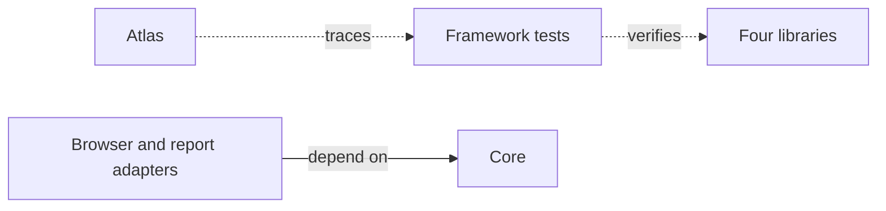
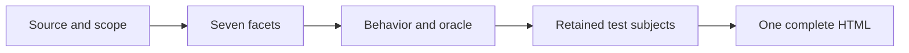
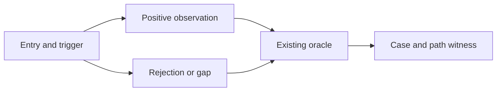

# ATF Atlas

## Overview

Atlas is a documentation and governance area for understanding the behavior
represented by existing tests. Start with the [coverage map](Coverage_Map.md),
then inspect the linked source, oracle and maintained suite before making a
coverage claim.

For another project or language, use the separate
[reusable project intake](../artifacts/atlas/README.md) and its evidence template.
This map remains specific to the ATF framework; generated analysis belongs in
the selected artifact root.

This documentation area owns the [complete report contract](Report_Contract.md), [knowledge base](Knowledge_Base.md) and [dedicated CSS](assets/atlas.css).

- Optional maintenance tools verify and publish the reviewed analysis.
- They do not execute product tests or provide Java runtime services.
- Generated HTML belongs in the selected artifact root.
- The Maven reactor remains the five modules described in [Architecture](../docs/Architecture.md).

## Ownership

The framework documentation owner maintains the map; each capability's source
and test owner remains responsible for its contract and acceptance. The
[governance index](../docs/governance/README.md) routes maintained documents to
their focused test owners and explains their suite registration.



<details>
<summary>Legend: relationships and proof boundary</summary>

Solid arrows are library dependencies. Dotted arrows represent documentation
traceability or test use; Atlas introduces no Maven dependency.

</details>

## Traceability contract

For an application flow, identify the actor, intent, visible action, business
object and observed result. For a framework contract, use its consumer, request,
operation, value/artifact and observed outcome. Link the implementation/support,
positive and meaningful negative checks, suite and remaining boundary.

For example, the existing
[request-executor regression](../atf-tests/src/test/java/com/ai/atf/core/support/base/ApiCoreExecutionArchitectureContractTest.java)
describes a rate-limited response, the recorded delay, a retry and the unchanged
observed final response. Explain that contract and its oracle separately from a
Core dependency arrow. Reading the test does not establish a fresh execution.

The archived English Atlas contract at `main_mcp:docs/prompts/html_EN/atlas/business-test-atlas-reference.html` informs this source-first approach.

- Its dedicated visual rules, collapsible sections, behavior trace and audit boundary are adapted through the current contract.
- Archived runtime entry points and automatic scores remain retired.
- J0's `ATF_Context_Atlas.md` provides the complementary reading pattern: topic, owner, contract, source and caller.

## Complete understanding report

New publication uses renderer 5: one offline business understanding HTML for the
selected project. Purpose, value, capabilities, behavior and boundaries are
explained before implementation detail.

- Sections 01–06 have stable numbers mirrored in navigation; child titles follow the 03.01 and 03.01.01 hierarchy.
- The business projection binds existing claims, owners and positive/negative cases; unknowns stay visible.
- Commands, source paths, digests, raw JSON and execution evidence stay in atlas-audit.json beside the analysis and outside delivery/.
- The HTML contains no hidden technical bundle. It can be read alone; full verification requires its original adjacent audit.
- Canonical styling is embedded, diagrams have legends and tables preserve complete readable text.

The [reader contract](Report_Contract.md#reader-and-audit-responsibilities) defines
audience separation and the retrieval–authoring–audit–render loop. Component
controls reject technical prose leakage, missing cases and numbering drift.
A reviewer still checks meaning.

Historical readers 1–4 and their evidence remain immutable under their captured contract.

## Review breadth and quality axes

New captures declare PROJECT or SELECTED review scope, actual owner units and seven evidence-backed reading facets: purpose, structure, behavior, data, configuration, failure and verification.

- REVIEWED, PARTIAL, UNKNOWN and NOT_APPLICABLE make the remaining reading work visible.
- A file captured for identity is not automatically reviewed.
- The declared architecture, unit owners and existing behavior flows cross-reference each other.



<details>
<summary>Legend: relationships and proof boundary</summary>

Arrows describe review and evidence assembly. They are separate from the runtime
dependency diagram above. A simple project needs no invented modules or tests.
Source-reviewed behavior retains that status; an executed behavior or oracle
requires its exact retained testcase identity, quoted source owner and outcome.

</details>

Optional 1–100 assessments declare the reviewer, scope, rationale, limitations, source claims and retained evidence.

- Project quality and Atlas quality have separate groups and weighted axes.
- The rubric and machine fields belong to the [report contract](Report_Contract.md); current observations and closure evidence belong to [depth feedback](../docs/feedback/Atlas_Depth_And_Assessment.md).
- Neither an automated gate nor a source inventory establishes full semantic understanding or an automatic quality score.

## Behavior cases and negative scope

New renderVersion 5 captures explain existing positive and negative cases with preconditions, triggers, expected observations and exact oracle source fragments.

- Each flow declares an entry, stable edge IDs, contiguous case walks and negative review scope.
- Every outcome has a case witness; all behavior nodes are reachable from entry and can reach an outcome.
- Supported finite loops remain valid.
- Missing or unreviewed negative behavior stays explicit, without inventing a test or guessing semantics from a case name.



<details>
<summary>Legend: relationships and proof boundary</summary>

Arrows show authoring evidence questions, not invented runtime branches.
The [case contract](Report_Contract.md#behavior-cases-and-negative-observations)
owns the fields. Focused graph invariants, metamorphic mutations and publisher
component fixtures improve declared coherence. Human review still checks source
meaning. Findings belong to [behavior feedback](../docs/feedback/Behavior_And_Negative_Cases.md).

</details>

## Verification

Run from an isolated reactor copy, following [Development](../docs/Development.md):

<details>
<summary>Run Verification commands</summary>

```powershell
mvn -B -ntp -pl atf-tests -am "-Dtest=FrameworkArchitectureGovernanceTest,DocumentationGovernanceTest,DocumentationRootGovernanceTest,DocumentationEditionGovernanceTest,LivingPrinciplesGovernanceTest,DocumentationStructureGovernanceTest,FeedbackGovernanceTest,DocumentationPublicationGovernanceTest,DocumentationReadabilityRulesTest" "-Dsurefire.failIfNoSpecifiedTests=false" test
```

</details>

Run the optional Atlas maintenance checks from the reactor root:

```powershell
node --test tools/verify-atlas.test.mjs tools/atlas-report.test.mjs tools/atlas-presentation.test.mjs tools/atlas-knowledge.test.mjs tools/atlas-bundle.test.mjs tools/atlas-execution.test.mjs tools/atlas-understanding.test.mjs tools/atlas-behavior.test.mjs
```

This selection checks the documentation and declared architecture; it does not
execute the application's business journeys. The maintained behavioral commands
and browser preparation belong to [Testing](../docs/Testing.md).

- [Coverage and proof boundaries](Coverage_Map.md)
- [Complete report and constructive failure contract](Report_Contract.md)
- [Cited knowledge and retrieval](Knowledge_Base.md)
- [Code and documentation policy](../docs/governance/Code_And_Documentation_Policy.md)
- [Active feedback and historical evidence](../docs/feedback/README.md)

Keep scores, dated execution counts and delivery receipts out of this map.
Use feedback and external validation evidence for those observations. An absent
or unexecuted application check remains an explicit gap.

Native desktop acceptance checks label pairs, label/node overlaps, unrelated-node
crossings and clipping with actual rendered bounds. Observe every declared graph
at both recorded widths and retain overlapping, repaired and touching-boundary
control receipts. Report missing `edgeLabelPairOverlaps` evidence as NOT_ASSESSED
and rerun the document component gate before publishing.

The primary business map is open on first reading, with actual objects and local object proof. Supporting graphs, legends and score rationale remain collapsed. The [reference profile](Report_Contract.md#business-reference-opening-and-local-proof) preserves authored judgments, reasoned ceilings and partial boundaries.

## Artifact calibration

Fresh project understanding uses `understand` with the four
[source-bound profiles](Report_Contract.md#current-source-bound-authoring-profiles).
Each case explains what its existing oracle compares and why a mismatch matters.

Rendered diagrams need three meaningful nodes and two real relationships; compact
ideas use reasoned text. Dirty source and consumed-library ownership stay visible
as business limits, with exact construction evidence in the adjacent audit.

Compatibility `publish` keeps historical captures at their original assessment.
Neither a valid page nor passing selected components upgrades a dirty capture,
absent producer source or a failed whole-project gate into complete acceptance.

The reader explains business purpose, project architecture and behavior. Architecture views preserve actual relationships using reader capability names; behavior maps stay in closed disclosures with adjacent legends.

- Compare the actual artifact with live implementation owners and project documents.
- Follow delegation to the operation; do not broaden detail masking into a guarantee for all screenshots or messages.
- Keep the observed verdict separate from the expected scenario outcome and expose partial review depth.
- Exercise navigation from closed sections, native screenshots, readability and the identity of selected bytes.

The [contract](Report_Contract.md) defines the schema and limits; the [calibration component](../tools/atlas-calibration.mjs) explains failures and repair routes. Axis ratings remain reasoned review judgments, not test pass rates.

The [diagram governance module](governance/README.md) adapts pinned archive
rules into current components. Current diagrams and tables fit without horizontal
scrolling; every graph has two closed local disclosures for its legend and
source-bound references.

Actual transformed type, geometry and original proof
are inspected together. Wide ideas require meaningful subviews or prose.

Semantic qualification uses distinct facet observations, owned source and independent oracles, with visible remaining limits. Atlas identity stays compact; review date belongs with confidence. See the [semantic contract](Report_Contract.md#semantic-review-and-compact-identity).

For a successive review, preserve the [baseline and each facet decision](Report_Contract.md#partial-facet-refinement), then apply the [archive-adapted graph rules](Report_Contract.md#source-graph-quality-and-archive-adaptation). Promotion counts do not replace evidence or meaning review.

For browser and application observations, use [bounded evidence](Report_Contract.md#bounded-observation-and-application-non-claims): a preview is not the complete body, and a captured image does not certify pixel meaning.

Successive reviews retain earlier evidence and non-claims. [Remaining questions](Report_Contract.md#successive-application-boundaries) explain what local components do not establish; they do not request additional E2E scenarios.
