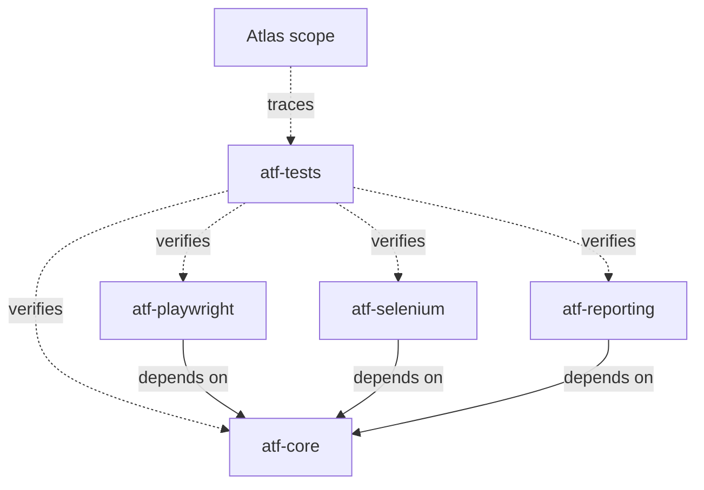
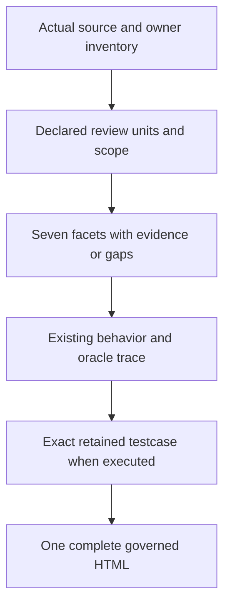
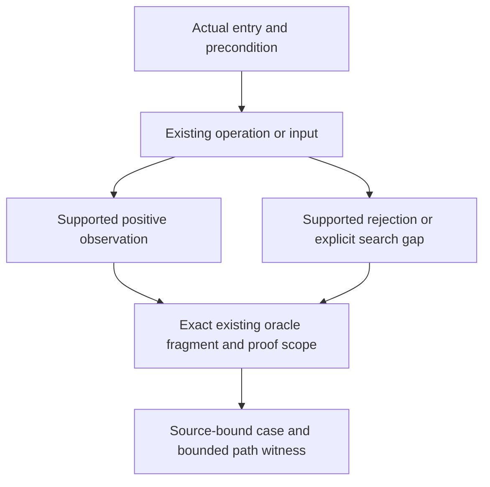

# ATF Atlas

## Overview

Atlas is a documentation and governance area for understanding the behavior
represented by existing tests. Start with the [coverage map](Coverage_Map.md),
then inspect the linked source, oracle and maintained suite before making a
coverage claim.

For another project or language, use the separate
[reusable project intake](../artifacts/atlas/README.md) and its evidence template.
This map remains specific to the ATF framework; generated analysis belongs in
the selected artifact root.

This documentation area owns the [complete report contract](Report_Contract.md),
[knowledge base](Knowledge_Base.md) and [dedicated CSS](assets/atlas.css).
Optional maintenance tools verify and publish the reviewed analysis. They do not
execute product tests or provide Java runtime services. Generated HTML belongs
in the selected artifact root. The Maven reactor remains the five modules
described in [Architecture](../docs/Architecture.md).

## Ownership

The framework documentation owner maintains the map; each capability's source
and test owner remains responsible for its contract and acceptance. The
[governance index](../docs/governance/README.md) routes maintained documents to
their focused test owners and explains their suite registration.



Solid arrows are library dependencies. Dotted arrows represent documentation
traceability or test use; Atlas introduces no Maven dependency.

## Traceability contract

For an application flow, identify the actor, intent, visible action, business
object and observed result. For a framework contract, use its consumer, request,
operation, value/artifact and observed outcome. Link the implementation/support,
positive and meaningful negative checks, suite and remaining boundary.

For example, the existing
[request-executor regression](../atf-tests/src/test/java/com/ai/atf/core/support/base/ApiCoreExecutionArchitectureContractTest.java)
describes a rate-limited response, the recorded delay, a retry and the unchanged
observed final response. Explain that contract and its oracle separately from a
Core dependency arrow. Reading the test does not establish a fresh execution.

The archived English Atlas contract at
`main_mcp:docs/prompts/html_EN/atlas/business-test-atlas-reference.html` informs
this source-first approach. Its dedicated visual rules, collapsible sections,
behavior trace and audit boundary are adapted through the current contract.
Archived runtime entry points and automatic scores remain retired. J0's `ATF_Context_Atlas.md`
provides the complementary reading pattern: topic, owner, contract, source and
caller.

## Complete understanding report

Each invocation, including knowledge-assisted authoring, delivers exactly one
complete understanding HTML for exactly one selected project, in any language or
build system. The reader artifact is `delivery/atlas.html` under a new analysis
run. It includes context, supported existing behavior and oracle or disclosed
oracle gap, claims, source fragments, architecture, governance audit, retrieved
requirements, proof limits and full declared inputs. Markdown, machine manifests,
logs and prior HTML stay outside that reader folder. An extra HTML below delivery/
or a report that combines separate target identities fails the delivery contract.

The canonical stylesheet is maintained separately and embedded into the report
with inline SVG and internal navigation. Copying the HTML alone must preserve
the full document offline. Missing tests, Git metadata or dependency edges remain
explicit, with source scope and limits. Retrieval supplies cited policy to a
source-grounded reviewer; it does not establish execution or semantic completeness.

Version 4 also governs reading structure and measured table balance. Explanations
receive space, dense comparisons scroll locally, long case witnesses become full
vertical records and every declared graph has an adjacent legend. The
[presentation contract](Report_Contract.md#reader-presentation-and-render-review)
separates component checks, native desktop measurements and human visual review.
Historical readers and their captured proof remain immutable.

## Review breadth and quality axes

New captures declare PROJECT or SELECTED review scope, actual owner units and
seven evidence-backed reading facets: purpose, structure, behavior, data,
configuration, failure and verification. REVIEWED, PARTIAL, UNKNOWN and
NOT_APPLICABLE make the remaining reading work visible. A file captured for
identity is not automatically reviewed. The declared architecture, unit owners
and existing behavior flows cross-reference each other.



Arrows describe review and evidence assembly. They are separate from the runtime
dependency diagram above. A simple project needs no invented modules or tests.
Source-reviewed behavior retains that status; an executed behavior or oracle
requires its exact retained testcase identity, quoted source owner and outcome.

Optional 1–100 assessments declare the reviewer, scope, rationale, limitations,
source claims and retained evidence. Project quality and Atlas quality have
separate groups and weighted axes. The rubric and machine fields belong to the
[report contract](Report_Contract.md); current observations and closure evidence
belong to [depth feedback](../docs/feedback/Atlas_Depth_And_Assessment.md).
Neither an automated gate nor a source inventory establishes full semantic
understanding or an automatic quality score.

## Behavior cases and negative scope

New renderVersion 4 captures explain existing positive and negative cases with
preconditions, triggers, expected observations and exact oracle source fragments.
Each flow declares an entry, stable edge IDs, contiguous case walks and negative
review scope. Every outcome has a case witness; all behavior nodes are reachable
from entry and can reach an outcome. Supported finite loops remain valid.
Missing or unreviewed negative behavior stays explicit, without inventing a test
or guessing semantics from a case name.



Arrows show authoring evidence questions, not invented runtime branches.
The [case contract](Report_Contract.md#behavior-cases-and-negative-observations)
owns the fields. Focused graph invariants, metamorphic mutations and publisher
component fixtures improve declared coherence. Human review still checks source
meaning. Findings belong to [behavior feedback](../docs/feedback/Behavior_And_Negative_Cases.md).

## Verification

Run from an isolated reactor copy, following [Development](../docs/Development.md):

<details>
<summary>Run Verification commands</summary>

```powershell
mvn -B -ntp -pl atf-tests -am "-Dtest=FrameworkArchitectureGovernanceTest,DocumentationGovernanceTest,DocumentationRootGovernanceTest,DocumentationEditionGovernanceTest,LivingPrinciplesGovernanceTest,DocumentationStructureGovernanceTest,FeedbackGovernanceTest,DocumentationPublicationGovernanceTest,DocumentationReadabilityRulesTest" "-Dsurefire.failIfNoSpecifiedTests=false" test
```

</details>

Run the optional Atlas maintenance checks from the reactor root:

```powershell
node --test tools/verify-atlas.test.mjs tools/atlas-report.test.mjs tools/atlas-presentation.test.mjs tools/atlas-knowledge.test.mjs tools/atlas-bundle.test.mjs tools/atlas-execution.test.mjs tools/atlas-understanding.test.mjs tools/atlas-behavior.test.mjs
```

This selection checks the documentation and declared architecture; it does not
execute the application's business journeys. The maintained behavioral commands
and browser preparation belong to [Testing](../docs/Testing.md).

- [Coverage and proof boundaries](Coverage_Map.md)
- [Complete report and constructive failure contract](Report_Contract.md)
- [Cited knowledge and retrieval](Knowledge_Base.md)
- [Code and documentation policy](../docs/governance/Code_And_Documentation_Policy.md)
- [Active feedback and historical evidence](../docs/feedback/README.md)

Keep scores, dated execution counts and delivery receipts out of this map.
Use feedback and external validation evidence for those observations. An absent
or unexecuted application check remains an explicit gap.

Native desktop acceptance checks label pairs, label/node overlaps, unrelated-node
crossings and clipping with actual rendered bounds. Observe every declared graph
at both recorded widths and retain overlapping, repaired and touching-boundary
control receipts. Report missing `edgeLabelPairOverlaps` evidence as NOT_ASSESSED
and rerun the document component gate before publishing.
