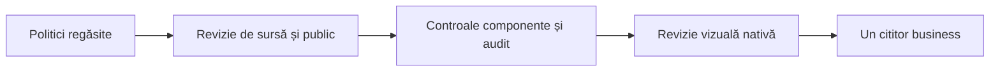
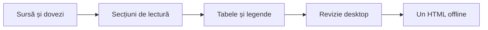

<a id="complete-atlas-report-contract"></a>
# Contractul raportului Atlas complet

<a id="reader-and-audit-responsibilities"></a>
## Responsabilitățile cititorului și auditului

Publicarea nouă folosește renderVersion 5. Livrabilul este un HTML offline de
înțelegere business pentru un singur proiect selectat. Explică scopul, valoarea,
capabilitățile, comportamentele utile, relațiile, încrederea și limitele înaintea implementării.
Cititorul este util fără înregistrările construirii sale.

`ATLAS-READER-001: Publish business understanding in one numbered offline HTML; preserve source, commands, file verification, raw JSON and execution evidence in a separate adjacent audit, never hidden in the reader.`

Publicatorul păstrează pachetul tehnic complet în atlas-audit.json lângă
analysis.json. delivery/ conține doar atlas.html. Cititorul copiat rămâne lizibil;
verificarea completă cere auditul adiacent original și rendererul canonic.
Nu elimina dovezi tehnice, nu reconstrui rezultate trecute și nu suprascrie istoricul.

| Public | Conținut | Limită |
|---|---|---|
| Cititorul proiectului | Scop, valoare, responsabili, comportamente, cazuri negative, încredere și întrebări | Fără comenzi, căi de sursă, amprente, date brute sau pachet ascuns |
| Revizorul sursei | Fragmente exacte, legături cu afirmații, trasee de caz și necunoscute | Analiza originală și dovezile complete rămân în audit |
| Responsabilul mentenanței | Validarea intrărilor, regăsirea politicilor, randarea și diagnosticele | Detaliile construirii nu devin capabilități ale proiectului |

<a id="numbered-reading-structure"></a>
## Structura numerotată de lectură

`ATLAS-READER-002: Use stable ordered section numbers mirrored in navigation, hierarchical child numbers, valid local anchors and adjacent diagram legends; keep concise explanations, meaningful cases and balanced tables.`

Ordinea fixă este 01 scop/valoare, 02 capabilități, 03 comportamente/cazuri,
04 model de funcționare, 05 încredere/domeniu și 06 limite/întrebări. Titlurile copil
urmează părintele, precum 03.01 și 03.01.01. Numerele completează titlurile descriptive;
nu înlocuiesc sensul și nu creează o cotă decorativă de secțiuni.

- Folosește secțiuni native pliabile, cu prezentarea generală deschisă și restul închise inițial.
- Păstrează navigarea locală și stilul încorporat; CSS-ul canonic dedicat rămâne întreținut separat.
- Folosește un model orizontal de lectură legat de dovezi. Legenda explică abstracția, fără a pretinde un graf runtime sau de dependențe exhaustiv.
- Folosește carduri pentru cazuri utile și tabele pentru comparații; păstrează textul complet, lizibil și aliniat sus.
- Randează la 1440 și 900 CSS px în Chromium desktop real, fără emulare de dispozitiv sau URL de aplicație.

<a id="source-bound-business-projection"></a>
## Proiecția business legată de sursă

analysis.reader declară schemaVersion 1, aceeași identitate de proiect, text în
engleză, o dată validă și un revizor semantic cu domeniu/limite explicite.
Proiecția aparține analizei originale; nu este o editare neauditată a paginii.

| Proiecție | Corespondență necesară | Control de eșec |
|---|---|---|
| Valoare și model | Afirmații existente revizuite | Necunoscutele nu pot deveni beneficii certe |
| Capabilități | Fiecare unitate declarată cu responsabil | O capabilitate nu poate împrumuta afirmațiile altui responsabil |
| Fluxuri pentru cititor | Legare explicită la comportamente | Lipsurile sau duplicatele neexplicate sunt respinse |
| Cazuri | Fiecare caz declarat al unui flux pentru cititor | Cazurile pozitive/negative și verificările lipsă rămân vizibile |
| Fluxuri doar tehnice | Clasificare explicită de construire/detaliu, cu motiv | Clasificarea rămâne revizuibilă în audit |
| Limite | Fiecare afirmație UNKNOWN | Nicio informație necertificată nu este omisă tacit |

Câmpurile cititorului resping tipare de implementare și câmpuri tehnice necunoscute.
Aceste controale finite completează revizia; nu certifică fiecare propoziție și nu
inferențiază automat relevanța business. Revizorul verifică sensul dintre afirmații
și explicații, precum și clasificările doar tehnice.

`ATLAS-READER-004: Explain verification and assessment limits in reader language; do not infer a project quality grade from consistency, retrieval or passing checks.`

<a id="governed-authoring-loop"></a>
## Ciclul guvernat de redactare

`ATLAS-READER-003: Retrieve mandatory audience and numbering policy, author the project-specific projection from actual source, preserve negative controls and repairs, verify the adjacent audit, and inspect native rendering before selecting the final reader.`



<details>
<summary>Legendă: responsabilitățile redactării și acceptanței</summary>

- Săgețile descriu secvența reviziei, nu execuția automată a unui model lingvistic.
- Un control component, de proveniență sau de aspect eșuat păstrează dovada originală și revine la responsabil pentru corecție.
- Geometria nativă și legarea sursei sunt semnale delimitate; revizorul verifică sensul, echilibrul și utilitatea explicațiilor.
- Nu se adaugă E2E de aplicație, emulator, serviciu de model lingvistic sau funcționalitate Java runtime.

</details>

Controalele curente de sursă/dovezi, înțelegere și trasee de caz se aplică în
continuare întregului audit. Rendererul 5 adaugă limita publicului, fără să reducă
dovezile. O execuție eșuată rămâne eșuată, un oracol lipsă rămâne lipsă, iar
observațiile din sursă nu devin executate prin prezentare.

<details>
<summary>Câmpuri tehnice pentru redactare și organizarea auditului</summary>

Schema executabilă este în [validatorul cititorului](../tools/atlas-reader.mjs), iar [fixture-ul component](../tools/atlas-reader.test.mjs) arată un proiect generic. Păstrează câmpurile tehnice în analiză, nu în textul cititorului.

| Câmp | Responsabilitate |
|---|---|
| schemaVersion / projectId / language | Versiunea 1, aceeași țintă și text redactat în engleză |
| title / summary / reviewDate | Identitate lizibilă, explicație concisă și dată calendaristică validă |
| review | Revizor, domeniu, limite și claimIds revizuite |
| value | Titlu, explicație și claimIds pentru fiecare beneficiu |
| capabilities | unitId, titlu, beneficiu și afirmații ale responsabilului corect |
| journeys / cases | flowId și fiecare caseId declarat, cu situație, rezultat așteptat și limite |
| auditOnlyFlows | flowId, reason de construire/detaliu și justificare explicită |
| architecture | graphId, titlu și legendă pentru fiecare hartă sursă |
| model | Titlu, etape și legături ordonate, afirmații revizuite și legendă |
| limits | Titlu, explicație și claimIds, inclusiv toate necunoscutele și eșecurile reținute |

analysis.json, source-index.json, documentele originale și dovezile rămân lângă atlas-audit.json. delivery/atlas.html este singurul fișier livrat cititorului. Rularea auditului are nevoie de dosarul complet; lectura offline nu.

</details>

<a id="artifact-audit-and-calibration"></a>
## Auditul și calibrarea artefactului

`ATLAS-CALIBRATION-001: Audit the actual rendered artifact against live source and project documentation; distinguish expected behavior from recorded verdicts, expose partial review, test native navigation, and retain source-bound architecture and behavior diagrams with adjacent legends.`

Atlasul explică scopul business, arhitectura proiectului și comportamentele relevante.
Harta arhitecturii proiectează relațiile reale dintre responsabilii surselor folosind
denumirile capabilităților pentru cititor. Păstrează direcția săgeților și responsabilii
deconectați. Hărțile comportamentale rămân colapsate în traseele lor; cazurile și
încrederea păstrează limitele pozitive, negative, parțiale și necunoscute reale.

| Întrebarea auditului | Comparația efectivă | Calea de reparare |
|---|---|---|
| Povestea corespunde implementării? | Urmărește delegarea până la operație și compară documentele proiectului | Restrânge garanțiile nesusținute; păstrează limitele cunoscute |
| Verificarea corespunde cazului? | Compară verdictul criteriului cu situația vizibilă | Refuzul așteptat poate trece; verificarea eșuată rămâne eșuată |
| Înțelegerea proiectului este completă? | Compară fațetele responsabililor cu profunzimea vizibilă a reviziei | Nu promova PARTIAL sau UNKNOWN deoarece testele trec |
| Cititorul poate ajunge la explicație? | Apasă fiecare legătură locală dintr-o secțiune închisă în Chromium nativ | Țintește conținutul din interiorul secțiunii colapsabile |
| Diagramele ajută înțelegerea? | Inspectează arhitectura, comportamentele, etichetele și legendele efective | Păstrează relațiile sursă; limitează local diagramele late fără micșorarea textului |

[Componenta de calibrare](../tools/atlas-calibration.mjs) leagă observațiile de
HTML-ul efectiv, revizia sursei și identitatea indexului. Cere ambele lățimi,
1440 și 900 CSS px, observații native de tastatură/navigare și comparații motivate
pentru toate cele șase secțiuni. [Controalele sale](../tools/atlas-calibration.test.mjs)
păstrează eșecurile specifice și reparațiile reale; [controalele diagramelor](../tools/atlas-reader-graphs.test.mjs)
protejează așezarea orizontală finită, ciclurile și relațiile originale.

<details>
<summary>Secvența auditului tehnic și limitele dovezii</summary>

1. Recuperează politica obligatorie de public și calibrare înainte de redactare.
2. Verifică sursa capturată și auditul complet față de proiectul live efectiv.
3. Revizuiește sensul față de implementările responsabile și documentele declarate.
4. Randează candidatul exact, verifică navigarea nativă și inspectează capturile.
5. Rulează calibrarea, păstrează artefactul/controlul eșuat și aplică reparația reală.
6. Selectează numai octeții acceptați; schimbarea HTML-ului sau a inventarului cere o nouă revizie.

Cititorii calibrați curenți declară data-atlas-calibration 1 și calibrationProfile 1 în publicare. Structurile istorice de versiune 5 păstrează navigarea/profilul capturat și nu sunt recertificate de noul audit.

Sonda browserului servește verificării documentului și nu este inclusă în cititor.
Declarațiile de comparație cu sursa sunt dovezi redactate, nu atestare semantică
automată. Metadatele nu pot demonstra veridicitatea capturii sau a reviziei umane.
Verificarea sursei, randarea canonică și revizia vizuală/semantică rămân porți distincte.
Notele sunt judecăți redactate cu domeniu explicit, nu rate de teste sau note automate.

</details>

<a id="semantic-review-and-compact-identity"></a>
## Revizia semantică și identitatea compactă

`ATLAS-SEMANTICS-001: Qualify semantic understanding through distinct scoped facet observations, owned implementation fragments and independent existing oracles; preserve remaining boundaries and verify the actual visible facet projection instead of inferring completeness from source inventory or test counts.`

Profilul `SEMANTIC_FACETS_V1` completează cele șapte dimensiuni ale fiecărui
responsabil. REVIEWED înseamnă că domeniul declarat al fațetei a fost investigat;
proiectul poate rămâne SELECTED. Nu transforma inventarul complet în înțelegere
exhaustivă și nu promova toate fațetele deoarece o selecție de teste trece.

| Înregistrare | Dovadă cerută | Limită păstrată |
|---|---|---|
| Explicație distinctă | Observație specifică dimensiunii | Fără text generic repetat pentru toate rolurile |
| Domeniu revizuit | Fragmente reale din implementarea responsabilă | Urmărește delegarea până la operația relevantă |
| Criteriu independent | Fragmente distincte ale verificării existente | Implementarea nu poate fi propriul criteriu |
| Criteriu executat | Identitatea originală a testului și fragmentul exact | Fără deducerea execuției din potrivirea sursei |
| Limite rămase | Întrebări specifice vizibile lângă capabilitate | Păstrează PARTIAL unde revizia este incompletă |

Scopul și structura pot folosi declarații reale. Promovarea comportamentului,
informațiilor, configurației, eșecului sau verificării cere și un criteriu existent
independent. Selecțiile trebuie să aparțină unității și fațetei; fragmentele
implementării și criteriului nu se pot suprapune. Clasificarea sensului rămâne o
responsabilitate explicită a revizorului.

Cititorul derivă explicațiile și limitele business din fațetele revizuite, în
secțiuni colapsabile. Metadatele și referințele tehnice rămân în audit. Sondele
native compară starea, explicația și limita vizibilă cu sursa calificată.

`ATLAS-IDENTITY-001: Use one compact Atlas and project-title line without a redundant language badge; retain review date with confidence, preserve readable text and measure the actual rendered header at both desktop widths.`

Antetul folosește o singură linie de identitate, cu font între 16 și 24 CSS px,
înălțime de cel mult 96 CSS px și margine superioară de cel mult 24 CSS px.
Textul nu este ascuns sau tăiat. Limba rămâne metadată semantică; data reviziei
apare la încredere. Limitele sunt verificate în randare la 1440 și 900 CSS px.

<details>
<summary>Responsabili și verificări ale calificării semantice</summary>

- [Componenta semantică](../tools/atlas-semantics.mjs) și [controalele sale](../tools/atlas-semantics.test.mjs) verifică promovările și reparațiile.
- [Legarea execuției](../tools/atlas-execution.mjs) păstrează testele originale inclusiv pentru criteriile fațetelor.
- [Calibrarea nativă](../tools/atlas-calibration.mjs) compară proiecția efectivă și geometria identității.
- Revizuiește relațiile dintre date, inițializarea, efectele secundare, cache-ul și căile de eșec; nu extinde un criteriu îngust într-o garanție generală.
- Un profil istoric fără dosar semantic rămâne necalificat semantic, chiar dacă structura sa HTML este validă.

</details>

<a id="partial-facet-refinement"></a>
## Aprofundarea fațetelor parțiale

`ATLAS-REFINEMENT-001: Compare every original partial facet with the preserved baseline audit, retain its original scope and limits, record the investigated question and decision, and require additional owned implementation and independent oracle fragments before promotion; scope deletion or recycled receipts cannot count as progress.`

Profilul păstrează dosarul anterior ca document verificat separat. Revizia
compară toate cele șapte dimensiuni ale fiecărei unități, apoi cere o decizie
pentru fiecare fațetă anterior PARTIAL. Nu ascunde întrebările dificile prin
eliminarea unor rânduri sau schimbarea limitelor inițiale.

| Intrare | Decizie cerută | Limită păstrată |
|---|---|---|
| Domeniul anterior | Întrebare concretă și observație nouă | Domeniul inițial rămâne inclus |
| Fragmente suplimentare | Implementare responsabilă; criteriu independent pentru promovare | O dovadă veche repetată nu înseamnă progres |
| Configurație | Valoare, momentul aplicării și alegerile observate | Comanda SDK nu certifică pixelii sau toate sistemele |
| Date | Origine, transformare, rezultat și refuz | Separă totalurile derivate de câmpurile furnizate manual |
| Verdict | REVIEWED delimitat sau PARTIAL explicat | Nicio acceptanță externă dedusă |

Înțelegerea unei limite nu repară automat implementarea. Păstrează lipsa
curățării datelor aplicației și necunoscutele vizuale ori de mediu acolo unde
nu există dovezi independente suficiente.

<a id="source-graph-quality-and-archive-adaptation"></a>
## Calitatea diagramelor și adaptarea arhivei

`ATLAS-DIAGRAM-001: Recover the archived shared visual grammar through source-specific readable nodes, complete relationship labels and arrowheads, horizontal dependency direction, compact supporting graphs, closed local bullet legends and honest boundary cues; compare the actual native graph with source endpoints and reject overlaps, clipping, missing cues and generic label substitution.`

Arhiva oferă principii, iar proiectul analizat stabilește sensul. Profilul
SOURCE_GRAPH_V1 păstrează fiecare relație și eticheta integrală. Explicațiile
lungi merg în legendă; textul nu este micșorat sau înlocuit cu „observe”.

| Principiu din main_mcp | Aplicare curentă | Adaptare necesară |
|---|---|---|
| Primitive și CSS comune | Aceeași scară pentru casete, text și săgeți | Un singur HTML cu stil încorporat |
| Actor, intenție, obiect, rezultat | Noduri și condiții specifice sursei | Pentru un framework, valoarea sa proprie este subiectul |
| Ierarhie și frontieră vizibile | Operație evidențiată; limită diferențiată prin contur | Un refuz observat nu devine automat o frontieră viitoare |
| Legende locale structurate | Liste concise, colapsate, imediat sub graf | Fără repetarea poveștii în casete |
| Traseu către dovezi | Referințe exacte în auditul adiacent | Comenzile și sursele brute rămân în afara HTML-ului |

Diagramele de dependențe arată consumatorul către furnizor; poziția nu promite
ordine de execuție. Ciclurile și relațiile lungi primesc trasee separate. Harta
de lectură rămâne distinctă de arhitectură și de comportamentele cu ramuri.

<details>
<summary>Verificări de componentă și randare</summary>

- [Componenta grafică](../tools/atlas-reader-graphs.mjs) păstrează identitățile, sensul și etichetele, inclusiv ciclurile.
- [Controalele](../tools/atlas-reader-graphs.test.mjs) refuză nodurile șablon și etichetele generice; textul lung este păstrat sau refuzat explicit.
- [Calibrarea nativă](../tools/atlas-calibration.mjs) compară textul efectiv și capetele relațiilor, verifică săgețile, contururile și suprapunerile.
- Capturile la 1440 și 900 px păstrează semnătura HTML-ului, a auditului și a sursei. O captură veche sau metadate verzi nu certifică aspectul curent.
- Cerințele istorice pentru eticheta de limbă, detalii tehnice interne și comenzi interactive nu înlocuiesc cerințele curente ale cititorului.

</details>

<a id="historical-contract-and-retained-provenance"></a>
## Contract istoric și proveniență păstrată

Contractul de mai jos descrie rendererele 1–4 și păstrează extrasele arhivate exacte.
Regula sa despre intrări complete în HTML este înlocuită pentru publicarea nouă de
separarea cititor/audit de mai sus. HTML-ul istoric este imuabil; validarea folosește
politica și stilul capturate pentru acel cititor istoric.

<details>
<summary>Renderere istorice 1–4: cititor tehnic și audit încorporat</summary>


Extrasele canonice pentru regăsire apar ca literali tehnici inline. Păstrează textul
lor englezesc exact în fiecare ediție a documentației; traduce explicațiile din jur
păstrând cerința citată și limitele dovezii.

<a id="reader-presentation-and-render-review"></a>
## Prezentarea pentru cititor și verificarea randării

ATLAS-REPORT-005: publicările noi folosesc renderVersion 4. Prezentarea urmează
aceleași principii de lectură ca documentația menținută. Explică scopul și limitele
înaintea detaliilor; folosește liste pentru observații paralele, tabele pentru
comparații și diagrame pentru relații susținute. Nu adăuga diagrame decorative sau cote.



<details>
<summary>Legendă: relații și limita dovezii</summary>

Săgețile descriu revizia publicării, nu comportamentul aplicației. Identitățile
surselor și execuțiilor originale rămân neschimbate de o actualizare a prezentării.

</details>

| Element pentru cititor | Prezentare cerută | Limita verificării |
|---|---|---|
| Explicație | Paragrafe logice reunite și ierarhie relevantă a titlurilor | Blocuri Markdown acceptate; textul original complet rămâne încorporat |
| Observații paralele | Liste semantice, fără marcatori afișați literal în paragrafe | Controale de componentă pentru blocuri și inspecția intrărilor generate |
| Comparație | Coloane adaptate conținutului, aliniere sus, identificatori împărțiți și text complet | Geometria nativă a celulelor la lățimile desktop declarate |
| Dovadă lungă de caz | Fișă verticală cu fiecare câmp original | Observația așteptată independentă, aserțiunea și limitele rămân vizibile |
| Diagramă | Legendă alăturată pentru casete, săgeți, domeniul dovezii și omisiuni | Săgețile de dependență și tranzițiile comportamentale păstrează sensuri distincte |
| Tabel dens | Derulare locală denumită, accesibilă prin tastatură | Fără depășirea documentului, decupare, puncte de suspensie sau micșorarea forțată a textului |

[Controalele de prezentare](../tools/atlas-presentation.test.mjs) verifică situații
negative, remediate și valide. Alocarea coloanelor rezervă prozei cel puțin 300
CSS px înaintea extinderii proporționale; metricile și identificatorii au influență
limitată. Un identificator lung nu poate ocupa spațiul coloanei explicative. Aceste
euristici sprijină lectura; nu demonstrează adevărul semantic sau un design perfect.

Sonda nativă măsoară lățimea vizibilă a celulei, numărul de linii, fontul și
decuparea. Semnalează proza lungă sub 180 CSS px cu cel puțin șase linii când
o celulă alăturată cu cel mult trei linii primește peste 1.8 ori lățimea ei. Respinge și depășirea
documentului, textul ascuns în celule, fontul sub 13 CSS px și derularea inaccesibilă.
Revizuiește eșecurile măsurate cu ATLAS-PRESENTATION, contractul responsabil și
indicația de remediere. Păstrează conținutul când repari lățimile sau alegi fișe de caz.

Randează la 1440 și 900 CSS px în Chromium desktop real, fără emulare de dispozitiv
sau URL de produs. Extinde secțiunile revizuite; inspectează diagramele, legendele,
tabelele, secțiunile pliabile, navigarea și resursele offline. Păstrează metricile,
capturile, identitatea stilului și controalele negative urmate de remediere. Un
rezultat automat reușit este un semnal limitat; revizorul verifică în continuare
ordinea lecturii, echilibrul și relevanța sensului.

Rendererul Markdown acceptă titluri, paragrafe reunite, liste simple, tabele
comparative, blocuri de cod delimitate și secțiuni native închise. Legăturile și
HTML-ul redactat rămân text inert. Blocurile Mermaid păstrează sursa completă cu
o notă explicită; grafurile declarate ale analizei furnizează SVG inline. Listele
imbricate și extensiile arbitrare Markdown/HTML nu reprezintă un contract complet
de parsare. Verifică sensul lor în intrările originale complete înaintea aprobării.

Istoricul renderVersion 1–3 rămâne acceptat cu randarea și stilul încorporat
originale. Păstrează cititorii originali imuabili. Un cititor nou cu versiunea 4
poate actualiza prezentarea unei capturi existente numai când fiecare câmp al
pachetului, cu excepția renderVersion, rămâne neschimbat; nu este o nouă revizie
a surselor sau execuție. Diferența exactă LF/CRLF în sursa de cunoștințe păstrează
hash-ul brut original și trebuie să corespundă conținutului canonic normalizat;
alte diferențe de octeți eșuează.

<a id="purpose-and-ownership"></a>
## Scop și responsabilitate

ATLAS-REPORT-001 se aplică redactării Atlas obișnuite și asistate de cunoștințe.
Fiecare invocare publică exact un HTML complet de înțelegere pentru exact un proiect selectat:
`Each invocation publishes exactly one complete understanding HTML for exactly one selected project.`
Proiectul poate folosi orice limbă sau sistem de construire și poate să nu aibă teste sau Git:
`The selected project may use any language or build system, or have no tests or Git metadata.`
Directorul cititorului este `delivery/` sub noua rulare de analiză.

- Singurul său HTML este `delivery/atlas.html`, numărând toți descendenții.
- Combinarea identităților unor ținte separate, precum AI și J1, sau adăugarea unui
  alt HTML în acel director încalcă contractul livrării.
- Selectează explicit un monorepo și domeniul său când monorepo-ul este ținta;
  nu importa fapte dintr-un proiect fără legătură.

Directorul livrării conține exact un fișier obișnuit: atlas.html. Contractul este
pentru un singur fișier, deci respinge și fișiere auxiliare non-HTML, fișiere imbricate
și legături simbolice. Intrările sursă, de analiză, execuție și revizuire a randării
rămân în afara delivery/, în locația declarată a analizei sau artefactelor.

Documentul trebuie să rămână lizibil offline când este copiat singur. CSS-ul canonic
este [atlas.css](assets/atlas.css); publicatorul încorporează octeții canonici UTF-8 LF,
normalizând o singură dată CRLF fără schimbarea conținutului. Markdown-ul, indexurile
sursei și artefactele execuției rămân intrări auditabile, nu dependențe necesare
navigării cititorului, și rămân în afara `delivery/`. Responsabilul documentației Atlas
menține contractul; responsabilii proiectului selectat rămân autoritatea pentru comportament.

Atlasul arhivat distingea un atlas comportamental de un inventar de clase.
Pentru un framework, subiecții sunt cereri, observații, contracte și rezultate ale
ciclului de viață. Pentru un consumator, sunt obiecte de domeniu și operații observate
ale aplicației. O săgeată de dependență Maven nu poate înlocui o tranziție
comportamentală. Sursa și criteriile existente de test sunt punctul de plecare;
această activitate nu adaugă scenarii de produs/E2E.

<a id="required-complete-sections"></a>
## Secțiuni complete obligatorii

| ID secțiune | Informații obligatorii |
|---|---|
| context | Țintă, revizie, stare modificată, domeniu, stare a dovezii și limitele revizuirii |
| behavior | Graful comportamentului existent, actor, intenție, obiect, rezultat și criteriu de verificare |
| evidence | Fiecare afirmație, stare, verificare mapată și referință de execuție |
| trace | Fragmente exacte de sursă și guvernanță, căi și intervale de linii |
| architecture | Limite declarate ale modulelor și graf de dependențe separat de comportament |
| audit | Rezultate reale, numărători, comenzi și identitățile sursei executate |
| knowledge | Cerințe regăsite, politică obligatorie, proveniență și digest-ul cunoștințelor |
| limits | Necunoscute, dovezi contrare, constatări și responsabilități |
| documents | Documentele Markdown declarate complete, fără trunchiere |
| provenance | Indexul complet al sursei, contractul analizei și corpurile originale XML/TAP/proveniență |

ATLAS-REPORT-002: HTML-ul final conține fiecare secțiune de mai sus și intrările
complete declarate ale analizei. Un index care deschide mai multe pagini HTML nu
este artefactul final de înțelegere. Documentele intermediare și rapoartele anterioare
rămân istoric de audit în afara directorului livrării cititorului.

Secțiunile folosesc pliere nativă details/summary și navigare prin fragmente interne.
Prezentarea rămâne deschisă; cititorii pot extinde alte secțiuni fără JavaScript.
Diagramele sunt SVG inline generate din noduri și muchii declarate. Nu este necesar
vreun fișier auxiliar de stil, font, imagine, script, iframe, fetch, import sau navigare.
Căile externe brute ale sursei sunt afișate ca text cu identitatea lor, nu ca legături
inventate. Documentul final și codul/comentariile sunt în engleză, conform citatului:
`The final document is English; code and comments remain English.`

<a id="source-evidence-and-behavior"></a>
## Sursă, dovezi și comportament

[Protocolul de intrare](../artifacts/atlas/README.md) și verificările exacte ale
sursei/citatelor/dovezilor se aplică în continuare. Raportul complet încorporează
starea capturată și distinge explicit revizuirea sursei de execuție. Guvernanța
înrudită nu acoperă complet fiecare propoziție. Verificările nesusținute rămân
NOT_MAPPED. Execuția păstrată eșuată rămâne FAILED chiar dacă verificarea consistenței
trece: `execution stays FAILED even if consistency verification passes.` Modificările
ulterioare cer o captură nouă; raportul consemnează identitatea originală a sursei.

Contractul analizei păstrează schemaVersion 1 și oferă behaviorFlows și
dependencyGraphs.

| Declarație | Câmpuri obligatorii și sens |
|---|---|
| Comportament | id, title, actor, intent, object, operation, outcome, testOracle, oracleStatus, oracleClaimId, limits, claimIds și graph |
| Criteriu observat | oracleStatus este SOURCE_REVIEWED sau EXECUTED; oracleClaimId identifică o afirmație separată dintr-un test existent real |
| Criteriu absent | oracleStatus NOT_FOUND, afirmație de oracol UNKNOWN; testOracle declară domeniul căutat și lacuna, fără execuție inventată |
| Graf comportamental | kind BEHAVIOR; noduri cu id/label/x/y/kind și muchii cu from/to/label/claimId |
| Graf de dependențe | id, title, kind DEPENDENCY, aceleași câmpuri declarate pentru noduri/muchii; tipuri de nod MODULE, COMPONENT, SERVICE sau BOUNDARY |

Coordonatele aranjării sunt date de prezentare, nu observații de execuție.

Fiecare afirmație de muchie și flux se rezolvă la o afirmație de analiză SOURCE_REVIEWED
sau EXECUTED; afirmațiile sursei și criteriilor includ fragmente exacte. Revizorul
verifică corespondența semantică. Instrumentele verifică identitatea și structura
declarate, fără a putea deduce adevărul prozei din potrivirea cuvintelor:
`identity and structure; it cannot infer that prose is true from matching words.`

- Harta unei singure componente poate avea un nod și zero muchii când limitarea
  explică absența dependențelor declarate.
- Un graf comportamental poate avea o stare susținută și nicio tranziție când
  graph.limits explică domeniul inspectat.
- Raportează lacunele declarate fără a inventa pași. Testele, metadatele Git sau
  declarațiile de construire absente nu autorizează copierea valorilor implicite ale altui proiect.

O listă opțională sourceDocuments selectează documente complete menținute prin căi
relative la țintă. Fiecare document selectat este legat de indexul sursei și
încorporat fără trunchiere. Include README-ul real de intrare, arhitectura, testarea
și responsabilii relevanți de contract/utilizare când aparțin domeniului cerut.
Pentru ATF_AI, arhitectura vie esențială poate fi inclusă din sursa menținută.
Nu înlocui cu documentația altui proiect și nu trata un document nerevizuit ca dovadă de execuție.

Nu se deduce vreun scor din verificări trecute: `No score is inferred from passing checks.`
Dacă nu sunt furnizate o rubrică și o evaluare, afișează NOT_ASSESSED.
Scorurile feedback-ului își păstrează domeniul declarat.

<a id="knowledge-and-archived-provenance"></a>
## Cunoștințe și proveniență arhivată

[Baza de cunoștințe](Knowledge_Base.md) adaptează cerințe Atlas arhivate utile în
înregistrări citate și testabile. Main rămâne fără registre și servicii de execuție
retrase. Identitatea canonică a arhivei este `70a7279c2a9560d39e6bd2554cd2f96a88626692`.
Blob-ul CSS comun vechi este
`d9a1ec153b4f9b7231fc25c37494e01ded8089788c775450728f843ae405cb1c`.
Resursa sursă păstrează regulile vizuale și adaugă aranjarea documentului revizuită.
Legătura CSS externă veche devine CSS inline canonic pentru a respecta livrarea
într-un singur fișier. Valoarea implicită veche a limbii devine engleza canonică.

<a id="verification-and-constructive-failure"></a>
## Verificare și eșec constructiv

[Publicatorul](../tools/atlas-report.mjs) opțional folosește modulele Node incluse.
Verifică dovezile sursei înainte de randare, escapează conținutul redactat și
încorporează pachetul mașină complet. Randarea deterministă repetată detectează
rezultate schimbate, secțiuni absente, resurse externe și divergență CSS. Controlul
livrării respinge un HTML suplimentar oriunde sub delivery/, iar identitatea
încorporată trebuie să corespundă singurei ținte selectate. Generatorul nu execută
teste de produs sau un model de limbaj. Testele dedicate includ coruperi intenționate
ale sursei, dovezilor, cunoștințelor, grafului și prezentării.

```powershell
node --test tools/verify-atlas.test.mjs tools/atlas-report.test.mjs tools/atlas-presentation.test.mjs tools/atlas-knowledge.test.mjs tools/atlas-bundle.test.mjs tools/atlas-execution.test.mjs tools/atlas-understanding.test.mjs tools/atlas-behavior.test.mjs
```

După pregătirea unei analize legate de sursă de către revizor, publică din rădăcina
reactorului folosind rădăcinile selectate ale sursei, analizei și artefactelor:

```powershell
$targetRoot = (Resolve-Path -LiteralPath $env:ATLAS_SOURCE_ROOT -ErrorAction Stop).Path
$analysisRoot = (Resolve-Path -LiteralPath $env:ATLAS_ANALYSIS_ROOT -ErrorAction Stop).Path
$artifactRoot = (Resolve-Path -LiteralPath $env:ATF_ARTIFACT_ROOT -ErrorAction Stop).Path
node tools/atlas-report.mjs publish --source "$targetRoot" --analysis "$analysisRoot" --artifacts "$artifactRoot"
```

Folosește un director nou de rulare pentru o captură nouă. Publicarea scrie o singură
dată; repararea rezultatului cititorului înseamnă regenerare din intrări revizuite,
nu suprascrierea unui raport istoric imuabil. Rezultatul este `delivery/atlas.html`
pentru țintă. Comanda understand este alias pentru publish, cu același contract
al intrărilor și rezultatului. Consumă intrările revizuite față de sursă, regăsește
cunoștințele obligatorii și emite documentul complet; nu deduce un model al proiectului
prin invocarea unui model de limbaj. Revizorul pregătește intrările față de sursa selectată.

Eșecurile păstrează ID stabil al regulii, dovezi observate, sens, indiciu de remediere,
responsabil canonic și comandă de reverificare. Eșecurile necunoscute rămân neclasificate.
Indiciile sunt investigații, nu dovezi că o cauză propusă este stabilită. Folosește
o copie izolată a reactorului pentru guvernanța Java existentă, conform
[Dezvoltare](../docs/Development.md). Randează rapoarte vechi și noi în Chromium desktop
real și inspectează diagramele, plierea, depășirile, navigarea și resursele offline.
Păstrează observațiile eșuate și rerulările reușite în zona selectată a artefactelor.

<a id="declared-understanding-breadth"></a>
## Amploarea declarată a înțelegerii

ATLAS-REPORT-003: capturile renderVersion 2 sau ulterioare păstrează analysis
schemaVersion 1. Necesită analysis.understanding cu schemaVersion 1. Artefactele
renderVersion 1 vechi rămân înregistrări istorice ale contractului original; păstrează
generatorul fixat și octeții originali fără a le actualiza tacit sensul sau a suprascrie livrarea.

Un inventar complet al sursei nu declară o înțelegere semantică completă:
`A full source inventory is not a declaration of complete semantic understanding.`
Obiectul understanding declară scope PROJECT sau SELECTED, scopeStatement nevid,
inventoryClaimIds și units. Afirmațiile inventarului se rezolvă la declarații
revizuite reale de construire, împachetare, intrare sau responsabilitate. PROJECT
înseamnă acordul inventarelor declarate de arhitectură și unități de revizuire;
nu înseamnă că fiecare linie indexată a fost înțeleasă sau testată. SELECTED declară
clar zona inspectată și excluderile. Un flux mic selectat este valid când domeniul
este clar. Nu cere componente inventate sau un număr minim de fluxuri unui proiect simplu.

Fiecare unitate declară id, label, kind MODULE/COMPONENT/SERVICE/BOUNDARY, scopePaths,
claimIds, sharedClaimIds, flowIds, facets și limits. scopePaths sunt fișiere sau
directoare normalizate relative la țintă care conțin surse indexate reale. claimIds
proprii necesită referințe sursă în acea unitate. sharedClaimId este o referință
explicită revizuită între responsabili; nu transferă responsabilitatea sursei.

Fiecare unitate de înțelegere declară toate cele șapte fațete: purpose, structure, behavior, data, configuration, failure și verification.

| Fațetă | Întrebarea cititorului |
|---|---|
| purpose | Ce responsabilitate are acest proprietar și cine îl folosește? |
| structure | Ce puncte de intrare, limite și dependențe o implementează? |
| behavior | Ce operație existentă schimbă sau observă ce obiect? |
| data | Ce valori, scheme, stare și artefacte trec prin ea? |
| configuration | Ce valori implicite, proprietăți și selecții reale o controlează? |
| failure | Ce erori, limite, reîncercări, întreruperi și curățare sunt acceptate? |
| verification | Ce aserțiuni existente sau revizuiri ale sursei susțin afirmația? |

Fiecare fațetă declară status REVIEWED, PARTIAL, UNKNOWN sau NOT_APPLICABLE,
claimIds și o explicație. REVIEWED și PARTIAL cer afirmații susținute din setul
propriu/comun al unității, inclusiv cel puțin o afirmație proprie per fațetă, cu
excepția verification, care poate folosi criterii comune explicite. Un set propriu
gol nu poate promova dovada altei unități la înțelegere revizuită. O fațetă behavior
REVIEWED cere un flux existent trasat. Explică inspecția parțială, observația absentă
sau inaplicabilitatea fără a fabrica un test sau a respinge toate fațetele ca inaplicabile.

Nodurile dependențelor declară unitId. Fluxurile comportamentale declară unitIds,
iar flowIds ale fiecărei unități declară asocierea inversă. Legăturile trebuie să
corespundă în ambele direcții. O captură PROJECT reprezintă fiecare unitate declarată
în grafurile arhitecturii. Tipurile grafurilor sunt exact BEHAVIOR și DEPENDENCY la
responsabilii corespunzători. Fiecare afirmație de muchie comportamentală aparține
claimIds ale fluxului; găsirea altei afirmații revizuite în raport este insuficientă.
Revizorii verifică în continuare dacă sursa exactă susține tranziția declarată.

<a id="exact-execution-subjects"></a>
## Subiecți exacți ai execuției

O afirmație de comportament sau criteriu executat cere executionSubjects legați de
identitățile și rezultatele cazurilor păstrate:
`An executed behavior or oracle claim requires executionSubjects bound to retained testcase identities and outcomes.`

Fiecare subiect al execuției declară evidenceId, testClass, testName și sourcePath.

- evidenceId aparține evidenceIds ale afirmației, iar sourcePath este deja citat
  de acea afirmație. Fiecare ID de dovadă a execuției referit are cel puțin un subiect.
- Subiecții XML corespund exact classname/name; lipsa classname înseamnă testClass
  șir gol. TAP Node plat corespunde testName exact cu testClass gol/omis.
- Cazul apare exact o dată, cu rezultat executat PASSED sau FAILED. Subiecții duplicați,
  absenți, ambigui, omiși și TODO eșuează.
- Decodează local entitățile XML predefinite/numerice; interzice rezolvarea entităților
  externe și declarațiile reale de tip de document/entități XML.
- Numai copiii testcase reali pe o cale validă de suită stabilesc identități XML.
  Instrucțiunile, comentariile, CDATA și textul containerelor de ieșire nu pot inventa
  cazuri sau eșecuri; structura/entitățile/caracterele malformate păstrează diagnosticul dovezii.
- Un doctype HTML observat în CDATA/ieșire inertă rămâne conținut valid.

Rezultatele originale ale subiecților selectați determină verdictul afirmației.
Un eșec al suitei în afara cazurilor selectate nu poate înlocui eșecul unui criteriu,
iar un rezumat trecut nu poate șterge un caz selectat eșuat. Verificările existente
ale numărătorilor rulării complete, țintei și manifestului sursă se aplică în continuare.
Un PASS selectat într-o suită mixtă rămâne PASSED, în timp ce starea întregii suite
a dovezii rămâne FAILED. Prezența unui fișier sursă într-o rulare trecută nu stabilește
că a fost executat criteriul său.

O afirmație executată despre un grup de mentenanță își poate păstra domeniul explicit
al selecției fără subiecți comportamentali când niciun comportament nu o referă.
Comportamentul revizuit în sursă și lacunele NOT_FOUND nu cer rulări inventate.
Legarea subiecților demonstrează identitatea și rezultatul păstrate; sensul de la
sursă la aserțiune necesită în continuare revizuire umană. Aceasta este guvernanță
de mentenanță, fără scenariu nou de produs/E2E.

Pentru un criteriu EXECUTED de caz renderVersion 3 sau ulterior, sourceRefIndices selectează
suplimentar intrările exacte cu indexare de la zero din sourceRefs ale afirmației
criteriului. Fiecare intrare selectată trebuie să corespundă sourcePath al subiectului,
iar subiecții păstrați împreună trebuie să acopere fiecare oracleRefIndices selectat
de caz. Indicii nu sunt numere de linii; referințele selectate au deja startLine,
endLine și quote exacte. Consultă [forma copiabilă a subiectului](../artifacts/atlas/Project_Map_Template.md#declared-breadth-record).

<a id="evidence-bound-review-axes"></a>
## Axe de revizuire susținute de dovezi

Evaluarea este o revizuire redactată cu domeniu delimitat, nu o rată de trecere sau scor automat:
`An assessment is a scoped authored review, not a test pass rate or an automatic score.`

analysis.assessment este opțional. Fără acesta, raportul rămâne NOT_ASSESSED.
Când este furnizat, method este EVIDENCE_BOUND_REVIEW, iar reviewer, scope, limits
și groups sunt explicite. Fiecare grup declară id unic, label, scope, limits și
axes. Separă calitatea proiectului și calitatea Atlas în grupuri diferite: un
publicator puternic nu poate certifica execuția proiectului selectat sau testele sale neexecutate.

Fiecare axă declară id unic, label, correctness, verification, clarity, score,
weight, claimIds, evidenceIds, reason și limits.

- Intrările numerice, score și weight sunt întregi de la 1 la 100.
- score este suma rotunjită a 0.40 × correctness, 0.30 × verification și
  0.30 × clarity.
- Ponderile axelor însumează 100 în fiecare grup. Scorul declarat trebuie să
  corespundă mediei ponderate rotunjite.
- Fiecare axă citează afirmații revizuite existente. Referințele de execuție se
  rezolvă la dovezi păstrate și mențin rezultatul și vechimea reale.
- evidenceIds poate fi gol când nicio execuție nu susține judecata delimitată.

Axe potrivite proiectului includ corectitudinea contractelor, calitatea testelor
existente, guvernanța, mentenanța/responsabilitățile, documentația și portabilitatea
configurației. Axe Atlas potrivite includ amploarea sursei, trasarea comportamentului/
criteriului, integritatea dovezilor, trasarea cunoștințelor, claritatea cititorului și
limitele declarate. Explică motivul fiecărui scor și incertitudinea sa. Scorurile nu
implică încredere statistică, acoperirea codului sau completitudine semantică automată.
Prioritatea și calitatea feedback-ului rămân judecăți separate, sub propria rubrică publicată.

<a id="complete-retrieval-receipt"></a>
## Dovada completă a regăsirii

Redactarea asistată de cunoștințe păstrează dovada canonică completă a regăsirii,
inclusiv parametrii interogării, ID-urile selectate și obligatorii, înregistrările
opționale, clasarea, citările, identitatea corpusului și proveniența sursei.
Recalcularea numai a digest-ului corpusului sau verificarea înregistrărilor obligatorii
nu poate valida o cerință opțională editată. Păstrează octeții canonici compleți ai
sursei cunoștințelor în pachetul complet. Politica regăsită oferă context de redactare;
nu poate stabili un fapt sau rezultat executat pentru altă țintă. Controalele negative
noi trebuie să păstreze indicii utile de remediere și să demonstreze regula intenționată
înainte de închiderea feedback-ului.

<a id="behavior-cases-and-negative-observations"></a>
## Cazuri comportamentale și observații negative

ATLAS-REPORT-004: capturile publice noi folosesc renderVersion 4. Fiecare flux
comportamental declară caseAnalysis schemaVersion 1. Capturile renderVersion 1/2
anterioare păstrează octeții originali, generatorul fixat și limitele dovezii;
nu sunt certificate retroactiv sub acest contract al cazurilor.

Fiecare rezultat comportamental declarat are un martor de caz legat de sursă, accesibil din intrare:
`Every declared behavior outcome has a source-bound case witness reachable from its entry.`

- caseAnalysis declară entryNodeId, pathScope, negativeScope și cases. Muchiile
  comportamentale au id-uri stabile unice plus from, to, label și claimId.
- entryNodeId selectează orice nod valid INTENT, ACTION, DECISION, STATE sau OUTCOME.
  Actor și intent aparțin fluxului; nu inventa un nod de intenție când operația
  observată începe la o acțiune sau stare.
- Un singur OUTCOME delimitat este valid cu o lacună explicită a criteriului.
  Fiecare nod comportamental este accesibil din intrare și poate ajunge la un OUTCOME.
- Observațiile inaccesibile, operațiile deconectate și ciclurile captive eșuează.
  Grafurile dependențelor rămân separate; modulele neconectate nu cer o intrare comună inventată.

pathScope este REPRESENTATIVE sau ALL_DECLARED_EDGES. REPRESENTATIVE declară
cazuri existente selectate și limitele rămase. ALL_DECLARED_EDGES cere căilor să
acopere setul declarat de muchii. Nu stabilește fiecare ramură a implementării,
fiecare combinație de intrări sau fiecare planificare a buclelor. Parcursurile finite
pot revizita noduri, inclusiv bucle comportamentale către sine acceptate cu martor
finit și ieșire spre rezultat. Aceste bucle au un traseu vizibil în diagramă;
buclele dependențelor către sine rămân invalide. Traversarea este delimitată de graf;
validatorul nu enumeră toate planificările posibile.

| Câmp al cazului | Sens obligatoriu |
|---|---|
| id, kind și title | Caz local unic POSITIVE/NEGATIVE și scopul său |
| precondition, trigger și expected | Condiția reală de pornire, intrarea/operația și rezultatul observat |
| nodeIds și edgeIds | Parcurs direcționat contiguu ordonat de la intrare la un OUTCOME |
| claimIds | Afirmații sursă revizuite locale fluxului care susțin cazul |
| oracleClaimId și oracleStatus | Criteriu local existent exact și limite reale ale dovezii sau NOT_FOUND explicit |
| oracleRefIndices | Indici sourceRefs selectați în afirmația acelui criteriu |
| assertion | Ce compară sau respinge aserțiunea existentă selectată |
| limits | Revizuire parțială, domeniu neexecutat și concluzii nesusținute |

Fiecare edgeIds leagă nodeIds adiacente în direcția declarată. Fiecare OUTCOME are
un martor de caz. Cazurile pozitive și negative pot împărți o stare finală când
sursa și aserțiunile justifică observațiile diferite. Tipul cazului și sensul
aserțiunii sunt declarații revizuite, niciodată deducții din nume de fișiere,
etichete sau cuvinte-cheie ale aserțiunilor.

Afirmațiile criteriilor revizuite/executate sunt locale fluxului. Aplică explicit
fiecare limită a sursei și execuției:

- Fragmente sursă: oracleRefIndices selectează căi, intervale și citate exacte ale
  criteriului. Un fragment nu se poate suprapune niciunui interval selectat al
  implementării din același fișier, nici cu fragmente mai mici sau extinse.
  Fragmentele fără suprapunere rămân valide; un alias numai al implementării nu poate înlocui un test independent.
- Identitatea conținutului: porțile live și portabile folosesc indexul verificat
  pentru a identifica fișiere egale între căi. Variantele de majuscule, hardlink-urile
  și copiile identice nu pot transforma intervale suprapuse într-un criteriu independent.
  Identitatea CRLF/LF cere politica declarată; artefactele bibliotecilor rămân identice la nivel de octet.
- Domeniul căilor: căile nu sunt transformate global în litere mici, deci fișierele
  distincte prin majuscule și cu conținut diferit păstrează identități separate.
  Analiza numai a metadatelor raportează DECLARED_PATHS_ONLY; publicarea live/portabilă oferă identități de conținut verificate.
- Criteriu absent: NOT_FOUND referă o afirmație UNKNOWN și oracleGap cu
  searchedClaimIds/explanation. Păstrează dovezi revizuite ale căutării fără a
  inventa test sau rulare. Cazurile revizuite în sursă își păstrează domeniul real.
- Criteriu executat: se aplică și contractul subiecților execuției păstrate.
  Fiecare executionSubjects are sourceRefIndices unici nevizi în sourceRefs ale
  criteriului, cu căi potrivite sourcePath. Subiecții reali păstrați acoperă fiecare
  oracleRefIndices selectat de caz; verificările independente de identitate/rezultat
  XML/TAP se aplică în continuare alături de indicii sursei.

Observațiile negative sunt cazuri explicit revizuite sau o lacună a căutării susținută de dovezi,
nu deducții dintr-o diagramă numai cu succes:
`Negative observations are explicit reviewed cases or an evidence-backed search gap, never inferred from a happy-path diagram.`

- negativeScope consemnează REVIEWED, PARTIAL, UNKNOWN sau NOT_APPLICABLE,
  claimIds revizuite nevide locale fluxului și o explicație.
- REVIEWED cere martor negativ; NOT_APPLICABLE nu poate coexista cu unul.
  Distinge cazurile revizuite, absența căutată și zonele nerevizuite.
- O afirmație negativă din altă parte nu poate certifica un graf numai pozitiv.
  Explică respingerea, validarea, expirarea, curățarea sau limita deja existente în sursă.
- Nu inventa cazuri de aplicație pentru un minim numeric. Revizorul verifică în
  continuare sensul sursă al fiecărei condiții, tranziții și aserțiuni.

Fațeta de eșec REVIEWED a unei unități cere cel puțin un caz NEGATIVE într-un flux
propriu cu negativeScope REVIEWED sau PARTIAL. Un fragment sursă negativ revizuit
fără martor comportamental explicit propriu nu poate certifica acea fațetă.

<a id="algorithm-and-component-proof-scope"></a>
## Limitele dovezilor algoritmilor și componentelor

Testele de guvernanță comportamentală verifică invariante ale grafurilor și relațiile
declarate ale dovezilor, nu adevărul automat al prozei. Controalele negative relevante
inversează sau elimină o cale validă spre rezultat, adaugă un rezultat orfan,
substituie o muchie necontiguă, selectează un fragment de criteriu fără legătură
sau elimină dovada negativă declarată. Fiecare eșuează pentru regula intenționată și
păstrează o cale de remediere cu responsabil. Redenumirea consecventă a identificatorilor,
reordonarea nodurilor/muchiilor și modificările valide de aranjare păstrează rezultatul
logic. Un ciclu acceptat cu ieșire spre rezultat rămâne valid; un ciclu captiv eșuează.

Testele componentei publicatorului asamblează intrări sursă/index/afirmații și verifică
rezultatul complet într-un singur fișier sau refuzul intenționat. Completează testele
focalizate de traversare, mutațiile metamorfice și controalele Java existente pentru
documentație/arhitectură. Sunt teste de mentenanță, nu scenarii noi de produs/E2E.
Nu se folosește emulator. Autenticitatea înregistrărilor demonstrează proveniența
politicii; păstrarea obligatorie pentru o interogare fără legătură este context onest
de politică, nu regăsire semantică a proiectului. Revizuirea sursei oferă explicația proiectului.

</details>
