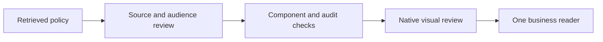
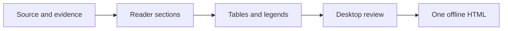

# Complete Atlas report contract

## Reader and audit responsibilities

New publication uses renderVersion 5. The deliverable is one offline business
understanding HTML for one selected project. Explain purpose, value, capabilities,
meaningful behavior, operating relationships, confidence and limits before implementation.
The reader is useful without its construction records.

`ATLAS-READER-001: Publish business understanding in one numbered offline HTML; preserve source, commands, file verification, raw JSON and execution evidence in a separate adjacent audit, never hidden in the reader.`

The publisher preserves the complete technical bundle as atlas-audit.json beside
analysis.json. delivery/ contains only atlas.html. A copied reader remains readable;
full verification requires the original adjacent audit and canonical renderer.
Do not remove technical evidence, reconstruct a passing result or overwrite history.

| Audience | Content | Boundary |
|---|---|---|
| Project reader | Purpose, value, owners, behavior, negative cases, confidence and questions | No commands, source paths, digests, raw payloads or hidden machine bundle |
| Source reviewer | Exact fragments, claim mappings, case walks and unknowns | Complete original analysis and evidence stay in the audit |
| Maintainer | Input validation, policy retrieval, rendering controls and diagnostics | Construction details do not become project capabilities |

## Numbered reading structure

`ATLAS-READER-002: Use stable ordered section numbers mirrored in navigation, hierarchical child numbers, valid local anchors and adjacent diagram legends; keep concise explanations, meaningful cases and balanced tables.`

The fixed root sequence is 01 purpose/value, 02 capabilities, 03 behavior/cases,
04 operating model, 05 confidence/scope and 06 limits/questions. Child headings
follow their parent, such as 03.01 and 03.01.01. Numbers supplement descriptive
titles; they never replace meaning or create a decorative section quota.

- Use native disclosure with the overview open and other sections initially closed.
- Keep navigation local and all styling inline; the dedicated canonical CSS remains owned separately.
- Use an evidence-bound horizontal reading model. Its legend explains that it is an abstraction, not an exhaustive runtime or dependency graph.
- Use cards for meaningful cases and tables for comparison; preserve readable type, complete text and top alignment.
- Render at 1440 and 900 CSS px in real desktop Chromium, without device emulation or an application URL.

## Source-bound business projection

analysis.reader declares schemaVersion 1, the same project identity, English
prose, a valid review date and an explicit semantic reviewer/scope/limits.
The projection is part of the original analysis, not an unaudited page edit.

| Projection | Required correspondence | Failure control |
|---|---|---|
| Value and model | Existing reviewed claims | Unknown facts cannot become confident benefits |
| Capabilities | Every declared source-owner unit | A capability cannot borrow another owner's claims |
| Reader journeys | Explicit behavior-flow mapping | Unexplained missing or duplicate flows fail |
| Cases | Every declared case in a reader journey | Positive/negative cases and missing checks remain visible |
| Technical-only flows | Explicit construction/detail classification with rationale | Classification remains reviewable in the audit |
| Limits | Every UNKNOWN claim | No silent omission of an unestablished fact |

Plain reader fields reject implementation patterns and unknown technical fields.
These finite guards complement review; they do not certify every sentence or infer
business relevance automatically. The reviewer checks the actual claim-to-prose
meaning and whether technical-only classifications are appropriate.

`ATLAS-READER-004: Explain verification and assessment limits in reader language; do not infer a project quality grade from consistency, retrieval or passing checks.`

## Current source-bound authoring profiles

`ATLAS-AUTHORING-001: Fresh understand authoring requires SOURCE_BOUND_COMPARISONS_V1, SOURCE_GRAPH_V2, GIT_WORKTREE_V1 and SOURCE_ORIGINS_V1 together; legacy publish preserves captured history without silently upgrading its assessment.`

The current `understand` entry point adds the reference presentation below to the four source profiles. Compatibility `publish`
can preserve an earlier capture; a valid historical envelope does not acquire
current semantic, source-origin or rendering qualification. Stop on a missing
current declaration rather than inventing facts to satisfy the schema.

| Review decision | Required meaning | Retained boundary |
|---|---|---|
| Compared state | Actual oracle subject, independent criterion and mismatch meaning | Descriptions are not invented observed values |
| Useful diagram | At least three meaningful nodes and two distinct real directed relationships | Small ideas remain prose or cards |
| Captured worktree | Actual revision, complete inventory and exact clean or dirty status | Dirty conclusions belong to the captured working copy |
| Source origin | Local implementation or a selected consumed contract | A selected package does not become producer source |

`ATLAS-COMPARISON-001: SOURCE_BOUND_COMPARISONS_V1 binds every represented case to its actual oracle subject, independent expected criterion, supported comparison relation and failureMeaning; describe compared state without inventing runtime actuals or treating an unrelated failure as the intended refusal.`

Record `observedSubject`, `expectedCriterion`, `relation` and `failureMeaning`
against the exact existing oracle fragments. EQUALITY, PREDICATE,
FAILURE_IDENTITY, ORDER and OWNERSHIP mean only what the assertions establish;
CUSTOM also explains the actual comparison. An exception class is not original
failure identity, membership is not order, and a boolean callback flag is not an
exact invocation count. Keep a missing oracle explicit instead of fabricating
an expected-versus-actual result.

`ATLAS-DIAGRAM-002: SOURCE_GRAPH_V2 renders a diagram only when it contains at least three meaningful nodes and two distinct real directed relationships; use TEXT_ONLY with a substantive diagramReason for a compact idea, never pad nodes or invent dependencies.`

Apply this requirement to rendered behavior, architecture and operating-model
views. A compact graph can remain truthful in the audit while its reader
explanation uses `TEXT_ONLY`. Explain why prose is clearer; the choice does not
remove the underlying cases, owner mapping or source limits. All displayed
graphs retain readable complete labels, actual direction and adjacent closed
legends under the existing visual contract.

`ATLAS-CAPTURE-001: GIT_WORKTREE_V1 captures the actual Git revision and complete indexed source with exact canonical porcelain status; retain leading status spaces, distinguish CLEAN from DIRTY and explain dirty-source limits in business language without presenting unpublished changes as a clean committed release.`

Canonical status normalizes CRLF to LF and removes trailing whitespace only.
Do not call `trim()` on porcelain output: its leading spaces encode state.
Verify the declared status against the actual working copy together with file
identities. The reader explains that conclusions belong to unpublished local
changes; exact paths, status payloads and commands stay in the adjacent audit.
No Git metadata means the current profile is unavailable, not an invented clean
capture; historical source-only inputs retain their declared limits.

`ATLAS-ORIGIN-001: SOURCE_ORIGINS_V1 distinguishes LOCAL_SOURCE units from CONSUMED_ARTIFACT boundaries; each selected consumed coordinate owns an indexed raw JAR/POM pair and a reviewed POM declaration, while absent producer implementation and native oracles remain explicit limits.`

A consumed unit is a BOUNDARY, not a local source module. Preserve its selected
coordinate, distinct `jarPath` and `pomPath`, indexed ownership and raw byte
identity; library pairs are not normalized text evidence. Review the selected
declaration and actual consumption scope. Consumer package acceptance can verify
the chosen dependency but cannot replace absent producer source or establish its
complete behavior. Local declarations and consumed contracts receive distinct
reader cues, with business explanations of the remaining responsibility.

## Business reference opening and local proof

`ATLAS-REFERENCE-AUTHORING-001: Fresh CURRENT_UNDERSTANDING_V2 requires BUSINESS_REFERENCE_V1 in addition to the source, comparison, origin and diagram profiles; preserve historical V1 declarations without upgrading their presentation assessment.`

The retained authoring literals describe captured V1/V2/V3 declarations. Current
`understand` publishes V4, retaining `BUSINESS_REFERENCE_V2` and adding
`CONCISE_READING_V1`. Earlier verification preserves its original scope;
historical readers are never rewritten or given a new presentation grade.

`ATLAS-READING-001: Fresh CURRENT_UNDERSTANDING_V4 requires CONCISE_READING_V1: a short source-bound reader guide, comparative responsibility and behavior tables, cases and individual score rationale closed on request, and meaningful use of native desktop width; favor understanding and calm presentation over repeated proof prose.`

`ATLAS-READING-PROOF-001: A concise guide binds each answer to every selected existing flow and its independent oracle or disclosed gap; deduplicate only exactly identical boundaries, preserve distinct limits and original case situations, expectations and verdicts, and keep complete construction detail in the adjacent audit.`

Declare `reader.readingProfile` and two to five `reader.guide` entries. Each
entry has `question`, `answer`, `limits`, `flowIds`, `claimIds` and
`oracleClaimIds`. Keep questions within 16 words, answers within 40 and limits
within 30. These bounds support editing; only source review establishes meaning.

`ATLAS-CLARITY-001: Remove exact repeated business sentences from the summary, value statements and guide answers; preserve distinct claims and proof boundaries, group capability-review detail in one initially closed disclosure, and feature only the most useful existing scores for the reader's purpose.`

`ATLAS-SPACING-001: Measure complete transformed native node and relationship-label rectangles; retain at least six CSS pixels between distinct boxes and labels, without shrinking type, clipping text, inventing nodes or removing source relationships.`

Use a short failure-review label that preserves the actual declared status.
UNKNOWN does not mean PARTIAL; a reviewed scope is not exhaustive coverage.

Exact sentence detection supports editing, while similar meanings still require
a reviewer. Standard labels and original proof text remain attributable.

Use the [reading component](governance/README.md) for progressive disclosure.
The short project brief precedes the open main map in a separate full-width band;
comparative tables use the available page. Native review includes 1920 px as
well as 1440/900. Measure the real first view before any interaction. Reuse a
shared boundary once only when its exact original text matches every row.

`ATLAS-PRIMARY-BAND-001: The open primary map owns an independent full-width content band, with a short brief above it and support below; measure both its panel and actual SVG canvas, reject sidebars and fixed narrow caps, and preserve uniform readable type, borders and every source relationship.`

`ATLAS-READER-NOISE-001: Fresh concise readers contain no generic footer, redundant score instruction or unowned narrative outside dedicated sections; keep confidence and remaining limits in their existing owned sections, without repeating global offline or scope labels.`

`ATLAS-DIAGRAM-WIDTH-001: Every current concise diagram uses the full width available in its own panel; measure both figure and actual SVG canvas, reject artificial width caps and overflow, and scale route geometry without stretching text or border weight.`

The centered reading frame retains small dark side gutters; the primary
canvas fills its available inner width. Responsive route geometry
keeps text and node borders at their native scale, rather than stretching fonts.
Value context remains collapsed below the map; its source meaning is preserved.

Use 90% of the viewport, capped at 1680 px. Decorative gutters do not justify
narrowing a diagram inside its own panel. Inspect all six sections at
900/1440/1920 px through normal navigation and with details expanded.

`ATLAS-READER-FRAME-001: Center the current reader at 90% viewport width with a maximum of 1680 CSS pixels and symmetric solid dark gutters; every diagram still fills its own inner panel, without clipping, horizontal scrolling or scaled-down type.`

`ATLAS-CONFIDENCE-001: Present review scope and its unproven boundary as short source-owned table answers, at most 40 words each; keep the exact date and clean-source provenance in one initially closed Review basis, retain dirty-source warnings and failed checks visibly, and inspect all six sections through native navigation.`

`ATLAS-DIAGRAM-FIT-001: Fresh CURRENT_UNDERSTANDING_V3 requires BUSINESS_REFERENCE_V2; every diagram and table fits without horizontal scrolling, clipping or reduced text, with actual transformed SVG type of at least 13 CSS px at the qualified desktop widths; split a wide idea into meaningful source-bound subviews or prose and retain its complete audit.`

`ATLAS-DIAGRAM-SUPPORT-001: Every current diagram has exactly two initially closed local disclosures, a source-specific bulleted legend and references with owned subjects, original proof and remaining limits; compare their actual rendered content with the original source-bound projection, never accept empty shells or generic legend filler.`

The [diagram governance module](governance/README.md) adapts archived visual
scale, legend and maturity contracts. Supporting views use a shared canvas and
bounded layers; overly wide stories fail with an owned split/prose repair.
Native checks measure text after SVG transforms, local overflow, initial
disclosures and source-specific references. A multiline text box cannot hide
a tiny font. The current no-scroll rule is a deliberate project decision;
archive citations retain their actual historical requirements.

`ATLAS-REFERENCE-001: Keep one source-bound primary business map open in the initial reader, with supporting maps, local legends, object proof and score rationale closed; explain the actual project objects rather than runtime module topology or authoring metadata.`

| Reading surface | Default | Source meaning |
|---|---|---|
| Primary business map | Open inside the open purpose section | Actual consumer objects, decisions, observations and outcomes |
| Behavior and architecture support | Closed | Separate operations and dependencies, with local legends |
| Local object proof | Closed immediately after the legend | Meaning, selected maturity, independent check basis and remaining limit |
| Featured review axes | Visible, with local rationale links | Original authored judgments with source and scope |
| Review rationale and earlier short model | Closed rationale; model in prose | Detailed goals, measures, ceilings and supporting interpretation |

`ATLAS-LOCAL-PROOF-001: Bind every primary object to actual owner facets, selected implementation claims and independent existing oracles; retain the least-established selected maturity, visible original failures and local remaining limits beside the graph.`

Declare `reader.primaryGraph` with real objects and named relationships.
Each node selects `facetRefs`, owned `claimIds` and independent
`oracleClaimIds`. Its `maturity` retains UNKNOWN before PARTIAL before
REVIEWED across the selected facets. A passing unrelated check cannot promote
that state. The focus identifies the owned result; dashed objects preserve a
limit rather than request a future E2E feature.

`ATLAS-SCORE-VIEW-001: Visible score cards must reopen to their original scoped authored axes, separate project and Atlas groups, expose goal-question-measure rationale and forty-thirty-thirty inputs, and respect a reasoned ceiling; passing checks never manufacture a score or application acceptance.`

`analysis.assessment` retains the original EVIDENCE_BOUND_REVIEW axes, source
claims and native evidence. `reader.assessment` supplies the business language,
featured axis references, goals, questions, measures, limits and ceilings.
Every axis remains represented; a featured subset cannot erase a weak or partial
review. Scores of 95 or above require original execution evidence and an explicit
remaining limit. No automatic Overall is added.

`ATLAS-REFERENCE-STYLE-001: Reuse canonical calm node, edge and legend primitives; rich primary maps use context, operation and outcome bands, complete readable relationship labels and honest maturity cues, verified against actual native geometry and initial disclosure state.`

Primary objects use bounded `band` and `column` reading positions. Six or
more objects require three bands; three honest objects remain valid for a simple
project. Do not invent nodes to meet density. Native review records the opening
before interactions, then checks every object, relationship, rationale and score
link. Hidden primary content, clipped cards, false maturity, changed grades and
broken rationale targets need their own observed refusal and actual repair.

The archive's node/method/layer strips become business object support here.
Exact method names, paths, commands and raw evidence remain in the adjacent audit;
they do not re-enter the business HTML. Shared style and stronger local proof are
adapted without restoring old runtime services or generating new product tests.

## Governed authoring loop

`ATLAS-READER-003: Retrieve mandatory audience and numbering policy, author the project-specific projection from actual source, preserve negative controls and repairs, verify the adjacent audit, and inspect native rendering before selecting the final reader.`



<details>
<summary>Legend: authoring and acceptance responsibilities</summary>

- Arrows describe the authoring review sequence, not automatic language-model execution.
- A failed component, provenance or layout gate preserves the original evidence and returns to its owner for repair.
- Native geometry and source bindings are bounded signals; a reviewer still checks meaning, balance and useful explanations.
- No new application E2E, emulator, language-model service or Java runtime feature is introduced.

</details>

The current source/evidence, understanding and directed-case validators still
apply to the entire audit. Renderer 5 adds an audience boundary; it does not reduce
proof coverage. A failed run stays failed, a missing oracle stays missing and
source-only observations never become executed through presentation.

<details>
<summary>Technical authoring fields and audit layout</summary>

The executable schema is in the [reader validator](../tools/atlas-reader.mjs); the [component fixture](../tools/atlas-reader.test.mjs) shows a generic project. Keep technical fields in the analysis, not in reader prose.

| Field | Responsibility |
|---|---|
| schemaVersion / projectId / language | Version 1, the same target and English authored text |
| title / summary / reviewDate | Readable identity, concise explanation and a valid calendar date |
| review | Reviewer, scope, limits and reviewed claimIds |
| value | Title, explanation and claimIds for each benefit |
| capabilities | unitId, title, benefit and claims from the correct owner |
| journeys / cases | flowId and every declared caseId, with situation, expectation and limits |
| auditOnlyFlows | flowId, construction/detail reason and explicit rationale |
| architecture | graphId, title and legend for each source architecture map |
| model | Title, ordered stages/links, reviewed claims and legend |
| limits | Title, explanation and claimIds, including every unknown and retained failure |

analysis.json, source-index.json, original documents and evidence remain beside atlas-audit.json. delivery/atlas.html is the only delivered reader file. Audit execution needs the complete dossier; offline reading does not.

</details>

## Artifact audit and calibration

`ATLAS-CALIBRATION-001: Audit the actual rendered artifact against live source and project documentation; distinguish expected behavior from recorded verdicts, expose partial review, test native navigation, and retain source-bound architecture and behavior diagrams with adjacent legends.`

The Atlas explains business purpose, project architecture and meaningful behavior.
The architecture view projects actual source-owner relationships using reader
capability names. It preserves edge direction and disconnected owners. Behavior
maps remain closed inside their journeys; cases and confidence retain actual
positive, negative, partial and unknown boundaries.

| Audit question | Actual comparison | Repair route |
|---|---|---|
| Does the story match implementation? | Follow delegation to the operation and compare project documents | Narrow unsupported guarantees; retain known limits |
| Does verification match the case? | Compare the oracle verdict with the visible case | Expected refusal may pass; a failed check remains failed |
| Is project understanding complete? | Compare source-owner facets with visible review depth | Never promote PARTIAL or UNKNOWN because checks pass |
| Can the reader reach the explanation? | Click each local link from a closed section in native Chromium | Target the content inside its disclosure |
| Do diagrams help understanding? | Inspect actual architecture, behavior, labels and legends | Keep source relationships; contain wide graphs without shrinking text |

The [calibration component](../tools/atlas-calibration.mjs) binds observations to
the actual HTML, source revision and source-index identity. It requires both
1440 and 900 CSS px, native keyboard/navigation observations and reasoned
comparisons for all six reader sections. Its [controls](../tools/atlas-calibration.test.mjs)
retain specific failures and actual repairs; the [graph controls](../tools/atlas-reader-graphs.test.mjs)
protect finite horizontal layout, cycles and original relationships.

<details>
<summary>Technical audit sequence and proof limits</summary>

1. Retrieve mandatory audience and calibration policy before authoring.
2. Verify the captured source and complete audit against the actual live project.
3. Review meaning against implementation owners and declared project documents.
4. Render the exact candidate, exercise native navigation and inspect screenshots.
5. Run calibration, preserve the failing artifact/control and apply the real repair.
6. Select only the accepted bytes; a changed HTML or source inventory needs a new review.

Current calibrated readers declare data-atlas-calibration 1 and publication calibrationProfile 1. Historical version-5 envelopes keep their captured navigation/profile and are not recertified by the new audit.

The browser probe is for document QA and is never embedded in the reader. Source
comparison declarations are authored evidence, not automatic semantic attestation.
Metadata cannot prove that a screenshot or human review is truthful. Full source
verification, canonical rendering and visual/semantic review remain separate gates.
Scores are scoped authored judgments, not test pass rates or automatic project grades.

</details>

## Semantic review and compact identity

`ATLAS-SEMANTICS-001: Qualify semantic understanding through distinct scoped facet observations, owned implementation fragments and independent existing oracles; preserve remaining boundaries and verify the actual visible facet projection instead of inferring completeness from source inventory or test counts.`

The `SEMANTIC_FACETS_V1` profile completes seven dimensions for each source
owner. REVIEWED means the declared facet scope was investigated; the project can
remain SELECTED. Do not convert a full inventory into exhaustive understanding
or promote every facet because one test selection passes.

| Record | Required evidence | Retained boundary |
|---|---|---|
| Distinct explanation | A facet-specific observation | No repeated generic prose across every responsibility |
| Reviewed scope | Actual owned implementation fragments | Follow delegation to the relevant operation |
| Independent oracle | Separate existing verification fragments | The implementation cannot be its own oracle |
| Executed oracle | Original testcase identity and exact fragment | Matching source alone does not establish execution |
| Remaining limits | Specific questions visible beside the capability | Preserve PARTIAL where review is incomplete |

Purpose and structure can use actual declarations. Promoting behavior, data,
configuration, failure or verification also needs an independent existing oracle.
Selections must belong to the unit and facet; implementation and oracle ranges
cannot overlap. Meaning classification remains an explicit reviewer responsibility.

The reader derives business explanations and limits from the reviewed facets in
closed disclosures. Technical metadata and references remain in the audit. Native
probes compare visible status, explanation and boundary with the qualified source.

`ATLAS-IDENTITY-001: Use one compact Atlas and project-title line without a redundant language badge; retain review date with confidence, preserve readable text and measure the actual rendered header at both desktop widths.`

The header uses one identity line, with type between 16 and 24 CSS px, height at
most 96 CSS px and top margin at most 24 CSS px. Text is neither hidden nor clipped.
Language remains semantic metadata; review date appears with confidence. Actual
rendering verifies these bounds at 1440 and 900 CSS px.

<details>
<summary>Semantic qualification owners and verification</summary>

- The [semantic component](../tools/atlas-semantics.mjs) and [controls](../tools/atlas-semantics.test.mjs) check promotions and actual repairs.
- [Execution binding](../tools/atlas-execution.mjs) preserves original testcase identities for facet oracles too.
- [Native calibration](../tools/atlas-calibration.mjs) compares the actual projection and identity geometry.
- Review data relationships, initialization, side effects, caching and failure routes; do not broaden a narrow oracle into a general guarantee.
- A historical profile without a semantic dossier remains semantically unqualified even if its HTML envelope is valid.

</details>

## Partial facet refinement

`ATLAS-REFINEMENT-001: Compare every original partial facet with the preserved baseline audit, retain its original scope and limits, record the investigated question and decision, and require additional owned implementation and independent oracle fragments before promotion; scope deletion or recycled receipts cannot count as progress.`

The profile preserves the previous dossier as a separately verified document.
Review compares all seven dimensions of every unit, then requires a decision
for every previously PARTIAL facet. Difficult questions cannot disappear through
deleted rows or rewritten original boundaries.

| Input | Required decision | Retained boundary |
|---|---|---|
| Previous scope | Concrete question and new observation | The original scope remains included |
| Additional fragments | Owned implementation; independent oracle for promotion | Repeating an old receipt is not progress |
| Configuration | Value, application time and observed choices | An SDK command does not certify pixels or every operating system |
| Information | Origin, transformation, result and refusal | Distinguish derived totals from manually supplied fields |
| Verdict | Bounded REVIEWED or explained PARTIAL | No inferred external acceptance |

Understanding a limit does not automatically repair implementation. Preserve
absent application-data cleanup and visual or environmental unknowns wherever
independent evidence remains insufficient.

## Bounded observation and application non-claims

`ATLAS-OBSERVATION-001: Separate observed response fields and bounded previews from complete payloads, image bytes from pixel meaning, and local component validation from application acceptance; a reviewed observation facet needs original passing component oracle subjects and explicit non-claims, while additional source-only observations remain partial.`

BOUNDED_OBSERVATIONS_V1 distinguishes executed component oracles from additional
source-only observations. Each refined facet states what its evidence does not
establish; changing a label cannot turn a local result into application acceptance.

| Observation | Verified boundary | Separate responsibility |
|---|---|---|
| Response | Observed URL, method and status | An error status is not success |
| Preview | Normalization and a 2000 UTF-16 unit limit, followed by an ellipsis | Complete raw body and its interpretation |
| Image | Bytes or encoded content retained by the adapter | Page layout, masking and pixel meaning |
| Request identity | Association of observed fields | Every delay and redirect combination |
| Local validation | Component assertion and original exception | Application persistence and data cleanup |

COMPONENT metadata needs PASSED verdicts for the named independent oracles, with
original fragment and testcase bindings. SOURCE_REVIEW retains PARTIAL status.
The reader and native audit compare the visible proof label and non-claims with
these declarations; they do not automatically certify the prose meaning.

`DOC-ROOT-FOCUS-001: The root README routes project decisions to owner guides; keep translated branch names and URLs in the edition guide, including references in comments and encoded examples.`

## Successive application boundaries

`ATLAS-SUCCESSIVE-001: Preserve prior observation proofs against the actual baseline, bind each new proof to its additional oracle fragments, and keep partial application facets explicit through source-bound remaining questions; local input or validation checks do not establish deployment persistence, global uniqueness or data deletion.`

BOUNDED_OBSERVATIONS_V2 retains the previous review's proof and exposes its
remaining questions. Acceptance boundaries are confidence information, not
implementation requests for additional E2E flows.

| Element | Rule and evidence |
|---|---|
| retainedProofs | Copy previously reviewed observation boundaries; publication compares them with the original prior audit |
| proofBoundary.claimIds | Select the current decision's additional oracles with their original outcomes |
| openQuestions | Every PARTIAL facet declares id, question and evidenceNeeded; unresolved in-scope questions cannot coexist with REVIEWED |
| Reader | Keep observations, limits and questions in collapsed sections without construction details |
| Rendering | Compare visible questions and retained boundaries with the audit projection at both desktop widths |

A prepared-field check does not establish global uniqueness. A local rejection
of an unrelated invoice does not establish application persistence. The reader
shows the actual observation and missing evidence without turning those limits
into TODOs for new product scenarios.

## Large audit inputs

`ATLAS-AUDIT-SIZE-001: Preserve full original baseline evidence and parse large escaped audit strings without tokenization-stack failure; retain JSON syntax and duplicate-member diagnostics, and keep construction payloads outside the business HTML.`

Do not truncate original history to avoid a parsing failure. Iterative string
scanning preserves JSON syntax and key identity, including duplicate-member
refusal after large escaped values. Regressions exercise inputs above 16 MiB;
they do not promise unlimited memory. Complete history remains adjacent while
the business reader stays one compact HTML.

## Source graph quality and archive adaptation

`ATLAS-DIAGRAM-001: Recover the archived shared visual grammar through source-specific readable nodes, complete relationship labels and arrowheads, horizontal dependency direction, compact supporting graphs, closed local bullet legends and honest boundary cues; compare the actual native graph with source endpoints and reject overlaps, clipping, missing cues and generic label substitution.`

The archive provides principles; the analyzed project determines meaning.
SOURCE_GRAPH_V1 retains every relationship and its complete label. Longer
explanations belong in the legend; text is neither shrunk nor replaced by “observe”.

| Archived principle | Current application | Required adaptation |
|---|---|---|
| Shared primitives and CSS | Consistent box, type and arrow scale | One HTML with embedded styling |
| Actor, intent, object, outcome | Source-specific nodes and conditions | A framework's own value is the subject when that framework is analyzed |
| Visible hierarchy and frontier | Emphasized operation; a distinct boundary outline | An observed refusal is not automatically a future frontier |
| Structured local legends | Concise closed bullets immediately below each graph | Keep essays outside the boxes |
| Traceable proof | Exact references in the adjacent audit | Commands and raw source stay outside the HTML |

Dependency maps point from consumer to provider; position does not promise
execution order. Cycles and long relationships receive separate routes.
The reading model remains distinct from architecture and branched behavior.

<details>
<summary>Component and rendered verification</summary>

- The [graph component](../tools/atlas-reader-graphs.mjs) retains identities, direction and labels, including cycles.
- [Controls](../tools/atlas-reader-graphs.test.mjs) refuse template-only nodes and generic relationships; long text is preserved or explicitly refused.
- [Native calibration](../tools/atlas-calibration.mjs) compares actual text and endpoints, arrowheads, visible outlines and overlaps.
- Captures at 1440 and 900 px bind the HTML, audit and source identities. A stale screenshot or passing metadata cannot qualify current appearance.
- Historical language badges, internal technical strips and interactive commands do not override the current reader requirements.

</details>

## Historical contract and retained provenance

The contract below describes renderers 1–4 and preserves the exact archival
retrieval excerpts. Its complete-input-in-HTML audience rule is superseded for
new publication by the reader/audit split above. Historical HTML is immutable;
validation uses the policy and stylesheet captured for that historical reader.

<details>
<summary>Historical renderers 1–4: technical reader and embedded audit</summary>


Canonical retrieval excerpts appear as inline technical literals. Keep their
exact English text in every documentation edition; translate the surrounding
explanations while preserving the cited requirement and its proof limits.

## Reader presentation and render review

ATLAS-REPORT-005: new publications use renderVersion 4. Presentation follows the
same reading principles as maintained documentation. Explain purpose and limits
before detail; use lists for parallel observations, tables for comparisons and
diagrams for supported relationships. Do not add decorative diagrams or quotas.



<details>
<summary>Legend: relationships and proof boundary</summary>

Arrows describe publication review, not application behavior. The original source
and execution identities remain unchanged by a presentation refresh.

</details>

| Reader element | Required presentation | Verification boundary |
|---|---|---|
| Explanation | Joined logical paragraphs and meaningful heading hierarchy | Supported Markdown blocks; full original text stays embedded |
| Parallel observations | Semantic lists rather than literal bullet characters in paragraphs | Block component controls and inspection of generated inputs |
| Comparison | Content-aware columns, top alignment, wrapped identifiers and full text | Native cell geometry at declared desktop widths |
| Long case witness | A vertical case record with every original field | Independent expected observation, assertion and limits remain visible |
| Diagram | Adjacent legend for boxes, arrows, evidence scope and omissions | Dependency arrows and behavior transitions retain different meanings |
| Dense table | Current V3: wrapped columns or case records; historical readers retain their captured policy | No horizontal scrolling, clipping, ellipsis or reduced type to force a fit |

The [presentation controls](../tools/atlas-presentation.test.mjs) exercise
negative, repaired and valid cases. Column allocation gives prose at least 300
CSS px before proportional expansion; metrics and identifiers have bounded
influence. A long identifier cannot consume the explanation column. These
heuristics support reading; they do not establish semantic truth or perfect design.

The native layout probe measures visible cell width, line count, font and
clipping. It signals long prose below 180 CSS px with at least six lines when a
neighboring cell with at most three lines receives over 1.8 times its width. It also rejects document
overflow, hidden cell text, type below 13 CSS px and inaccessible table scrolling.
Review measured failures with ATLAS-PRESENTATION, the owning contract and its
repair hint. Preserve all content while repairing widths or choosing case records.

Render at 1440 and 900 CSS px in real desktop Chromium, with no device emulation
or product URL. Expand reviewed sections; inspect diagrams, legends, tables,
disclosure, navigation and offline resources. Retain metrics, screenshots,
stylesheet identity and negative-to-repaired controls. An automated pass is a
bounded signal; a reviewer still checks reading order, balance and useful meaning.

The Markdown renderer supports headings, joined paragraphs, simple lists,
comparison tables, fenced code and closed native disclosures. Links and authored
HTML remain inert text. Mermaid fences retain their complete source with an
explicit note; the declared analysis graphs supply inline SVG. Nested lists and
arbitrary Markdown/HTML extensions are not a full parser contract. Check their
meaning against the complete original inputs before approving publication.

Historical renderVersion 1–3 remains supported with its original rendering and
embedded stylesheet. Keep original readers immutable. A new version-4 reader
may refresh presentation of an existing capture only when every bundle field
except renderVersion is unchanged; it is not a new source review or execution.
An exact LF/CRLF difference in the knowledge source preserves its original raw
digest and must match canonical normalized content; other byte drift fails.

## Purpose and ownership

ATLAS-REPORT-001 applies to ordinary and knowledge-assisted Atlas authoring.
`Each invocation publishes exactly one complete understanding HTML for exactly one selected project.`
`The selected project may use any language or build system, or have no tests or Git metadata.`
Its reader delivery directory is `delivery/` under the new analysis run.

- Its only HTML is `delivery/atlas.html`, counting all descendants.
- Combining separate target identities, such as AI and J1, or adding another HTML
  in that directory violates the delivery contract.
- Select a monorepo and its scope explicitly when that monorepo is the target;
  do not import facts from an unrelated project.

The delivery directory contains exactly one ordinary file: atlas.html. This is a
single-file contract, so non-HTML sidecars, nested files and symbolic links are
also rejected. Source, analysis, execution and render-review inputs stay outside
delivery/ in their declared analysis or artifact location.

The document must remain readable offline when copied alone. The canonical CSS is
[atlas.css](assets/atlas.css); the publisher embeds its canonical UTF-8 LF bytes,
normalizing CRLF once without changing content. Markdown,
source indexes and execution artifacts remain auditable inputs, not required
navigation dependencies for the reader and stay outside `delivery/`. The Atlas documentation owner maintains
this contract; the selected project's owners remain authoritative for behavior.

The archived Atlas distinguished a behavior atlas from a class inventory. For a
framework, subjects are requests, observations, contracts and lifecycle outcomes.
For a consumer, subjects are domain objects and observed application operations.
A Maven dependency arrow cannot stand in for a behavior transition. Existing
source and test oracles are the entrance; this work adds no product/E2E scenario.

## Required complete sections

| Section ID | Required information |
|---|---|
| context | Target, revision, dirty state, scope, proof status and review limits |
| behavior | Existing behavior graph, actor, intent, object, outcome and oracle |
| evidence | Every claim, status, mapped check and execution reference |
| trace | Exact source and governance fragments, paths and line ranges |
| architecture | Declared module boundaries and dependency graph, separate from behavior |
| audit | Actual outcomes, counters, commands and executed-source identities |
| knowledge | Retrieved requirements, mandatory policy, provenance and knowledge digest |
| limits | Unknowns, contrary evidence, findings and ownership |
| documents | Complete declared Markdown input documents, without truncation |
| provenance | Full source index, analysis contract and original XML/TAP/provenance payloads |

ATLAS-REPORT-002: the final HTML contains every section above and the complete
declared analysis inputs. A navigation index that opens several HTML pages is
not the final understanding artifact. Intermediate documents and prior reports
remain audit history outside the reader delivery directory.

Sections use native details/summary disclosure and internal fragment navigation.
The overview remains open; readers can expand other sections without JavaScript.
Diagrams are inline SVG generated from declared nodes and edges. No stylesheet,
font, image, script, iframe, fetch, import or navigation sidecar is needed. Raw
external source paths are displayed as text with their identity, not invented
links. `The final document is English; code and comments remain English.`

## Source, evidence and behavior

The [intake](../artifacts/atlas/README.md) and exact source/quote/evidence checks
still apply. The complete report embeds the captured state and explicitly
distinguishes source review from execution. Related governance is not complete
coverage of each clause. Unsupported checks remain NOT_MAPPED. A failed retained
`execution stays FAILED even if consistency verification passes.` Later edits
require a new capture; the report records its original source identity.

The analysis contract retains schemaVersion 1 and supplies behaviorFlows and
dependencyGraphs.

| Declaration | Required fields and meaning |
|---|---|
| Behavior | id, title, actor, intent, object, operation, outcome, testOracle, oracleStatus, oracleClaimId, limits, claimIds and graph |
| Observed oracle | oracleStatus is SOURCE_REVIEWED or EXECUTED; oracleClaimId identifies a separate claim from an actual existing test |
| Missing oracle | oracleStatus NOT_FOUND, oracle claim UNKNOWN; testOracle states the searched scope and gap without inventing execution |
| Behavior graph | BEHAVIOR kind; nodes with id/label/x/y/kind and edges with from/to/label/claimId |
| Dependency graph | id, title, DEPENDENCY kind, the same declared node/edge fields; node kinds MODULE, COMPONENT, SERVICE or BOUNDARY |

Layout coordinates are presentation data, not execution observations.

Each edge and flow claim resolves to a SOURCE_REVIEWED or EXECUTED analysis claim;
source and oracle claims include exact fragments. The reviewer verifies semantic
correspondence. Tooling checks declared
`identity and structure; it cannot infer that prose is true from matching words.`

- A single-component dependency map may contain one node and zero edges when
  its limitation explains the absence of declared dependencies.
- A behavior graph may contain one supported state and no transition when
  graph.limits explains the inspected scope.
- Report disclosed gaps instead of inventing flow steps. Missing tests, Git
  metadata or build declarations do not authorize copying another project's defaults.

An optional sourceDocuments list selects complete maintained documents by
target-relative path. Each selected document is bound to the source index and
embedded without truncation. Include the actual entry README, architecture,
testing and relevant contract/usage owners when they belong to the requested
scope. For ATF_AI, the essential living architecture can be included from its
maintained source. Do not substitute another project's documentation or treat
an unreviewed document as proof of execution.

`No score is inferred from passing checks.` If no rubric and assessment are
supplied, display NOT_ASSESSED. Feedback scores retain their own declared scope.

## Knowledge and archived provenance

The [knowledge base](Knowledge_Base.md) adapts useful archived Atlas requirements
into cited, testable records. Main remains free of retired runtime registries and
services. Canonical archive identity is `70a7279c2a9560d39e6bd2554cd2f96a88626692`.
The old shared CSS blob is
`d9a1ec153b4f9b7231fc25c37494e01ded8089788c775450728f843ae405cb1c`.
The source asset preserves its visual rules and adds reviewed document layout.
The old external CSS link becomes canonical inline CSS to satisfy this single-file
delivery contract. The old language default becomes canonical English.

## Verification and constructive failure

The optional [publisher](../tools/atlas-report.mjs) uses Node built-ins. It verifies
source evidence before rendering, escapes authored content and embeds the full
machine bundle. A deterministic re-render detects changed output, missing
sections, external resources and CSS drift. The delivery guard rejects an extra
HTML anywhere below delivery/, and the embedded identity must match the one
selected target. The renderer does not execute product
tests or a language model. The dedicated tests include deliberately corrupted
source, evidence, knowledge, graph and presentation cases.

```powershell
node --test tools/verify-atlas.test.mjs tools/atlas-report.test.mjs tools/atlas-presentation.test.mjs tools/atlas-knowledge.test.mjs tools/atlas-bundle.test.mjs tools/atlas-execution.test.mjs tools/atlas-understanding.test.mjs tools/atlas-behavior.test.mjs
```

After the reviewer prepares a source-bound analysis, publish from the reactor
root using the selected source, analysis and artifact roots:

```powershell
$targetRoot = (Resolve-Path -LiteralPath $env:ATLAS_SOURCE_ROOT -ErrorAction Stop).Path
$analysisRoot = (Resolve-Path -LiteralPath $env:ATLAS_ANALYSIS_ROOT -ErrorAction Stop).Path
$artifactRoot = (Resolve-Path -LiteralPath $env:ATF_ARTIFACT_ROOT -ErrorAction Stop).Path
node tools/atlas-report.mjs publish --source "$targetRoot" --analysis "$analysisRoot" --artifacts "$artifactRoot"
```

Use a new run directory for a new capture. Publishing is write-once; repairing
the reader output means regenerating from reviewed inputs, not overwriting an
immutable historical report. The output is `delivery/atlas.html` for that target.
The understand command is an alias for publish with the same input and output
contract. It consumes the source-reviewed intake, retrieves mandatory knowledge
and emits the complete document; it does not infer a project model by invoking a
language model. The reviewer prepares the intake against the selected source.

Failures preserve a stable rule ID, observed evidence, meaning, repair hint,
canonical owner and recheck command. Unknown failures remain unclassified.
Hints are investigations, not evidence that a proposed cause is established.
Use an isolated reactor copy for existing Java documentation governance, following
[Development](../docs/Development.md). Render old and new reports in real desktop
Chromium, inspect diagrams, disclosure, overflow, navigation and offline resources.
Preserve failing observations and successful reruns in the selected artifact area.

## Declared understanding breadth

ATLAS-REPORT-003: captures using renderVersion 2 or later retain analysis
schemaVersion 1. They require analysis.understanding with schemaVersion 1. Older
renderVersion 1 artifacts remain historical records of their original contract;
preserve their pinned renderer and original bytes rather than silently upgrading
their meaning or overwriting their delivery.

`A full source inventory is not a declaration of complete semantic understanding.`
The understanding object declares scope PROJECT or SELECTED, a nonempty
scopeStatement, inventoryClaimIds and units. Inventory claims resolve to actual
reviewed build, package, entry or ownership declarations. PROJECT means that the
declared architecture and review-unit inventories agree; it never means that
every indexed line has been understood or tested. SELECTED states the inspected
area and excluded areas plainly. A small selected flow is valid when its scope
is clear. Do not require invented components or a minimum flow count for a simple
project.

Each unit declares id, label, kind MODULE/COMPONENT/SERVICE/BOUNDARY, scopePaths,
claimIds, sharedClaimIds, flowIds, facets and limits. scopePaths are normalized,
target-relative files or directories containing actual indexed source. Owned
claimIds need source references inside that unit. A sharedClaimId is an explicit
reviewed cross-owner reference; it does not transfer source ownership.

Each understanding unit declares all seven facets: purpose, structure, behavior, data, configuration, failure and verification.

| Facet | Reader question |
|---|---|
| purpose | What responsibility does this owner have, and who uses it? |
| structure | Which entry points, boundaries and dependencies implement it? |
| behavior | Which existing operation changes or observes which object? |
| data | Which values, schemas, state and artifacts pass through it? |
| configuration | Which actual defaults, properties and selections control it? |
| failure | Which errors, limits, retries, interrupts and cleanup are supported? |
| verification | Which existing assertions or source reviews support the claim? |

Every facet declares status REVIEWED, PARTIAL, UNKNOWN or NOT_APPLICABLE,
claimIds and an explanation. REVIEWED and PARTIAL require supported claims from
the unit's owned/shared set, including at least one owned claim for each facet
except verification, which may use explicitly shared oracle claims. An empty
owned set cannot promote another unit's evidence to reviewed understanding.
A REVIEWED behavior facet requires an existing
traced flow. Explain partial inspection, an absent observation or inapplicability
without manufacturing a test or dismissing all facets as inapplicable.

Dependency nodes declare unitId. Behavior flows declare unitIds, and each unit's
flowIds declares the reverse association. These links must agree in both
directions. A PROJECT capture represents every declared unit in its architecture
graphs. Graph kinds are exactly BEHAVIOR and DEPENDENCY at their corresponding
owners. Every behavior edge claim belongs to that flow's claimIds; merely finding
another reviewed claim in the report is insufficient. Reviewers still check
whether the exact source supports the stated transition.

## Exact execution subjects

`An executed behavior or oracle claim requires executionSubjects bound to retained testcase identities and outcomes.`

Each execution subject declares evidenceId, testClass, testName and sourcePath.

- evidenceId belongs to the claim's evidenceIds, and sourcePath is already quoted
  by that claim. Every referenced execution evidence ID has at least one subject.
- XML subjects match exact classname/name; missing classname means testClass is
  the empty string. Flat Node TAP matches exact testName with empty/omitted testClass.
- The case occurs exactly once with executed PASSED or FAILED outcome. Duplicate,
  missing, ambiguous, skipped and TODO subjects fail.
- Decode predefined/numeric XML entities locally; prohibit external entity
  resolution and actual XML document type/entity declarations.
- Only actual testcase children on a valid suite path establish XML identities.
  Instructions, comments, CDATA and output-container text cannot invent testcases
  or failures; malformed structure/entities/characters retain the evidence diagnostic.
- An observed HTML doctype inside inert CDATA/output remains valid payload.

The selected subjects' original outcomes determine the claim verdict. A suite
failure outside the selected cases cannot substitute for an oracle failure,
and a passing summary cannot erase a selected failed case. Existing whole-run
counter, target and source-manifest checks still apply. A selected PASS in a
mixed suite stays PASSED while that evidence's whole-suite status stays FAILED.
A source file present
during a passing run does not establish that its oracle executed.

An executed maintenance-cohort claim may retain its explicit selection scope
without behavioral subjects when no behavior references it. Source-reviewed
behavior and NOT_FOUND oracle gaps require no invented run. The subject binding
proves retained identity and outcome; source-to-assertion semantics still need a
human review. This is maintenance governance, with no new product/E2E scenario.

For a renderVersion 3 or later EXECUTED case oracle, sourceRefIndices additionally selects
the exact zero-based entries in that oracle claim's sourceRefs. Each selected
entry must match its subject's sourcePath, and the retained subjects together
must cover every case-selected oracleRefIndices entry. Indices are not line
numbers; the selected references already own their exact startLine, endLine and
quote. See the [copyable subject shape](../artifacts/atlas/Project_Map_Template.md#declared-breadth-record).

## Evidence-bound review axes

`An assessment is a scoped authored review, not a test pass rate or an automatic score.`

analysis.assessment is optional. Without it, the report remains NOT_ASSESSED.
When supplied, method is EVIDENCE_BOUND_REVIEW and reviewer, scope, limits and
groups are explicit. Every group declares a unique id, label, scope, limits and
axes. Keep project quality and Atlas quality in separate groups: a strong
publisher cannot certify the selected project's runtime or its unexecuted tests.

Each axis declares a unique id, label, correctness, verification, clarity, score,
weight, claimIds, evidenceIds, reason and limits.

- Numeric inputs, score and weight are integers from 1 to 100.
- score is the rounded sum of 0.40 × correctness, 0.30 × verification and
  0.30 × clarity.
- Axis weights sum to 100 within each group. Its declared score must match the
  rounded weighted mean.
- Each axis cites existing reviewed claims. Execution references resolve to
  retained evidence and keep its actual outcome and age.
- evidenceIds may be empty when no execution supports the scoped judgment.

Suitable project axes include contract correctness, existing-test quality,
governance, maintenance/ownership, documentation and configuration portability.
Suitable Atlas axes include source breadth, behavior/oracle trace, evidence
integrity, knowledge trace, reader clarity and declared limitations. Explain the
reason for each score and its uncertainty. Scores do not imply statistical
confidence, code coverage or automatic semantic completeness. Feedback priority
and quality remain separate judgments under their own published rubric.

## Complete retrieval receipt

Knowledge-assisted authoring preserves the complete canonical retrieval receipt,
including query parameters, selected IDs, mandatory IDs, optional records,
ranking, citations, corpus identity and source provenance. Recomputing only a
corpus digest or checking mandatory records cannot validate an edited optional
requirement. Retain the full canonical knowledge-source bytes in the complete
bundle. Retrieved policy is authoring context; it cannot establish a fact or an
executed outcome for another target. New negative controls must retain useful
repair hints and prove the intended rule before a feedback item is closed.

## Behavior cases and negative observations

ATLAS-REPORT-004: new public captures use renderVersion 4. Each behavior flow
declares caseAnalysis schemaVersion 1. Earlier renderVersion 1/2 captures retain
their original bytes, pinned renderer and proof scope; they are not certified
retroactively under this case contract.

`Every declared behavior outcome has a source-bound case witness reachable from its entry.`

- caseAnalysis declares entryNodeId, pathScope, negativeScope and cases. Behavior
  edges have stable unique id values plus from, to, label and claimId.
- entryNodeId selects any valid INTENT, ACTION, DECISION, STATE or OUTCOME node.
  Actor and intent belong to the flow; do not invent an intent node when the
  observed operation starts at an action or state.
- A bounded single OUTCOME is valid with an explicit oracle gap. Every behavior
  node is reachable from entry and can reach an OUTCOME.
- Unreachable observations, disconnected operations and trapped cycles fail.
  Dependency graphs remain separate; disconnected modules need no invented common entry.

pathScope is REPRESENTATIVE or ALL_DECLARED_EDGES. REPRESENTATIVE declares
selected existing cases and remaining limits. ALL_DECLARED_EDGES requires their
paths to cover the declared graph edge set. It does not establish every branch
in the implementation, every input combination or every loop schedule. Finite
case walks can revisit nodes, including supported behavior self-loops with a
finite witness and an outcome escape. Such loops have a visible diagram corridor;
dependency self-loops remain invalid. Traversal is bounded by the graph; the validator
does not enumerate all possible schedules.

| Case field | Required meaning |
|---|---|
| id, kind and title | Unique local POSITIVE/NEGATIVE case and its purpose |
| precondition, trigger and expected | Actual starting condition, input/operation and observed result |
| nodeIds and edgeIds | Ordered contiguous directed walk from entry to an OUTCOME |
| claimIds | Reviewed flow-local source claims supporting this case |
| oracleClaimId and oracleStatus | Exact existing local oracle and actual proof scope, or explicit NOT_FOUND |
| oracleRefIndices | Selected sourceRefs indices within that oracle claim |
| assertion | What the selected existing assertion compares or rejects |
| limits | Partial review, unexecuted scope and unsupported conclusions |

Every edgeIds item connects its adjacent nodeIds in the declared direction.
Every OUTCOME has a case witness. Positive and negative cases may share a
terminal state when source and assertions justify their different observations.
Case kind and assertion meaning are reviewed declarations, never inferred from
filenames, labels or assertion keywords.

Reviewed/executed oracle claims are local to the flow. Apply each source and
execution boundary explicitly:

- Source fragments: oracleRefIndices selects exact oracle paths, line ranges and
  quotes. A fragment cannot overlap any selected implementation range in the same
  file, even with smaller or extended slices. Nonoverlapping same-file fragments
  remain valid; an implementation-only alias cannot replace an independent test.
- Content identity: live and portable gates use the verified source index to
  identify equal files across paths. Case variants, hardlinks and identical
  copies cannot turn overlapping ranges into an independent oracle. CRLF/LF
  identity requires the declared policy; published library artifacts stay byte-exact.
- Path scope: paths are never globally lowercased, so case-distinct files with
  different content retain separate identities. Metadata-only analysis reports
  DECLARED_PATHS_ONLY; live/portable publication supplies verified content identities.
- Missing oracle: NOT_FOUND references an UNKNOWN oracle claim and oracleGap with
  searchedClaimIds/explanation. Preserve reviewed search evidence without inventing
  a test or run. Source-reviewed cases retain their actual scope.
- Executed oracle: the retained execution-subject contract also applies. Every
  executionSubjects entry has nonempty unique sourceRefIndices into that oracle's
  sourceRefs with paths matching sourcePath. Actual retained subjects cover every
  case-selected oracleRefIndices entry; independent XML/TAP identity/outcome
  checks still apply alongside source indices.

`Negative observations are explicit reviewed cases or an evidence-backed search gap, never inferred from a happy-path diagram.`

- negativeScope records REVIEWED, PARTIAL, UNKNOWN or NOT_APPLICABLE, nonempty
  reviewed flow-local claimIds and an explanation.
- REVIEWED needs a negative case witness; NOT_APPLICABLE cannot coexist with one.
  Distinguish reviewed cases, searched absence and unreviewed areas.
- A negative claim elsewhere cannot certify a positive-only graph. Explain actual
  rejection, validation, timeout, cleanup or boundary behavior already in source.
- Do not invent application cases for a numerical minimum. The reviewer still
  checks the source meaning of every condition, transition and assertion.

A unit's REVIEWED failure facet needs at least one NEGATIVE case in an owned
flow whose negativeScope is REVIEWED or PARTIAL. A reviewed negative source
fragment without an explicit owned behavior witness cannot certify that facet.

## Algorithm and component proof scope

Behavior governance tests check graph invariants and declared evidence relationships, not automatic prose truth.
Meaningful negative controls reverse or remove a valid outcome path, add an
orphan outcome, substitute a noncontiguous case edge, select an unrelated oracle
fragment or drop declared negative evidence. Each fails for its intended rule
and retains an owned repair route. Consistent identifier renaming, node/edge
reordering and valid layout changes preserve the logical result. A supported
cycle with an outcome escape remains valid; a trapped cycle fails.

Publisher component tests assemble source/index/claim inputs and verify the
complete one-file result or intended refusal. They complement focused traversal
tests, metamorphic mutations and existing Java documentation/architecture
guards. They are maintenance tests, not new product/E2E scenarios. No emulator
is used. Receipt authenticity proves policy provenance; mandatory fallback for
an unrelated query is honest policy context and does not become semantic
project retrieval. Source review supplies the project explanation.

</details>
