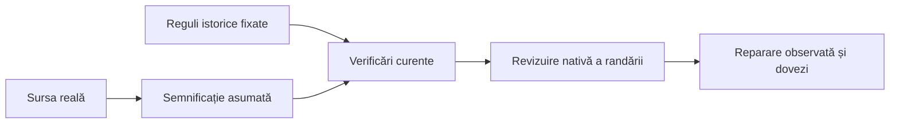

<a id="atlas-diagram-governance"></a>
# Guvernanța diagramelor Atlas

<a id="overview"></a>
## Prezentare generală

Această zonă adaptează contractele utile pentru diagrame din main_mcp în
componente independente de mentenanță. Deține layout-ul delimitat și regulile
de prezentare măsurată; [contractul raportului](../Report_Contract.md) deține
cititorul complet. Nu adaugă un modul Maven sau funcționalități Java la execuție.



<details>
<summary>Legendă: relații și limita dovezilor</summary>

Săgețile arată intrările revizuirii și verificările acceptanței. O regulă istorică
de stil informează contractul curent; nu certifică sursa de astăzi și nu
înlocuiește inspecția documentului generat. O observație eșuată rămâne vizibilă
în timpul reparării.

</details>

<details>
<summary>Referințe și domeniul revizuirii</summary>

[Înregistrările de cunoștințe](../knowledge/atlas-contracts.json) păstrează
digesturile Git fixate și extrasele. [Cazurile de componentă](diagram-layout.test.mjs)
verifică layout-ul, referințele semantice, limitele sursei și refuzurile măsurate.
Revizuirea nativă externă furnizează capturile reale și pixelii transformați.

</details>

<a id="ownership"></a>
## Responsabilități

| Regulă istorică | Responsabilitate curentă |
|---|---|
| Scară vizuală și benzi pentru hărți ample | [Layout delimitat și reguli măsurate](diagram-layout.mjs); [CSS](../assets/atlas.css) canonic |
| Legendă utilă în puncte | [Proiecție specifică sursei](../../tools/atlas-reader-graphs.mjs): scop, contribuție la harta principală și limită |
| Dovezi locale și maturitatea nodurilor | [Contractul de referință](../../tools/atlas-reference.mjs): fațete reale, verificări independente și maturitatea cel mai puțin stabilită |
| Subgrafuri secundare colapsate | [Cititor](../../tools/atlas-reader.mjs): harta principală deschisă, suportul închis, două secțiuni închise sub fiecare graf |
| Cazuri negative pentru candidați | [Teste de componentă](diagram-layout.test.mjs) și [calibrare nativă](../../tools/atlas-calibration.mjs) |
| Orientare concisă legată de sursă | [Componenta de lectură](reading.mjs) și [cazurile independente](reading.test.mjs): răspunsuri scurte, limite comune exacte și lățime/secțiuni măsurate |
| Narațiune repetată și detalii expuse devreme | [Componenta de lectură](reading.mjs): propoziții identice, un grup de revizuire închis și stări distincte ale eșecurilor |
| Spațiu liber în diagrame | [Revizuirea dreptunghiurilor native](diagram-layout.mjs): identitățile complete din sursă și minimum șase pixeli CSS între casete și etichete distincte |
| Bandă independentă pentru harta principală și prezentare calmă | [Componenta de lectură](reading.mjs): panou/desen pe toată lățimea, rezumat deasupra și text în secțiunile responsabile |

Reperul sursei este revizia `main_mcp`
`70a7279c2a9560d39e6bd2554cd2f96a88626692`. Regulile istorice pentru scară
vizuală, calitatea legendei și maturitatea nodurilor ghidează adaptarea.
Execuția vechilor skill-uri, serviciile MCP și Allure nu fac parte din acest modul.

<a id="repair-decisions"></a>
## Decizii de reparare

- Fără scroll orizontal: obiectele reale încap la scară lizibilă. Împarte o
  poveste prea amplă în subvederi cu sens și sursă sau folosește proză substanțială.
- Păstrează relațiile și cazurile originale în auditul adiacent; nu inventa
  noduri și nu omite un rezultat negativ pentru a face desenul să încapă.
- Fiecare diagramă are două secțiuni închise inițial: legenda și referințele
  cu dovada originală și limitele rămase. Secțiunile goale nu sunt suficiente.
- Măsoară textul real după transformările SVG, inclusiv etichetele pe mai multe
  linii. Un font mic într-o casetă înaltă nu devine o dovadă lizibilă.
- Compară referințele vizibile cu cazurile și verdictele originale ale sursei.
  Numărul verificărilor trecute nu promovează o limită parțială a aplicației.

<a id="verification"></a>
## Verificare

`HORIZONTAL_SCROLL`, `DIAGRAM_SCALE` și `DIAGRAM_DISCLOSURES` identifică
eșecurile măsurate. Proiecția sursei, geometria grafului și dovada originală au
verificări independente. Diagnosticele indică responsabilul raportului și o
reverificare concretă; markup-ul valid nu certifică singur adevărul semantic.

`DIAGRAM_SPACING` indică graful, perechea aglomerată și distanța măsurată. Mută
sau scurtează eticheta legată de sursă; păstrează relația și fontul lizibil.

`NEGATIVE_SCOPE` păstrează distincția dintre revizuirea necunoscută și cea parțială
a eșecurilor. Aceste verificări completează inspecția vizuală și comparația cu sursa.

`PRIMARY_BAND` identifică o coloană laterală, un panou/desen îngustat sau un rezumat deplasat.
Măsoară dimensiunile randate; lățimea paginii nu dovedește lățimea hărții.
`READER_NOISE` elimină textele generice și păstrează limitele în secțiunile responsabile.

`DIAGRAM_WIDTH` compară fiecare desen secundar cu lățimea panoului disponibil;
lățirea paginii exterioare nu repară un desen plafonat.

<details>
<summary>Comandă pentru componentele vizate</summary>

```powershell
node --test tools/atlas-reading.test.mjs tools/atlas-fit.test.mjs tools/atlas-reader-graphs.test.mjs tools/atlas-calibration.test.mjs
```

</details>
