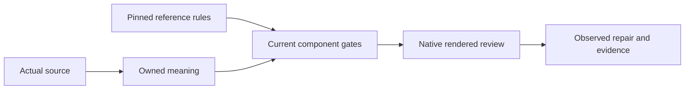

# Atlas diagram governance

## Overview

This area adapts useful main_mcp diagram contracts into current, independent
maintenance components. It owns bounded layout and measured presentation rules;
the [report contract](../Report_Contract.md) owns the complete reader. It adds no
Maven module or Java runtime feature.



<details>
<summary>Legend: relationships and proof boundary</summary>

Arrows show review inputs and acceptance gates. An archived style rule informs
the current contract; it does not certify today's source or replace inspection
of the generated document. A failed observation stays visible during repair.

</details>

<details>
<summary>References and review scope</summary>

The [knowledge records](../knowledge/atlas-contracts.json) preserve pinned Git
digests and excerpts. The [component cases](diagram-layout.test.mjs)
exercise layout, semantic references, source boundaries and measured refusals.
The external native review supplies actual screenshots and transformed pixels.

</details>

## Ownership

| Historical rule | Current responsibility |
|---|---|
| Visual scale and rich-map bands | [Bounded layout and measured rules](diagram-layout.mjs); canonical [CSS](../assets/atlas.css) |
| Useful bulleted legend | [Source-specific projection](../../tools/atlas-reader-graphs.mjs): purpose, contribution to the main map and limit |
| Local node proof and maturity | [Reference contract](../../tools/atlas-reference.mjs): actual facets, independent checks and least-established maturity |
| Collapsed supporting subgraphs | [Reader](../../tools/atlas-reader.mjs): primary open, support closed, two closed disclosures below each graph |
| Negative candidate fixtures | [Component tests](diagram-layout.test.mjs) and [native calibration](../../tools/atlas-calibration.mjs) |
| Concise source orientation | [Reading component](reading.mjs) and [independent cases](reading.test.mjs): short answers, exact shared boundaries and measured width/disclosure |

The source anchor is `main_mcp` revision
`70a7279c2a9560d39e6bd2554cd2f96a88626692`. The archived visual-scale,
legend-quality and node-maturity rules guide adaptation. Retired skill execution,
MCP services and Allure are outside this module.

## Repair decisions

- No horizontal scrolling: fit actual objects at readable scale. Split a wide
  story into meaningful source-bound subviews or use a substantive prose view.
- Keep all original relationships and cases in the adjacent audit; never invent
  nodes or omit a negative outcome to make the drawing fit.
- Every diagram has two initially closed disclosures: its legend and references
  with original proof and remaining limits. Empty shells do not qualify.
- Measure actual text after SVG transforms, including multiline labels. Small
  font hidden inside a tall text box does not become readable evidence.
- Compare visible reference rows with source-owned cases and original verdicts.
  A passing count does not promote a partial application boundary.

## Verification

`HORIZONTAL_SCROLL`, `DIAGRAM_SCALE` and `DIAGRAM_DISCLOSURES` identify measured
failures. Source projection, graph geometry and original proof have independent
checks. Their diagnostics identify the report owner and a concrete recheck;
passing markup alone never certifies semantic truth.

<details>
<summary>Focused component command</summary>

```powershell
node --test tools/atlas-reading.test.mjs tools/atlas-fit.test.mjs tools/atlas-reader-graphs.test.mjs tools/atlas-calibration.test.mjs
```

</details>
