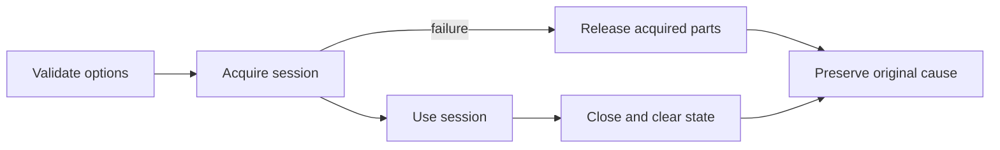

# atf-core

## Overview

Core provides configuration, UI lifecycle/contracts and neutral reporting without REST Assured, Selenium, Playwright or Extent SDK dependencies. Its coordinates are
`com.ai:atf-core:1.0.0`; it inherits Java 11 compilation from
[atf-parent](../pom.xml).

## Ownership and entry points

| Area | Entry point and responsibility |
|---|---|
| Configuration | [ConfigManager](src/main/java/com/ai/core/support/config/ConfigManager.java), typed options and classpath defaults |
| UI contracts | [UIEngine](src/main/java/com/ai/ui/core/engine/UIEngine.java), capabilities, locators and request/response values |
| UI composition | [UiEngineProvider](src/main/java/com/ai/ui/core/engine/UiEngineProvider.java), registry and factory |
| UI lifecycle | [BaseTestUI](src/main/java/com/ai/ui/core/runtime/BaseTestUI.java), session and runtime metadata |
| API library | [BaseTestAPI](../atf-api/src/main/java/com/ai/api/core/BaseTestAPI.java), owned by atf-api: HTTP execution, retries, polling and validation |
| Reporting contracts | [ReportLogger](src/main/java/com/ai/core/reporting/ReportLogger.java), TestStatus and [ReportingBackend SPI](src/main/java/com/ai/core/reporting/spi/ReportingBackend.java) |
| Steps | [StepLogger](src/main/java/com/ai/core/reporting/StepLogger.java), scopes, console output and neutral report delegation |

[Core support](src/main/java/com/ai/core/support/README.md) owns reusable
configuration, metadata, YAML and HTML primitives. Neutral UIActions remains in
Core; product pages, services, workflows and business assertions belong to
[atf-tests](../atf-tests/README.md).

## Dependencies and extension

Core has no dependency on another ATF module.

- Consumers add a browser adapter for UI execution and atf-reporting for Extent publication.
- Java ServiceLoader discovers UiEngineProvider and ReportingBackend implementations.
- Public Core signatures remain independent of vendor SDK types.
- The neutral [TestListener](src/main/java/com/ai/core/reporting/listener/TestListener.java) compatibility facade forwards lifecycle events to the selected backend.

See [Architecture](../docs/Architecture.md) for provider composition and the
runtime sequence.

## Configuration

[framework.properties](src/main/resources/framework.properties) supplies defaults.

- JVM properties override individual keys; `framework.properties` can select an explicit file.
- Important defaults include `ui.engine=playwright`, `ui.headless=true`, `ui.wait.timeout.seconds=20`, `api.wait.timeout.seconds=10` and `reporting.engine=extent`.
- Browser and report implementations are supplied by their modules.

## Validated UI configuration and cleanup

UI options are validated before provider acquisition. Core owns the shared
boolean and wait readers; adapters receive the validated values. JVM overrides,
classpath or explicit-file defaults and the legacy wait fallback retain their
existing precedence.

| Input | Accepted values | Failure boundary |
|---|---|---|
| UI booleans | Trimmed, case-insensitive `true` or `false`; blank retains the owning fallback | Invalid text identifies its actual key and value |
| Configured wait | `1..2147483` whole seconds | Reject zero, negative, malformed and millisecond-overflowing values |
| Engine | `playwright`, `selenium` or legacy `default` | Normalize with `Locale.ROOT` and reject unknown names before acquisition |
| Legacy wait | `explicit.wait.seconds` when `ui.wait.timeout.seconds` is absent | Apply the same range and name the selected key in diagnostics |

The boolean boundary covers headless, console details, runtime metadata and the three screenshot flags.

- Screenshot handling reuses the same boolean reader.
- WaitUtils reuses the validated seconds reader; explicit Duration overloads keep their separate existing contract.
- Supported zoom normalization remains unchanged.



<details>
<summary>Legend: relationships and proof boundary</summary>

Arrows describe lifecycle ownership. Validation precedes allocation. Acquisition
rollback releases only acquired resources; class teardown clears interaction
state even when engine shutdown throws. The original exception remains primary,
and distinct cleanup failures remain suppressed evidence.

</details>

The existing [UI option contracts](../atf-tests/src/test/java/com/ai/atf/ui/component/UiEngineRuntimeOptionsContractTest.java),
[wait contracts](../atf-tests/src/test/java/com/ai/atf/ui/component/WaitUtilsContractTest.java)
and [base lifecycle contracts](../atf-tests/src/test/java/com/ai/atf/core/support/base/BaseTestUIContractTest.java)
exercise these boundaries without starting a browser. Native adapter provider
tests inject acquisition failures; they do not establish live-site acceptance.

## Observation and optional reporting boundaries

| Decision | Existing contract | Evidence boundary |
|---|---|---|
| Wait for a state | Return the first matching observation; on expiry, return the last observed value | A returned value alone does not establish a match or a real-time deadline |
| Require a condition | The condition wrapper raises the caller assertion when no match was observed | Supplier errors and blocking operations keep their own failure boundary |
| Run Core without reporting | Optional logger lookup is absent; explicitly requiring a logger fails clearly | Console-only callbacks do not create an Extent report |

The [wait components](../atf-tests/src/test/java/com/ai/atf/ui/component/WaitUtilsContractTest.java)
compare values and observation counts. [Core-only reporting](src/test/java/com/ai/core/reporting/ConsoleOnlyReportingContractTest.java)
and [provider discovery](src/test/java/com/ai/core/reporting/spi/ReportingBackendLoaderTest.java)
separate no provider, one provider and ambiguity before construction. The backend
is selected during class initialization; classpath changes do not hot-replace it.

## Verification

From an isolated reactor copy:

<details>
<summary>Run Verification commands</summary>

```powershell
mvn -B -ntp -pl atf-core -am test
mvn -B -ntp -pl atf-tests -am "-Dtest=ConfigManagerFileContractTest,BaseTestAPIContractTest,BaseTestUIContractTest,UiEngineRuntimeOptionsContractTest,WaitUtilsContractTest,StepLoggerContractTest" "-Dsurefire.failIfNoSpecifiedTests=false" test
```

</details>

The first command runs native Core checks; the second selects cross-module
regressions. [Testing](../docs/Testing.md) owns complete local, browser and
reporting acceptance.
