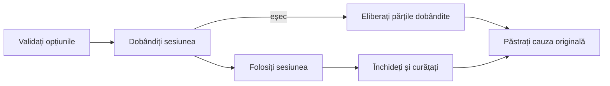

# atf-core

<a id="overview"></a>
## Prezentare generală

Core oferă configurare, contracte și ciclu de viață UI, precum și raportare neutră, fără dependențe SDK REST Assured, Selenium, Playwright sau Extent. Coordonatele sunt
`com.ai:atf-core:1.0.0`; compilarea Java 11 este moștenită de la
[atf-parent](../pom.xml).

<a id="ownership-and-entry-points"></a>
## Responsabilități și puncte de intrare

| Zonă | Punct de intrare și responsabilitate |
|---|---|
| Configurație | [ConfigManager](src/main/java/com/ai/core/support/config/ConfigManager.java), opțiuni tipizate și valori implicite din classpath |
| Contracte UI | [UIEngine](src/main/java/com/ai/ui/core/engine/UIEngine.java), capabilități, locatori și valori de cerere/răspuns |
| Compoziție UI | [UiEngineProvider](src/main/java/com/ai/ui/core/engine/UiEngineProvider.java), registru și fabrică |
| Ciclu de viață UI | [BaseTestUI](src/main/java/com/ai/ui/core/runtime/BaseTestUI.java), sesiune și metadate de execuție |
| Bibliotecă API | [BaseTestAPI](../atf-api/src/main/java/com/ai/api/core/BaseTestAPI.java), deținut de atf-api: execuție HTTP, reîncercări, interogare repetată și validare |
| Contracte de raportare | [ReportLogger](src/main/java/com/ai/core/reporting/ReportLogger.java), TestStatus și [SPI ReportingBackend](src/main/java/com/ai/core/reporting/spi/ReportingBackend.java) |
| Pași | [StepLogger](src/main/java/com/ai/core/reporting/StepLogger.java), domenii de pas, ieșire în consolă și delegare neutră către rapoarte |

[Suportul Core](src/main/java/com/ai/core/support/README.md) gestionează primitivele
reutilizabile de configurație, metadate, YAML și HTML. UIActions rămâne neutru în
Core; paginile produsului, serviciile, fluxurile și aserțiunile de afaceri aparțin
[atf-tests](../atf-tests/README.md).

<a id="dependencies-and-extension"></a>
## Dependențe și extensie

Core nu depinde de alt modul ATF.

- Consumatorii adaugă un adaptor de browser pentru execuție UI și atf-reporting pentru publicare Extent.
- Java ServiceLoader descoperă implementările UiEngineProvider și ReportingBackend.
- Semnăturile publice Core rămân independente de tipurile SDK-urilor furnizorilor.
- Fațada neutră de compatibilitate [TestListener](src/main/java/com/ai/core/reporting/listener/TestListener.java) transmite evenimentele de ciclu de viață către implementarea selectată.

Consultă [Arhitectură](../docs/Architecture.md) pentru compoziția furnizorilor și
secvența de execuție.

<a id="configuration"></a>
## Configurație

[framework.properties](src/main/resources/framework.properties) furnizează valorile implicite.

- Proprietățile JVM suprascriu chei individuale; `framework.properties` poate selecta un fișier explicit.
- Printre valorile implicite importante se numără `ui.engine=playwright`, `ui.headless=true`, `ui.wait.timeout.seconds=20`, `api.wait.timeout.seconds=10` și `reporting.engine=extent`.
- Implementările de browser și raportare sunt furnizate de modulele lor.

<a id="validated-ui-configuration-and-cleanup"></a>
## Configurație UI validată și curățare

Opțiunile UI sunt validate înaintea achiziției resurselor furnizorului. Core deține
cititorii comuni pentru booleeni și așteptare; adaptoarele primesc valori validate.
Suprascrierile JVM, valorile implicite din classpath sau fișier explicit și
fallback-ul vechi pentru așteptare își păstrează precedența existentă.

| Intrare | Valori acceptate | Limita eșecului |
|---|---|---|
| Booleeni UI | `true` sau `false` după eliminarea spațiilor, fără diferență de majuscule; valoarea goală păstrează fallback-ul responsabil | Textul invalid identifică cheia și valoarea reale |
| Așteptare configurată | `1..2147483` secunde întregi | Respinge zero, valori negative, malformate sau care depășesc reprezentarea în milisecunde |
| Motor | `playwright`, `selenium` sau aliasul vechi `default` | Normalizează cu `Locale.ROOT` și respinge numele necunoscute înaintea achiziției |
| Așteptare veche | `explicit.wait.seconds` când lipsește `ui.wait.timeout.seconds` | Aplică același interval și numește cheia selectată în diagnostic |

Limita pentru booleeni acoperă headless, detaliile consolei, metadatele runtime și cele trei opțiuni de captură.

- Tratarea capturilor reutilizează același cititor.
- WaitUtils reutilizează cititorul validat de secunde; suprasarcinile cu Duration explicit își păstrează contractul separat.
- Normalizarea acceptată a zoom-ului rămâne neschimbată.



<details>
<summary>Legendă: relații și limita dovezii</summary>

Săgețile descriu responsabilitatea lifecycle-ului. Validarea precede alocarea.
Rollback-ul eliberează numai resursele achiziționate; închiderea la nivel de clasă
curăță starea interacțiunilor chiar dacă motorul aruncă o excepție. Excepția
originală rămâne primară, iar eșecurile distincte de curățare rămân dovezi suprimate.

</details>

[Contractele existente pentru opțiuni UI](../atf-tests/src/test/java/com/ai/atf/ui/component/UiEngineRuntimeOptionsContractTest.java),
[așteptare](../atf-tests/src/test/java/com/ai/atf/ui/component/WaitUtilsContractTest.java)
și [lifecycle-ul de bază](../atf-tests/src/test/java/com/ai/atf/core/support/base/BaseTestUIContractTest.java)
verifică aceste limite fără pornirea unui browser. Testele native ale furnizorilor
injectează eșecuri de achiziție; nu demonstrează acceptanța unui site live.

<a id="verification"></a>
<a id="observation-and-optional-reporting-boundaries"></a>
## Limitele observației și ale raportării opționale

| Decizie | Contract existent | Limita dovezii |
|---|---|---|
| Așteaptă o stare | Returnează prima observație care satisface condiția; la expirare, returnează ultima valoare observată | O valoare returnată nu demonstrează singură o potrivire sau un termen de timp real |
| Cere o condiție | Învelișul pentru condiție ridică aserțiunea apelantului când nu s-a observat o potrivire | Erorile furnizorului și operațiile blocante păstrează propria limită de eșec |
| Rulează Core fără raportare | Căutarea opțională nu găsește un jurnal; cererea explicită a unui jurnal eșuează clar | Callback-urile numai pentru consolă nu creează un raport Extent |

[Componentele de așteptare](../atf-tests/src/test/java/com/ai/atf/ui/component/WaitUtilsContractTest.java)
compară valorile și numărul observațiilor. [Raportarea numai cu Core](src/test/java/com/ai/core/reporting/ConsoleOnlyReportingContractTest.java)
și [descoperirea furnizorilor](src/test/java/com/ai/core/reporting/spi/ReportingBackendLoaderTest.java)
separă lipsa furnizorului, un furnizor și ambiguitatea înainte de construire.
Backend-ul este selectat la inițializarea clasei; modificarea classpath-ului nu îl
înlocuiește dinamic.

## Verificare

Dintr-o copie izolată a reactorului:

<details>
<summary>Rulează comenzile: Verificare</summary>

```powershell
mvn -B -ntp -pl atf-core -am test
mvn -B -ntp -pl atf-tests -am "-Dtest=ConfigManagerFileContractTest,BaseTestAPIContractTest,BaseTestUIContractTest,UiEngineRuntimeOptionsContractTest,WaitUtilsContractTest,StepLoggerContractTest" "-Dsurefire.failIfNoSpecifiedTests=false" test
```

</details>

Prima comandă rulează verificările native Core; a doua selectează regresiile
între module. [Testare](../docs/Testing.md) descrie verificările complete locale,
de browser și de raportare.
