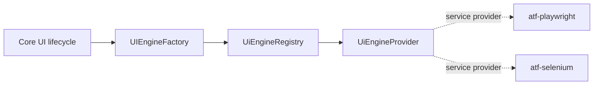

# Neutral UI engine contracts

## Overview

This package belongs to [atf-core](../../../../../../../../README.md).
It owns the stable UI API, provider SPI, engine selection and shared selector,
timing and zoom vocabulary.

## Composition

Legend: relationships and proof boundary

Solid arrows show Core calls. Dotted arrows identify provider implementations
discovered through ServiceLoader; they are not Core module dependencies.

| Contract | Responsibility |
|---|---|
| [UIEngine](UIEngine.java) | Browser-neutral actions and capabilities |
| [UiEngineProvider](UiEngineProvider.java) | Provider identity and engine creation |
| [UiEngineRegistry](UiEngineRegistry.java) | Available provider registration and selection |
| [UIEngineFactory](UIEngineFactory.java) | Configuration-driven creation |
| [syntax](syntax) | Shared selector and option text normalization |
| [timing](timing) | Duration conversion and timing helpers |
| [zoom](zoom) | Shared zoom phase vocabulary |

## Adapter ownership

[atf-playwright](../../../../../../../../../atf-playwright/README.md) owns Playwright
sessions, locators, element actions, screenshots and network/zoom evidence.
[atf-selenium](../../../../../../../../../atf-selenium/README.md) owns the corresponding
Selenium implementation and driver resolution.

Vendor imports belong to the matching adapter module, even though Java package
names retain the com.ai.ui.core.engine prefix. Product support calls the neutral
API. Engines publish runtime metadata through Core contracts; report rendering
belongs to atf-reporting.

## Verification

[Registry checks](../../../../../../../../../atf-tests/src/test/java/com/ai/atf/ui/component/registry/UiEngineRegistryContractTest.java),
[boundary checks](../../../../../../../../../atf-tests/src/test/java/com/ai/atf/ui/component/engine/UiEngineBoundaryContractTest.java)
and [browser parity](../../../../../../../../../atf-tests/src/test/java/com/ai/atf/ui/component/parity/SeleniumPlaywrightLocatorParityContractTest.java)
protect composition and behavior. Run the focused checks and complete browser
acceptance appropriate to the change, following
[Testing](../../../../../../../../../docs/Testing.md).
