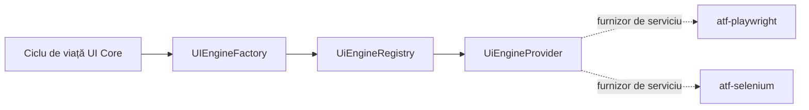

# Contractele neutre ale motorului UI

## Prezentare generală

Acest pachet aparține [atf-core](../../../../../../../../README.md).
Gestionează API-ul UI stabil, SPI-ul furnizorilor, selecția motorului și vocabularul
comun pentru selectori, temporizare și zoom.

## Compoziție

Legendă: relații și limita dovezii

Săgețile continue arată apelurile Core. Cele punctate identifică implementările
furnizorilor descoperite prin ServiceLoader; nu sunt dependențe ale modulului Core.

| Contract | Responsabilitate |
|---|---|
| [UIEngine](UIEngine.java) | Acțiuni și capabilități independente de browser |
| [UiEngineProvider](UiEngineProvider.java) | Identitatea furnizorului și crearea motorului |
| [UiEngineRegistry](UiEngineRegistry.java) | Înregistrarea și selectarea furnizorilor disponibili |
| [UIEngineFactory](UIEngineFactory.java) | Creare pe baza configurației |
| [syntax](syntax) | Normalizarea comună a textelor selectorilor și opțiunilor |
| [timing](timing) | Conversia duratelor și utilitare de temporizare |
| [zoom](zoom) | Vocabularul comun al etapelor de zoom |

## Responsabilitățile adaptoarelor

[atf-playwright](../../../../../../../../../atf-playwright/README.md) gestionează sesiunile,
locatorii, acțiunile elementelor, capturile și dovezile de rețea/zoom Playwright.
[atf-selenium](../../../../../../../../../atf-selenium/README.md) gestionează implementarea
Selenium corespunzătoare și rezolvarea driverului.

Importurile furnizorilor aparțin adaptorului corespunzător, chiar dacă numele
pachetelor Java păstrează prefixul com.ai.ui.core.engine. Suportul produsului apelează
API-ul neutru. Motoarele publică metadate prin contractele Core; redarea rapoartelor
aparține atf-reporting.

## Verificare

[Verificările registrului](../../../../../../../../../atf-tests/src/test/java/com/ai/atf/ui/component/registry/UiEngineRegistryContractTest.java),
[verificările limitelor](../../../../../../../../../atf-tests/src/test/java/com/ai/atf/ui/component/engine/UiEngineBoundaryContractTest.java)
și [paritatea browserelor](../../../../../../../../../atf-tests/src/test/java/com/ai/atf/ui/component/parity/SeleniumPlaywrightLocatorParityContractTest.java)
protejează compoziția și comportamentul. Rulează verificările focalizate și acceptanța
completă de browser potrivită schimbării, conform
[Testare](../../../../../../../../../docs/Testing.md).
