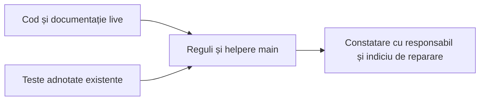

# atf-governance

<a id="overview"></a>
## Prezentare generală

Guvernanța codului, dependențelor și documentației are propriul modul Maven:
`com.ai:atf-governance:1.0.0`. Regulile și helperele sunt împachetate din `src/main`;
clasele existente adnotate cu `@Test` TestNG sunt executate din `src/test`.



<details>
<summary>Legendă: inspecție și contraexemple independente</summary>

Săgețile descriu inspecția surselor și apelarea regulilor. Testele existente verifică
intrări valide, încălcări relevante și reparări reale. Constatarea indică un
responsabil și o reverificare; nu dovedește cauza sau comportamentul aplicației la distanță.

</details>

<a id="ownership"></a>
## Responsabilități

| Rădăcină de surse | Responsabilitate |
|---|---|
| [src/main/java](src/main/java) | Reguli de arhitectură, documentație, traducere și analiză lexicală; căi comune ale surselor |
| [src/test/java](src/test/java) | Contracte de guvernanță adnotate existente și controalele lor negative |
| [Resurse de guvernanță](src/test/resources/governance) | Un inventar revizuit al metodelor din guvernanță și verificările framework-ului |
| [Suita de guvernanță](src/test/resources/suites/framework-governance.xml) | Selecția implicită explicită a claselor |

JAR-ul helperelor main folosește JDK și TestNG. Bibliotecile de execuție sunt dependențe
de test pentru descoperirea furnizorilor și compilarea exemplelor documentate; aceste
dependențe de test nu devin dependențe ale consumatorilor JAR-ului de helpere.

Helperele framework-ului și produsului aparțin [atf-tests](../atf-tests/README.md).
Ambele module de verificare impun aceeași regulă: helpere în main,
clase TestNG adnotate și fixture-uri adnotate imbricate în test.

<a id="execution"></a>
## Execuție

<details>
<summary>Rulează guvernanța sau reactorul complet</summary>

```powershell
mvn -B -ntp -pl atf-governance -am test
mvn -B -ntp verify
```

</details>

Construirea din rădăcină rulează guvernanța înainte de atf-tests. Profilurile browser și
aggregate schimbă selecția atf-tests; guvernanța păstrează propria suită implicită.
Rulările filtrate oferă dovezi focalizate, fără a înlocui acceptanța reactorului complet.

Folosește [politica](../docs/governance/Code_And_Documentation_Policy.md) și
[procesul de diagnostic](../docs/governance/Failure_Diagnostics.md) pentru o încălcare.
Păstrează rezultatele originale și califică repararea reală. [Testare](../docs/Testing.md)
explică diferența dintre guvernanță, componente și acceptanța aplicației.
