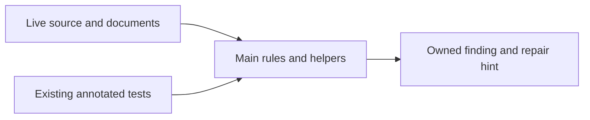

# atf-governance

## Overview

Code, dependency and documentation governance has its own Maven owner:
`com.ai:atf-governance:1.0.0`. Rules and helpers are packaged from `src/main`;
existing classes annotated with TestNG `@Test` execute from `src/test`.



<details>
<summary>Legend: inspection and independent counterexamples</summary>

Arrows describe source inspection and rule invocation. Existing tests exercise
valid inputs, meaningful violations and real repairs. A finding identifies an
owner and a recheck; it does not prove a root cause or remote application behavior.

</details>

## Ownership

| Source root | Responsibility |
|---|---|
| [src/main/java](src/main/java) | Architecture, documentation, translation and lexical rules; shared source paths |
| [src/test/java](src/test/java) | Existing annotated governance contracts and their negative controls |
| [governance resources](src/test/resources/governance) | One reviewed method inventory spanning governance and framework checks |
| [governance suite](src/test/resources/suites/framework-governance.xml) | Explicit default class selection |

The main helper JAR uses the JDK and TestNG. Runtime libraries are test dependencies
for provider discovery and compilation of documented examples; those test dependencies
do not become dependencies of consumers of this helper JAR.

Framework and product helpers belong to [atf-tests](../atf-tests/README.md).
Both verification modules enforce the same source-root rule: helpers in main,
annotated TestNG classes and nested annotated fixtures in test.

## Execution

<details>
<summary>Run governance or the complete reactor</summary>

```powershell
mvn -B -ntp -pl atf-governance -am test
mvn -B -ntp verify
```

</details>

The root build runs governance before atf-tests. The browser and aggregate profiles
change the atf-tests selection; governance keeps its own default suite. Filtered
runs are focused evidence, not substitutes for complete reactor acceptance.

Use the [policy](../docs/governance/Code_And_Documentation_Policy.md) and
[diagnostic workflow](../docs/governance/Failure_Diagnostics.md) to inspect a failure.
Preserve original outcomes and qualify the actual repair. [Testing](../docs/Testing.md)
explains the difference between governance, components and application acceptance.
