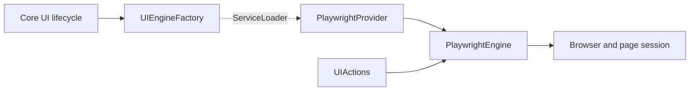

# atf-playwright

## Overview

The Playwright adapter implements Core UI contracts with the Playwright Java
SDK. Its coordinates are `com.ai:atf-playwright:1.0.0`.

## Ownership and entry points

The [Playwright engine package](src/main/java/com/ai/ui/core/engine/playwright)
owns browser/context/page lifecycle, element actions and reads, locator
translation, screenshots, zoom and network evidence. The module registers its
UiEngineProvider through ServiceLoader.

The [provider](src/main/java/com/ai/ui/core/engine/playwright/PlaywrightProvider.java)
creates the [engine](src/main/java/com/ai/ui/core/engine/playwright/PlaywrightEngine.java);
the [browser session](src/main/java/com/ai/ui/core/engine/playwright/PlaywrightBrowserSession.java)
owns Playwright browser/context/page creation and cleanup.



<details>
<summary>Legend: relationships and proof boundary</summary>

The lifecycle node is BaseTestUI/DriverManager. Solid arrows show creation or
delegation; the dotted arrow shows provider discovery. Consumers use Core
UIEngine/UIActions and choose `ui.engine=playwright`.
Playwright SDK types stay inside this adapter.

</details>

## Dependencies and configuration

| Dependency | Purpose |
|---|---|
| [atf-core](../atf-core/README.md) | Neutral UI API, provider SPI, configuration and runtime metadata |
| Playwright Java SDK | Browser implementation and pinned browser revision |

[Core defaults](../atf-core/src/main/resources/framework.properties) select Playwright with headless execution.

- Shared UI keys control window size, zoom, waits and screenshots.
- PLAYWRIGHT_BROWSERS_PATH can select an external browser cache.
- Use the SDK's bundled Node runtime for the maintained setup.

## Consumer example

Install `com.ai:atf-playwright:1.0.0` in the consumer project; it brings Core
transitively. Reporting is optional and comes from `com.ai:atf-reporting:1.0.0`.
Configure the consumer before TestNG starts, using its configuration file or
equivalent JVM properties:

```properties example
ui.engine=playwright
ui.headless=true
ui.wait.timeout.seconds=8
```

This complete illustrative class belongs in the consumer project. It is not a
repository test selection. It uses the neutral API and a local data page, with
no public application dependency:

```java compile
import com.ai.ui.core.runtime.BaseTestUI;
import com.ai.ui.core.runtime.DriverManager;
import com.ai.ui.support.actions.UIActions;
import org.testng.Assert;
import org.testng.annotations.Test;

import java.net.URLEncoder;
import java.nio.charset.StandardCharsets;

public class PlaywrightUiExampleTest extends BaseTestUI {
    @Test
    public void displaysTheEnteredName() {
        String html = "<!doctype html><html lang='en'><body>"
                + "<label for='name'>Name</label><input id='name'>"
                + "<button id='show' onclick=\"document.getElementById('result').textContent="
                + "document.getElementById('name').value\">Show name</button>"
                + "<p id='result' aria-live='polite'></p></body></html>";
        String page = "data:text/html;charset=UTF-8,"
                + URLEncoder.encode(html, StandardCharsets.UTF_8).replace("+", "%20");
        DriverManager.getEngine().open(page);
        UIActions.type("#name", "Name input", "Reader");
        UIActions.click("#show", "Show name");
        Assert.assertEquals(UIActions.getText("#result", "Displayed name"), "Reader");
    }
}
```

BaseTestUI owns the class-scoped session hooks. Set the engine before setup,
rather than changing it after a test method has started. The same consumer
action/assertion code also works with the [Selenium configuration](../atf-selenium/README.md#consumer-example).

## Acquisition failure and cleanup

If launch, context/page creation or window setup fails, release only acquired
resources in reverse order. A persistent context owns its browser; close the
context and Playwright, then remove the temporary profile. Preserve the original
failure and retain distinct cleanup causes as suppressed exceptions.

The existing [provider test](src/test/java/com/ai/ui/core/engine/playwright/PlaywrightProviderTest.java)
uses a package-local acquisition seam to exercise success, RuntimeException,
Error and cleanup failures without browser launch. Normal close preserves its
first failure while still closing later resources. Real process termination
retains its separate native-browser proof boundary.

## Verification

From an isolated reactor copy:

<details>
<summary>Run Verification commands</summary>

```powershell
mvn -B -ntp -pl atf-playwright -am test
mvn -B -ntp -pl atf-tests -am "-Dtest=SeleniumPlaywrightLocatorParityContractTest,UiEngineScreenshotSmokeTest" "-Dsurefire.failIfNoSpecifiedTests=false" test
mvn -B -ntp -pl atf-tests -am -Pbrowser test
```

</details>

The first command runs native provider/Core checks without starting a browser.

- The second selects existing local locator, real network-response and screenshot regressions.
- Their fixtures exercise **both Playwright and Selenium**; setting `ui.engine=playwright` does not turn those parity selections into a single-engine run.
- The final command selects the maintained browser suite.
- Follow [browser preparation](../docs/Testing.md#browser-preparation-and-checks) first.

| Behavior | Existing executable source |
|---|---|
| Locators, observed local request/response and negative response matching | [Locator/network parity contracts](../atf-tests/src/test/java/com/ai/atf/ui/component/parity/SeleniumPlaywrightLocatorParityContractTest.java) |
| Browser screenshots and configured window behavior | [Screenshot smoke contracts](../atf-tests/src/test/java/com/ai/atf/core/reporting/screenshot/UiEngineScreenshotSmokeTest.java) |
| Screenshot/report attachment lifecycle | [Final screenshot contracts](../atf-tests/src/test/java/com/ai/atf/core/reporting/screenshot/FinalUiScreenshotContractTest.java) |

Identifiers, comments, logs and assertion messages **MUST be in English**.
Canonical documentation is English; Romanian README translations follow the
[edition contract](../docs/governance/Readme_Editions.md). Apply the [code/documentation policy](../docs/governance/Code_And_Documentation_Policy.md)
and retain meaningful [scanner fixtures](../atf-tests/src/test/java/com/ai/atf/governance/JavaSourceScannerTest.java).
