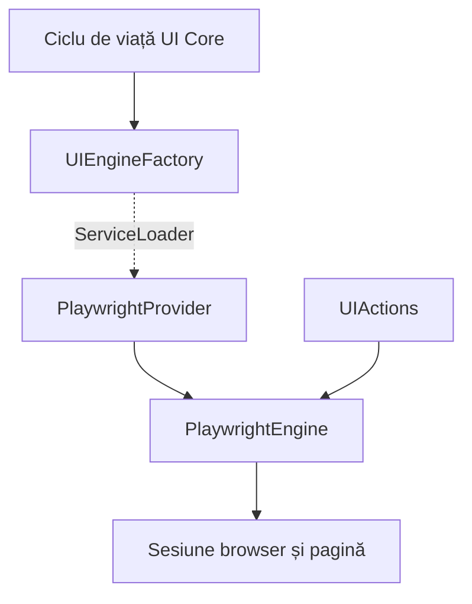

# atf-playwright

<a id="overview"></a>
## Prezentare generală

Adaptorul Playwright implementează contractele UI Core folosind SDK-ul Playwright
pentru Java. Coordonatele sunt `com.ai:atf-playwright:1.0.0`.

<a id="ownership-and-entry-points"></a>
## Responsabilități și puncte de intrare

[Pachetul motorului Playwright](src/main/java/com/ai/ui/core/engine/playwright)
gestionează ciclul de viață browser/context/pagină, acțiunile și citirile elementelor,
traducerea locatorilor, capturile de ecran, zoomul și dovezile de rețea. Modulul
înregistrează UiEngineProvider prin ServiceLoader.

[Furnizorul](src/main/java/com/ai/ui/core/engine/playwright/PlaywrightProvider.java)
creează [motorul](src/main/java/com/ai/ui/core/engine/playwright/PlaywrightEngine.java);
[sesiunea de browser](src/main/java/com/ai/ui/core/engine/playwright/PlaywrightBrowserSession.java)
gestionează crearea și închiderea browserului, contextului și paginii Playwright.



Nodul ciclului de viață reprezintă BaseTestUI/DriverManager. Săgețile continue arată
crearea sau delegarea; săgeata punctată arată descoperirea furnizorului. Consumatorii
folosesc UIEngine/UIActions din Core și aleg `ui.engine=playwright`.
Tipurile SDK-ului Playwright rămân în acest adaptor.

<a id="dependencies-and-configuration"></a>
## Dependențe și configurație

| Dependență | Scop |
|---|---|
| [atf-core](../atf-core/README.md) | API UI neutru, SPI pentru furnizori, configurație și metadate de execuție |
| SDK Playwright pentru Java | Implementarea browserului și revizia fixată a acestuia |

[Valorile implicite Core](../atf-core/src/main/resources/framework.properties) selectează
Playwright cu execuție fără interfață vizibilă. Cheile UI comune controlează dimensiunea ferestrei,
zoomul, așteptările și capturile. PLAYWRIGHT_BROWSERS_PATH poate selecta un cache
extern pentru browsere. Pentru pregătirea menținută, folosește Node inclus în SDK.

<a id="consumer-example"></a>
## Exemplu pentru consumator

Instalează `com.ai:atf-playwright:1.0.0` în proiectul consumator; acesta aduce Core
tranzitiv. Raportarea este opțională și provine din `com.ai:atf-reporting:1.0.0`.
Configurează consumatorul înainte de pornirea TestNG, prin fișierul său de configurație
sau prin proprietăți JVM echivalente:

```properties example
ui.engine=playwright
ui.headless=true
ui.wait.timeout.seconds=8
```

Această clasă ilustrativă completă aparține proiectului consumator. Nu reprezintă
o selecție de teste din depozit. Folosește API-ul neutru și o pagină locală de date,
fără dependență de o aplicație publică:

```java compile
import com.ai.ui.core.runtime.BaseTestUI;
import com.ai.ui.core.runtime.DriverManager;
import com.ai.ui.support.actions.UIActions;
import org.testng.Assert;
import org.testng.annotations.Test;

import java.net.URLEncoder;
import java.nio.charset.StandardCharsets;

public class PlaywrightUiExampleTest extends BaseTestUI {
    @Test
    public void displaysTheEnteredName() {
        String html = "<!doctype html><html lang='en'><body>"
                + "<label for='name'>Name</label><input id='name'>"
                + "<button id='show' onclick=\"document.getElementById('result').textContent="
                + "document.getElementById('name').value\">Show name</button>"
                + "<p id='result' aria-live='polite'></p></body></html>";
        String page = "data:text/html;charset=UTF-8,"
                + URLEncoder.encode(html, StandardCharsets.UTF_8).replace("+", "%20");
        DriverManager.getEngine().open(page);
        UIActions.type("#name", "Name input", "Reader");
        UIActions.click("#show", "Show name");
        Assert.assertEquals(UIActions.getText("#result", "Displayed name"), "Reader");
    }
}
```

BaseTestUI gestionează metodele sesiunii la nivel de clasă. Setează motorul înainte
de inițializare, nu după pornirea unei metode de test. Același cod de acțiuni și
aserțiuni funcționează și cu [configurația Selenium](../atf-selenium/README.md#consumer-example).

<a id="acquisition-failure-and-cleanup"></a>
## Eșecul achiziției și curățarea

Dacă lansarea, crearea contextului/paginii sau configurarea ferestrei eșuează,
eliberează numai resursele achiziționate, în ordine inversă. Contextul persistent
deține browserul; închide contextul și Playwright, apoi elimină profilul temporar.
Păstrează eșecul original și cauzele distincte de curățare ca excepții suprimate.

[Testul existent al furnizorului](src/test/java/com/ai/ui/core/engine/playwright/PlaywrightProviderTest.java)
folosește o injecție de achiziție locală pachetului pentru succes, RuntimeException,
Error și eșecuri de curățare, fără pornirea browserului. Închiderea normală păstrează
primul eșec și continuă eliberarea celorlalte resurse. Terminarea proceselor reale
își păstrează limita separată de dovezi native de browser.

<a id="verification"></a>
## Verificare

Dintr-o copie izolată a reactorului:

<details>
<summary>Rulează comenzile: Verificare</summary>

```powershell
mvn -B -ntp -pl atf-playwright -am test
mvn -B -ntp -pl atf-tests -am "-Dtest=SeleniumPlaywrightLocatorParityContractTest,UiEngineScreenshotSmokeTest" "-Dsurefire.failIfNoSpecifiedTests=false" test
mvn -B -ntp -pl atf-tests -am -Pbrowser test
```

</details>

Prima comandă rulează verificările native ale furnizorului și Core fără a porni browserul.
A doua selectează regresiile existente pentru locatori locali, răspunsuri reale de rețea
și capturi. Fixture-urile verifică **atât Playwright, cât și Selenium**; setarea
`ui.engine=playwright` nu transformă selecțiile de paritate într-o rulare cu un singur motor.
Ultima comandă selectează suita menținută de browser. Urmează mai întâi
[pregătirea browserelor](../docs/Testing.md#browser-preparation-and-checks).

| Comportament | Sursă executabilă existentă |
|---|---|
| Locatori, cerere/răspuns local observat și potrivirea negativă a răspunsurilor | [Contracte de paritate pentru locatori și rețea](../atf-tests/src/test/java/com/ai/atf/ui/component/parity/SeleniumPlaywrightLocatorParityContractTest.java) |
| Capturi de browser și comportamentul ferestrei configurate | [Contracte de verificare rapidă a capturilor](../atf-tests/src/test/java/com/ai/atf/core/reporting/screenshot/UiEngineScreenshotSmokeTest.java) |
| Ciclul capturilor și al atașamentelor din rapoarte | [Contractele capturii finale](../atf-tests/src/test/java/com/ai/atf/core/reporting/screenshot/FinalUiScreenshotContractTest.java) |

Identificatorii, comentariile, jurnalele și mesajele aserțiunilor **TREBUIE să fie în engleză**.
Documentația canonică este în engleză; traducerile README în română urmează
[contractul edițiilor](../docs/governance/Readme_Editions.md). Aplică [politica pentru cod și documentație](../docs/governance/Code_And_Documentation_Policy.md)
și păstrează [fixture-uri relevante ale scanerului](../atf-tests/src/test/java/com/ai/atf/governance/JavaSourceScannerTest.java).
