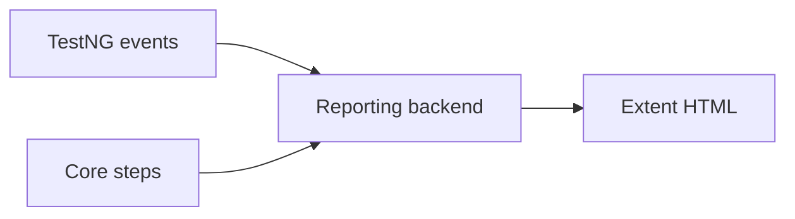

# atf-reporting

## Overview

Reporting supplies the Core ReportingBackend implementation, TestNG lifecycle
integration and Extent publication. Its coordinates are
`com.ai:atf-reporting:1.0.0`.



<details>
<summary>Legend: selection, ownership and outcomes</summary>

Arrows show TestNG lifecycle and neutral Core step events reaching the Extent backend. This module owns publication, sessions, attachments and finalization. Aggregate acceptance produces a separate Extent reader from executed case records.

</details>

## Ownership and entry points

| Area | Owner |
|---|---|
| Vendor translation | [Adapters](src/main/java/com/ai/core/reporting/adapters/README.md) |
| TestNG events and runtime outcomes | [Listener](src/main/java/com/ai/core/reporting/listener/README.md) |
| Combined executed-case publication | [Aggregate reporting](src/main/java/com/ai/core/reporting/aggregate/README.md) |
| Runtime artifacts | Attachment registries, screenshots, audit and report HTML |

[DefaultReportingBackend](src/main/java/com/ai/core/reporting/DefaultReportingBackend.java) implements the Core ReportingBackend SPI and is discovered through ServiceLoader.

- [ReportingTestListener](src/main/java/com/ai/core/reporting/listener/ReportingTestListener.java) is the concrete lifecycle listener, reached through Core's compatibility facade.
- Core owns the neutral ReportLogger/TestStatus/step contracts and carries no vendor listener annotation.

## Dependencies and configuration

| Dependency | Purpose |
|---|---|
| [atf-core](../atf-core/README.md) | Reporting SPI, steps, configuration and runtime evidence |
| ExtentReports | HTML report implementation |

[Core defaults](../atf-core/src/main/resources/framework.properties) select `reporting.engine=extent` and `reports.dir=target/reports`.

- Timestamp keys control Extent output naming.
- The aggregate profile selects its maintained suite and publishes Extent HTML with the aggregate configuration.

Ordinary reporting does not depend on historical evidence or calibration files.

## Verification

From an isolated reactor copy:

<details>
<summary>Run Verification commands</summary>

```powershell
mvn -B -ntp -pl atf-reporting -am test
mvn -B -ntp -pl atf-tests -am "-Datf.test.suite=src/test/resources/suites/framework-reporting.xml" test
mvn -B -ntp -Paggregate test
```

</details>

Native checks protect module integration; cross-module regressions protect
lifecycle and presentation behavior. [Testing](../docs/Testing.md) also defines
aggregate and real-browser artifact acceptance. Inspect the emitted
reports and attachments as well as the test result.
