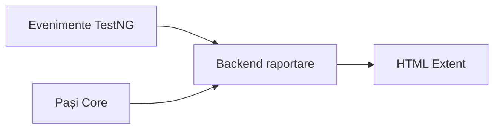

# atf-reporting

<a id="overview"></a>
## Prezentare generală

Reporting furnizează implementarea Core ReportingBackend, integrarea ciclului de viață
TestNG și publicarea Extent. Coordonatele sunt
`com.ai:atf-reporting:1.0.0`.



<details>
<summary>Legendă: selecție, responsabilitate și rezultate</summary>

Săgețile arată evenimentele TestNG și pașii neutri Core ajungând la implementarea Extent. Modulul deține publicarea, sesiunile, atașamentele și finalizarea. Acceptanța agregată produce un cititor Extent separat din cazurile executate.

</details>

<a id="ownership-and-entry-points"></a>
## Responsabilități și puncte de intrare

| Zonă | Responsabil |
|---|---|
| Conversie către furnizori | [Adaptoare](src/main/java/com/ai/core/reporting/adapters/README.md) |
| Evenimente TestNG și rezultate de execuție | [Ascultător](src/main/java/com/ai/core/reporting/listener/README.md) |
| Publicarea combinată a cazurilor executate | [Raportare agregată](src/main/java/com/ai/core/reporting/aggregate/README.md) |
| Artefacte de execuție | Registre de atașamente, capturi, audit și HTML pentru rapoarte |

[DefaultReportingBackend](src/main/java/com/ai/core/reporting/DefaultReportingBackend.java) implementează SPI-ul Core ReportingBackend și este descoperit prin ServiceLoader.

- [ReportingTestListener](src/main/java/com/ai/core/reporting/listener/ReportingTestListener.java) este ascultătorul concret al ciclului de viață, accesat prin fațada de compatibilitate Core.
- Core gestionează contractele neutre ReportLogger/TestStatus/pași și nu include adnotarea ascultătorului unui furnizor.

<a id="dependencies-and-configuration"></a>
## Dependențe și configurație

| Dependență | Scop |
|---|---|
| [atf-core](../atf-core/README.md) | SPI de raportare, pași, configurație și dovezi de execuție |
| ExtentReports | Implementarea raportului HTML |

[Valorile implicite Core](../atf-core/src/main/resources/framework.properties) selectează `reporting.engine=extent` și `reports.dir=target/reports`.

- Cheile de marcaj temporal controlează denumirea rezultatelor Extent.
- Profilul aggregate selectează suita sa menținută și publică HTML Extent folosind configurația de agregare.

Raportarea obișnuită nu depinde de dovezi istorice sau de fișiere de calibrare.

<a id="verification"></a>
## Verificare

Dintr-o copie izolată a reactorului:

<details>
<summary>Rulează comenzile: Verificare</summary>

```powershell
mvn -B -ntp -pl atf-reporting -am test
mvn -B -ntp -pl atf-tests -am "-Datf.test.suite=src/test/resources/suites/framework-reporting.xml" test
mvn -B -ntp -Paggregate test
```

</details>

Verificările native protejează integrarea modulului; regresiile între module protejează
ciclul de viață și prezentarea. [Testare](../docs/Testing.md) definește și verificările
agregate și acceptanța artefactelor în browsere reale. Inspectează rapoartele și
atașamentele emise, împreună cu rezultatul testelor.
