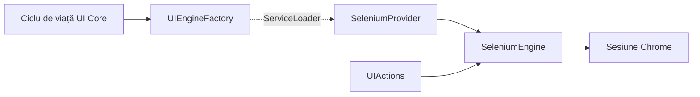

# atf-selenium

<a id="overview"></a>
## Prezentare generală

Adaptorul Selenium implementează contractele UI Core folosind Selenium WebDriver.
Coordonatele sunt `com.ai:atf-selenium:1.0.0`.

<a id="ownership-and-entry-points"></a>
## Responsabilități și puncte de intrare

[Pachetul motorului Selenium](src/main/java/com/ai/ui/core/engine/selenium)
gestionează ciclul de viață WebDriver, acțiunile și citirile elementelor, traducerea
selectorilor, capturile de ecran, zoomul și dovezile de rețea. Modulul înregistrează
UiEngineProvider prin ServiceLoader.

[Furnizorul](src/main/java/com/ai/ui/core/engine/selenium/SeleniumProvider.java)
creează [motorul](src/main/java/com/ai/ui/core/engine/selenium/SeleniumEngine.java);
[sesiunea de browser](src/main/java/com/ai/ui/core/engine/selenium/SeleniumBrowserSession.java)
deleagă crearea ChromeDriver către fabrica de drivere a adaptorului.



<details>
<summary>Legendă: relații și limita dovezii</summary>

Nodul ciclului de viață reprezintă BaseTestUI/DriverManager; sesiunea Chrome aparține
SeleniumBrowserSession și fabricii sale de drivere. Săgețile continue arată crearea
sau delegarea; cea punctată arată descoperirea furnizorului. Consumatorii folosesc
UIEngine/UIActions din Core și aleg `ui.engine=selenium`.
WebDriver și celelalte tipuri ale SDK-ului Selenium rămân în acest adaptor.

</details>

<a id="dependencies-and-configuration"></a>
## Dependențe și configurație

| Dependență | Scop |
|---|---|
| [atf-core](../atf-core/README.md) | API UI neutru, SPI pentru furnizori, configurație și metadate de execuție |
| Selenium Java | Implementarea browserului și a driverului |

[Setările Core](../atf-core/src/main/resources/framework.properties) comune controlează
execuția fără interfață vizibilă, dimensiunea ferestrei, zoomul, așteptările și capturile.
[SeleniumChromeDriverFactory](src/main/java/com/ai/ui/core/engine/selenium/SeleniumChromeDriverFactory.java)
preferă un `webdriver.chrome.driver` explicit, apoi o cale utilizabilă către driverul din
cache, apoi Selenium Manager. Leagă dovezile de acceptanță browser/driver de
versiunile instalate efectiv.

<a id="consumer-example"></a>
## Exemplu pentru consumator

Instalează `com.ai:atf-selenium:1.0.0` în proiectul consumator; Core este tranzitiv.
Adaugă `com.ai:atf-reporting:1.0.0` când sunt necesare dovezi publicate în rapoarte.
Configurează consumatorul înainte de pornirea TestNG:

```properties example
ui.engine=selenium
ui.headless=true
ui.wait.timeout.seconds=8
```

Aceasta este o clasă ilustrativă completă pentru consumator, nu o selecție de teste din depozit.
Folosește acțiunile neutre Core și un fixture local de date:

```java compile
import com.ai.ui.core.runtime.BaseTestUI;
import com.ai.ui.core.runtime.DriverManager;
import com.ai.ui.support.actions.UIActions;
import org.testng.Assert;
import org.testng.annotations.Test;

import java.net.URLEncoder;
import java.nio.charset.StandardCharsets;

public class SeleniumUiExampleTest extends BaseTestUI {
    @Test
    public void displaysTheEnteredName() {
        String html = "<!doctype html><html lang='en'><body>"
                + "<label for='name'>Name</label><input id='name'>"
                + "<button id='show' onclick=\"document.getElementById('result').textContent="
                + "document.getElementById('name').value\">Show name</button>"
                + "<p id='result' aria-live='polite'></p></body></html>";
        String page = "data:text/html;charset=UTF-8,"
                + URLEncoder.encode(html, StandardCharsets.UTF_8).replace("+", "%20");
        DriverManager.getEngine().open(page);
        UIActions.type("#name", "Name input", "Reader");
        UIActions.click("#show", "Show name");
        Assert.assertEquals(UIActions.getText("#result", "Displayed name"), "Reader");
    }
}
```

Metodele moștenite creează și închid sesiunea de browser asociată firului de execuție.
Codul de acțiuni și aserțiuni este comun cu [exemplul Playwright](../atf-playwright/README.md#consumer-example);
furnizorul instalat și setarea `ui.engine` de dinaintea inițializării selectează adaptorul.

<a id="acquisition-failure-and-cleanup"></a>
## Eșecul achiziției și curățarea

După achiziția driverului, orice eșec al timeout-urilor, ferestrei sau verificării
ferestrelor inițiale închide exact acel driver. Un factory eșuat nu furnizează un
driver de închis. Păstrează RuntimeException sau Error original și atașează eșecul
distinct al închiderii ca dovadă suprimată; un eșec nu se poate suprima pe sine.

[Testul existent al furnizorului](src/test/java/com/ai/ui/core/engine/selenium/SeleniumProviderTest.java)
injectează factory-ul și colaboratorii driverului fără pornirea Chrome. Succesul
folosește și închide același driver deținut. Compatibilitatea browser/driver reală
își păstrează limita separată de acceptanță nativă.

<a id="verification"></a>
## Verificare

Dintr-o copie izolată a reactorului:

<details>
<summary>Rulează comenzile: Verificare</summary>

```powershell
mvn -B -ntp -pl atf-selenium -am test
mvn -B -ntp -pl atf-tests -am "-Dtest=SeleniumPlaywrightLocatorParityContractTest,UiEngineScreenshotSmokeTest" "-Dsurefire.failIfNoSpecifiedTests=false" test
mvn -B -ntp -pl atf-tests -am -Pbrowser test
```

</details>

Prima comandă rulează verificările native ale furnizorului și Core fără a porni Chrome.

- A doua selectează regresiile existente pentru locatori locali, răspunsuri reale de rețea și capturi.
- Fixture-urile selectate verifică **atât Selenium, cât și Playwright**; `ui.engine=selenium` nu limitează aceste cazuri parametrizate de paritate la un singur motor.
- Ultima comandă selectează suita menținută de browser.
- Urmează [pregătirea browserelor](../docs/Testing.md#browser-preparation-and-checks).
- [Contractele interne](../atf-tests/src/test/java/com/ai/atf/ui/component/engine/SeleniumEngineInternalContractTest.java) și [paritatea locatorilor](../atf-tests/src/test/java/com/ai/atf/ui/component/parity/SeleniumPlaywrightLocatorParityContractTest.java) protejează rezolvarea driverului și comportamentul comun.

| Comportament | Sursă executabilă existentă |
|---|---|
| Locatori, metodă/stare/corp din răspunsul local real și nepotriviri cu așteptare limitată | [Contracte de paritate pentru locatori și rețea](../atf-tests/src/test/java/com/ai/atf/ui/component/parity/SeleniumPlaywrightLocatorParityContractTest.java) |
| Capturi de browser și setări ale ferestrei | [Contracte de verificare rapidă a capturilor](../atf-tests/src/test/java/com/ai/atf/core/reporting/screenshot/UiEngineScreenshotSmokeTest.java) |
| Ciclul capturii finale și al atașamentelor din rapoarte | [Contractele capturii finale](../atf-tests/src/test/java/com/ai/atf/core/reporting/screenshot/FinalUiScreenshotContractTest.java) |

Identificatorii din surse, comentariile, jurnalele și mesajele aserțiunilor **TREBUIE să fie în engleză**.
Documentația canonică este în engleză; traducerile README în română urmează
[contractul edițiilor](../docs/governance/Readme_Editions.md). Urmează [politica pentru cod și documentație](../docs/governance/Code_And_Documentation_Policy.md)
și [cazurile de regresie ale scanerului de surse](../atf-tests/src/test/java/com/ai/atf/governance/JavaSourceScannerTest.java).

[Matricea menținută browser/driver/CDP](../docs/Testing.md#selenium-pinned-manager-route)
definește versiunile exacte și pregătirea portabilă. Folosește ruta Manager existentă,
cu un browser selectat explicit și un cache ATF de rezervă, separat și gol;
un driver explicit sau din cache poate ocoli altfel selecția browserului făcută de Manager.
Criteriile curente de acceptanță și de schimbare a versiunii sunt păstrate în
[feedback-ul de compatibilitate a browserelor](../docs/feedback/Browser_Compatibility_And_Portability.md#f-008).
