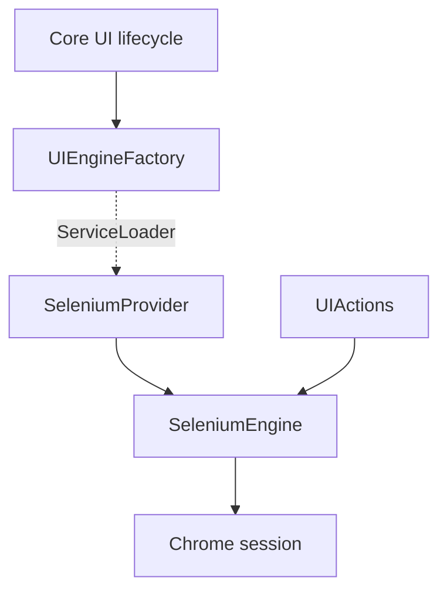

# atf-selenium

## Overview

The Selenium adapter implements Core UI contracts with Selenium WebDriver.
Its coordinates are `com.ai:atf-selenium:1.0.0`.

## Ownership and entry points

The [Selenium engine package](src/main/java/com/ai/ui/core/engine/selenium)
owns WebDriver lifecycle, element actions and reads, selector translation,
screenshots, zoom and network evidence. The module registers its
UiEngineProvider through ServiceLoader.

The [provider](src/main/java/com/ai/ui/core/engine/selenium/SeleniumProvider.java)
creates the [engine](src/main/java/com/ai/ui/core/engine/selenium/SeleniumEngine.java);
the [browser session](src/main/java/com/ai/ui/core/engine/selenium/SeleniumBrowserSession.java)
delegates ChromeDriver creation to the adapter's driver factory.



The lifecycle node is BaseTestUI/DriverManager; Chrome session belongs to
SeleniumBrowserSession and its driver factory. Solid arrows show creation or
delegation; the dotted arrow shows provider discovery. Consumers use Core
UIEngine/UIActions and choose `ui.engine=selenium`.
WebDriver and other Selenium SDK types stay inside this adapter.

## Dependencies and configuration

| Dependency | Purpose |
|---|---|
| [atf-core](../atf-core/README.md) | Neutral UI API, provider SPI, configuration and runtime metadata |
| Selenium Java | Browser and driver implementation |

Shared [Core settings](../atf-core/src/main/resources/framework.properties)
control headless execution, window size, zoom, waits and screenshots.
[SeleniumChromeDriverFactory](src/main/java/com/ai/ui/core/engine/selenium/SeleniumChromeDriverFactory.java)
prefers an explicit `webdriver.chrome.driver`, then its usable cached driver
path, then Selenium Manager. Keep browser/driver acceptance evidence tied to
the actual installed versions.

## Consumer example

Install `com.ai:atf-selenium:1.0.0` in the consumer project; Core is transitive.
Add `com.ai:atf-reporting:1.0.0` when published report evidence is required.
Configure the consumer before TestNG starts:

```properties example
ui.engine=selenium
ui.headless=true
ui.wait.timeout.seconds=8
```

This is a complete illustrative consumer class, not a repository test selection.
It uses Core's neutral actions and a local data fixture:

```java compile
import com.ai.ui.core.runtime.BaseTestUI;
import com.ai.ui.core.runtime.DriverManager;
import com.ai.ui.support.actions.UIActions;
import org.testng.Assert;
import org.testng.annotations.Test;

import java.net.URLEncoder;
import java.nio.charset.StandardCharsets;

public class SeleniumUiExampleTest extends BaseTestUI {
    @Test
    public void displaysTheEnteredName() {
        String html = "<!doctype html><html lang='en'><body>"
                + "<label for='name'>Name</label><input id='name'>"
                + "<button id='show' onclick=\"document.getElementById('result').textContent="
                + "document.getElementById('name').value\">Show name</button>"
                + "<p id='result' aria-live='polite'></p></body></html>";
        String page = "data:text/html;charset=UTF-8,"
                + URLEncoder.encode(html, StandardCharsets.UTF_8).replace("+", "%20");
        DriverManager.getEngine().open(page);
        UIActions.type("#name", "Name input", "Reader");
        UIActions.click("#show", "Show name");
        Assert.assertEquals(UIActions.getText("#result", "Displayed name"), "Reader");
    }
}
```

The inherited hooks create and close the thread-owned browser session. The
action/assertion code is shared with the [Playwright example](../atf-playwright/README.md#consumer-example);
the installed provider and the pre-setup `ui.engine` setting select the adapter.

## Verification

From an isolated reactor copy:

<details>
<summary>Run Verification commands</summary>

```powershell
mvn -B -ntp -pl atf-selenium -am test
mvn -B -ntp -pl atf-tests -am "-Dtest=SeleniumPlaywrightLocatorParityContractTest,UiEngineScreenshotSmokeTest" "-Dsurefire.failIfNoSpecifiedTests=false" test
mvn -B -ntp -pl atf-tests -am -Pbrowser test
```

</details>

The first command runs native provider/Core checks without starting Chrome.
The second selects existing local locator, real network-response and screenshot
regressions. The selected fixtures exercise **both Selenium and Playwright**;
`ui.engine=selenium` does not restrict those parameterized parity cases to one
engine. The final command selects the maintained browser suite. Follow
[browser preparation](../docs/Testing.md#browser-preparation-and-checks).
[Internal contracts](../atf-tests/src/test/java/com/ai/atf/ui/component/engine/SeleniumEngineInternalContractTest.java)
and [locator parity](../atf-tests/src/test/java/com/ai/atf/ui/component/parity/SeleniumPlaywrightLocatorParityContractTest.java)
protect driver resolution and shared behavior.

| Behavior | Existing executable source |
|---|---|
| Locators, actual local response method/status/body and bounded mismatches | [Locator/network parity contracts](../atf-tests/src/test/java/com/ai/atf/ui/component/parity/SeleniumPlaywrightLocatorParityContractTest.java) |
| Browser screenshots and window settings | [Screenshot smoke contracts](../atf-tests/src/test/java/com/ai/atf/core/reporting/screenshot/UiEngineScreenshotSmokeTest.java) |
| Final screenshot/report attachment lifecycle | [Final screenshot contracts](../atf-tests/src/test/java/com/ai/atf/core/reporting/screenshot/FinalUiScreenshotContractTest.java) |

Source identifiers, comments, logs and assertion messages **MUST be in English**.
Canonical documentation is English; Romanian README translations follow the
[edition contract](../docs/governance/Readme_Editions.md). Follow the [code/documentation policy](../docs/governance/Code_And_Documentation_Policy.md)
and its [source scanner regression cases](../atf-tests/src/test/java/com/ai/atf/governance/JavaSourceScannerTest.java).

The [maintained browser/driver/CDP matrix](../docs/Testing.md#selenium-pinned-manager-route)
owns exact versions and portable preparation. It uses the existing Manager route
with an explicitly selected browser and a separate empty ATF fallback cache;
an explicit or cached driver can otherwise bypass Manager's browser selection.
Current acceptance and version-change criteria are retained in
[browser compatibility feedback](../docs/feedback/Browser_Compatibility_And_Portability.md#f-008).
