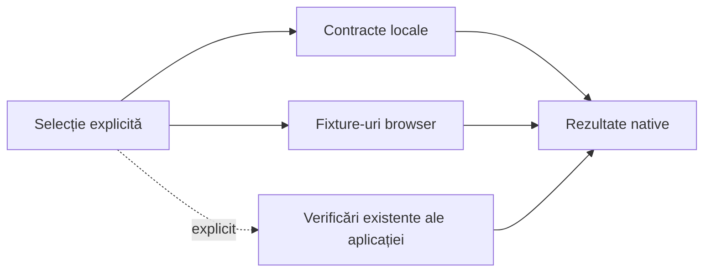

# atf-tests

<a id="overview"></a>
## Prezentare generală

Acest modul deține helperele de framework/produs și verificările existente între module și ale aplicației. Coordonate: `com.ai:atf-tests:1.0.0`.

Helperele sunt împachetate din src/main/java; clasele cu adnotări @Test TestNG rămân în src/test/java. Guvernanța are propriul [modul](../atf-governance/README.md).



<details>
<summary>Legendă: selecție, responsabilitate și rezultate</summary>

Săgețile arată selecția testelor și producerea dovezilor. Ramura punctată necesită o clasă explicită de aplicație și precondițiile mediului său. Suitele locale și browser nu selectează implicit acea ramură. Rezultatele native își păstrează subiectele și limitele; rezultatul aplicației nu se deduce dintr-un fixture local.

</details>

<a id="ownership"></a>
## Responsabilități

| Zonă | Locație |
|---|---|
| Verificări de framework adnotate | [com.ai.atf](src/test/java/com/ai/atf) |
| Pagini, fluxuri și aserțiuni UI ale produsului | [com.ai.ui.support](src/main/java/com/ai/ui/support) |
| Endpoint-uri API, modele și fabrici ale produsului | [com.ai.api.support](src/main/java/com/ai/api/support) |
| Selecții TestNG menținute | [suite](src/test/resources/suites) |
| Date fixture și scheme împachetate | [Resurse main](src/main/resources/tests) |
| Helpere de framework/raportare | [Java main](src/main/java/com/ai/atf) |

Modulul separat atf-governance protejează graful celor șapte module, limitele SDK-urilor, documentația și plasarea surselor. Verificările native rămân în modulele responsabile.

Modulul folosește [atf-core](../atf-core/README.md),
[atf-playwright](../atf-playwright/README.md),
[atf-selenium](../atf-selenium/README.md), [atf-reporting](../atf-reporting/README.md), [atf-api](../atf-api/README.md) și [atf-governance](../atf-governance/README.md) ca dependențe de compilare ale helperelor împachetate.

<a id="execution"></a>
## Execuție

Pentru o verificare eșuată a surselor sau documentației, urmează
[procedura de diagnostic](../docs/governance/Failure_Diagnostics.md): păstrează
constatarea observată, inspectează contractul responsabil și verifică remedierea
propusă prin selecția menținută. Un indiciu de remediere nu dovedește cauza.

Dintr-o copie izolată a reactorului:

<details>
<summary>Rulează comenzile: Execuție</summary>

```powershell
mvn -B -ntp test
mvn -B -ntp -pl atf-tests -am test
mvn -B -ntp -Pbrowser test
mvn -B -ntp -Paggregate test
```

</details>

Execuția implicită aici selectează framework-local. Reactorul rulează și suita separată de guvernanță.

- Profilul browser selectează framework-browser numai în acest modul.
- Profilul aggregate execută suita menținută de agregare și publică raportul HTML Extent.
- [Testare](../docs/Testing.md) definește pregătirea browserelor, comenzile filtrate, configurația aplicației și acceptanța artefactelor.

Scenariile aplicației rămân selecții explicite de clase. Au nevoie de URL-uri și
conturi configurate și pot crea date. Rezultatele locale de framework nu demonstrează
acceptanța pe un site public.

[Selecția UI păstrată](../docs/Testing.md#retained-product-ui-audit) rulează aceleași metode de înregistrare, cont și profil o dată prin fiecare furnizor de browser.

- Metodele testelor de produs compun servicii/componente și validări; acțiunile consemnează finalizarea tehnică, iar validările consemnează dovezile de afaceri așteptate/observate și un verdict final.
- Un scenariu negativ de aplicație trece numai când criteriul său de respingere este îndeplinit.
- Consultă [principiile vii](../docs/Living_Architecture_UI_API_doc_v1_0.md#retained-principles) pentru responsabilitățile menținute și limita explicită privind curățarea datelor.

<a id="evidence-and-maintenance"></a>
## Dovezi și mentenanță

Verificările existente de guvernanță impun catalogul menținut al suitelor, excluderile
explicite pentru teste live și fixture-uri de eșec, documentația responsabililor și ciclul feedback-ului.
Ghidul viu UI/API are o sursă Markdown canonică și o proiecție HTML verificată;
Atlasul de documentație rămâne în afara reactorului de execuție.

Rezultatele aparțin directoarelor target ale acestui modul din copia temporară
de validare. Păstrează sursa fiecărei rulări, selecția exactă, numărătorile și
artefactele în afara arborilor de surse de dezvoltare și live.
[Feedback-ul](../docs/feedback/README.md) păstrează TODO-urile active și dovezile istorice;
rezultatele noi trebuie să își precizeze limitele execuției.

Păstrează regresiile focalizate lângă comportamentul protejat. Actualizează
[responsabilitățile testelor de raportare](src/test/java/com/ai/atf/core/reporting/README.md)
când modifici acea zonă de teste.
