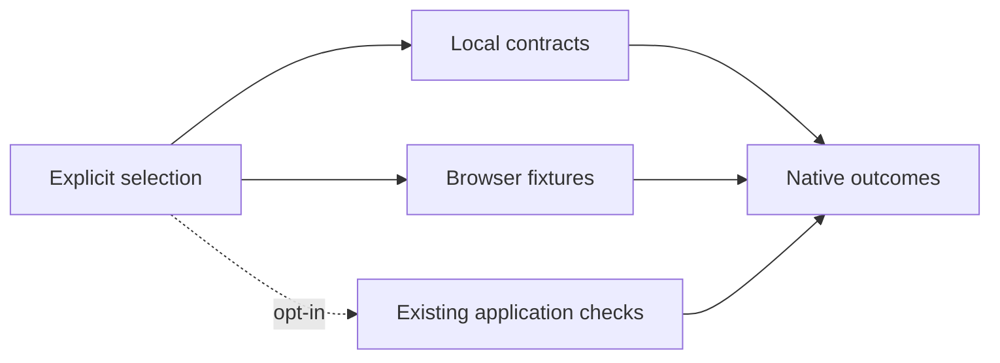

# atf-tests

## Overview

This module owns framework/product helpers and existing cross-module and application checks. Coordinates: `com.ai:atf-tests:1.0.0`.

Helpers are packaged from src/main/java; classes containing TestNG @Test annotations remain in src/test/java. Governance has its own [module](../atf-governance/README.md).



<details>
<summary>Legend: selection, ownership and outcomes</summary>

Arrows show test selection and evidence production. The dotted branch requires an explicit application class and its deployment prerequisites. Local and browser suites do not select that branch implicitly. Native outcomes retain their own subjects and proof limits; an application result is not inferred from a local fixture.

</details>

## Ownership

| Area | Location |
|---|---|
| Annotated framework checks | [com.ai.atf](src/test/java/com/ai/atf) |
| UI product pages, workflows and assertions | [com.ai.ui.support](src/main/java/com/ai/ui/support) |
| API product endpoints, models and factories | [com.ai.api.support](src/main/java/com/ai/api/support) |
| Maintained TestNG selections | [suites](src/test/resources/suites) |
| Packaged fixture data and schemas | [main resources](src/main/resources/tests) |
| Framework/report helpers | [main Java](src/main/java/com/ai/atf) |

The separate atf-governance module protects the seven-module graph, vendor boundaries, documentation and source placement. Native library checks remain with their owning modules.

The module uses [atf-core](../atf-core/README.md),
[atf-playwright](../atf-playwright/README.md),
[atf-selenium](../atf-selenium/README.md), [atf-reporting](../atf-reporting/README.md), [atf-api](../atf-api/README.md) and [atf-governance](../atf-governance/README.md) as compile dependencies of its packaged helpers.

## Execution

For a failed source/documentation guard, use the
[diagnostic workflow](../docs/governance/Failure_Diagnostics.md): preserve the
observed finding, inspect its owning contract and verify the proposed correction
with the maintained selection. A repair hint is not proof of a root cause.

From an isolated reactor copy:

<details>
<summary>Run Execution commands</summary>

```powershell
mvn -B -ntp test
mvn -B -ntp -pl atf-tests -am test
mvn -B -ntp -Pbrowser test
mvn -B -ntp -Paggregate test
```

</details>

The default here selects framework-local. The reactor also runs the separate governance suite.

- The browser profile selects framework-browser only in this module.
- The aggregate profile executes the maintained aggregate suite and publishes Extent HTML.
- [Testing](../docs/Testing.md) owns browser preparation, filtered commands, application configuration and artifact acceptance.

Application journeys remain explicit class selections. They need configured
URLs/accounts and can create data. Local framework results do not establish
public-site acceptance.

The [retained UI selection](../docs/Testing.md#retained-product-ui-audit) runs the same registration, account and profile methods once through each browser provider.

- Product test methods compose services/components and validations; actions record technical completion, while validations record expected/actual business evidence and a terminal verdict.
- A negative application scenario passes only when its rejection oracle succeeds.
- See the [living principles](../docs/Living_Architecture_UI_API_doc_v1_0.md#retained-principles) for the maintained responsibilities and explicit data-cleanup limit.

## Evidence and maintenance

The existing governance checks enforce the maintained suite catalog, explicit
live/failure-fixture exclusions, owner documentation and feedback lifecycle.
The living UI/API guide has a canonical Markdown source and a checked HTML
projection; the documentation Atlas stays outside the runtime reactor.

Results belong to this module's target directories in the disposable validation
copy. Preserve each run's source checkpoint, exact selection, counts and
artifacts outside the development and live source trees.
[Feedback](../docs/feedback/README.md) retains active TODOs and historical proof;
new results must identify their own execution scope.

Keep focused regressions next to the behavior they protect. Update
[reporting test ownership](src/test/java/com/ai/atf/core/reporting/README.md)
when changing that test area.
