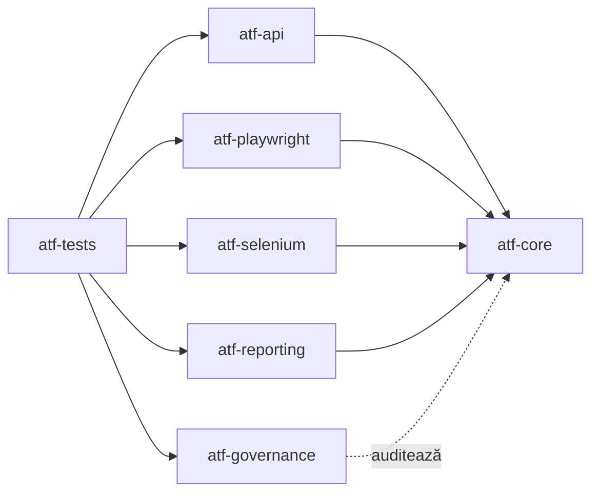
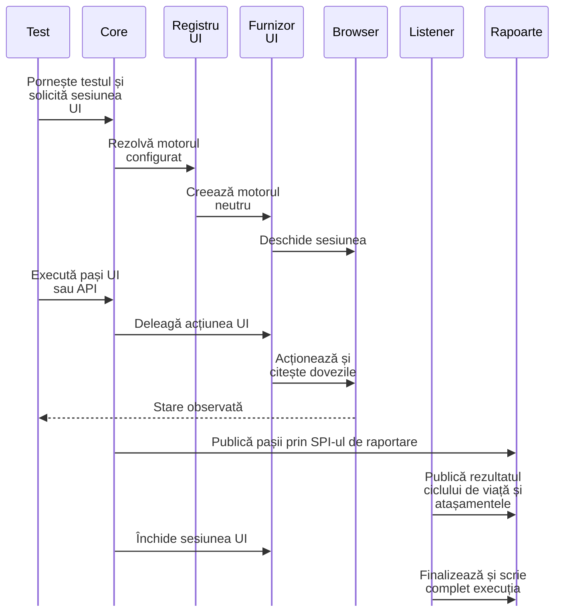

# Arhitectura framework-ului

## Responsabilitățile modulelor

[POM-ul părinte](../pom.xml) coordonează șapte module cu aceeași versiune. Core deține configurarea comună, contractele UI și raportarea neutră. Bibliotecile API, browser și raportare depind de Core. Modulele de verificare separă helperele reutilizabile de clasele TestNG adnotate.

Legendă: relații și limita dovezii

Săgețile continue arată dependențe de compilare selectate; cele punctate arată inspecția sursei. Guvernanța are dependențe de test spre cele cinci biblioteci de execuție pentru descoperirea SPI și compilarea exemplelor. Core nu depinde de implementările API, browser sau raportare.

| Modul | Responsabilitatea surselor |
|---|---|
| [atf-core](../atf-core/README.md) | com.ai.core.support, com.ai.core.reporting neutru, com.ai.ui.core neutru și UIActions |
| [atf-api](../atf-api/README.md) | com.ai.api.core: execuție REST Assured, ciclu de viață API și contractele răspunsului |
| [atf-playwright](../atf-playwright/README.md) | com.ai.ui.core.engine.playwright |
| [atf-selenium](../atf-selenium/README.md) | com.ai.ui.core.engine.selenium |
| [atf-reporting](../atf-reporting/README.md) | Furnizori de raportare, adaptoare, ascultători, publicarea atașamentelor, audit de execuție și generatoare agregate |
| [atf-governance](../atf-governance/README.md) | Reguli/helpere în main; teste de guvernanță adnotate și inventarul metodelor în test |
| [atf-tests](../atf-tests/README.md) | Main: helpere de framework/produs; test: clase existente adnotate de componentă și aplicație |

Pachetele își păstrează numele Java între module. Responsabilitățile modulelor,
declarațiile dependențelor și importurile definesc împreună limitele.

## Compoziția furnizorilor

[UIEngine](../atf-core/src/main/java/com/ai/ui/core/engine/UIEngine.java)
este API-ul independent de browser. [UiEngineProvider](../atf-core/src/main/java/com/ai/ui/core/engine/UiEngineProvider.java)
este descoperit prin Java ServiceLoader. Setarea `ui.engine` selectează un furnizor
disponibil; JAR-ul adaptorului oferă implementarea și înregistrarea serviciului.
Tipurile SDK-ului de browser rămân în modulul adaptorului responsabil.

Core gestionează și ReportLogger, TestStatus, StepLogger și
[SPI-ul ReportingBackend](../atf-core/src/main/java/com/ai/core/reporting/spi/ReportingBackend.java).
Modulul de raportare oferă
[DefaultReportingBackend](../atf-reporting/src/main/java/com/ai/core/reporting/DefaultReportingBackend.java)
prin ServiceLoader. Fațada de compatibilitate
[TestListener](../atf-core/src/main/java/com/ai/core/reporting/listener/TestListener.java)
din Core transmite evenimentele TestNG către
[ReportingTestListener](../atf-reporting/src/main/java/com/ai/core/reporting/listener/ReportingTestListener.java)
concret al implementării. Integrarea Extent aparține atf-reporting;
clasele de bază Core nu declară un ascultător de raportare al unui furnizor.

Legendă: relații și limita dovezii

Săgețile continue arată apeluri sau publicări direcționate; cea punctată întoarce
o stare observată. Secvența arată limitele responsabilităților, fără să enumere fiecare apel TestNG.

| ID actor | Responsabilitate reală |
|---|---|
| `Test` | Testul consumatorului și fixture-ul de produs |
| `Core` | Ciclul de viață și pașii Core |
| `Registry` | UiEngineRegistry rezolvă UiEngineProvider configurat |
| `Adapter` | Furnizorul UIEngine instalat selectat și adaptorul său de browser |
| `Browser` | Sesiunea de browser și aplicația țintă |
| `Listener` | ReportingTestListener oferit de atf-reporting |
| `Reports` | ReportingBackend oferit de atf-reporting |

Ascultătorul și implementarea raportării sunt oferite de atf-reporting. Execuția
exclusiv API folosește infrastructura API Core fără o sesiune de browser.

## Configurație și resurse

[ConfigManager](../atf-core/src/main/java/com/ai/core/support/config/ConfigManager.java)
încarcă valorile implicite Core din classpath sau un fișier selectat explicit.
Proprietățile JVM suprascriu setări individuale. Consumatorii trebuie să rezolve
resursele împachetate din classpath; locațiile surselor servesc guvernanței dezvoltării.

Sursele de producție aparțin arborelui src/main al fiecărei biblioteci. Ambele module de verificare împachetează helperele din src/main/java și păstrează clasele adnotate în src/test/java. Datele de produs și schemele aparțin atf-tests/src/main/resources; suitele XML și inventarul metodelor rămân resurse de test.
Guvernanța care citește surse rezolvă rădăcina reactorului și modulul responsabil,
fără să presupună că directorul curent al procesului conține un singur arbore src.

## Dovezi observabile ale produsului

[Verificările dovezilor de factură](../atf-tests/src/test/java/com/ai/atf/ui/component/InvoiceEvidenceContractTest.java)
protejează rândul exact al clientului observat în lista facturilor. Deschiderea
detaliilor cu un ID din răspunsul de creare necesită în continuare observarea
rândului corespunzător. Dovada stării admin consemnează selecția persistată după
redeschiderea paginii de editare și rândul comenzii corespunzătoare. Valoarea
persistată și eticheta sa vizibilă rămân observații separate.

[Verificările trimiterii înregistrării](../atf-tests/src/test/java/com/ai/atf/ui/component/RegistrationSubmissionContractTest.java)
protejează o singură trimitere a unei singure identități. Apelanții validează
rezultatul observat; o eroare de formular nu declanșează implicit un client înlocuitor.

## Raportare și dovezi

[atf-reporting](../atf-reporting/README.md) transformă operațiile neutre de raportare
în Extent. Registrele de execuție leagă capturile și atașamentele stării
finale de testul corect. Generatoarele agregate păstrează rezultatele executate,
numărătorile, temporizarea și dovezile de execuție cu un descriptor gestionat de apelant.

Execuția obișnuită nu necesită rapoarte istorice sau fișiere de calibrare.
[Testare](Testing.md) distinge rezultatele native, acceptanța aplicației și inspecția
artefactelor. [Feedback-ul](feedback/README.md) consemnează verificările incomplete
și corecțiile susținute de dovezi.
