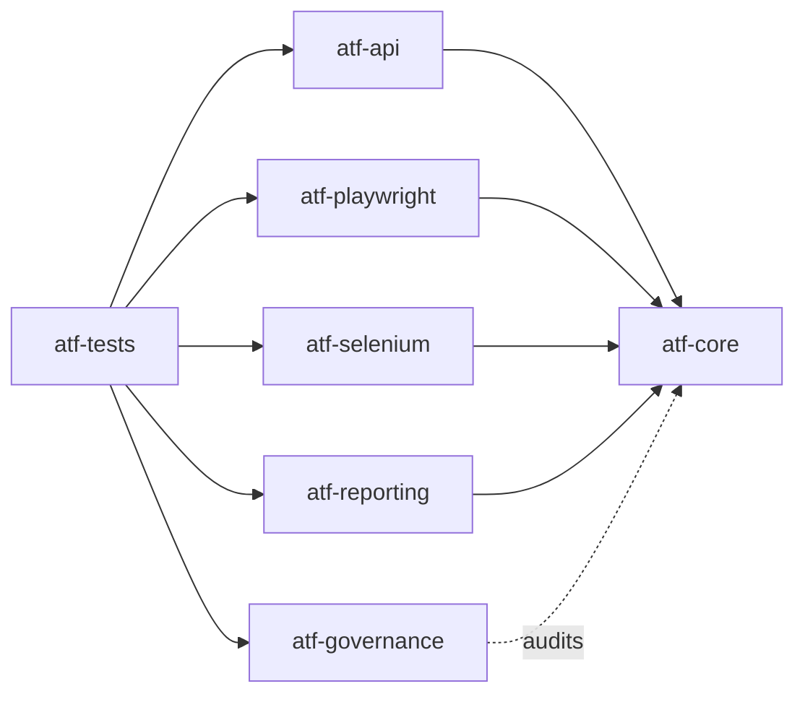
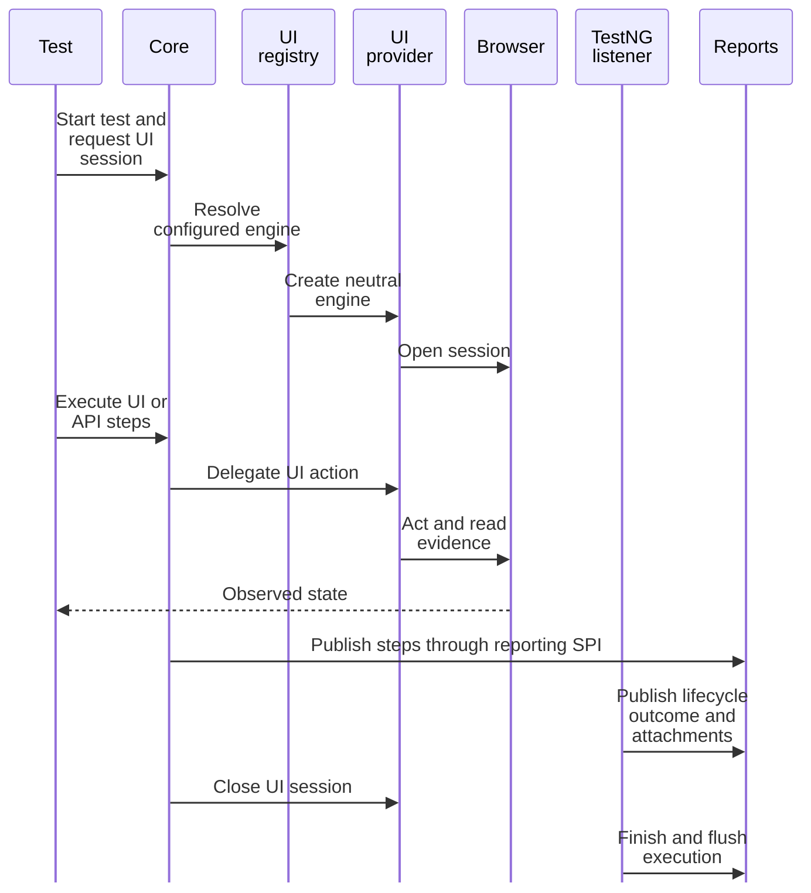

# Framework architecture

## Module ownership

The [parent POM](../pom.xml) coordinates seven modules with one version. Core owns shared configuration, UI contracts and neutral reporting. API, browser and reporting libraries depend on Core. The verification modules separate reusable helpers from annotated TestNG classes.

Legend: relationships and proof boundary

Solid arrows show selected compile dependencies; dotted arrows show source inspection. Governance has test-scoped dependencies on the five runtime libraries for SPI discovery and example compilation. Core has no dependency on API, browser or report implementations.

| Module | Source ownership |
|---|---|
| [atf-core](../atf-core/README.md) | com.ai.core.support, neutral com.ai.core.reporting, neutral com.ai.ui.core and UIActions |
| [atf-api](../atf-api/README.md) | com.ai.api.core: REST Assured execution, API lifecycle and response contracts |
| [atf-playwright](../atf-playwright/README.md) | com.ai.ui.core.engine.playwright |
| [atf-selenium](../atf-selenium/README.md) | com.ai.ui.core.engine.selenium |
| [atf-reporting](../atf-reporting/README.md) | Reporting providers, adapters, listeners, attachment publication, runtime audit and aggregate writers |
| [atf-governance](../atf-governance/README.md) | Rules/helpers in main; annotated governance tests and reviewed method inventory in test |
| [atf-tests](../atf-tests/README.md) | Main: framework/product helpers; test: existing annotated component and application classes |

Packages retain their Java names across modules. Module ownership, dependency
declarations and imports together define the boundary.

## Provider composition

[UIEngine](../atf-core/src/main/java/com/ai/ui/core/engine/UIEngine.java)
is the browser-neutral API. [UiEngineProvider](../atf-core/src/main/java/com/ai/ui/core/engine/UiEngineProvider.java)
is discovered with Java ServiceLoader. The configured `ui.engine` selects an
available provider; an adapter JAR supplies its implementation and service
registration. Browser SDK types stay inside the owning adapter module.

Core also owns ReportLogger, TestStatus, StepLogger and the
[ReportingBackend SPI](../atf-core/src/main/java/com/ai/core/reporting/spi/ReportingBackend.java).
The reporting module supplies
[DefaultReportingBackend](../atf-reporting/src/main/java/com/ai/core/reporting/DefaultReportingBackend.java)
through ServiceLoader. Core's compatibility
[TestListener](../atf-core/src/main/java/com/ai/core/reporting/listener/TestListener.java)
forwards TestNG events to the backend's concrete
[ReportingTestListener](../atf-reporting/src/main/java/com/ai/core/reporting/listener/ReportingTestListener.java).
Extent integration belongs to atf-reporting; Core base classes
do not declare a vendor reporting listener.

Legend: relationships and proof boundary

Solid arrows show directed calls or publication; the dotted arrow returns an
observed state. The sequence maps responsibility boundaries, not every TestNG callback.

| Actor ID | Actual responsibility |
|---|---|
| `Test` | Consumer test and product fixture |
| `Core` | Core lifecycle and steps |
| `Registry` | UiEngineRegistry resolves the configured UiEngineProvider |
| `Adapter` | Selected installed UIEngine provider and its browser adapter |
| `Browser` | Browser session and target application |
| `Listener` | ReportingTestListener supplied by atf-reporting |
| `Reports` | ReportingBackend supplied by atf-reporting |

The reporting listener and backend are supplied by atf-reporting. API-only
execution uses the atf-api runtime without a browser session.

## Configuration and resources

[ConfigManager](../atf-core/src/main/java/com/ai/core/support/config/ConfigManager.java)
loads the Core classpath defaults or an explicitly selected file. JVM properties
override individual settings. Consumers should resolve packaged resources from
the classpath; source locations are for development governance.

Production sources belong to each library's src/main tree. Both verification modules package helpers from src/main/java and keep annotated classes in src/test/java. Product fixture data and schemas belong to atf-tests/src/main/resources; suite XML and the governance method inventory remain test resources. Source-reading
governance resolves the reactor root and owning module rather than assuming
that the process working directory contains a single src tree.

## Observable product evidence

[Invoice evidence checks](../atf-tests/src/test/java/com/ai/atf/ui/component/InvoiceEvidenceContractTest.java)
protect the exact customer row observed in the invoice list. Opening details
with a creation-response ID still requires observing that matching row.
Admin status evidence records the persisted selection after reopening the edit
page and the matching order row. A persisted value and its visible label remain
separate observations.

[Registration submission checks](../atf-tests/src/test/java/com/ai/atf/ui/component/RegistrationSubmissionContractTest.java)
protect one submission of one identity. Callers validate the observed result;
a form error does not trigger an implicit replacement customer.

## Reporting and evidence

[atf-reporting](../atf-reporting/README.md) translates neutral report operations
into Extent. Runtime registries connect screenshots and final-state
attachments to the correct test. Aggregate writers preserve executed outcomes,
counts, timing and runtime evidence with a caller-owned descriptor.

Ordinary execution requires no historical report or calibration file.
[Testing](Testing.md) distinguishes native results, application acceptance and
artifact inspection. [Feedback](feedback/README.md) records incomplete checks
and evidence-backed corrections.
