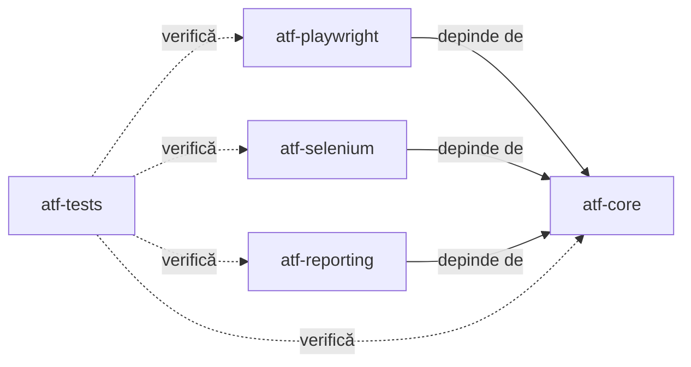
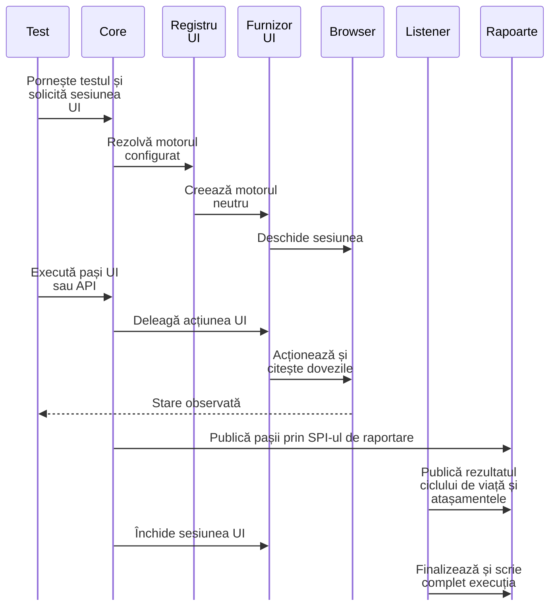

# Arhitectura framework-ului

## Responsabilitățile modulelor

[POM-ul părinte](../pom.xml) coordonează cinci module cu aceeași versiune.
Core gestionează contractele reutilizabile și ciclul de viață. Fiecare implementare
de browser și implementarea raportării depind de Core. Modulul de teste consumă
cele patru biblioteci ca dependențe destinate testelor.

Săgețile continue arată dependențele bibliotecilor; cele punctate arată utilizarea
pentru verificare. Core nu depinde de o implementare de browser sau de raportare.

| Modul | Responsabilitatea surselor |
|---|---|
| [atf-core](../atf-core/README.md) | com.ai.core.support, com.ai.core.reporting neutru, com.ai.api.core, com.ai.ui.core neutru și UIActions |
| [atf-playwright](../atf-playwright/README.md) | com.ai.ui.core.engine.playwright |
| [atf-selenium](../atf-selenium/README.md) | com.ai.ui.core.engine.selenium |
| [atf-reporting](../atf-reporting/README.md) | Furnizori de raportare, adaptoare, ascultători, publicarea atașamentelor, audit de execuție și generatoare agregate |
| [atf-tests](../atf-tests/README.md) | Testele com.ai.atf și fixture-urile specifice produsului com.ai.ui.support / com.ai.api.support |

Pachetele își păstrează numele Java între module. Responsabilitățile modulelor,
declarațiile dependențelor și importurile definesc împreună limitele.

## Compoziția furnizorilor

[UIEngine](../atf-core/src/main/java/com/ai/ui/core/engine/UIEngine.java)
este API-ul independent de browser. [UiEngineProvider](../atf-core/src/main/java/com/ai/ui/core/engine/UiEngineProvider.java)
este descoperit prin Java ServiceLoader. Setarea `ui.engine` selectează un furnizor
disponibil; JAR-ul adaptorului oferă implementarea și înregistrarea serviciului.
Tipurile SDK-ului de browser rămân în modulul adaptorului responsabil.

Core gestionează și ReportLogger, TestStatus, StepLogger și
[SPI-ul ReportingBackend](../atf-core/src/main/java/com/ai/core/reporting/spi/ReportingBackend.java).
Modulul de raportare oferă
[DefaultReportingBackend](../atf-reporting/src/main/java/com/ai/core/reporting/DefaultReportingBackend.java)
prin ServiceLoader. Fațada de compatibilitate
[TestListener](../atf-core/src/main/java/com/ai/core/reporting/listener/TestListener.java)
din Core transmite evenimentele TestNG către
[ReportingTestListener](../atf-reporting/src/main/java/com/ai/core/reporting/listener/ReportingTestListener.java)
concret al implementării. Integrarea serviciului Allure nativ aparține atf-reporting;
clasele de bază Core nu declară un ascultător de raportare al unui furnizor.

Săgețile continue arată apeluri sau publicări direcționate; cea punctată întoarce
o stare observată. Secvența arată limitele responsabilităților, fără să enumere fiecare apel TestNG.

| ID actor | Responsabilitate reală |
|---|---|
| `Test` | Testul consumatorului și fixture-ul de produs |
| `Core` | Ciclul de viață și pașii Core |
| `Registry` | UiEngineRegistry rezolvă UiEngineProvider configurat |
| `Adapter` | Furnizorul UIEngine instalat selectat și adaptorul său de browser |
| `Browser` | Sesiunea de browser și aplicația țintă |
| `Listener` | ReportingTestListener oferit de atf-reporting |
| `Reports` | ReportingBackend oferit de atf-reporting |

Ascultătorul și implementarea raportării sunt oferite de atf-reporting. Execuția
exclusiv API folosește infrastructura API Core fără o sesiune de browser.

## Configurație și resurse

[ConfigManager](../atf-core/src/main/java/com/ai/core/support/config/ConfigManager.java)
încarcă valorile implicite Core din classpath sau un fișier selectat explicit.
Proprietățile JVM suprascriu setări individuale. Consumatorii trebuie să rezolve
resursele împachetate din classpath; locațiile surselor servesc guvernanței dezvoltării.

Sursele de producție aparțin arborelui src/main al fiecărei biblioteci. Fixture-urile
de produs, resursele de test și XML-urile suitelor aparțin atf-tests/src/test.
Guvernanța care citește surse rezolvă rădăcina reactorului și modulul responsabil,
fără să presupună că directorul curent al procesului conține un singur arbore src.

## Dovezi observabile ale produsului

[Verificările dovezilor de factură](../atf-tests/src/test/java/com/ai/atf/ui/component/InvoiceEvidenceContractTest.java)
protejează rândul exact al clientului observat în lista facturilor. Deschiderea
detaliilor cu un ID din răspunsul de creare necesită în continuare observarea
rândului corespunzător. Dovada stării admin consemnează selecția persistată după
redeschiderea paginii de editare și rândul comenzii corespunzătoare. Valoarea
persistată și eticheta sa vizibilă rămân observații separate.

[Verificările trimiterii înregistrării](../atf-tests/src/test/java/com/ai/atf/ui/component/RegistrationSubmissionContractTest.java)
protejează o singură trimitere a unei singure identități. Apelanții validează
rezultatul observat; o eroare de formular nu declanșează implicit un client înlocuitor.

## Raportare și dovezi

[atf-reporting](../atf-reporting/README.md) transformă operațiile neutre de raportare
în Extent și Allure. Registrele de execuție leagă capturile și atașamentele stării
finale de testul corect. Generatoarele agregate păstrează rezultatele executate,
numărătorile, temporizarea și dovezile de execuție cu un descriptor gestionat de apelant.

Execuția obișnuită nu necesită rapoarte istorice sau fișiere de calibrare.
[Testare](Testing.md) distinge rezultatele native, acceptanța aplicației și inspecția
artefactelor. [Feedback-ul](feedback/README.md) consemnează verificările incomplete
și corecțiile susținute de dovezi.
