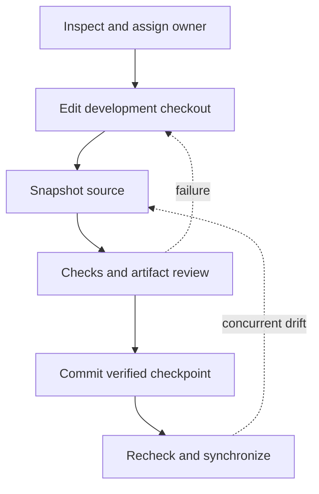

# Isolated development and synchronization

## Working roles

| Location role | Purpose |
|---|---|
| Development checkout | Source and documentation edits on main |
| Live checkout | Separate synchronization target for verified checkpoints |
| External work root | Disposable validation copies, shared caches and preserved run evidence |
| main_mcp branch | Preserved original implementation |

Do not build in the development or live checkout. Copy the intended source
checkpoint into a separate validation directory and run Maven there. Use a
fresh validation copy or unique evidence location for each acceptance run.

Start at the development reactor root. Resolve the optional caller-provided
ATF_WORK_ROOT override, or derive a sibling work directory from the current
project location:

```powershell
$projectRoot = (Get-Location).Path
$workRootInput = if ($env:ATF_WORK_ROOT) {
    $env:ATF_WORK_ROOT
} else {
    Join-Path (Split-Path -Parent $projectRoot) '.atf-work'
}
$workRoot = $ExecutionContext.SessionState.Path.GetUnresolvedProviderPathFromPSPath($workRootInput)
$validationRoot = Join-Path $workRoot 'validation'
$mavenCache = Join-Path $workRoot 'cache/m2'
$evidenceRoot = Join-Path $workRoot 'runs'
```

Check that the resolved work root is outside both source checkouts before
creating directories. Choose a unique child of validation for each snapshot;
enter that snapshot's reactor root before running [Testing](Testing.md) commands.
These variables are shell setup, not framework configuration. In feedback,
`${ATF_WORK_ROOT}/...` denotes a path below this resolved external root; it is
portable provenance notation, not a literal PowerShell path.

## Checkpoint workflow



Arrows show the checkpoint sequence. Dotted returns require correction or
reconciliation and renewed validation; synchronization follows a source review
and compatible live state.

1. Inspect the development and live Git bases and pending changes. Record the
   observed gap and a checkable acceptance criterion in
   [feedback](feedback/README.md).
2. Edit only the development checkout. Keep library changes in their owning
   module and product support in atf-tests.
3. Prepare a separate snapshot containing the complete intended source state.
   Preserve its provenance, including the base commit and any uncommitted diff
   used for validation.
4. Run affected native checks, the local/governance suite and browser/reporting
   acceptance as appropriate. [Testing](Testing.md) owns the commands.
5. Preserve failed observations and inspect artifacts. Review the source and
   documentation diff, then commit the verified checkpoint on main.
6. Reconcile and validate the Romanian documentation edition against the chosen main
   checkpoint using the [edition workflow](governance/Readme_Editions.md#synchronization-and-review).
   Recheck both source branches, remote refs and live for concurrent changes.
   Publish the verified main and main_RO checkpoints with normal fast-forward
   pushes. Stop on drift and reconcile without discarding another change.
7. In each synchronization checkout, fetch the published ref and merge its
   matching origin branch using `--ff-only`. Compare development, live and remote
   commit identities for that branch. A successful push alone does not update
   a separate live checkout.

Git synchronization returns tracked source and maintained documentation to live.
Keep each output role separate:

- Build output, downloaded browser binaries, caches and intermediate logs remain
  in external validation/evidence directories.
- At the owner's explicit selection, publish a minimal selected proof set,
  one audited retained-UI Extent reader per engine and one Atlas HTML per project
  into live's ignored artifacts/reports/current and artifacts/atlas/current trees.
  Follow the [artifact publication contract](../artifacts/README.md); these copies
  remain local data, separate from Git synchronization and build execution.
- Full runs, failed attempts, temporary render controls and prior Atlas captures
  remain together in external immutable history.
- The publication inventory records captured source identities; selecting a
  snapshot does not make it the latest HEAD.

Do not run simultaneous builds in the same directory, stop unrelated processes,
overwrite previous evidence, use `reset --hard` or use `git clean` for synchronization.

## Module and documentation changes

Update a module's README when its public contract, dependencies, resources or
verification changes. Keep the [root overview](../README.md) concise.
Project rules belong in these owner guides; main does not carry `AGENTS.md`
or an active agent/skill instruction layer.
[Architecture](Architecture.md) owns cross-module boundaries; package READMEs
explain local implementation responsibilities. The canonical
[review policy](governance/Code_And_Documentation_Policy.md) owns the checklist;
module guides describe only its concrete application.

Governance in atf-tests checks module ownership, source boundaries and maintained
documentation. Changes to a guard should retain a useful failing fixture or
behavioral regression; a source move alone does not justify weakening a
boundary.

## Feedback and closure

Each feedback item needs observed and expected behavior, an owner, a reproducer
and closure evidence. Close it only after the stated checks pass. Record the
source checkpoint, exact command and preserved external artifacts.

Keep historical evidence at its original scope. Move durable rules into the
owning document and keep active work visible in the
[feedback register](feedback/README.md).
