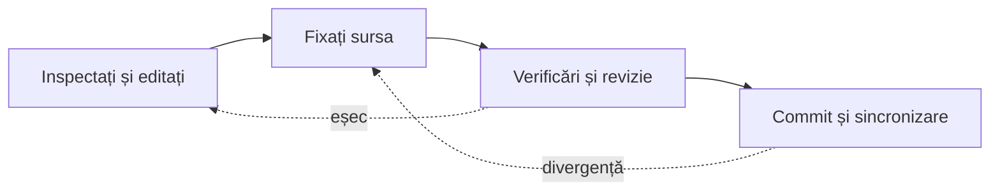

<a id="isolated-development-and-synchronization"></a>
# Dezvoltare izolată și sincronizare

<a id="working-roles"></a>
## Rolurile locațiilor

| Rolul locației | Scop |
|---|---|
| Checkout de dezvoltare | Modificări ale surselor și documentației pe main |
| Checkout live | Destinație separată de sincronizare pentru puncte de control verificate |
| Rădăcină de lucru externă | Copii temporare de validare, cache-uri comune și dovezi păstrate ale rulărilor |
| Ramura main_mcp | Implementarea originală păstrată |

Nu compila în checkout-ul de dezvoltare sau live. Copiază punctul de control dorit
al sursei într-un director separat de validare și rulează Maven acolo. Folosește
o copie nouă de validare sau o locație unică a dovezilor pentru fiecare rulare de acceptanță.

Începe din rădăcina reactorului de dezvoltare. Rezolvă suprascrierea opțională
ATF_WORK_ROOT oferită de apelant sau derivă un director de lucru vecin din
locația curentă a proiectului:

```powershell
$projectRoot = (Get-Location).Path
$workRootInput = if ($env:ATF_WORK_ROOT) {
    $env:ATF_WORK_ROOT
} else {
    Join-Path (Split-Path -Parent $projectRoot) '.atf-work'
}
$workRoot = $ExecutionContext.SessionState.Path.GetUnresolvedProviderPathFromPSPath($workRootInput)
$validationRoot = Join-Path $workRoot 'validation'
$mavenCache = Join-Path $workRoot 'cache/m2'
$evidenceRoot = Join-Path $workRoot 'runs'
```

Verifică dacă rădăcina de lucru rezolvată este în afara ambelor checkout-uri de surse
înainte de a crea directoare. Alege un subdirector unic al validation pentru fiecare
instantaneu; intră în rădăcina reactorului său înainte de comenzile din [Testare](Testing.md).
Aceste variabile pregătesc shell-ul, fără să configureze framework-ul. În feedback,
`${ATF_WORK_ROOT}/...` desemnează o cale sub această rădăcină externă rezolvată;
este o notație portabilă de proveniență, nu o cale PowerShell literală.

<a id="checkpoint-workflow"></a>
## Fluxul punctelor de control



<details>
<summary>Legendă: relații și limita dovezii</summary>

Săgețile arată succesiunea punctelor de control. Revenirea punctată necesită corecție
sau reconciliere și validare repetată; sincronizarea urmează revizuirii sursei și
confirmării unei stări live compatibile.

</details>

1. Inspectează bazele Git și modificările în așteptare din dezvoltare și live.
   Consemnează lacuna observată și un criteriu de acceptanță verificabil în
   [feedback](feedback/README.md).
2. Modifică numai checkout-ul de dezvoltare. Păstrează schimbările bibliotecilor în
   modulul responsabil, iar suportul produsului în atf-tests.
3. Pregătește un instantaneu separat cu întreaga stare dorită a sursei. Păstrează
   proveniența, inclusiv commit-ul de bază și orice diferență neînregistrată folosită
   pentru validare.
4. Rulează verificările native afectate, suita locală/de guvernanță și acceptanța
   de browser/raportare potrivită. [Testare](Testing.md) definește comenzile.
5. Păstrează observațiile eșuate și inspectează artefactele. Revizuiește diferențele
   de sursă și documentație, apoi înregistrează punctul de control verificat pe main.
6. Reconciliază și validează ediția română a documentației față de punctul main ales,
   folosind [fluxul edițiilor](governance/Readme_Editions.md#synchronization-and-review).
   Reverifică ambele ramuri sursă, referințele remote și live pentru schimbări concurente.
   Publică punctele verificate main și main_RO prin push-uri normale fast-forward.
   Oprește publicarea la divergență și reconciliază fără a elimina altă schimbare.
7. În fiecare checkout de sincronizare, preia referința publicată și integrează ramura
   origin corespunzătoare cu `--ff-only`. Compară identitățile commit-urilor din
   dezvoltare, live și remote pentru acea ramură. Un push reușit nu actualizează
   singur un checkout live separat.

Sincronizarea Git aduce în live sursele urmărite și documentația menținută.
Păstrează separat rolurile rezultatelor:

- Rezultatele compilării, binarele descărcate de browser, cache-urile și jurnalele
  intermediare rămân în directoarele externe de validare/dovezi.
- La selecția explicită a responsabilului, publică un set minim de dovezi selectate,
  un cititor Extent auditat al UI-ului păstrat pentru fiecare motor și un HTML Atlas
  pentru fiecare proiect în arborii ignorați artifacts/reports/current și
  artifacts/atlas/current din live. Respectă [contractul publicării artefactelor](../artifacts/README.md);
  aceste copii rămân date locale, separate de sincronizarea Git și execuția compilării.
- Rulările complete, încercările eșuate, controalele temporare de randare și capturile
  Atlas anterioare rămân împreună în istoricul extern imuabil.
- Inventarul publicării consemnează identitățile sursei capturate; selectarea unui
  instantaneu nu îl transformă în cel mai recent HEAD.

Nu rula compilări simultane în același director, nu opri procese fără legătură,
nu suprascrie dovezi anterioare și nu folosi `reset --hard` sau `git clean` pentru sincronizare.

<a id="module-and-documentation-changes"></a>
## Schimbări ale modulelor și documentației

Actualizează README-ul unui modul când se schimbă contractul public, dependențele,
resursele sau verificarea. Păstrează concisă [prezentarea principală](../README.md).
Regulile proiectului aparțin acestor ghiduri responsabile; main nu conține `AGENTS.md`
sau un strat activ de instrucțiuni pentru agenți/skill-uri.
[Arhitectura](Architecture.md) definește limitele dintre module; README-urile pachetelor
explică responsabilitățile locale ale implementării. [Politica de revizuire](governance/Code_And_Documentation_Policy.md)
canonică definește lista de verificare; ghidurile modulelor descriu numai aplicarea ei concretă.

Guvernanța din atf-tests verifică responsabilitățile modulelor, limitele surselor și
documentația menținută. Modificările unui control trebuie să păstreze un fixture util
care eșuează sau o regresie comportamentală; simpla mutare a sursei nu justifică
slăbirea unei limite.

<a id="feedback-and-closure"></a>
## Feedback și închidere

Fiecare element de feedback necesită comportamentele observat și așteptat, un responsabil,
un reproducer și dovezi de închidere. Închide-l numai după ce verificările declarate trec.
Consemnează punctul sursei, comanda exactă și artefactele externe păstrate.

Păstrează dovezile istorice la limitele lor originale. Mută regulile durabile în
documentul responsabil și menține vizibilă activitatea deschisă în
[registrul de feedback](feedback/README.md).
