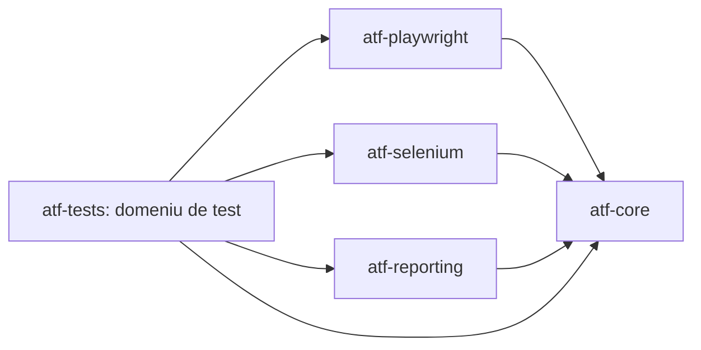
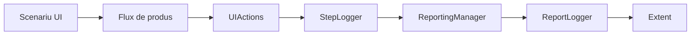
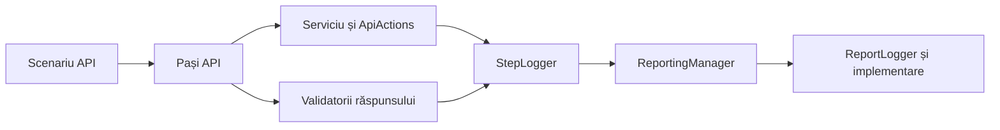
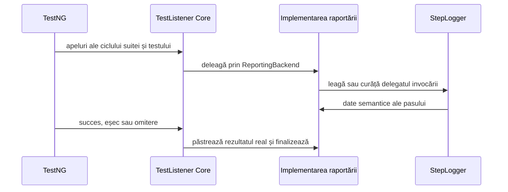
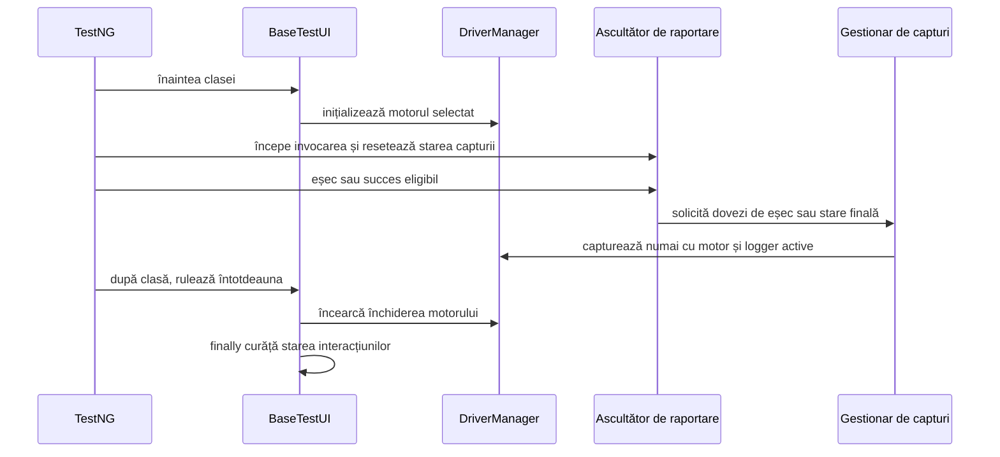
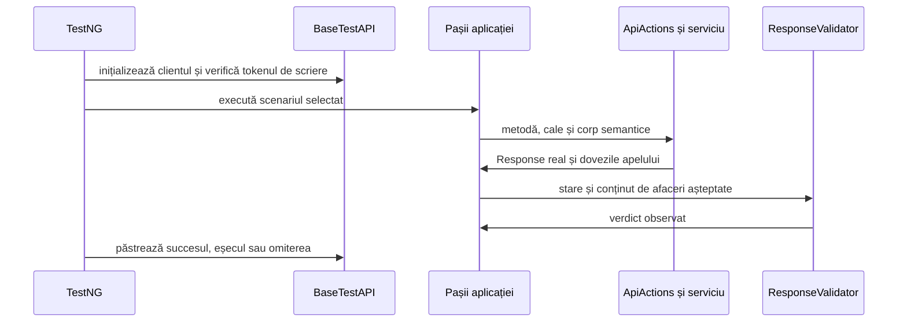
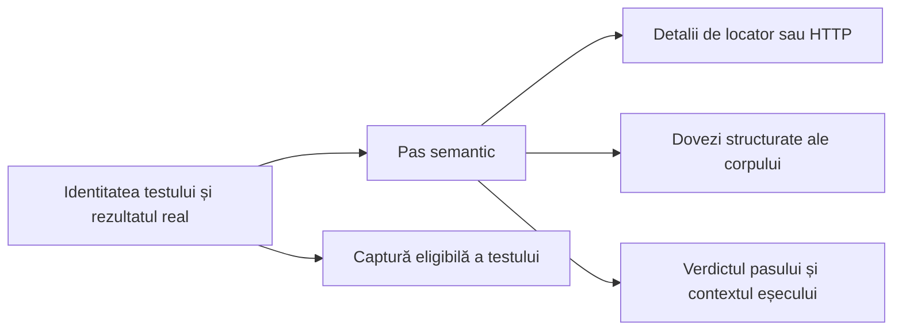

<a id="living-architecture"></a>
<a id="living-architecture-ui--api"></a>
# Arhitectură vie (UI + API)

Acest ghid păstrează contractele esențiale UI, API, de raportare și testare din
arhitectura v1.0 arhivată. Le reconciliază cu framework-ul modular curent. Numele
păstrat al fișierului identifică filiația documentului, nu o nouă versiune a
bibliotecii sau o dovadă de execuție.

[Documentul HTML asociat](Living_Architecture_UI_API_doc_v1_0.html) prezintă aceleași
secțiuni în panouri pliabile și diagrame statice. Acest document Markdown deține
conținutul; metadatele HTML consemnează numele fișierului sursă și SHA-256 normalizat.
Actualizează-le împreună. [Arhitectura](Architecture.md) definește harta concisă a
modulelor, [Testare](Testing.md) definește strategia,
[colecția de comenzi](Testing_Commands.md) definește rețetele de execuție, iar
[feedback-ul](feedback/README.md) gestionează criteriile nerezolvate. Ghidul nu consemnează acceptanță nouă a aplicației.

Diagramele HTML late păstrează dimensiunea nativă a etichetelor. Derulează în
interiorul figurii pentru o secvență lată; pagina rămâne lizibilă.

[Matricea de browser menținută](Testing.md#selenium-pinned-manager-route) definește
versiunile fixate Selenium/browser/driver/CDP și pregătirea portabilă a binarelor.
Căile proiectului provin din rădăcina reactorului sau din intrări explicite ale
apelantului/mediului; căile absolute de execuție se rezolvă din aceste intrări
când un API le cere.

<a id="approach"></a>
<a id="1-approach-and-scope"></a>
## 1) Abordare și domeniu

<details open>
<summary>Responsabilități și vocabular</summary>

| Etichetă | Sens | Limită |
|---|---|---|
| CORE | Contracte comune, configurație și ciclu de viață | SDK-urile furnizorilor de browser și raportare rămân în afara Core |
| UI | Acțiuni și așteptări neutre față de motor, ciclu de browser și observații | Paginile și fluxurile aplicației rămân în suportul de test |
| API | Execuție HTTP, validarea răspunsurilor și servicii de aplicație | Transportul HTTP este distinct de aserțiunile de afaceri |
| REPORTING | Implementare și publicare Extent | Core expune contracte neutre de raportare și un SPI opțional pentru implementare |

Modelul de interacțiune rămâne `UIActions + WaitUtils + UIEngine` pentru UI,
`Steps + Services + ApiActions/ApiClient + Validators` pentru API și
`StepLogger + ReportingManager + ReportLogger` pentru raportarea semantică.
TestNG deține rezultatele testelor. Furnizorii de browser și raportare implementează
contracte; nu decid succesul de afaceri pe baza unor dovezi construite.

</details>

<a id="ownership-map"></a>
<a id="current-source-and-module-ownership"></a>
### Responsabilitățile curente ale surselor și modulelor

Bibliotecile se compilează în bytecode Java 11. Folosește pregătirea JDK/Maven
descrisă în [ghidul principal](../README.md#start). Pachetele Java publice păstrează
rădăcina `com.ai` între module; un prefix comun nu permite o dependență inversă.

| Modul Maven | Sursă gestionată | Contract principal pentru consumator |
|---|---|---|
| [atf-core](../atf-core/README.md) | Configurare comună, contracte UI și raportare neutră | UIEngine, ConfigManager, StepLogger, ReportingBackend |
| [atf-api](../atf-api/README.md) | com.ai.api.core: execuție HTTP, aserțiuni și ciclu de viață API | ApiClient, ApiActions, BaseTestAPI |
| [atf-playwright](../atf-playwright/README.md) | com.ai.ui.core.engine.playwright | UiEngineProvider Playwright |
| [atf-selenium](../atf-selenium/README.md) | com.ai.ui.core.engine.selenium | UiEngineProvider Selenium |
| [atf-reporting](../atf-reporting/README.md) | Adaptoare Extent, ciclu de viață și generatoare agregate | ReportingBackend și operații ReportLogger |
| [atf-governance](../atf-governance/README.md) | Main: reguli și helpere; test: verificări de guvernanță adnotate | Constatări despre surse/documentație și indicii de reparare |
| [atf-tests](../atf-tests/README.md) | Main: helpere de framework/produs; test: verificări adnotate | Componente existente și scenarii explicite de aplicație |

Șapte module Maven separă contractele comune Core, execuția REST, adaptoarele de browser, raportarea, guvernanța și verificările existente. Bibliotecile de execuție depind de Core. Helperele de verificare se compilează din main; clasele TestNG sunt executate din test. [Atlasul exclusiv documentar](../atf-atlas/README.md) este o
hartă de revizuire/responsabilități în afara reactorului Maven; nu oferă execuție Java sau furnizori.

Paginile, serviciile, fabricile, pașii și validările de produs aparțin atf-tests/src/main/java; datele și schemele aparțin src/main/resources. Clasele adnotate de componentă și aplicație rămân în src/test/java. UIActions și WaitUtils generice păstrează
pachetele existente în Core pentru compatibilitate. Clasele SDK concrete ale browserelor
rămân în adaptorul responsabil. Consumatorul selectează bibliotecile necesare;
nu consumă atf-tests ca API de producție.

<a id="configuration"></a>
<a id="2-centralized-configuration"></a>
## 2) Configurație centralizată

<a id="configuration-precedence"></a>
<a id="loading-and-precedence"></a>
### Încărcare și precedență

[ConfigManager](../atf-core/src/main/java/com/ai/core/support/config/ConfigManager.java)
încarcă `framework.properties` din classpath sau un fișier explicit selectat prin
`-Dframework.properties=...`. Sursa împachetată responsabilă este
`atf-core/src/main/resources/framework.properties`. Încărcarea la execuție nu caută
un arbore sursă monolitic. Proprietățile JVM individuale suprascriu cheile încărcate.

Folosește `get(key, default)` pentru valori opționale și `require(key)` pentru valori
obligatorii nevide. Accesul și validarea configurației aparțin opțiunilor tipizate Core;
pașii aplicației nu trebuie să dubleze interpretarea. Setările explicite ale mediului,
cache-urile browserelor și selecția suitei rămân responsabilitatea apelantului.
Nu pune acreditări sau căi presupuse ale unei mașini în exemplele publicate.

<a id="ui-configuration"></a>
<a id="ui-configuration-1"></a>
### Configurație UI

<details open>
<summary>Valori implicite UI menținute</summary>

```properties defaults
base.url=https://practicesoftwaretesting.com
ui.engine=playwright
ui.headless=true
ui.window.mode=fullscreen
ui.window.size=
ui.page.zoom.percent=60
ui.wait.timeout.seconds=20
ui.screenshots.enabled=true
ui.screenshots.on.failure.only=false
ui.screenshots.capture.final.state=true
```

`ui.engine` selectează un furnizor instalat `playwright` sau `selenium`.
Descoperirea nu pornește un browser. Furnizorii absenți sau duplicați produc
diagnostice; indisponibilitatea unui adaptor nu justifică selectarea tacită a altui motor.

Dimensiunea explicită validă a ferestrei are prioritate. Altfel, rezolvarea folosește
o dimensiune utilizabilă a sistemului, cu `2560x1440` ca alternativă când execuția
este fără interfață sau sistemul nu oferă o dimensiune utilizabilă. Alternativa nu
promite că fiecare sesiune configurată are acea dimensiune. Zoomul se normalizează
la nivelurile acceptate: valoarea configurată `60` devine `67`. Navigarea și capturile
păstrează zoomul rezolvat. Pregătirea browserelor și selecția Node implicită a SDK-ului
sunt descrise în [Testare](Testing.md#browser-preparation-and-checks).

</details>

<a id="api-report-configuration"></a>
<a id="api-and-reporting-configuration"></a>
### Configurație API și raportare

<details open>
<summary>Valori implicite API și raportare menținute</summary>

```properties defaults
base.url.api=https://gorest.co.in
auth.token=
api.wait.timeout.seconds=10
api.rate.limit.max.retries=2
api.rate.limit.retry.default.delay.seconds=5
api.rate.limit.retry.max.delay.seconds=65
reporting.engine=extent
reports.dir=target/reports
reports.timestamp.enabled=true
reports.timestamp.format=yyyy-MM-dd_HH-mm-ss
console.details.enabled=true
```

Numărul maxim de reîncercări la limitarea ratei trebuie să fie nenegativ. Zero
permite cererea inițială fără reîncercări; valorile negative eșuează înaintea execuției.

Aceste URL-uri sunt valori implicite, nu autorizare pentru modificarea unei aplicații.
Fluxurile API de scriere cer un token explicit utilizabil. `BaseTestAPI` sare
inițializarea orientată spre scriere dacă tokenul este gol; omiterea nu înseamnă
acceptanță. Fixture-urile anonime/cu autentificare invalidă controlate de apelant
folosesc căile explicite de cerere destinate lor. Autentificarea obișnuită este
centralizată în ApiClient; utilitarele speciale de autentificare negativă sunt suport
de test, nu un al doilea mecanism de autentificare de producție.

Core poate executa fără o implementare a raportării. Instalarea atf-reporting oferă Extent prin serviciul neutru ReportingBackend. Setarea susținută este `reporting.engine=extent`; motoarele nesusținute eșuează explicit, iar căile rapoartelor rămân relative la modulul executant dacă nu sunt suprascrise.

</details>

<a id="architecture-diagrams"></a>
<a id="3-architecture-diagrams"></a>
## 3) Diagrame de arhitectură

<a id="module-dependencies"></a>
<a id="maven-dependency-direction"></a>
### Direcția dependențelor Maven



<details>
<summary>Legendă: relații și limita dovezii</summary>

Săgețile înseamnă dependență, nu ordine de execuție. Core nu încarcă direct o clasă
a unui furnizor de browser sau raportare. Descriptorii serviciilor Java aparțin
furnizorilor. atf-tests verifică compoziția; nu este o dependență a unei biblioteci.
Atlasul documentar lipsește intenționat din acest graf de execuție.

</details>

<a id="canonical-rules"></a>
<a id="4-canonical-execution-rules"></a>
## 4) Reguli canonice de execuție

MUST și MUST NOT de mai jos sunt reguli de revizuire cu domeniu delimitat.
Nu implică existența unui control automat pentru fiecare afirmație.
[Harta verificării](#verification-map) identifică responsabilii actuali ai surselor/testelor;
acceptanța nerezolvată rămâne în feedback.

<a id="retained-principles"></a>
<a id="retained-principles-and-auditable-ui-execution"></a>
### Principii păstrate și execuție UI auditabilă

Titlurile v1.0 arhivate definesc filiația acestor douăsprezece principii păstrate.
Intenția lor rămâne obligatorie în stratul declarat.
[Deciziile reconciliate](#historical-reconciliation) explică regulile literale înlocuite;
eliminarea unei restricții de implementare depășite nu elimină obligația privind
responsabilitatea, adevărul eșecului sau dovezile.

`MAINTAINED` înseamnă că sunt identificați responsabilul sursei curente și o verificare
existentă. Nu înseamnă că verificarea s-a executat, că fiecare ramură este acoperită
sau că o aplicație publică a acceptat scenariul. `PARTIAL` expune o obligație cunoscută
neîndeplinită. Dovezile de execuție aparțin sursei exacte, selecției, motorului și
rezultatului nativ din [publicarea rapoartelor](../artifacts/reports/README.md).

| ID | Intenție arhivată / decizie curentă | Implementare | Verificări existente | Stare | Limitele dovezii |
|---|---|---|---|---|---|
| LD-01 | Secțiunea 3, Config: un singur responsabil al configurației; acces tipizat obligatoriu/opțional. | [ConfigManager](../atf-core/src/main/java/com/ai/core/support/config/ConfigManager.java) | [Încărcarea configurației](../atf-tests/src/test/java/com/ai/atf/core/support/config/ConfigManagerFileContractTest.java) | MAINTAINED | Precedența și validarea aparțin sursei; acreditările apelantului și disponibilitatea mediului rămân separate. |
| LD-02 | Secțiunea 3: aplicația folosește UIActions; motoarele furnizorilor dețin capabilități, nu decizii de afaceri. | [UIActions](../atf-core/src/main/java/com/ai/ui/support/actions/UIActions.java) | [Delegarea motorului](../atf-tests/src/test/java/com/ai/atf/ui/component/UiEngineDelegationContractTest.java) | MAINTAINED | Testele tehnice ale motorului pot apela direct interfața; scenariile aplicației nu se pot ramifica după SDK-ul furnizorului. |
| LD-03 | Secțiunea 3: Selenium folosește așteptări prin fațadă; Playwright oferă așteptare automată nativă. | [UiActionWait](../atf-core/src/main/java/com/ai/ui/support/actions/UiActionWait.java) | [Paritatea acțiunilor și intrărilor](../atf-tests/src/test/java/com/ai/atf/ui/component/UiEngineActionParityContractTest.java) | MAINTAINED | Ambele căi de așteptare au contracte de componentă; browserul și produsul necesită execuție separată. |
| LD-04 | Secțiunea 3, așteptări: WaitUtils observă condiții delimitate și nu emite independent FAIL. | [WaitUtils](../atf-core/src/main/java/com/ai/ui/support/wait/WaitUtils.java) | [Regresii ale așteptărilor delimitate](../atf-tests/src/test/java/com/ai/atf/ui/component/WaitUtilsContractTest.java) | MAINTAINED | WaitUtils nu emite FAIL; acțiunea/validarea deține verdictul. Expirarea interogării repetate nu este succes. |
| LD-05 | Secțiunea 3: validările compară valori reale independente cu condiții de afaceri așteptate, în pași Validate expliciți. | [Validarea înregistrării](../atf-tests/src/main/java/com/ai/ui/support/validation/RegistrationValidation.java) și [validarea profilului](../atf-tests/src/main/java/com/ai/ui/support/validation/ProfileAccountValidation.java) | [Contractele validării înregistrării](../atf-tests/src/test/java/com/ai/atf/ui/component/RegistrationValidationContractTest.java) | MAINTAINED | Detaliile așteptat/observat și un verdict final explică aserțiunea; finalizarea acțiunii nu stabilește singură succesul de afaceri. |
| LD-06 | Secțiunea 4, detalii și excepții: ascultătorul deține ciclul testului și păstrează eșecul real din afara unui pas de acțiune. | [Ascultător raportare](../atf-reporting/src/main/java/com/ai/core/reporting/listener/ReportingTestListener.java) și [BaseTestUI](../atf-core/src/main/java/com/ai/ui/core/runtime/BaseTestUI.java) | [Eșecurile ascultătorului](../atf-tests/src/test/java/com/ai/atf/core/reporting/lifecycle/TestListenerFailureContractTest.java) | MAINTAINED | Inițializarea/închiderea clasei sunt dovezi de configurație, nu teste de produs; păstrați domeniul original al eșecului. |
| LD-07 | Secțiunile 3.5 și 4: detaliile cer un pas activ, un verdict final și suport pentru adâncime imbricată. | [StepLogger](../atf-core/src/main/java/com/ai/core/reporting/StepLogger.java) și [StepScope](../atf-core/src/main/java/com/ai/core/reporting/step/StepScope.java) | [Regresiile ciclului pașilor](../atf-tests/src/test/java/com/ai/atf/core/reporting/regression/StepLoggerContractTest.java) | MAINTAINED | Acțiunile imbricate trebuie să revină în domeniul validării; închiderea unui domeniu nefinalizat nu este PASS implicit. |
| LD-08 | Secțiunea 4: o urmă a pasului eșuat și atașamente de eșec la nivel de test, deținute de ascultător. | [Gestionarul capturilor UI](../atf-core/src/main/java/com/ai/ui/core/reporting/UiScreenshotFailureHandler.java) și [registrul atașamentelor de eșec](../atf-core/src/main/java/com/ai/core/reporting/attachment/FailureAttachmentRegistry.java) | [Contractele atașamentelor de eșec](../atf-tests/src/test/java/com/ai/atf/core/reporting/attachment/FailureAttachmentRegistryTest.java) | MAINTAINED | Captura configurată a stării finale este distinctă de captura la eșec; lipsa atașamentelor nu transformă eșecul în succes. |
| LD-09 | Secțiunea 4: fațadă neutră pentru dovezi; Reporting deține adaptoarele și ciclul de viață. | [ReportingManager](../atf-core/src/main/java/com/ai/core/reporting/ReportingManager.java) și [Backend implicit](../atf-reporting/src/main/java/com/ai/core/reporting/DefaultReportingBackend.java) | [Contractele gestionarului raportării](../atf-tests/src/test/java/com/ai/atf/core/reporting/regression/ReportingManagerSessionContractTest.java) | MAINTAINED | Absența backend-ului, configurația invalidă și diagnosticele adaptorului rămân distincte; fără alternativă tacită universală. |
| LD-10 | Secțiunea 5: date unice din fabrici, independență de ordinea metodelor și ciclu explicit al fixture-ului comun. | [UserDataFactory](../atf-tests/src/main/java/com/ai/ui/support/factory/UserDataFactory.java) și [Componentă profil](../atf-tests/src/main/java/com/ai/ui/support/component/ProfileAccountComponent.java) | [Contractele trimiterii înregistrării](../atf-tests/src/test/java/com/ai/atf/ui/component/RegistrationSubmissionContractTest.java) | MAINTAINED | Contraexemplele cu date malformate rămân valide; fixture-urile cont/profil ale clasei doar citesc starea contului. |
| LD-11 | Secțiunea 5, date de test: curățarea datelor create în aplicație rămâne obligatorie și trebuie să aibă propriul contract observabil. | [RegistrationService](../atf-tests/src/main/java/com/ai/ui/support/service/RegistrationService.java) și [Componentă profil](../atf-tests/src/main/java/com/ai/ui/support/component/ProfileAccountComponent.java) | [Contractele trimiterii înregistrării](../atf-tests/src/test/java/com/ai/atf/ui/component/RegistrationSubmissionContractTest.java) | PARTIAL | ACCOUNT_DELETION_NOT_IMPLEMENTED: demo-ul creează conturi fără ștergere; verificările trimiterii nu dovedesc curățarea. |
| LD-12 | Secțiunile 4 și 5, independența motorului: selectează aceleași scenarii păstrate prin configurație pentru Playwright și Selenium. | [UIEngineRegistry](../atf-core/src/main/java/com/ai/ui/core/engine/UiEngineRegistry.java) | [Scenariile de înregistrare](../atf-tests/src/test/java/com/ai/atf/ui/RegistrationTests.java), [scenariile de cont](../atf-tests/src/test/java/com/ai/ui/tests/AccountAuthenticatedAreaTests.java) și [scenariile de profil](../atf-tests/src/test/java/com/ai/ui/tests/ProfileContactAddressMemoryTests.java) | MAINTAINED | SAME_RETAINED_SCENARIOS: ambele motoare selectează aceleași 16 metode; doar rezultatele native și observațiile dovedesc execuția. |

Pentru fiecare scenariu UI selectat, pasul acțiunii consemnează intenția, locatorul
și intrarea raportabilă; valorile etichetate ca parolă/secret sunt reprezentate prin
`[REDACTED]`, în timp ce valoarea originală ajunge în browser. Această clasificare
delimitată nu inspectează câmpuri arbitrare ale aplicației și nu curăță textul
excepțiilor SDK. Revizuirea finală a artefactelor trebuie să verifice dovezile
generate efectiv pentru valori sensibile neintenționate.

Pasul validării declară așteptarea, citește valoarea observată și deține aserțiunea
și verdictul final PASS/FAIL. Comportamentul negativ așteptat al aplicației poate
trece testul numai când respingerea așteptată este observată independent. Un eșec
neașteptat de browser, acțiune, aserțiune sau configurație își păstrează rezultatul
real eșuat sau omis; consemnarea metadatelor contractului nu îl poate certifica.

Responsabilul guvernanței principiilor living
[LivingPrinciplesGovernanceTest](../atf-governance/src/test/java/com/ai/atf/governance/LivingPrinciplesGovernanceTest.java)
verifică cele douăsprezece ID-uri, căile reale către surse/verificări și stările
delimitate. Principiile absente sau duplicate și promovarea lacunei declarate de
curățare sunt eșecuri de diagnostic. Aceste controale structurale nu stabilesc
completitudinea semantică și nu înlocuiesc acceptanța nativă a produsului.

<a id="configuration-boundary"></a>
<a id="configuration-and-reporting-boundaries"></a>
### Limitele configurației și raportării

Validarea UI respinge booleenii malformați și așteptările din afara intervalului
`1..2147483` secunde întregi înaintea achiziției furnizorului. Cele șase opțiuni UI
folosesc un cititor comun de booleeni; WaitUtils folosește cititorul validat de
așteptare. Precedența cheii canonice și a celei vechi și valorile implicite valide
rămân neschimbate. Vezi [contractul Core](../atf-core/README.md#validated-ui-configuration-and-cleanup).


- MUST păstra un singur încărcător de configurație Core și folosi responsabilii opțiunilor sale tipizate.
- MUST direcționa raportarea semantică a execuției prin StepLogger/ReportLogger.
- MUST păstra importurile SDK Extent în atf-reporting și importurile SDK de browser
  în adaptorul corespunzător.
- MUST NOT permite unui pas de afaceri să instanțieze un adaptor de raportare sau să
  controleze începutul/sfârșitul/scrierea completă a testului. Ciclul de viață aparține ascultătorului/implementării.
- MAY publica evenimente neutre de execuție din adaptoare prin publicatorul Core;
  aceasta nu oferă adaptorului acces la StepLogger sau la mecanismele interne ale implementării.

<a id="ui-interactions"></a>
<a id="ui-interactions-selectors-and-evidence"></a>
### Interacțiuni UI, selectori și dovezi

Fluxurile aplicației folosesc UIActions generice și responsabili reutilizabili de
pagini/validări. UIEngine oferă capabilități de browser precum interacțiuni, citiri,
așteptări, capturi și observarea răspunsurilor de rețea; nu implementează regulile
de afaceri ale clienților sau comenzilor. Testele de adaptor/contract ale framework-ului
pot exercita direct UIEngine pentru această limită. Nu sunt exemple pentru stratul aplicației.

Preferă locatori CSS semantici stabili. Folosește vocabularul de locatori acceptat
și potrivirea exactă a textului/identității când este necesară. XPath este potrivit
când expresia CSS/semantică acceptată nu poate exprima relația necesară.
Nu deduce paritatea browserelor numai pentru că același șir se compilează.

Dovezile observate MUST proveni din elementul sau răspunsul potrivit. Un ID de
creare identifică factura dorită; nu demonstrează prezența în lista clientului.
Valoarea persistată a stării, eticheta afișată și identitatea rândului sunt observații
separate. Un utilitar de înregistrare trimite o singură identitate o singură dată;
trebuie să expună rezultatul eșuat în loc să înlocuiască tacit acel client.

<a id="bounded-waits"></a>
<a id="waits-retries-and-timing"></a>
### Așteptări, reîncercări și temporizare

UIActions aplică așteptări în funcție de motor: Selenium declară `supportsAutoWait=false`,
iar Playwright declară `true`. Condițiile explicite comune folosesc WaitUtils și
timpul-limită configurat. Mecanismele interne ale adaptoarelor pot implementa așteptarea
nativă; vechea regulă generală care interzicea orice așteptare în afara WaitUtils
nu descrie sursa curentă.

WaitUtils furnizează observații și aruncă o excepție când o condiție obligatorie
nu este îndeplinită; poate adăuga detalii unui pas activ, dar nu emite independent
FAIL. Acțiunea/validarea înconjurătoare deține verdictul. Preferă finalizarea observabilă
și un timp-limită delimitat în locul pauzelor fixe. Utilitarele curente de pauză și
așteptările vechi nu dovedesc temporizare deterministă; evaluează-le în testele existente.

Interogarea repetată API și reîncercările la limitarea ratei au politici separate.
Păstrează aserțiunile exacte pentru furnizor/încercări, rezultatul final și cazul
negativ de expirare. O reîncercare nu stabilește că o operație ne-idempotentă a fost
anulată sau poate fi repetată sigur. Nu schimba așteptările, reîncercările sau valorile
așteptate numai pentru a obține o rulare verde.

<a id="validation-layer"></a>
<a id="validation-and-assertion-ownership"></a>
### Responsabilitatea validării și aserțiunilor

Validările aplicației compară valori reale observate independent cu contractul
de afaceri așteptat și produc dovezi utile la eșec. Reutilizează responsabilul
validării în loc să împrăștii aserțiuni de afaceri prin servicii. Testele de
framework/unitate își afirmă direct contractele tehnice; nu trebuie să treacă
fiecare aserțiune printr-o clasă de validare a produsului.

Un eșec de afaceri trebuie să rămână un test eșuat. Continuarea testelor independente
ulterioare este politica executantului/suitei, nu permisiune de a ascunde eșecul
original. Fixture-urile cu eșec așteptat trebuie să declare rezultatul așteptat și
să păstreze un criteriu separat; un FAIL produs intenționat într-un raport nu înseamnă
automat eșecul regresiei exterioare.

<a id="api-orchestration"></a>
<a id="api-steps-services-and-http-execution"></a>
### Pași API, servicii și execuție HTTP

| Strat | Responsabilitate | Limită |
|---|---|---|
| Test de aplicație | Compune un scenariu și deține fixture-ul/curățarea | Nu dublează transportul, autentificarea sau raportarea implementării |
| Steps | Coordonează apeluri semantice și validări | Folosește fabrici/constructori pentru date de afaceri valide reutilizabile |
| Service | Deține căile endpoint-urilor și invocă cereri ApiClient | Nu ascunde aserțiuni de afaceri în metodele de transport |
| ApiActions / executantul cererii | Încadrează apelul furnizat, politica reîncercărilor și detaliile raportului | Întoarce răspunsul RestAssured Response real |
| Validator | Afirmă starea, antetele, corpul/schema și starea eventuală | Deține dovezi așteptat/observat și un contract delimitat de interogare repetată |

Folosește URL-ul de bază API configurat plus calea relativă a serviciului. Pașii
API transmit răspunsul observat către validatori. Un serviciu poate folosi ApiClient
în apelul furnizat către ApiActions; nu trebuie descris ca motor alternativ de
raportare directă. Utilitarele existente de autentificare invalidă/corp brut sunt
excepții intenționate de suport pentru teste, nu o politică universală a corpurilor cererilor.

Pașii HTTP folosesc un titlu semantic precum `POST /public/v2/users` și păstrează
metoda, calea relativă/completă, starea reală și detaliile cererii/răspunsului.
Serializarea normală a modelelor și formatarea răspunsurilor aparțin utilitarelor
comune. Păstrează corpuri invalide literale când un test negativ le cere; înlocuirea
cu un constructor valid ar elimina comportamentul testat.

<a id="step-contract"></a>
<a id="steplogger-contract"></a>
### Contractul StepLogger

Operațiile publice acceptate includ:

```java
StepLogger.startStep(String title);
StepLogger.logDetail(String detail);
StepLogger.logCodeBlock(String content);
StepLogger.pass(String message);
StepLogger.fail(String message, Throwable failure);
StepLogger.fail(String message, String stacktraceAsText);
StepLogger.step(String title); // returns an AutoCloseable StepScope
```

Detaliile și operațiile finale necesită un pas activ. Contextul pasului este ținut
pe fir și curățat la limitele testului. Adâncimea imbricată a pașilor este acceptată;
regula arhivată care interzicea întotdeauna un al doilea pas activ este depășită.
Apelanții trebuie să închidă domeniul deținut și să evite publicarea finală duplicată.
StepScope își protejează propriile operații close/pass/fail.

Un StepScope nefinalizat înregistrează un diagnostic și își închide adâncimea;
nu fabrică un verdict de afaceri trecut. Implementarea curentă nu impune global
un apel final exact o dată în fața utilizării arbitrar incorecte de către apelanți.
Folosește regresiile existente pentru ciclul de viață în loc să documentezi o
promisiune mai puternică decât oferă sursa.

<a id="module-constraints"></a>
<a id="global-and-module-constraints"></a>
### Restricții globale și de modul

Bibliotecile de producție necesită dependențele lor de execuție. Lombok la compilare
și dublurile/verificările destinate testelor au domenii distincte intenționate.
atf-tests depinde de biblioteci în domeniul de test; interdicția arhivată asupra
tuturor dependențelor de test și modulelor Maven separate nu se aplică.

Păstrează contractele publice mici, evită suprascrieri accidentale ale metodelor de
ciclu de viață/monitor ale Object și explicitează responsabilitățile. Guvernanța surselor
trebuie să examineze toate rădăcinile modulelor de producție, profilurile, tipurile
importate/calificate și referințele simple relevante. Un arbore sursă copiat sau un
nume de fișier potrivit nu demonstrează o direcție validă a dependenței.

<a id="reporting"></a>
<a id="5-reporting-flows-and-lifecycle"></a>
## 5) Fluxuri de raportare și ciclu de viață

<a id="reporting-ui-flow"></a>
<a id="ui-actions-to-semantic-reporting"></a>
### De la acțiuni UI la raportare semantică



<details>
<summary>Legendă: relații și limita dovezii</summary>

UIActions deține pasul acțiunii, detaliile locatorului/valorii/așteptării și rezultatul
observat al acțiunii. UIEngine selectat execută lucrul în browser prin adaptor.
Raportarea primește evenimente neutre. Codul produsului este izolat de SDK-urile
browserelor și raportării; testele tehnice ale adaptoarelor verifică limita inferioară.

</details>

<a id="reporting-api-flow"></a>
<a id="api-calls-and-validations-to-semantic-reporting"></a>
### De la apeluri și validări API la raportare semantică



<details>
<summary>Legendă: relații și limita dovezii</summary>

Finalizarea apelului și validarea de afaceri sunt observații distincte. Sosirea
reușită a unui răspuns nu demonstrează corectitudinea conținutului de afaceri.
Pașii apelurilor HTTP păstrează faptele cererii/stării/răspunsului; pașii validării
explică așteptarea și comparația observată. Utilitarele de curățare/interogare repetată
au propriul domeniu și nu trebuie confundate cu acceptanța completă a aplicației.

</details>

<a id="test-lifecycle"></a>
<a id="testng-lifecycle-and-failure-ownership"></a>
### Ciclul TestNG și responsabilitatea eșecului



<details>
<summary>Legendă: relații și limita dovezii</summary>

TestListener Core este fațada stabilă. atf-reporting oferă ReportingTestListener prin ReportingBackend și deține starea sesiunii/grupului/invocării, atașamentele, scrierea completă și auditul execuției. BaseTestUI/BaseTestAPI declară ascultătorul Core; publicarea specifică furnizorului rămâne în modulul raportării.

</details>

O excepție din afara unui pas de acțiune este tratată la limita ciclului testului.
Existența ei nu trebuie pierdută fiindcă nu exista un pas semantic deschis. Eșecurile
de configurație, cazurile omise și simulările controlate de eșec rămân distincte de
execuția obișnuită reușită. Eșecurile opționale de diagnostic/publicare se consemnează
separat de rezultatul de afaceri.

<a id="ui-screenshots"></a>
<a id="ui-lifecycle-failure-screenshots-and-final-state"></a>
### Ciclu UI, capturi la eșec și stare finală

Închiderea clasei curăță starea interacțiunilor în `finally` după orice rezultat
al închiderii motorului. Eșecurile achiziției eliberează numai resursele obținute,
în ordine inversă, păstrând eșecul primar și cauzele distincte suprimate de curățare.
Testele de componentă existente pentru bază și furnizori verifică aceste căi fără
pornirea browserelor; acceptanța nativă și cea de produs rămân separate.




<details>
<summary>Legendă: relații și limita dovezii</summary>

BaseTestUI inițializează/închide motorul o dată pe clasă, cu închidere programată
întotdeauna. Nu orchestrează sesiunile raportării. Registrele de eșec/stare finală
invocă gestionarul atașamentelor UI. ScreenshotManager atașează cel mult o dată pe
invocare după o captură/atașare reușită; fără motor/logger active nu fabrică dovezi.

</details>

Ultima săgeată încearcă închiderea; nota indică acea curățare independentă din
finally. DriverManager elimină referința motorului, iar BaseTestUI curăță starea
interacțiunilor chiar dacă quit aruncă o excepție. [Criteriul de componentă F-011](feedback/Behavior_And_Negative_Cases.md#f-011)
verifică succesul, RuntimeException și Error, identitatea exactă a cauzei și
repetarea închiderii. Programarea întotdeauna, singură, nu stabilește aceste
garanții. Contractul stării framework-ului este separat de obligația LD-11 privind
curățarea datelor aplicației și de acceptanța proceselor de browser.

Captura la eșec depinde de configurație. Succesul eligibil poate captura și starea
UI finală când capturile sunt activate, modul exclusiv-la-eșec este dezactivat și
captura stării finale este activată. Vechea regulă potrivit căreia capturile apar
numai la FAIL nu mai este validă. Păstrează captura completă, zoomul curent și
identitatea testului; nu trata un decupaj al ferestrei sau imaginea altui test ca dovadă.

<a id="api-lifecycle"></a>
<a id="api-lifecycle-authentication-and-validation"></a>
### Ciclu API, autentificare și validare



<details>
<summary>Legendă: relații și limita dovezii</summary>

BaseTestAPI este orientat spre scriere: autentificarea goală provoacă omiterea
pregătirii. Execuția API Core este independentă de inițializarea UI. Fabricile
aplicației dețin modelele reutilizabile; serviciile dețin endpoint-urile relative;
execuția comună aplică politica configurată a reîncercărilor; validatorii dețin
aserțiunile și schemele. Căile separate anonime/cu autentificare invalidă rămân
fixture-uri negative explicite.

</details>

<a id="report-node-model"></a>
<a id="test-and-step-node-evidence-model"></a>
### Modelul dovezilor pentru nodurile de test și pas



<details>
<summary>Legendă: relații și limita dovezii</summary>

Nodul testului identifică invocarea și starea finală. Nodurile pașilor țin detalii
semantice și context relevant de corp/eșec; dovezile de captură sunt asociate testului.
Păstrează eșecurile ușor de parcurs și evită publicarea aceleiași excepții de afaceri
prin noduri fără legătură. Nu promite un DOM identic pentru toate rapoartele sau
reprezentarea exclusivă a fiecărui eșec într-un anumit bloc HTML: formele rapoartelor
de execuție, agregate și sintetice diferă.

</details>

<a id="reporting-engines"></a>
<a id="engines-adapters-and-fail-safety"></a>
### Motoare, adaptoare și protejarea eșecului

Extent implementează ReportLogger prin ReportingBackend instalat. Deține nodurile explicite, pașii semantici, atașamentele și scrierea completă/finalizarea. Implementarea și selecția susținută a motorului rămân în atf-reporting, accesate prin fațadele Core.

Diagnosticele neblocante păstrează problemele opționale de publicare/atașare fără
a rescrie rezultatul original de afaceri. Aceasta nu garantează ignorarea unei
configurații invalide, a furnizorilor obligatorii absenți sau a fiecărui eșec I/O.
Inspectează diagnosticele și artefactele reale, precum și codul de ieșire al executantului.
Adăugarea unui motor este o schimbare viitoare de implementare; ghidul nu adaugă motoare.

<a id="console-and-details"></a>
<a id="console-details-and-example-evidence"></a>
### Detalii de consolă și exemplu de dovezi

Pașii semantici folosesc titlu lizibil, detalii indentate și verdict final.
`console.details.enabled=false` suprimă detaliile opționale din consolă, nu criteriul
de verificare al testului. Utilitarele Core de consolă/diagnostic pot emite diagnostice
ale framework-ului; afirmația arhivată absolută că nicio componentă în afară de
StepLogger nu scrie vreodată în consolă nu este un invariant al sursei curente.

```text
POST /public/v2/users
  method=POST
  url=https://gorest.co.in/public/v2/users
  response.status=201
  request/response payload evidence
PASS Call completed
Validate status: expected 201
  actual=201
PASS Response validated
```

Exemplul explică aranjarea; nu este o cerere executată sau un număr curent de teste.
Detaliile UI identifică similar locatorul, intrarea/selecția și așteptarea aplicată.
Exemplele nu trebuie să expună tokenuri sau să sugereze că o valoare așteptată
cunoscută reprezintă o observație independentă.

<a id="test-organization"></a>
<a id="6-test-organization-and-requirements"></a>
## 6) Organizarea și cerințele testelor

<a id="ui-scenarios"></a>
<a id="ui-scenarios-and-lifecycle-ownership"></a>
### Scenarii UI și responsabilitatea ciclului de viață

Clasele UI ale aplicației folosesc BaseTestUI sau un ciclu de viață intenționat,
revizuit de responsabil. Compun servicii/acțiuni/pagini/validări de produs în locul
apelurilor SDK de browser. Testele framework/native pot deține direct fixture-uri
ușoare de motor; nu sunt obligate să lanseze aplicația sau să extindă clasa de bază a produsului.

Exemplul istoric de înregistrare era `/auth/register`, cu rezultate pozitive și
negative. Păstrează intenția verificând comportamente de afaceri relevante și
variante de eșec, fără a afirma un număr universal arbitrar de teste sau a impune
înregistrarea fiecărui test UI fără legătură. Regresiile păstrate ale înregistrării
acoperă o identitate/o trimitere și erori vizibile.

<a id="api-scenarios"></a>
<a id="api-scenarios-independence-and-cleanup"></a>
### Scenarii API, independență și curățare

Testele API ale aplicației dețin entitățile create și rămân independente de ordinea
metodelor. Un scenariu GET/update/delete creează entitatea necesară; curățarea nu
înlocuiește tacit criteriul său de afaceri. Un scenariu complet de ciclu de viață
distinge crearea, citirea, actualizarea, ștergerea și verificarea ștergerii.
Fixture-urile comune trebuie să declare ciclul de viață și limitele curățării.

Exemplele arhivate folosesc următoarele operații de serviciu:

```text
POST   /public/v2/users       -> creation contract
GET    /public/v2/users/{id}  -> retrieval contract
PUT    /public/v2/users/{id}  -> replacement contract
PATCH  /public/v2/users/{id}  -> partial update contract
DELETE /public/v2/users/{id}  -> deletion contract
```

Stările/conținutul așteptate provin din contractul țintei selectate, nu din această
listă ilustrativă de endpoint-uri. Validarea schemei JSON aparține validării
răspunsului într-un pas relevant. O listă de metode nu demonstrează acoperirea
endpoint-urilor, iar o dublură locală nu demonstrează acceptanța serviciului public.

<a id="test-data-and-auth"></a>
<a id="test-data-authentication-and-negative-fixtures"></a>
### Date de test, autentificare și fixture-uri negative

Datele reutilizabile de fixture aparțin `atf-tests/src/main/resources/tests/testdata`
și fabricilor/constructorilor lor. DataGenerator existent deține valorile unice ale
aplicației. JSON este formatul păstrat pentru exemplele comune de produs; testele
unitare pot folosi dubluri în memorie, iar testele negative pot cere date literale
malformate. Vechea cerință ca fiecare valoare din fiecare test să provină din JSON
nu este un invariant global valid pentru regresiile framework-ului.

Furnizează autentificarea la execuție. Nu lipi tokenuri reale în documente,
fixture-uri înregistrate sau exemple de raport. Utilitarele de autentificare
negativă pot selecta explicit autentificarea absentă/invalidă; nu schimbă identitatea
configurată în spatele apelantului unui utilitar pozitiv. Inspectează ipotezele
existente privind conturile demo înainte de execuția controlată a aplicației.

<a id="test-oracles"></a>
<a id="observable-oracles-and-honest-execution-scope"></a>
### Criterii observabile și limite oneste de execuție

Regresiile existente trebuie să distingă valori așteptate și observate, să păstreze
calea negativă și să eșueze când comportamentul protejat este eliminat. Aserțiunile
privind forma sursei protejează arhitectura; nu înlocuiesc comportamentul la execuție.
Nu transforma un eșec în omitere, nu relaxa valoarea așteptată, nu șterge cazul negativ
și nu crește timpii-limită fără o cauză diagnosticată și un responsabil.

Folosește selecțiile menținute locale, de browser și agregate descrise în
Testare. Delimitează separat rezultatele: contractele native, fixture-urile locale,
fixture-urile în browsere reale și scenariile controlate de aplicație răspund unor
întrebări diferite. Domeniul curent al mentenanței păstrează inventarul E2E existent
și îmbunătățește stabilitatea framework-ului, documentația și guvernanța.
[Registrul de feedback](feedback/README.md) gestionează deciziile de domeniu și
dovezile matricei browser/CDP. Fixture-urile locale nu stabilesc acceptanța aplicației publice.

<a id="delivery"></a>
<a id="7-delivery-artifacts-and-execution"></a>
## 7) Artefacte de livrare și execuție

Artefactele menținute obligatorii includ POM-urile părinte/module, README-urile
modulelor, framework.properties Core, sursele bibliotecilor, resursele/suitele de
test și perechea ghidului arhitecturii. JAR-urile de execuție conțin clasele proprii
și descriptorii serviciilor. atf-tests ține sursele de verificare și nu oferă un API
de framework pentru producție. Consumul curent înlocuiește coordonata monolitică
istorică descrisă în [migrarea consumatorului](../README.md#consumer-migration).

<details>
<summary>Rulează comenzile pentru 7) Artefacte de livrare și execuție</summary>

```powershell
mvn -B -ntp verify
mvn -B -ntp -Pbrowser test
mvn -B -ntp -Paggregate test
```

</details>

Rulează comenzile numai dintr-o copie temporară pregătită pentru validare.
Instalarea browserelor, filtrele de clasă, cache-urile
și locațiile rezultatelor sunt documentate în Testare. Păstrează dovezile în afara
surselor de dezvoltare/live. Consemnează selecția reală, punctul sursei, stările și
artefactele; o rulare omisă sau copiată nu este o execuție reușită.

<a id="historical-reconciliation"></a>
<a id="8-reconciled-archival-decisions"></a>
## 8) Decizii arhivate reconciliate

| Afirmație v1.0 arhivată | Interpretare curentă |
|---|---|
| Un arbore src, un POM și fără module Maven | Înlocuită de cinci module Maven responsabile și verificare în domeniul de test |
| Fiecare dependență trebuie să fie de execuție | Dependențele de execuție, adnotările de compilare și instrumentele exclusiv de test au domenii distincte intenționate |
| Un pas nou nu poate începe într-un pas activ | StepExecutionContext curent acceptă adâncime imbricată; apelanții dețin finalizarea domeniului |
| Numai FAIL poate avea captură | Este acceptată și captura configurată a stării finale la succes |
| Fiecare test UI trebuie să viziteze înregistrarea; fiecare aserțiune/valoare trebuie să folosească un singur tipar de produs | Regulile de revizuire a produsului sunt delimitate; fixture-urile native/de regresie și negative intenționate păstrează criterii proprii |
| CSS este singura formă de selector | Preferați CSS stabil și selectori semantici comuni; folosiți puntea XPath existentă pentru relațiile pe care nu le pot exprima |
| Fiecare raportor indisponibil/invalid este tacit NO-OP | Core poate rula fără implementare; configurația obligatorie invalidă/selecția furnizorului sunt totuși diagnosticate |
| O singură dimensiune 2560x1440 descrie fiecare sesiune | Dimensiunea explicită/de sistem are prioritate; aceasta este alternativa, cu normalizarea acceptată a zoomului |

Nicio regulă arhivată nu restaurează generare, promovare, server sau execuție de agenți.
Politicile reutilizabile de revizuire a codului/documentației sunt menținute ca guvernanță.
Atlas rămâne context documentar și hartă a responsabilităților; fluxurile de analiză
propuse nu devin capabilități implementate de execuție numai fiindcă apar în ghid.

<a id="verification-map"></a>
<a id="9-source-ownership-and-verification-map"></a>
## 9) Harta responsabilităților surselor și verificării

| Contract | Responsabilul sursei | Responsabilul verificării existente |
|---|---|---|
| Configurație Core și suprascrieri | [ConfigManager](../atf-core/src/main/java/com/ai/core/support/config/ConfigManager.java) | [Regresia configurației](../atf-tests/src/test/java/com/ai/atf/core/support/config/ConfigManagerFileContractTest.java) |
| Selecție neutră a furnizorului de browser | [UiEngineRegistry](../atf-core/src/main/java/com/ai/ui/core/engine/UiEngineRegistry.java) | [Testele registrului Core](../atf-core/src/test/java/com/ai/ui/core/engine/UiEngineRegistryTest.java) și testele native ale adaptoarelor |
| Rezolvarea ferestrei/zoomului | [UIWindowSizeResolver](../atf-core/src/main/java/com/ai/ui/core/engine/window/UIWindowSizeResolver.java) | [Zona contractelor UI](../atf-tests/src/test/java/com/ai/atf/ui/component) |
| Așteptări și verdicte de acțiune | [UiActionWait](../atf-core/src/main/java/com/ai/ui/support/actions/UiActionWait.java) și [WaitUtils](../atf-core/src/main/java/com/ai/ui/support/wait/WaitUtils.java) | [Regresiile așteptărilor](../atf-tests/src/test/java/com/ai/atf/ui/component/WaitUtilsContractTest.java) |
| Ciclul pașilor | [StepLogger](../atf-core/src/main/java/com/ai/core/reporting/StepLogger.java) și [StepScope](../atf-core/src/main/java/com/ai/core/reporting/step/StepScope.java) | [Regresiile raportării](../atf-tests/src/test/java/com/ai/atf/core/reporting) |
| Raportarea apelurilor API | [ApiActions](../atf-api/src/main/java/com/ai/api/core/client/ApiActions.java) și [ApiExecutionReporter](../atf-api/src/main/java/com/ai/api/core/client/ApiExecutionReporter.java) | [Zona regresiilor API](../atf-tests/src/test/java/com/ai/atf/api) |
| Raportare și atașamente | [ReportingTestListener](../atf-reporting/src/main/java/com/ai/core/reporting/listener/ReportingTestListener.java) și [gestionarul capturilor UI](../atf-core/src/main/java/com/ai/ui/core/reporting/UiScreenshotFailureHandler.java) | [Responsabilitățile testelor de raportare](../atf-tests/src/test/java/com/ai/atf/core/reporting/README.md) |
| Guvernanța dependențelor/documentației | [Testele existente de guvernanță](../atf-governance/src/test/java/com/ai/atf/governance) | [Responsabilul guvernanței](../atf-governance/README.md) |

Harta identifică locațiile implementării și ale regresiilor păstrate. Nu afirmă
că fiecare regulă a fost executată în fiecare mediu. Păstrează acceptanța deschisă,
dovezile exacte și propunerile documentare viitoare la responsabilul lor.
