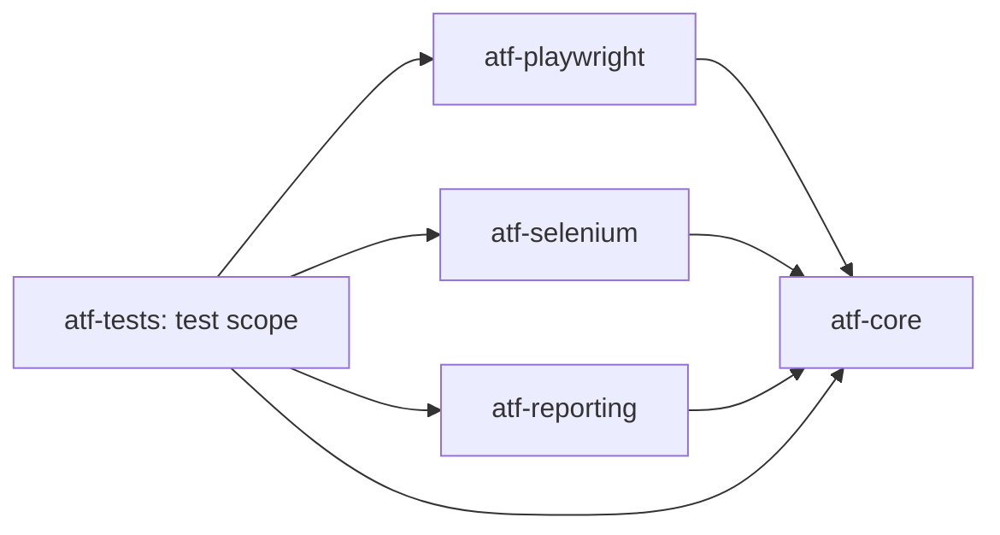
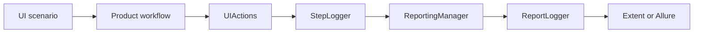
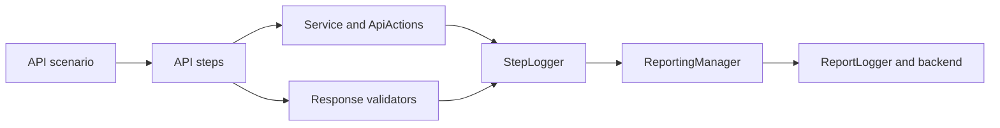
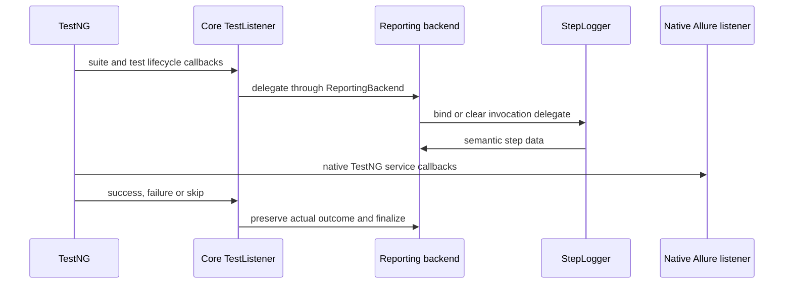
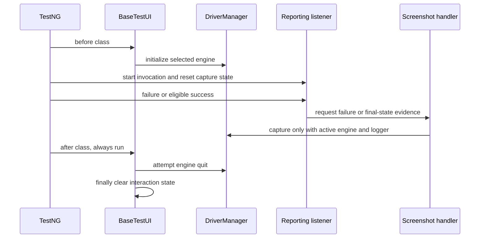
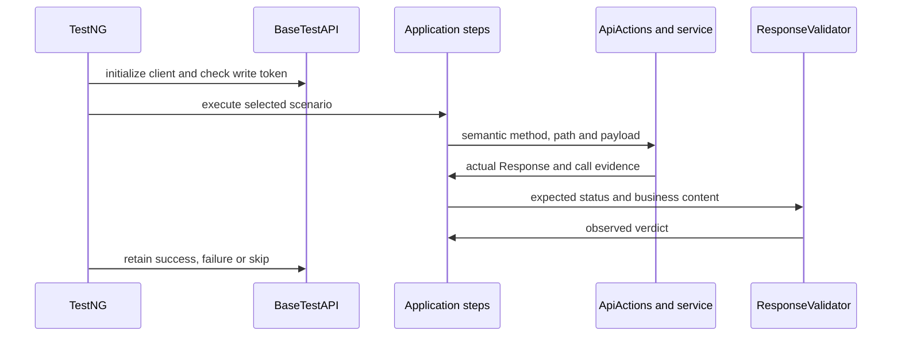
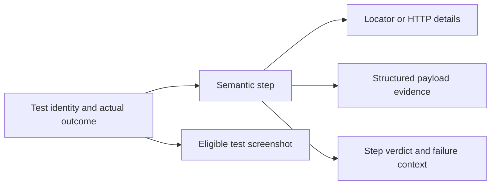

<a id="living-architecture"></a>
# Living Architecture (UI + API)

This guide preserves the essential UI, API, reporting and test contracts from
the archived v1.0 architecture. It reconciles them with the current modular
framework. The retained filename identifies the document lineage, not a new
library release or an execution receipt.

The [HTML companion](Living_Architecture_UI_API_doc_v1_0.html) presents the same
sections with collapsible panels and static diagrams. This Markdown document
owns the content; the HTML metadata records its source filename and normalized
SHA-256. Update both together. [Architecture](Architecture.md) owns the concise
module map, [Testing](Testing.md) owns strategy, the
[command cookbook](Testing_Commands.md) owns execution recipes, and
[feedback](feedback/README.md) owns unresolved criteria. This guide records no fresh application acceptance.

Wide HTML diagrams retain their native label size. Scroll inside the figure
to inspect a wide sequence; the surrounding page remains readable.

The [maintained browser matrix](Testing.md#selenium-pinned-manager-route) owns
the Selenium/browser/driver/CDP pins and portable binary preparation. Project
paths derive from the reactor root or explicit caller/environment inputs;
absolute runtime paths are resolved from those inputs when an API requires them.

<a id="approach"></a>
## 1) Approach and scope

<details open>
<summary>Responsibilities and vocabulary</summary>

| Label | Meaning | Boundary |
|---|---|---|
| CORE | Shared contracts, configuration and lifecycle | Browser and reporting vendor SDKs stay outside Core |
| UI | Engine-neutral actions, waits, browser lifecycle and observations | Application pages and workflows stay in test support |
| API | HTTP execution, response validation and application services | HTTP transport is distinct from business assertions |
| REPORTING | Extent/Allure implementation and publication | Core exposes neutral reporting contracts and an optional backend SPI |

The interaction model remains `UIActions + WaitUtils + UIEngine` for UI,
`Steps + Services + ApiActions/ApiClient + Validators` for API, and
`StepLogger + ReportingManager + ReportLogger` for semantic reporting.
TestNG owns test outcomes. The browser and reporting providers implement
contracts; they do not decide business success from constructed evidence.

</details>

<a id="ownership-map"></a>
### Current source and module ownership

Libraries compile to Java 11 bytecode. Use the JDK/Maven preparation described
in the [root guide](../README.md#start). Public Java packages retain the `com.ai`
root across modules; sharing a package prefix does not permit a reverse dependency.

| Maven module | Owned source | Primary consumer contract |
|---|---|---|
| [atf-core](../atf-core/README.md) | Neutral `com.ai.core`, `com.ai.api.core`, neutral `com.ai.ui.core`, generic UI action/wait facades | UIEngine, UiEngineProvider, ConfigManager, StepLogger, ReportLogger, ReportingBackend |
| [atf-playwright](../atf-playwright/README.md) | `com.ai.ui.core.engine.playwright` | Playwright implementation of UiEngineProvider |
| [atf-selenium](../atf-selenium/README.md) | `com.ai.ui.core.engine.selenium` | Selenium implementation of UiEngineProvider |
| [atf-reporting](../atf-reporting/README.md) | Reporting backend, concrete listeners, Extent/Allure adapters and aggregate writers | ReportingBackend and neutral ReportLogger operations |
| [atf-tests](../atf-tests/README.md) | Cross-module integration/governance checks and product UI/API support under test sources | Verification and explicit application journeys |

There are five Maven modules. Each browser adapter and Reporting depends on
Core; atf-tests consumes all four libraries with test scope. The parent POM
coordinates versions. The [documentation-only Atlas](../atf-atlas/README.md) is a review/ownership
map outside the Maven reactor; it supplies no Java runtime or provider.

Product pages, services, factories, steps, business validations and application
scenarios live under `atf-tests/src/test`. Generic UIActions and WaitUtils retain
their existing packages in Core for compatibility. Concrete browser SDK classes
remain inside the owning adapter. A consumer selects the libraries it needs;
it does not consume atf-tests as a production API.

<a id="configuration"></a>
## 2) Centralized configuration

<a id="configuration-precedence"></a>
### Loading and precedence

[ConfigManager](../atf-core/src/main/java/com/ai/core/support/config/ConfigManager.java)
loads `framework.properties` from the classpath, or an explicit file selected by
`-Dframework.properties=...`. Its packaged source owner is
`atf-core/src/main/resources/framework.properties`. Runtime loading does not
search a monolithic source tree. Individual JVM properties override loaded keys.

Use `get(key, default)` for optional values and `require(key)` for nonblank
required values. Configuration access and validation belong to Core typed options;
application steps should not duplicate parsing. Explicit environment settings,
browser caches and suite selection remain caller-owned. Do not place credentials
or assumed machine-specific paths into published examples.

<a id="ui-configuration"></a>
### UI configuration

<details open>
<summary>Maintained UI defaults</summary>

```properties defaults
base.url=https://practicesoftwaretesting.com
ui.engine=playwright
ui.headless=true
ui.window.mode=fullscreen
ui.window.size=
ui.page.zoom.percent=60
ui.wait.timeout.seconds=20
ui.screenshots.enabled=true
ui.screenshots.on.failure.only=false
ui.screenshots.capture.final.state=true
```

`ui.engine` selects an installed `playwright` or `selenium` provider. Discovery
does not start a browser. Missing or duplicate providers produce diagnostics;
an unavailable adapter is not a reason to silently select another engine.

An explicit valid window size takes precedence. Otherwise the resolver uses a
usable system size, with `2560x1440` as the headless/unavailable-system fallback.
That fallback is not a promise that every configured session has that size.
Zoom is normalized to supported levels: the configured `60` resolves to `67`.
Navigation and screenshots preserve the resolved zoom. Browser preparation and
SDK-default Node selection are covered in [Testing](Testing.md#browser-preparation-and-checks).

</details>

<a id="api-report-configuration"></a>
### API and reporting configuration

<details open>
<summary>Maintained API and report defaults</summary>

```properties defaults
base.url.api=https://gorest.co.in
auth.token=
api.wait.timeout.seconds=10
api.rate.limit.max.retries=2
api.rate.limit.retry.default.delay.seconds=5
api.rate.limit.retry.max.delay.seconds=65
reporting.engine=extent
reports.dir=target/reports
reports.timestamp.enabled=true
reports.timestamp.format=yyyy-MM-dd_HH-mm-ss
console.details.enabled=true
```

The maximum rate-limit retry count must be nonnegative. Zero permits the initial
request without reattempts; negative values fail before execution.

These URLs are defaults, not authorization to mutate an application. API write
flows require an explicit usable token. `BaseTestAPI` skips its write-oriented
setup when that token is blank; a skip is not acceptance. Caller-controlled
anonymous/invalid-auth fixtures use the explicit request paths designed for them.
Normal authentication is centralized in ApiClient; special negative-auth helpers
are test support, not a second production authentication mechanism.

Core can execute without a Reporting backend. Installing atf-reporting enables
its Extent/Allure implementation. The two report engines are selected by
`reporting.engine` behind one ReportingBackend service and the neutral facade;
invalid engine configuration is a diagnostic, not a
documented universal NO-OP fallback. Report directories are relative to the
executing validation module unless overridden.

</details>

<a id="architecture-diagrams"></a>
## 3) Architecture diagrams

<a id="module-dependencies"></a>
### Maven dependency direction



Arrows mean dependency, not execution order. Core never loads a browser or
reporting vendor class directly. Java service descriptors belong to their
providers. atf-tests verifies composition; it is not a dependency of a library.
The documentary Atlas is absent from this runtime graph by design.

<a id="canonical-rules"></a>
## 4) Canonical execution rules

MUST and MUST NOT below are scoped review rules. They do not imply that every
statement has an automatic guard. The [verification map](#verification-map)
identifies current source/test owners; unresolved acceptance stays in feedback.

<a id="retained-principles"></a>
### Retained principles and auditable UI execution

The archived v1.0 headings define the lineage of these twelve retained
principles. Their intent remains mandatory within its stated layer. The
[reconciled decisions](#historical-reconciliation) explain superseded literal
rules; removing an obsolete implementation constraint does not remove its
ownership, failure-truth or evidence obligation.

`MAINTAINED` means that the current source owner and an existing check are
identified. It does not mean that a check was executed, that every branch was
covered, or that a public application accepted the scenario. `PARTIAL` exposes
a known unfulfilled obligation. Execution evidence belongs to its exact source,
selection, engine and native result in the [report publication](../artifacts/reports/README.md).

| ID | Archived intent / current decision | Implementation owner | Existing checks | State | Proof boundary |
|---|---|---|---|---|---|
| LD-01 | Section 3, Config: one configuration owner; use required/optional typed access. | [ConfigManager](../atf-core/src/main/java/com/ai/core/support/config/ConfigManager.java) | [Configuration loading](../atf-tests/src/test/java/com/ai/atf/core/support/config/ConfigManagerFileContractTest.java) | MAINTAINED | Source-owned precedence and validation; caller credentials and environment availability remain separate. |
| LD-02 | Section 3, UI interactions: application interactions use UIActions; vendor engines own capabilities rather than business decisions. | [UIActions](../atf-core/src/main/java/com/ai/ui/support/actions/UIActions.java) | [Engine delegation](../atf-tests/src/test/java/com/ai/atf/ui/component/UiEngineDelegationContractTest.java) | MAINTAINED | Technical engine tests may call the interface directly; application scenarios may not branch on vendor SDKs. |
| LD-03 | Section 3, engine-dependent waits: Selenium requires explicit facade waits; Playwright supplies native auto-wait capability. | [UiActionWait](../atf-core/src/main/java/com/ai/ui/support/actions/UiActionWait.java) | [Action and input parity](../atf-tests/src/test/java/com/ai/atf/ui/component/UiEngineActionParityContractTest.java) | MAINTAINED | Both wait-capability paths are component contracts; native browser observations and product outcomes need their own execution. |
| LD-04 | Section 3, Waits: WaitUtils observes bounded conditions and does not independently emit FAIL. | [WaitUtils](../atf-core/src/main/java/com/ai/ui/support/wait/WaitUtils.java) | [Bounded wait regressions](../atf-tests/src/test/java/com/ai/atf/ui/component/WaitUtilsContractTest.java) | MAINTAINED | The enclosing action or validation owns its terminal verdict; a polling timeout is not a successful observation. |
| LD-05 | Section 3, Validation: reusable validations compare independent actual values with expected business conditions inside explicit Validate steps. | [Registration validation](../atf-tests/src/test/java/com/ai/ui/support/validation/RegistrationValidation.java) and [Profile validation](../atf-tests/src/test/java/com/ai/ui/support/validation/ProfileAccountValidation.java) | [Registration validation contracts](../atf-tests/src/test/java/com/ai/atf/ui/component/RegistrationValidationContractTest.java) | MAINTAINED | Expected/actual details and one terminal verdict explain the assertion; action completion alone does not establish business success. |
| LD-06 | Section 4, Details and exceptions: the listener owns test lifecycle and preserves the actual failure outside an action step. | [ReportingTestListener](../atf-reporting/src/main/java/com/ai/core/reporting/listener/ReportingTestListener.java) and [BaseTestUI](../atf-core/src/main/java/com/ai/ui/core/runtime/BaseTestUI.java) | [Listener failures](../atf-tests/src/test/java/com/ai/atf/core/reporting/lifecycle/TestListenerFailureContractTest.java) | MAINTAINED | Class setup and teardown remain configuration evidence, not additional product tests; failure attribution must retain its original scope. |
| LD-07 | Sections 3.5 and 4, step ownership: details require an active step; each owned step has one terminal verdict; nested depth is supported. | [StepLogger](../atf-core/src/main/java/com/ai/core/reporting/StepLogger.java) and [StepScope](../atf-core/src/main/java/com/ai/core/reporting/step/StepScope.java) | [Step lifecycle regressions](../atf-tests/src/test/java/com/ai/atf/core/reporting/regression/StepLoggerContractTest.java) | MAINTAINED | Nested actions must return to their validation scope; closing an unfinished scope is not an implicit PASS. |
| LD-08 | Section 4, Stacktrace and screenshot: retain one failing-step trace and listener-owned test-level failure attachments. | [UI screenshot handler](../atf-core/src/main/java/com/ai/ui/core/reporting/UiScreenshotFailureHandler.java) and [Failure attachment registry](../atf-core/src/main/java/com/ai/core/reporting/attachment/FailureAttachmentRegistry.java) | [Failure attachment contracts](../atf-tests/src/test/java/com/ai/atf/core/reporting/attachment/FailureAttachmentRegistryTest.java) | MAINTAINED | Configured final-state capture is distinct from a failure screenshot; missing attachments do not convert a failure into success. |
| LD-09 | Section 4, Extensibility and operations: application layers emit semantic evidence through the neutral facade; Reporting owns adapters and lifecycle. | [ReportingManager](../atf-core/src/main/java/com/ai/core/reporting/ReportingManager.java) and [DefaultReportingBackend](../atf-reporting/src/main/java/com/ai/core/reporting/DefaultReportingBackend.java) | [Reporting manager contracts](../atf-tests/src/test/java/com/ai/atf/core/reporting/regression/ReportingManagerSessionContractTest.java) | MAINTAINED | Backend absence, invalid configuration and adapter diagnostics have different contracts; no universal silent fallback is inferred. |
| LD-10 | Section 5, Test data and independence: factories own unique product values; scenarios remain independent of method order and declare shared fixture lifecycle. | [UserDataFactory](../atf-tests/src/test/java/com/ai/ui/support/factory/UserDataFactory.java) and [ProfileAccountComponent](../atf-tests/src/test/java/com/ai/ui/support/component/ProfileAccountComponent.java) | [Registration submission contracts](../atf-tests/src/test/java/com/ai/atf/ui/component/RegistrationSubmissionContractTest.java) | MAINTAINED | Framework counterexamples may use literal malformed data; shared account/profile fixtures are class-scoped and their selected checks only read account state. |
| LD-11 | Section 5, Test data: cleanup of created application data remains mandatory and must have its own observable contract. | [RegistrationService](../atf-tests/src/test/java/com/ai/ui/support/service/RegistrationService.java) and [ProfileAccountComponent](../atf-tests/src/test/java/com/ai/ui/support/component/ProfileAccountComponent.java) | [Registration submission contracts](../atf-tests/src/test/java/com/ai/atf/ui/component/RegistrationSubmissionContractTest.java) | PARTIAL | ACCOUNT_DELETION_NOT_IMPLEMENTED: retained public-demo tests create accounts and select no account-deletion operation. Submission checks do not prove cleanup. |
| LD-12 | Sections 4 and 5, engine independence: select the same retained scenarios through configuration for Playwright and Selenium. | [UIEngineRegistry](../atf-core/src/main/java/com/ai/ui/core/engine/UiEngineRegistry.java) | [Registration scenarios](../atf-tests/src/test/java/com/ai/atf/ui/RegistrationTests.java), [Account scenarios](../atf-tests/src/test/java/com/ai/ui/tests/AccountAuthenticatedAreaTests.java) and [Profile scenarios](../atf-tests/src/test/java/com/ai/ui/tests/ProfileContactAddressMemoryTests.java) | MAINTAINED | SAME_RETAINED_SCENARIOS: the same 16 existing methods form both engine selections. Only native result identities and actual application observations establish their execution outcomes. |

For each selected UI scenario, the action step records intent, locator and the
reportable input; password/secret-labelled values are represented by
`[REDACTED]` while the original value still reaches the browser. This bounded
classification does not inspect arbitrary application fields or sanitize SDK
exception text. A final artifact review must check the actual generated
evidence for unintended sensitive values.

The validation step states the expectation, reads the observed value and owns
the assertion and terminal PASS/FAIL. Expected negative application behavior
can pass its test only when that expected rejection is independently observed.
An unexpected browser, action, assertion or configuration failure retains its
actual failed or skipped result; recording contract metadata cannot certify it.

The [documentation governance owner](../atf-tests/src/test/java/com/ai/atf/governance/DocumentationGovernanceTest.java)
checks the twelve IDs, real source/check routes and bounded states. Missing or
duplicate principles and promotion of the declared cleanup gap are diagnostic
failures. These structural guards do not establish semantic completeness or
replace native product acceptance.

<a id="configuration-boundary"></a>
### Configuration and reporting boundaries

UI runtime validation rejects malformed boolean values and waits outside
`1..2147483` whole seconds before provider acquisition. The six UI flags share
one boolean reader; WaitUtils shares the validated wait reader. Canonical and
legacy wait precedence and valid defaults remain unchanged. See the
[Core configuration contract](../atf-core/README.md#validated-ui-configuration-and-cleanup).


- MUST keep one Core configuration loader and use its typed option owners.
- MUST route semantic execution reporting through StepLogger/ReportLogger.
- MUST keep Extent/Allure SDK imports inside atf-reporting and browser SDK imports
  inside the corresponding adapter.
- MUST NOT let a business step instantiate a reporting adapter or control test
  start/end/flush. Lifecycle ownership belongs to the listener/backend.
- MAY publish neutral runtime events from adapters through the Core publisher;
  this does not grant an adapter access to StepLogger or backend internals.

<a id="ui-interactions"></a>
### UI interactions, selectors and evidence

Application workflows use generic UIActions and reusable page/validation owners.
UIEngine provides browser capabilities such as interaction, reads, waits,
screenshots and network-response observation; it does not implement customer or
order business rules. Framework adapter/contract tests may exercise UIEngine
directly to test that boundary. They are not application-layer examples.

Prefer stable semantic CSS locators. Use the supported locator vocabulary and
exact text/identity matching when required. XPath is appropriate when the
supported CSS/semantic expression cannot express the needed relationship.
Do not infer browser parity merely because the same string compiles.

Observed evidence MUST come from the matched element or response. A creation
ID identifies the desired invoice; it does not prove that the invoice appears
in the customer's list. Persisted status value, display label and row identity
are separate observations. A registration helper submits one identity once;
it must expose a failed result instead of silently replacing that customer.

<a id="bounded-waits"></a>
### Waits, retries and timing

UIActions applies engine-aware waits: Selenium reports `supportsAutoWait=false`,
while Playwright reports `true`. Shared explicit conditions use WaitUtils and
the configured timeout. Adapter internals may implement their native waiting
mechanism; the old blanket rule forbidding every wait outside WaitUtils is not
a description of the current source.

WaitUtils supplies observations and throws when a required condition is unmet;
it may append detail to an active step but does not independently emit FAIL.
The enclosing action/validation owns the verdict. Prefer observable completion
and a bounded timeout to fixed sleeps. Current pause helpers and legacy waits
are not evidence of deterministic timing; evaluate them in their existing tests.

API polling and rate-limit retries have separate policies. Preserve the exact
supplier/attempt assertions, terminal result and negative timeout case. A retry
does not establish that a non-idempotent operation was rolled back or safe to
repeat. Do not change waits, retries or expected values only to obtain a green run.

<a id="validation-layer"></a>
### Validation and assertion ownership

Application validations compare independently observed actual values with the
expected business contract and produce useful failure evidence. Reuse the
validation owner instead of scattering business assertions through services.
Framework/unit tests assert their own technical contracts directly; they are
not required to route every assertion through a product validation class.

A business failure must remain a failed test. Continuing later independent
tests is a runner/suite policy, not permission to swallow the original failure.
Expected-failure fixtures must declare their expected outcome and preserve a
separate oracle; a deliberately produced report FAIL is not automatically a
failed outer regression.

<a id="api-orchestration"></a>
### API steps, services and HTTP execution

| Layer | Responsibility | Boundary |
|---|---|---|
| Application test | Compose a scenario and own its fixture/cleanup | Does not duplicate transport, auth or backend reporting |
| Steps | Coordinate semantic calls and validations | Use factories/builders for reusable valid business data |
| Service | Own endpoint paths and invoke ApiClient requests | Does not hide business assertions in transport methods |
| ApiActions / request executor | Wrap the supplied call, retry policy and report details | Return the actual RestAssured Response |
| Validator | Assert status, headers, body/schema and eventual state | Own expected/actual evidence and a bounded polling contract |

Use the configured API base URL plus the service-relative path. API steps pass
the observed response into validators. A service can use ApiClient inside the
call supplied to ApiActions; it must not be described as an alternative direct
reporting engine. Existing invalid-auth/raw-payload helpers are intentional
test-support exceptions, not a universal payload policy.

HTTP steps use a semantic title such as `POST /public/v2/users` and retain method,
relative/full path, actual status and request/response details. Normal model
serialization and response formatting belong to the shared helpers. Preserve
literal invalid payloads when a negative test requires them; replacing them
with a valid builder would remove the behavior under test.

<a id="step-contract"></a>
### StepLogger contract

The supported public operations include:

```java
StepLogger.startStep(String title);
StepLogger.logDetail(String detail);
StepLogger.logCodeBlock(String content);
StepLogger.pass(String message);
StepLogger.fail(String message, Throwable failure);
StepLogger.fail(String message, String stacktraceAsText);
StepLogger.step(String title); // returns an AutoCloseable StepScope
```

Details and terminal operations require an active step. Step context is held
per thread and cleared at test boundaries. Nested step depth is supported;
the archived rule that a second active step is always forbidden is obsolete.
Callers must close the scope they own and avoid duplicate terminal publication.
StepScope guards its own close/pass/fail operations.

An uncompleted StepScope logs a diagnostic and closes its depth; it does not
manufacture a passed business verdict. The current implementation does not
globally enforce an exactly-once terminal call across arbitrary caller misuse.
Use existing regressions to protect lifecycle behavior rather than documenting
a stronger guarantee than the source provides.

<a id="module-constraints"></a>
### Global and module constraints

Production libraries require their runtime dependencies. Compile-time Lombok
and test-scoped test doubles/checks have intentional distinct scopes.
atf-tests depends on libraries in test scope; the archived prohibition on all
test-scoped dependencies and separate Maven modules does not apply.

Keep public contracts small, avoid accidental overrides of Object lifecycle/
monitor methods, and make ownership explicit. Source governance must examine
all production module roots, profiles, imported/qualified types and relevant
simple type references. A copied source tree or matching filename does not
prove a valid dependency direction.

<a id="reporting"></a>
## 5) Reporting flows and lifecycle

<a id="reporting-ui-flow"></a>
### UI actions to semantic reporting



UIActions owns the action step, locator/value/wait detail and observed action
outcome. The selected UIEngine performs browser work through its adapter.
Reporting receives neutral events. Product code is insulated from the browser
and reporting SDKs; technical adapter tests verify the lower-level boundary.

<a id="reporting-api-flow"></a>
### API calls and validations to semantic reporting



Call completion and business validation are distinct observations. A response
arriving successfully does not prove its business content is correct. HTTP
call steps retain request/status/response facts; validation steps explain their
expectation and observed comparison. Cleanup/polling helpers have their own
scope and must not be mistaken for complete application acceptance.

<a id="test-lifecycle"></a>
### TestNG lifecycle and failure ownership



The Core TestListener is the stable facade. atf-reporting supplies
ReportingTestListener through ReportingBackend and owns session/group/invocation
state, attachments, flushing and runtime audit. BaseTestUI/BaseTestAPI declare
the Core listener; they do not import AllureTestNg. Native Allure TestNG service
discovery belongs to the Reporting dependency. Do not add the archived direct
Allure listener annotation/order to Core or manually duplicate that provider.

An exception outside an action step is handled at the test lifecycle boundary.
Its existence must not be lost because no semantic step was open. Configuration
failures, skipped cases and controlled failure simulations remain distinguishable
from ordinary successful execution. Optional diagnostic/publication failures
are recorded separately from the business outcome.

<a id="ui-screenshots"></a>
### UI lifecycle, failure screenshots and final state

Class teardown clears interaction state in `finally` after every engine shutdown
outcome. Provider acquisition failures release only acquired resources in reverse
order, preserving the primary failure and distinct suppressed cleanup causes.
The existing base/provider component tests exercise these error paths without
starting browsers; native browser and product acceptance remain separate.




BaseTestUI initializes/quits the engine once per class with always-run teardown.
It does not orchestrate report sessions. Failure/final-state registries invoke
the UI attachment handler. ScreenshotManager attaches at most once per invocation
after a successful capture/attachment; without an active engine/logger it does
not manufacture evidence.

The final diagram arrow attempts shutdown; the note identifies independent
cleanup in finally. DriverManager removes its engine reference and BaseTestUI
clears interaction state even when quit throws. The existing
[F-011 component oracle](feedback/Behavior_And_Negative_Cases.md#f-011)
checks success, RuntimeException and Error, exact cause identity and repeated
teardown. Always-run scheduling alone does not establish these guarantees. This
framework-state contract is separate from LD-11's application-data cleanup
obligation and from browser-process acceptance.

Failure capture is configuration-dependent. Eligible success can also capture
the final UI state when screenshots are enabled, failure-only mode is disabled
and final-state capture is enabled. The old rule saying screenshots occur only
on FAIL is no longer valid. Retain the complete screenshot, current zoom and
its test identity; do not treat a viewport crop or another test's image as proof.

<a id="api-lifecycle"></a>
### API lifecycle, authentication and validation



BaseTestAPI is write-oriented: blank authentication causes its readiness skip.
Core API execution is independent of UI initialization. Application factories
own reusable models; services own relative endpoints; shared execution applies
the configured retry policy; validators own assertions and schemas. Separate
anonymous/invalid-auth paths remain explicit negative fixtures.

<a id="report-node-model"></a>
### Test and step node evidence model



The test node identifies the invocation and final status. Step nodes hold
semantic details and relevant payload/failure context; screenshot evidence is
associated with its test. Keep failures scannable and avoid publishing the same
business exception through unrelated nodes. Do not promise that every report
kind has identical DOM or that every failure is exclusively represented by one
specific HTML block: runtime, aggregate and synthetic report shapes differ.

<a id="reporting-engines"></a>
### Engines, adapters and fail-safety

Extent and Allure implement ReportLogger behind the installed ReportingBackend.
Extent manages its explicit report nodes and flush/finalization. Allure's native
TestNG integration owns its test lifecycle while the adapter publishes semantic
steps and structured evidence. Backend implementations and engine selection
remain inside atf-reporting, reached through Core facades.

Nonblocking diagnostics preserve optional publication/attachment problems
without rewriting the original business outcome. This is not a guarantee that
invalid configuration, missing required providers or every I/O failure is ignored.
Inspect diagnostics and actual artifacts as well as the runner exit code.
Adding an engine is a future implementation change; this guide adds no engine.

<a id="console-and-details"></a>
### Console details and example evidence

Semantic steps use a readable title, indented details and a terminal verdict.
`console.details.enabled=false` suppresses optional console details, not the
underlying test oracle. Core console/diagnostic helpers can emit framework
diagnostics; the archived absolute claim that no component except StepLogger
ever writes a console message is not a current source invariant.

```text
POST /public/v2/users
  method=POST
  url=https://gorest.co.in/public/v2/users
  response.status=201
  request/response payload evidence
PASS Call completed
Validate status: expected 201
  actual=201
PASS Response validated
```

The example explains layout; it is not an executed request or a current test
count. UI details similarly identify locator, input/selection and applied wait.
Examples must not expose tokens or suggest that a known expected value is an
independent observation.

<a id="test-organization"></a>
## 6) Test organization and requirements

<a id="ui-scenarios"></a>
### UI scenarios and lifecycle ownership

Application UI classes use BaseTestUI or an intentional owner-reviewed lifecycle.
They compose product services/actions/pages/validations rather than browser SDK
calls. Framework/native tests can own lightweight engine fixtures directly;
they are not forced to launch an application or extend the product base class.

The historical registration example was `/auth/register`, with positive and
negative outcomes. Preserve that intent by verifying meaningful business
behavior and failure variants, not by asserting an arbitrary universal test
count or making every unrelated UI test navigate to registration. The retained
registration regressions cover one identity/one submission and visible errors.

<a id="api-scenarios"></a>
### API scenarios, independence and cleanup

Application API tests own their created entities and remain independent of
method order. A GET/update/delete scenario creates the entity it requires;
cleanup does not silently replace its business oracle. A complete lifecycle
scenario distinguishes creation, retrieval, update, deletion and verification
of deletion. Shared fixtures must declare their lifecycle and cleanup limits.

The archived examples use these service operations:

```text
POST   /public/v2/users       -> creation contract
GET    /public/v2/users/{id}  -> retrieval contract
PUT    /public/v2/users/{id}  -> replacement contract
PATCH  /public/v2/users/{id}  -> partial update contract
DELETE /public/v2/users/{id}  -> deletion contract
```

Expected statuses/content come from the selected target's contract, not from
this illustrative endpoint list. JSON schema validation belongs to response
validation inside a meaningful step. A list of methods does not prove endpoint
coverage, and a local mock does not prove public-service acceptance.

<a id="test-data-and-auth"></a>
### Test data, authentication and negative fixtures

Reusable fixture data belongs under `atf-tests/src/test/resources/tests/testdata` and
its factories/builders. Existing DataGenerator owns unique application values.
JSON is the retained data format for shared product examples; unit tests may
use in-memory doubles, and negative tests may need literal malformed data.
The old requirement that every value in every test must come from JSON is not
a valid global invariant for framework regressions.

Supply authentication at runtime. Do not paste real tokens into documents,
committed fixtures or report examples. Negative-auth helpers can explicitly
select missing/invalid authentication; they do not change the configured
identity behind a positive helper's caller. Inspect existing demo-account
assumptions before controlled application execution.

<a id="test-oracles"></a>
### Observable oracles and honest execution scope

Existing regressions should distinguish expected and observed values, retain
the negative path and fail when the protected behavior is removed. Source
shape assertions protect architecture; they do not replace runtime behavior.
Do not convert a failure to a skip, loosen the expected value, delete the
negative case or increase timeouts without a diagnosed cause and owner.

Use the maintained local, browser, Allure and aggregate selections described
in Testing. Scope results separately: native contracts, local fixtures,
real-browser fixtures and controlled application journeys answer different
questions. The current maintenance scope keeps the existing E2E inventory and
improves framework stability, documentation and governance. The
[feedback register](feedback/README.md) owns scope decisions and browser/CDP
matrix evidence. Local fixtures do not establish public application acceptance.

<a id="delivery"></a>
## 7) Delivery artifacts and execution

Required maintained artifacts include the parent/module POMs, module READMEs,
Core framework.properties, owned library sources, test resources/suites and
the paired architecture guide. Runtime JARs contain their owned classes and
service descriptors. atf-tests holds verification sources and no production
framework API. Current consumption replaces the historical monolithic
coordinate as described in [consumer migration](../README.md#consumer-migration).

<details>
<summary>Run 7) Delivery artifacts and execution commands</summary>

```powershell
mvn -B -ntp verify
mvn -B -ntp -Pbrowser test
mvn -B -ntp -Paggregate test
```

</details>

Run those commands only from a prepared disposable validation copy. Browser
installation, explicit Allure selection, class filters, caches and output
locations are documented in Testing. Keep evidence outside development/live
sources. Record the actual selection, source checkpoint, statuses and artifacts;
a skipped or copied run is not a successful execution.

<a id="historical-reconciliation"></a>
## 8) Reconciled archival decisions

| Archived v1.0 claim | Current interpretation |
|---|---|
| One src tree, one POM and no Maven modules | Superseded by five owned Maven modules and test-scoped verification |
| Every dependency must be runtime scoped | Runtime dependencies, compile-time annotations and test-only tools have distinct intentional scopes |
| Core base classes directly declare AllureTestNg first | Core declares TestListener; Reporting owns native Allure service integration |
| A new step cannot start inside an active step | Current StepExecutionContext supports nested depth; callers own their scope's completion |
| Only FAIL can have a screenshot | Configured final-state success capture is also supported |
| Every UI test must visit registration; every assertion/data value must use one product pattern | Product review rules are scoped; native/regression and intentional negative fixtures retain their own oracles |
| CSS is the only selector form | Stable CSS and the shared semantic vocabulary remain preferred; the existing XPath bridge is allowed when that supported vocabulary cannot express the relationship |
| Every unavailable/invalid reporter is silently NO-OP | Core can run without a backend; invalid required configuration/provider selection is still diagnosed |
| A single 2560x1440 size describes every session | Explicit/system sizing takes precedence; this is the fallback, with supported zoom normalization |

No archived rule restores generation, promotion, server or agent execution.
Reusable code/documentation review policies are maintained as governance.
Atlas remains a documentary context and ownership map; proposed analysis
workflows do not become implemented runtime capabilities merely by appearing
in this guide.

<a id="verification-map"></a>
## 9) Source ownership and verification map

| Contract | Source owner | Existing verification owner |
|---|---|---|
| Core configuration and overrides | [ConfigManager](../atf-core/src/main/java/com/ai/core/support/config/ConfigManager.java) | [Configuration regression](../atf-tests/src/test/java/com/ai/atf/core/support/config/ConfigManagerFileContractTest.java) |
| Browser-neutral provider selection | [UiEngineRegistry](../atf-core/src/main/java/com/ai/ui/core/engine/UiEngineRegistry.java) | [Core registry tests](../atf-core/src/test/java/com/ai/ui/core/engine/UiEngineRegistryTest.java) and adapter native tests |
| Window/zoom resolution | [UIWindowSizeResolver](../atf-core/src/main/java/com/ai/ui/core/engine/window/UIWindowSizeResolver.java) | [UI contract area](../atf-tests/src/test/java/com/ai/atf/ui/component) |
| Action waits and verdicts | [UiActionWait](../atf-core/src/main/java/com/ai/ui/support/actions/UiActionWait.java) and [WaitUtils](../atf-core/src/main/java/com/ai/ui/support/wait/WaitUtils.java) | [Wait regressions](../atf-tests/src/test/java/com/ai/atf/ui/component/WaitUtilsContractTest.java) |
| Step lifecycle | [StepLogger](../atf-core/src/main/java/com/ai/core/reporting/StepLogger.java) and [StepScope](../atf-core/src/main/java/com/ai/core/reporting/step/StepScope.java) | [Reporting regressions](../atf-tests/src/test/java/com/ai/atf/core/reporting) |
| API call reporting | [ApiActions](../atf-core/src/main/java/com/ai/api/core/client/ApiActions.java) and [ApiExecutionReporter](../atf-core/src/main/java/com/ai/api/core/client/ApiExecutionReporter.java) | [API regression area](../atf-tests/src/test/java/com/ai/atf/api) |
| Reporting and attachments | [ReportingTestListener](../atf-reporting/src/main/java/com/ai/core/reporting/listener/ReportingTestListener.java) and [UI screenshot handler](../atf-core/src/main/java/com/ai/ui/core/reporting/UiScreenshotFailureHandler.java) | [Reporting test ownership](../atf-tests/src/test/java/com/ai/atf/core/reporting/README.md) |
| Dependency/docs governance | [Existing governance tests](../atf-tests/src/test/java/com/ai/atf/governance) | [Governance owner](../atf-tests/README.md) |

The map identifies implementation and retained regression locations. It is not
a claim that every rule has been executed in every environment. Keep open
acceptance, exact evidence and future documentary proposals at their owner.
