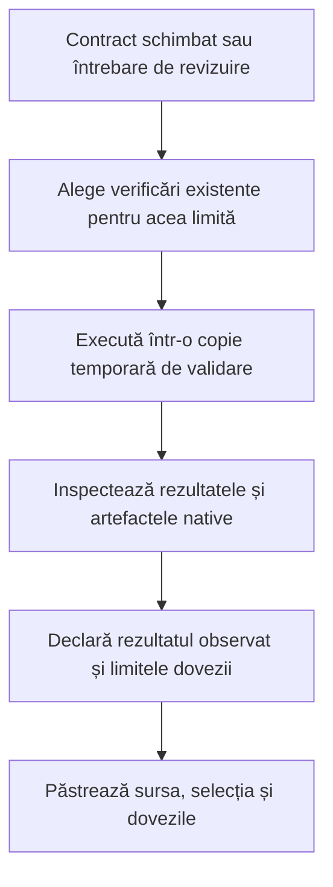

# Testarea framework-ului

Acest ghid definește selecția testelor, limitele dovezilor și revizuirea acestora.
Folosește [colecția de comenzi](Testing_Commands.md) pentru exemple executabile.
Rețetele sunt pliate implicit pentru a nu ascunde strategia de testare sub comenzile de pregătire.

## Locația și domeniul rulării

Rulează Maven din rădăcina reactorului unei copii temporare de validare, conform
[Dezvoltare](Development.md). Păstrează compilările, cache-urile Maven/browser și
dovezile complete ale rulărilor în afara checkout-urilor sursă de dezvoltare și live.

Domeniul curent al mentenanței păstrează inventarul E2E existent. Îmbunătățește
determinismul, aserțiunile, documentația și guvernanța verificărilor existente.
Folosește browsere desktop; nu adăuga scenarii de aplicație și nu utiliza emulatoare.

## Alege limitele dovezii

| Schimbare sau întrebare | Selecție existentă | Observație necesară |
|---|---|---|
| Contractul propriu al unei biblioteci | Verificări native ale modulului împreună cu dependențele | Clasele selectate și aserțiunile lor s-au executat |
| Comportament între module sau guvernanță | Suita locală implicită | Rezultate locale și controale negative relevante |
| Acțiuni, răspunsuri sau capturi reale de browser | Profilul browser | Ambele adaptoare selectate, curățarea și artefactele complete |
| Publicare Extent/Allure | Subsetul Allure nativ și profilul aggregate | Rezultate reale și datele/randarea raportului generat |
| Un scenariu existent de aplicație | Selecție explicită de clasă concretă | Implementarea țintă, identitățile, starea persistată și limitele curățării |

Folosește cea mai mică selecție care expune limita schimbată. Înainte de închiderea
feedback-ului, rulează suita completă relevantă și inspectează rezultatele reale.

Săgețile continue arată succesiunea revizuirii, nu apeluri de execuție sau dependențe de module.

- Păstrează rezultatele observate PASS, FAIL și SKIP.
- Un control de sursă demonstrează numai regula de inspecție acceptată. Fixture-urile
  locale și paginile de browser nu stabilesc acceptanța controlată a aplicației.
- Publicarea și verificările de consistență nu rerulează testele și nu extind limitele dovezii.

## Baza locală

Selecția implicită din rădăcină rulează verificările native ale bibliotecilor și
[framework-local.xml](../atf-tests/src/test/resources/suites/framework-local.xml)
în atf-tests, inclusiv guvernanța.

- Fixture-urile și dublurile locale acoperă configurația, execuția API, delegarea
  UI și raportarea.
- Sunt excluse cazurile dependente de browser, fixture-urile de eșec intenționat
  și scenariile live de aplicație.
- O compilare reușită sau o suită omisă nu reprezintă dovezi de execuție.

Folosește [rețeta bazei locale](Testing_Commands.md#local-baseline).

## Verificări selective

Subseturile menținute [API](../atf-tests/src/test/resources/suites/framework-api.xml),
[UI](../atf-tests/src/test/resources/suites/framework-ui.xml) și
[raportare](../atf-tests/src/test/resources/suites/framework-reporting.xml)
răspund unor întrebări focalizate. Nu înlocuiesc rularea completă implicită de guvernanță.

| Domeniu API | Responsabil existent | Ce stabilește rezultatul |
|---|---|---|
| Contracte API locale ale framework-ului | BaseTestAPIContractTest și ApiCoreExecutionArchitectureContractTest | Inițializare, pregătirea scrierii, bugete, ordinea apelurilor și propagarea eșecului cu fixture-uri/dubluri locale; fără cerere GoRest |
| Scenarii API opționale de aplicație | [PositiveUserTests](../atf-tests/src/test/java/com/ai/api/tests/PositiveUserTests.java) | Două scrieri GoRest existente, numai când sunt executate cu `auth.token` explicit; SKIP din inițializarea cu token gol nu este acceptanța aplicației |

Selecția modulului/dependențelor compilează bibliotecile din amonte. Un filtru de
clasă poate lăsa modulele fără clasă corespunzătoare să continue; verifică execuția
efectivă a testelor cerute din aval. O rulare numai a bibliotecii nu execută
regresiile între module din atf-tests.

Consultă [rețetele selective](Testing_Commands.md#selective-checks).

## Pregătirea și verificarea browserelor

Pregătește ambele medii de execuție ale browserelor înainte de acceptarea
comportamentului. Folosește intrările portabile pentru rădăcina de lucru/cache
în [Dezvoltare](Development.md#working-roles). Obținerea unui binar de browser
este separată de executarea unei verificări de acceptanță.

### Mediul de execuție Playwright

SDK-ul Java Playwright fixat selectează revizia Chromium și folosește propriul
Node inclus. `PLAYWRIGHT_BROWSERS_PATH` poate selecta cache-ul extern.
Pregătirea omite execuția testelor; `PLAYWRIGHT_SKIP_BROWSER_DOWNLOAD` controlează
descărcările inițiale, nu acțiunile browserului.

Folosește [rețeta pregătirii Playwright](Testing_Commands.md#playwright-runtime).

### Calea Selenium Manager cu versiuni fixate

[POM-ul părinte](../pom.xml) și contractul browserului selectează această matrice:

| Componentă | Versiune selectată |
|---|---|
| Selenium Java | 4.54.0 |
| Chrome for Testing | 158.0.8127.88 |
| ChromeDriver | 158.0.8127.88 |
| CDP tipizat obligatoriu | 158 |

- Selectează un executabil Chrome existent, specific gazdei, prin `ATF_CHROME_BINARY`.
- Un `webdriver.chrome.driver` explicit sau un driver utilizabil din cache-ul ATF
  are prioritate față de Manager. Folosește un cache alternativ ATF gol sau inexistent pentru Manager.
- Aliniază configurația/cache-ul Manager separat cu matricea; setări conflictuale
  în `se-config.toml` pot suprascrie intrările de mediu.
- Păstrează dovezile reale ale browserului, driverului, binarului selectat și CDP-ului tipizat.

Clasa existentă de paritate locatori/rețea exercită ambele adaptoare. `ui.engine`
nu restrânge furnizorii săi de date la un singur motor. Folosește
[rețeta pregătirii Manager și parității](Testing_Commands.md#selenium-pinned-manager-route).

### Selecția completă de browser

Profilul browser selectează
[framework-browser.xml](../atf-tests/src/test/resources/suites/framework-browser.xml)
numai în atf-tests. Verificările native ale bibliotecilor rămân parte a rulării
reactorului. Paginile locale acoperă paritatea motoarelor, capturile, comportamentul
ferestrei/zoomului și raportarea.

- `SE_OFFLINE` controlează accesul Manager la rețea; opțiunea offline Maven
  controlează rezolvarea artefactelor Maven. Activează-le după punerea în cache a resurselor necesare.
- Păstrează capturile complete. O schimbare de versiune necesită o verificare nouă
  a matricei și o rulare de browser, consemnate în feedback.

Folosește [rețeta completă de browser](Testing_Commands.md#complete-browser-selection).

## Acceptanța raportării

[Subsetul Allure nativ](../atf-tests/src/test/resources/suites/framework-allure.xml)
verifică integrarea nativă.
[Suita agregată](../atf-tests/src/test/resources/suites/framework-aggregate.xml)
colectează cazuri executate și publică atât Extent, cât și Allure.

Inspectează numărătorile, stările, temporizările, atașamentele și căile declarate
ale rezultatelor, precum și rezultatul TestNG. Folosește [rețetele raportării](Testing_Commands.md#reporting-acceptance).

## Scenarii de aplicație

Suportul produsului și clasele opționale de aplicație aparțin atf-tests. Selectează
o clasă concretă existentă și configurează `base.url`/`base.url.api` pentru țintă;
scrierile API necesită și `auth.token` explicit.

Aceste scenarii pot crea utilizatori, comenzi sau facturi. Acreditările absente,
serviciile indisponibile și scenariile neexecutate nu stabilesc acceptanța.

- Consemnează lacunele framework-ului în [feedback](feedback/README.md), păstrând domeniul.
- Verifică [precondițiile selecției aplicației](Testing_Commands.md#application-journeys).

## Auditul UI de produs păstrat

Aceleași metode existente rulează prin oricare dintre furnizori. Sunt separate de
framework-ui și framework-browser; aceste suite nu selectează tacit aplicația publică.

| Responsabil existent | Metode | Contract observat |
|---|---:|---|
| [RegistrationTests](../atf-tests/src/test/java/com/ai/atf/ui/RegistrationTests.java) | 6 | Înregistrare și respingerea câmpurilor obligatorii, emailului, duplicatelor, parolei și telefonului |
| [AccountAuthenticatedAreaTests](../atf-tests/src/test/java/com/ai/ui/tests/AccountAuthenticatedAreaTests.java) | 5 | Navigarea autentificată în cont, profil, favorite, facturi și mesaje |
| [ProfileContactAddressMemoryTests](../atf-tests/src/test/java/com/ai/ui/tests/ProfileContactAddressMemoryTests.java) | 5 | Valorile înregistrate de contact/adresă rămân observabile în profil |

Folosește câte o copie de validare și un istoric de rezultate separat pentru fiecare
motor. Selecția demo configurată creează clienți sintetici; nu creează facturi,
nu schimbă comenzile admin și nu șterge acești clienți. Închiderea browserului
închide sesiunile, nu datele aplicației.

- PASS al acțiunii înseamnă finalizare tehnică. PASS de afaceri necesită validare
  separată cu observații așteptate/reale.
- Un scenariu negativ trece când criteriul respingerii reușește. Validarea absentă
  sau neatinsă nu este acel succes.
- Păstrează rezultatele originale FAIL/SKIP, identitățile exacte clasă/metodă,
  hash-urile sursei, comanda, URL-ul, identitatea browserului și dovezile raportului nativ.

[Principiile vii](Living_Architecture_UI_API_doc_v1_0.md#retained-principles)
definesc responsabilitățile sursei;
[contractul publicării](../artifacts/reports/README.md#retained-ui-report-publication)
definește cititorul fiecărui motor.
[Rețetele UI păstrate](Testing_Commands.md#retained-product-ui-audit) separă
execuția, controalele de mentenanță și reverificarea consistenței unui cititor existent.
Consistența nu stabilește execuție nouă, curățarea datelor sau acoperire exhaustivă.

## Configurație explicită

[ConfigManager](../atf-core/src/main/java/com/ai/core/support/config/ConfigManager.java)
încarcă implicit `framework.properties` din classpath. Un fișier explicit al
consumatorului înlocuiește acea resursă și trebuie să ofere setările consumatorului
selectat. Proprietățile JVM individuale au în continuare prioritate.

Rezolvă un fișier existent o singură dată din rădăcina reactorului, înainte ca Maven
să intre în module. [Rețeta configurației](Testing_Commands.md#explicit-configuration)
acceptă `ATF_CONFIG_FILE` sau `config/local.properties` al consumatorului.

- Consumatorul furnizează fișierul; rezolvarea eșuează înainte de Maven dacă lipsește.
- Transmiterea căii rezolvate evită ipotezele despre directorul curent al proceselor separate.

## Rezultate și dovezi

Căile implicite sunt relative la copia temporară de validare:

| Rezultat | Locație |
|---|---|
| Rezultate Surefire/TestNG | target/surefire-reports al fiecărui modul testat |
| Rezultate între module | atf-tests/target/surefire-reports |
| Rapoarte Extent | atf-tests/target/reports |
| Rezultate brute Allure | atf-tests/target/allure-results |
| Publicare agregată | atf-tests/target/atf-core-aggregate-report |

Directorul agregat își păstrează numele de compatibilitate; proprietățile de execuție
pot redirecționa raportarea. `atf.build.directory` și `surefire.reportsDirectory`
afectează numai atf-tests, fără să mute toate artefactele reactorului.
Consultă [detaliile rezultatelor](Testing_Commands.md#output-and-evidence).

| Rolul dovezii | Limita păstrării | Revizuire necesară |
|---|---|---|
| Rulări complete și eșecuri | Istoric extern imuabil al rulărilor | Punctul sursei, comanda/selecția exactă, numărătorile și artefactele originale |
| Dovezi native și înregistrări selectate | artifacts/reports/current ignorat | Revizie capturată, verdict real și [structura publicării](../artifacts/README.md#verification) |
| Cititor UI păstrat | Un cititor Extent original auditat pentru fiecare motor, cu dovezi native XML/sursă/audit | Subiecți/stări exacte și [contractul arhivei de rapoarte](../artifacts/reports/README.md) |
| Cititor Atlas selectat | Un HTML pentru fiecare proiect în artifacts/atlas/current | [Verificarea consistenței Atlas](../artifacts/atlas/README.md#verification) față de sursa/dovezile capturate |

- Păstrează fiecare rulare separat pentru ca o rerulare focalizată să nu suprascrie XML-ul anterior.
- Consemnează în feedback sursa, comanda, suita selectată, numărătorile și locațiile
  externe ale dovezilor.
- Distinge verificările istorice, nou executate, omise și neexecutate.
- O captură păstrată nu este automat cel mai recent HEAD; copierea sau publicarea
  ei nu este o rulare nouă.
- Guvernanța Java nu execută CLI-ul colectorului de artefacte. Rulează selecția
  Node explicită a arhivei când modifici acel instrument.
