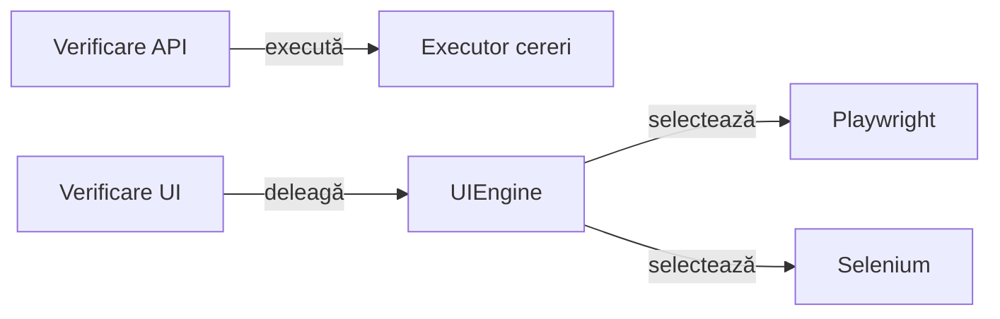
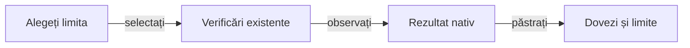

# Testarea framework-ului

Acest ghid explică ce verificări existente răspund unei schimbări, ce observă și
cum susțin rezultatele o afirmație. Începeți cu limitele de proiectare de mai jos;
folosiți [ghidul comenzilor](Testing_Commands.md) pentru pregătire și execuție.

## Trei direcții, dovezi explicite

Verificările API și UI folosesc aceeași configurație și raportare. API are un
executor propriu de cereri; UI folosește același contract al motorului prin doi
furnizori independenți. Un test trebuie să observe rezultatul la limita pe care
afirmă că o protejează.

Legendă: căi de execuție și responsabilități comune

- Săgețile continue arată execuția sau delegarea; ramurile furnizorilor sunt alternative.
- Execuția cererilor API are bugete, reîncercări și aserțiuni proprii asupra răspunsurilor.
- UIEngine oferă contractul UI comun; adaptoarele furnizorilor dețin achiziția,
  interacțiunea și eliberarea browserului. Selectarea unuia nu îl validează pe celălalt.
- Configurația și raportarea susțin ambele căi; sunt omise pentru a păstra scopul
  diagramei. [Arhitectura](Architecture.md) deține harta modulelor și dependențelor.

| Direcție | Responsabil de proiectare | Oracol observabil | Limita dovezii |
|---|---|---|---|
| API | [Executor de cereri](../atf-core/src/main/java/com/ai/api/core/client/ApiRequestExecutor.java) | Ordinea cererilor, bugetul de reîncercare și eroarea originală | Dublurile dovedesc contractele locale de execuție; GoRest necesită execuție separată |
| Playwright | [Furnizor Playwright](../atf-playwright/src/main/java/com/ai/ui/core/engine/playwright/PlaywrightProvider.java) | Resurse dobândite, starea paginii și răspunsul real | Colaboratorii de componentă nu dovedesc comportamentul Chromium |
| Selenium | [Furnizor Selenium](../atf-selenium/src/main/java/com/ai/ui/core/engine/selenium/SeleniumProvider.java) | Resurse dobândite, starea paginii și răspunsul real | Dovada browserului se leagă de binarul, driverul și CDP-ul tipizat selectate |

[Subsetul API](../atf-tests/src/test/resources/suites/framework-api.xml) deține
selecția API locală. Testele native ale furnizorilor observă eliberarea resurselor
la eșec; [paritatea locatorilor/rețelei](../atf-tests/src/test/java/com/ai/atf/ui/component/parity/SeleniumPlaywrightLocatorParityContractTest.java)
observă starea reală a paginii și cererea/răspunsul unui server local prin ambele adaptoare.
Acestea sunt niveluri distincte de dovadă, chiar când protejează aceeași abstracție.

## Alegeți limita dovezii

| Schimbare sau întrebare | Selecție existentă | Observație necesară |
|---|---|---|
| Contractul unei biblioteci | Modulul responsabil și dependențele | Aserțiunile selectate și responsabilitatea resurselor |
| Configurație sau comportament între module | Suita locală implicită | Rezultate locale și controale negative relevante |
| Interacțiune sau răspuns UI real | Profilul browser | Ambele adaptoare, stare/răspuns real și curățare |
| Integrarea și publicarea rapoartelor | Subsetul raportării și profilul agregat | Rezultate, atașamente și cititor generat |
| Comportament existent al aplicației | Clasă concretă explicită | Mediul țintă, identități și stare persistentă |

Legendă: cum susține un rezultat o afirmație delimitată

- Săgețile continue descriu secvența reviziei, nu dependențe de execuție.
- Selectați cea mai mică verificare existentă care expune limita schimbată, apoi
  rulați selecția completă relevantă înainte de închiderea feedback-ului.
- Păstrați rezultatele originale PASS, FAIL și SKIP. O verificare omisă nu oferă dovadă de execuție.
- Guvernanța sursei dovedește regula de inspecție susținută. Fixture-urile dovedesc
  comportamentul lor local; acceptanța aplicației necesită mediul intenționat.

## Referința locală

Reactorul implicit rulează testele native ale bibliotecilor și
[framework-local.xml](../atf-tests/src/test/resources/suites/framework-local.xml).
Acoperă execuția API, delegarea/configurația UI, raportarea și guvernanța, fără
selectarea implicită a claselor dependente de browser sau de aplicație.

- Observați bugetele, ordinea apelurilor și propagarea erorilor în testele API locale.
- Observați opțiunile UI stricte, curățarea la închidere și eliberarea achizițiilor
  parțiale prin colaboratori injectați pentru ambii furnizori.
- Folosiți drept oracol starea independentă sau identitatea erorii; revenirea
  dintr-o acțiune ori apelarea de două ori a aceluiași helper nu sunt dovezi suficiente.
- Verificați controalele negative și corecția reală. Păstrați eșecul original.

Calificați separat infrastructura testelor: păstrați sursele deținute când excludeți
rezultatele generate, repetați aserțiunile originale de ciclu de viață și înregistrați
checkout-ul/codarea exacte. Repetarea locală oferă dovadă delimitată, nu o rată CI
pe termen lung; vezi [T-007](feedback/Code_And_Documentation_Maturity.md#t-007).

[Politica inventarului metodelor](governance/Code_And_Documentation_Policy.md#existing-test-quality)
protejează identitățile revizuite ale testelor; nu dovedește execuția.
Consultați [rețeta referinței locale](Testing_Commands.md#local-baseline).

## Verificări selective

| Domeniu | Selecție existentă | Întrebare de proiectare |
|---|---|---|
| API | [Suita API](../atf-tests/src/test/resources/suites/framework-api.xml) | Sunt păstrate local inițializarea, pregătirea scrierilor, bugetele și erorile? |
| UI | [Suita UI](../atf-tests/src/test/resources/suites/framework-ui.xml) | Își păstrează contractele acțiunile comune, opțiunile și ciclul de viață? |
| Raportare | [Suita raportării](../atf-tests/src/test/resources/suites/framework-reporting.xml) | Păstrează adaptoarele structura rezultatelor și a dovezilor? |

Un filtru de clasă poate permite continuarea modulelor anterioare fără potriviri.
Inspectați identitățile și rezultatele testelor cerute în modulul destinație;
compilarea reușită este insuficientă. [Rețetele selective](Testing_Commands.md#selective-checks)
păstrează distincte aceste selecții focalizate și referința locală completă.

## Pregătirea browserelor și verificări

[Suita browser](../atf-tests/src/test/resources/suites/framework-browser.xml)
folosește pagini locale pentru paritatea locatorilor/rețelei, capturi, ferestre și
raportare. Furnizorii săi de date de paritate verifică Playwright și Selenium;
`ui.engine` nu reduce acea clasă la un singur furnizor.

### Mediul Playwright

Pregătiți revizia Chromium selectată de SDK-ul Java fixat, apoi verificați
comportamentul real al paginii/răspunsului. Simpla achiziție a browserului nu
este dovadă de execuție. Consultați [pregătirea Playwright](Testing_Commands.md#playwright-runtime).

### Ruta Selenium Manager fixată

Aliniați browserul, driverul și CDP-ul tipizat cu matricea deținută de POM;
păstrați identitățile reale lângă rezultat. Suprascrierile cache-ului și pregătirea
Manager aparțin [rețetei Selenium](Testing_Commands.md#selenium-pinned-manager-route).

### Selecția browser completă

Rulați [selecția browser completă](Testing_Commands.md#complete-browser-selection)
după pregătirea ambelor medii. Succesul pe pagini locale nu dovedește acceptanța
aplicației publice. Păstrați capturile complete și eșecurile originale.

## Acceptanța raportării

[Subsetul raportării](../atf-tests/src/test/resources/suites/framework-reporting.xml)
verifică integrarea; [suita agregată](../atf-tests/src/test/resources/suites/framework-aggregate.xml)
colectează cazurile executate și publică Extent.
Revizuiți numerele, stările, duratele și atașamentele față de rezultatele native
folosind [rețetele raportării](Testing_Commands.md#reporting-acceptance).

## Scenariile aplicației

Clasele existente ale aplicației se selectează explicit. Configurați `base.url`
sau `base.url.api` pentru mediul intenționat; scrierile API necesită un
`auth.token` explicit. Subsetul API local folosește fixture-uri/dubluri și nu
trimite cereri GoRest.

[PositiveUserTests](../atf-tests/src/test/java/com/ai/api/tests/PositiveUserTests.java)
conține două scrieri GoRest existente. Lipsa accesului poate produce SKIP la
inițializare; acesta nu reprezintă acceptanța aplicației. Folosiți
[condițiile aplicației](Testing_Commands.md#application-journeys).

## Auditul UI de produs păstrat

Aceleași metode UI existente pot rula prin oricare furnizor. Ele rămân
separate de framework-ui și framework-browser.

| Responsabil existent | Metode | Limită observată |
|---|---:|---|
| [RegistrationTests](../atf-tests/src/test/java/com/ai/atf/ui/RegistrationTests.java) | 6 | Înregistrarea și respingerea datelor invalide |
| [AccountAuthenticatedAreaTests](../atf-tests/src/test/java/com/ai/ui/tests/AccountAuthenticatedAreaTests.java) | 5 | Navigarea în cont, profil, favorite, facturi și mesaje |
| [ProfileContactAddressMemoryTests](../atf-tests/src/test/java/com/ai/ui/tests/ProfileContactAddressMemoryTests.java) | 5 | Valorile înregistrate pentru contact/adresă observate în profil |

- PASS al acțiunii înseamnă finalizare tehnică. PASS de business necesită validare
  separată așteptat/observat; un caz negativ trece când reușește oracolul de respingere.
- Folosiți istorii distincte pentru motoare. Demo-ul configurat creează clienți
  sintetici; selecțiile nu creează facturi, nu modifică comenzi admin și nu șterg clienți.
- Închiderea browserului închide sesiunile. Curățarea datelor aplicației este o obligație separată.

[Principiile living](Living_Architecture_UI_API_doc_v1_0.md#retained-principles),
[contractul publicării per motor](../artifacts/reports/README.md#retained-ui-report-publication)
și [rețetele UI păstrate](Testing_Commands.md#retained-product-ui-audit) dețin detaliile.

## Locul și scopul execuției

Folosiți rădăcina reactorului dintr-o copie de validare separată, conform
[Dezvoltării](Development.md). Păstrați build-urile, cache-urile browser/Maven și
istoria completă în afara copiilor de dezvoltare și live. Mențineți inventarul
E2E existent și browserele desktop; nu adăugați scenarii și nu folosiți emulatoare.

## Configurație explicită

Rezolvați o singură dată un fișier existent al consumatorului la rădăcina
reactorului, înainte de intrarea Maven în module. [Rețeta configurației](Testing_Commands.md#explicit-configuration)
explică înlocuirea resursei, precedența JVM și rezolvarea portabilă.

## Ieșiri și dovezi

| Rolul dovezii | Loc de păstrare | Criteriu de revizie |
|---|---|---|
| Execuții complete, inclusiv eșecuri | Istorie externă a execuțiilor | Reper sursă, comandă, subiecte și rezultate native |
| Dovadă nativă selectată | Zona ignorată artifacts/reports/current | Revizia capturată și verdictul original |
| Cititor UI păstrat | Un cititor auditat per motor | Aceleași subiecte/stări în XML-ul nativ și raport |
| Înțelegerea Atlas | Un HTML per proiect în artifacts/atlas/current | Sursă/dovezi capturate și necunoscute explicite |

Păstrați separat fiecare execuție. [Ghidul ieșirilor](Testing_Commands.md#output-and-evidence)
deține căile implicite; [contractul artefactelor](../artifacts/README.md#verification)
deține publicarea și verificările de consistență. Regăsirea Atlas ajută revizia
afirmațiilor despre sursă; regăsirea ori consistența reușită nu reprezintă o nouă execuție a testelor.
