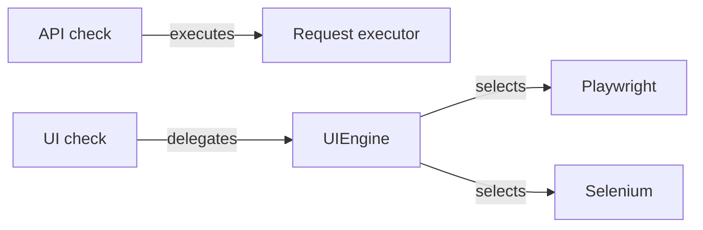
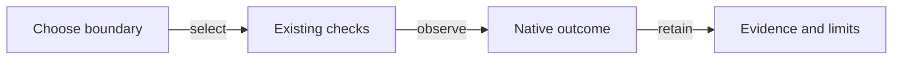

# Framework testing

This guide explains which existing checks answer a change, what they observe,
and how their results support a claim. Start with the design boundaries below;
use the [command cookbook](Testing_Commands.md) for setup and execution recipes.

## Three lanes, explicit proof

API and UI checks share configuration and reporting. API uses its own request
executor; UI uses the same engine contract through two independent providers.
A test must observe the result at the boundary it claims to protect.

Legend: execution paths and shared responsibilities

- Solid arrows mean execution or delegation; the provider branches are alternatives.
- API request execution has its own budgets, retries and response assertions.
- UIEngine supplies the common UI contract; provider adapters own browser acquisition,
  interaction and release. Selecting one provider does not validate the other.
- Configuration and reporting support both paths; they are omitted to keep this
  diagram focused. [Architecture](Architecture.md) owns the module/dependency map.

| Lane | Design owner | Observable oracle | Proof limit |
|---|---|---|---|
| API | [Request executor](../atf-core/src/main/java/com/ai/api/core/client/ApiRequestExecutor.java) | Request order, retry budget and original failure | Doubles prove local execution contracts; GoRest needs separate execution |
| Playwright | [Playwright provider](../atf-playwright/src/main/java/com/ai/ui/core/engine/playwright/PlaywrightProvider.java) | Acquired resources, page state and actual response | Component collaborators do not prove Chromium behavior |
| Selenium | [Selenium provider](../atf-selenium/src/main/java/com/ai/ui/core/engine/selenium/SeleniumProvider.java) | Acquired resources, page state and actual response | Browser proof binds the selected binary, driver and typed CDP |

The [API subset](../atf-tests/src/test/resources/suites/framework-api.xml) owns
local API selection. Provider-native checks observe resource rollback;
[locator/network parity](../atf-tests/src/test/java/com/ai/atf/ui/component/parity/SeleniumPlaywrightLocatorParityContractTest.java)
observes actual page state and a local server's request/response through both adapters.
These are distinct proof levels, even when they protect the same abstraction.

## Choose the proof boundary

| Change or question | Existing selection | Required observation |
|---|---|---|
| One library contract | Owning module and dependencies | Selected assertions and resource ownership |
| Configuration or cross-module behavior | Default local suite | Local outcomes and meaningful negative controls |
| Real UI interaction or response | Browser profile | Both adapters, actual state/response and cleanup |
| Report integration and publication | Reporting subset and aggregate profile | Outcomes, attachments and generated reader |
| Existing application behavior | Explicit concrete class | Target deployment, identities and persisted state |

Legend: how a result becomes a bounded claim

- Solid arrows describe the review sequence, not runtime dependencies.
- Select the smallest existing check that exposes the changed boundary, then run
  the relevant complete selection before closing feedback.
- Retain original PASS, FAIL and SKIP outcomes. A skipped check supplies no execution proof.
- Source governance proves its supported inspection rule. Fixtures prove their
  local behavior; application acceptance requires the intended deployment.

## Local baseline

The default reactor runs native library checks and
[framework-local.xml](../atf-tests/src/test/resources/suites/framework-local.xml).
It covers API execution, UI delegation/configuration, reporting and governance
without opting into browser-dependent or application classes.

- Observe budgets, call ordering and failure propagation in local API checks.
- Observe strict UI options, teardown cleanup and acquisition rollback through
  injected collaborators for both providers.
- Use independent state or failure identity as the oracle; returning from an
  action or calling the same helper twice is insufficient proof.
- Test negative controls and the real repair. Preserve the original failure.

The [method inventory policy](governance/Code_And_Documentation_Policy.md#existing-test-quality)
protects reviewed test identities; it does not establish execution.
See the [local baseline recipe](Testing_Commands.md#local-baseline).

## Selective checks

| Focus | Existing selection | Design question |
|---|---|---|
| API | [API suite](../atf-tests/src/test/resources/suites/framework-api.xml) | Are setup, write readiness, budgets and failures preserved locally? |
| UI | [UI suite](../atf-tests/src/test/resources/suites/framework-ui.xml) | Do common actions, options and lifecycle retain their contracts? |
| Reporting | [Reporting suite](../atf-tests/src/test/resources/suites/framework-reporting.xml) | Do adapters preserve outcome and evidence structure? |

A class filter can let upstream modules with no match continue. Inspect the
requested downstream test identities and outcomes; successful compilation is
insufficient. The [selective recipes](Testing_Commands.md#selective-checks)
keep these focused selections separate from the complete local baseline.

## Browser preparation and checks

The [browser suite](../atf-tests/src/test/resources/suites/framework-browser.xml)
uses local pages for locator/network parity, screenshots, windows and reporting.
Its parity data providers exercise Playwright and Selenium; `ui.engine` does
not reduce that class to one provider.

### Playwright runtime

Prepare the Chromium revision selected by the pinned Java SDK, then verify actual
page/response behavior. Browser acquisition alone is not execution evidence.
See the [Playwright preparation](Testing_Commands.md#playwright-runtime).

### Selenium pinned Manager route

Align the browser, driver and typed CDP with the POM-owned matrix; retain their
actual identities with the result. Cache overrides and Manager preparation belong
to the [Selenium recipe](Testing_Commands.md#selenium-pinned-manager-route).

### Complete browser selection

Run the [complete browser selection](Testing_Commands.md#complete-browser-selection)
after preparing both runtimes. Local-page success does not establish public
application acceptance. Preserve complete screenshots and original failures.

## Reporting acceptance

The [reporting subset](../atf-tests/src/test/resources/suites/framework-reporting.xml)
checks integration; the [aggregate suite](../atf-tests/src/test/resources/suites/framework-aggregate.xml)
collects executed cases and publishes Extent.
Review counts, statuses, timing and attachments against native results using the
[reporting recipes](Testing_Commands.md#reporting-acceptance).

## Application journeys

Existing application classes are opt-in. Configure the intended `base.url` or
`base.url.api`; API writes require an explicit `auth.token`. The local API subset
uses fixtures/doubles and makes no GoRest request.

[PositiveUserTests](../atf-tests/src/test/java/com/ai/api/tests/PositiveUserTests.java)
contains two existing GoRest writes. Missing credentials can produce setup SKIP;
that is not application acceptance. Use the
[application prerequisites](Testing_Commands.md#application-journeys).

## Retained product UI audit

The same existing UI methods can run through either provider. They remain
separate from framework-ui and framework-browser.

| Existing owner | Methods | Observed boundary |
|---|---:|---|
| [RegistrationTests](../atf-tests/src/test/java/com/ai/atf/ui/RegistrationTests.java) | 6 | Registration and invalid-input rejection |
| [AccountAuthenticatedAreaTests](../atf-tests/src/test/java/com/ai/ui/tests/AccountAuthenticatedAreaTests.java) | 5 | Account, profile, favorites, invoices and messages navigation |
| [ProfileContactAddressMemoryTests](../atf-tests/src/test/java/com/ai/ui/tests/ProfileContactAddressMemoryTests.java) | 5 | Registered contact/address values observed in profile |

- Action PASS means technical completion. Business PASS needs a separate
  expected/actual validation; a negative case passes when its rejection oracle succeeds.
- Use separate engine histories. The configured demo creates synthetic customers;
  these selections do not create invoices, alter admin orders or delete customers.
- Browser teardown closes sessions. Application-data cleanup is a separate obligation.

The [living principles](Living_Architecture_UI_API_doc_v1_0.md#retained-principles),
[per-engine publication contract](../artifacts/reports/README.md#retained-ui-report-publication)
and [retained UI recipes](Testing_Commands.md#retained-product-ui-audit) own the details.

## Run location and scope

Use the reactor root of a disposable validation copy, following
[Development](Development.md). Keep builds, browser/Maven caches and complete
run history outside development and live checkouts. Maintain the existing E2E
inventory and desktop-browser scope; do not add journeys or use emulators.

## Explicit configuration

Resolve an existing consumer file once at the reactor root before Maven enters
modules. The [configuration recipe](Testing_Commands.md#explicit-configuration)
explains resource replacement, JVM precedence and portable resolution.

## Output and evidence

| Evidence role | Retention boundary | Review criterion |
|---|---|---|
| Complete runs, including failures | External run history | Source checkpoint, command, subjects and native outcomes |
| Selected native proof | Ignored artifacts/reports/current | Captured revision and original verdict |
| Retained UI reader | One audited reader per engine | Same subjects/statuses in native XML and report |
| Atlas understanding | One HTML per project in artifacts/atlas/current | Captured source/evidence and explicit unknowns |

Keep each run separate. The [output cookbook](Testing_Commands.md#output-and-evidence)
owns default paths; the [artifact contract](../artifacts/README.md#verification)
owns publication and consistency checks. Atlas retrieval helps review source
claims; retrieval or a successful consistency check supplies no fresh test execution.
