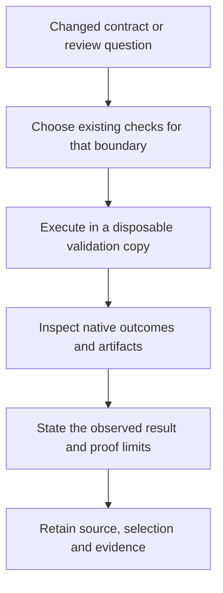

# Framework testing

This guide owns test selection, proof limits and evidence review. Use the
[command cookbook](Testing_Commands.md) for runnable examples. Its recipes are
collapsed by default so setup commands do not obscure the testing strategy.

## Run location and scope

Run Maven from the reactor root of a disposable validation copy, following
[Development](Development.md). Keep builds, Maven/browser caches and complete
run evidence outside the development and live source checkouts.

The current maintenance scope keeps the existing E2E inventory. Improve the
determinism, assertions, documentation and governance of existing checks.
Use desktop browsers; do not add application journeys or use emulators.

## Choose the proof boundary

| Change or question | Existing selection | Required observation |
|---|---|---|
| A library's own contract | Native module checks with its dependencies | The selected classes and their assertions ran |
| Cross-module behavior or governance | Default local suite | Local outcomes and meaningful negative controls |
| Real browser actions, responses or screenshots | Browser profile | Both selected adapters, cleanup and complete artifacts |
| Extent/Allure publication | Native Allure subset and aggregate profile | Actual outcomes and the generated report data/rendering |
| An existing application journey | Explicit concrete class selection | Intended deployment, identities, persisted state and cleanup limits |

Use the smallest selection that exposes the changed boundary. Before closing
feedback, run the relevant complete suite and inspect its actual results.

Solid arrows show the review sequence, not runtime calls or module dependencies.

- Retain the observed PASS, FAIL and SKIP outcomes.
- A source guard proves only its supported inspection rule. Local fixtures and
  browser pages do not establish controlled application acceptance.
- Publication and consistency checks do not rerun tests or broaden their proof boundary.

## Local baseline

The default root selection runs native library checks and
[framework-local.xml](../atf-tests/src/test/resources/suites/framework-local.xml)
in atf-tests, including governance.

- Local fixtures and doubles cover configuration, API execution, UI delegation
  and reporting.
- Browser-dependent cases, intentional failure fixtures and live application
  journeys are excluded.
- A successful compile or a skipped suite is not execution evidence.

Use the [local baseline recipe](Testing_Commands.md#local-baseline).

Existing local UI checks now include failure-safe class teardown, strict UI
boolean/wait/engine validation and acquisition rollback for both providers.
Injected resource collaborators observe ownership and exception identity without
starting browsers. Keep those component results separate from the existing
browser and application selections.

## Selective checks

The maintained [API](../atf-tests/src/test/resources/suites/framework-api.xml),
[UI](../atf-tests/src/test/resources/suites/framework-ui.xml) and
[reporting](../atf-tests/src/test/resources/suites/framework-reporting.xml)
subsets answer focused questions. They do not replace the complete default
governance run.

| API scope | Existing owner | What its outcome establishes |
|---|---|---|
| Framework-local API contracts | BaseTestAPIContractTest and ApiCoreExecutionArchitectureContractTest | Setup, write readiness, budgets, call ordering and failure propagation with local fixtures/doubles; no GoRest request |
| Opt-in API application journeys | [PositiveUserTests](../atf-tests/src/test/java/com/ai/api/tests/PositiveUserTests.java) | Two existing GoRest writes, only when executed with an explicit `auth.token`; empty-token setup SKIP is not application acceptance |

The module/dependency selection builds upstream libraries. A class filter can
allow upstream modules with no matching class to continue; verify that the
requested downstream tests actually ran. A library-only run does not execute
the cross-module regressions in atf-tests.

See the [selective recipes](Testing_Commands.md#selective-checks).

## Browser preparation and checks

Prepare both browser runtimes before accepting browser behavior. Use the
portable work-root/cache inputs in [Development](Development.md#working-roles).
Acquiring a browser binary is separate from executing an acceptance check.

### Playwright runtime

The pinned Playwright Java SDK selects its Chromium revision and uses its
bundled Node runtime. `PLAYWRIGHT_BROWSERS_PATH` can select the external cache.
Preparation skips test execution; `PLAYWRIGHT_SKIP_BROWSER_DOWNLOAD` controls
bootstrap downloads, not browser actions.

Use the [Playwright preparation recipe](Testing_Commands.md#playwright-runtime).

### Selenium pinned Manager route

The [parent POM](../pom.xml) and browser contract select this matrix:

| Component | Selected version |
|---|---|
| Selenium Java | 4.54.0 |
| Chrome for Testing | 158.0.8127.88 |
| ChromeDriver | 158.0.8127.88 |
| Required typed CDP | 158 |

- Select an existing host-specific Chrome executable through `ATF_CHROME_BINARY`.
- An explicit `webdriver.chrome.driver` or usable ATF-cached driver takes priority
  over Manager. Use an empty or nonexistent ATF fallback cache for the Manager route.
- Keep the separate Manager cache/configuration aligned with the matrix;
  conflicting `se-config.toml` settings can override environment inputs.
- Retain actual browser, driver, selected binary and typed CDP evidence.

The existing locator/network parity class exercises both adapters. `ui.engine`
does not restrict its data providers to one engine. Use the
[Manager preparation and parity recipe](Testing_Commands.md#selenium-pinned-manager-route).

### Complete browser selection

The browser profile selects
[framework-browser.xml](../atf-tests/src/test/resources/suites/framework-browser.xml)
only in atf-tests. Native library checks remain part of the reactor run. Local
pages cover engine parity, screenshots, window/zoom behavior and reporting.

- `SE_OFFLINE` controls Manager network access; Maven's offline flag controls Maven
  artifact resolution. Enable them after caching the required assets.
- Preserve complete screenshots. A version change requires a fresh matrix check
  and browser run, recorded in feedback.

Use the [complete browser recipe](Testing_Commands.md#complete-browser-selection).

## Reporting acceptance

The [native Allure subset](../atf-tests/src/test/resources/suites/framework-allure.xml)
checks native integration. The
[aggregate suite](../atf-tests/src/test/resources/suites/framework-aggregate.xml)
collects executed cases and publishes both Extent and Allure.

Inspect counts, statuses, timing, attachments and declared output paths as well
as the TestNG result. Use the [reporting recipes](Testing_Commands.md#reporting-acceptance).

## Application journeys

Product support and opt-in application classes belong to atf-tests. Select a
concrete existing class and configure the intended `base.url`/`base.url.api`;
API writes also need an explicit `auth.token`.

These journeys can create users, orders or invoices. Missing credentials,
unavailable services and unexecuted journeys do not establish acceptance.

- Record framework gaps in [feedback](feedback/README.md), preserving scope.
- Check the [application selection prerequisites](Testing_Commands.md#application-journeys).

## Retained product UI audit

The same existing methods run through either provider. They are separate from
framework-ui and framework-browser; those suites do not silently opt into the
public application.

| Existing owner | Methods | Observed contract |
|---|---:|---|
| [RegistrationTests](../atf-tests/src/test/java/com/ai/atf/ui/RegistrationTests.java) | 6 | Registration plus required-field, email, duplicate, password and phone rejection |
| [AccountAuthenticatedAreaTests](../atf-tests/src/test/java/com/ai/ui/tests/AccountAuthenticatedAreaTests.java) | 5 | Authenticated account, profile, favorites, invoices and messages navigation |
| [ProfileContactAddressMemoryTests](../atf-tests/src/test/java/com/ai/ui/tests/ProfileContactAddressMemoryTests.java) | 5 | Registered contact/address values remain observable in the profile |

Use a separate validation copy and output history per engine. The configured
demo selection creates synthetic customers; it does not create invoices,
change admin orders or delete those customers. Browser teardown closes sessions,
not application data.

- Action PASS means technical completion. Business PASS needs a separate
  validation with expected/actual observations.
- A negative scenario passes when its rejection oracle succeeds. Missing or
  unreached validation is not that success.
- Preserve original FAIL/SKIP outcomes, exact class/method identities, source
  hashes, command, URL, browser identity and native report evidence.

The [living principles](Living_Architecture_UI_API_doc_v1_0.md#retained-principles)
own source responsibilities; the
[publication contract](../artifacts/reports/README.md#retained-ui-report-publication)
owns the per-engine reader. The
[retained UI recipes](Testing_Commands.md#retained-product-ui-audit) separate
execution, maintenance controls and an existing reader's consistency recheck.
Consistency does not establish fresh execution, data cleanup or exhaustive coverage.

## Explicit configuration

[ConfigManager](../atf-core/src/main/java/com/ai/core/support/config/ConfigManager.java)
loads classpath `framework.properties` by default. An explicit consumer file
replaces that resource and must supply the selected consumer's settings.
Individual JVM properties still take precedence.

Resolve an existing file once at the reactor root, before Maven enters modules.
The [configuration recipe](Testing_Commands.md#explicit-configuration) accepts
`ATF_CONFIG_FILE` or the consumer's `config/local.properties`.

- The consumer supplies the file; resolution fails before Maven if it is absent.
- Passing the resolved path avoids forked-process working-directory assumptions.

## Output and evidence

Default paths are relative to the disposable validation copy:

| Output | Location |
|---|---|
| Surefire/TestNG results | Each tested module's target/surefire-reports |
| Cross-module results | atf-tests/target/surefire-reports |
| Extent reports | atf-tests/target/reports |
| Allure raw results | atf-tests/target/allure-results |
| Aggregate publication | atf-tests/target/atf-core-aggregate-report |

The aggregate directory retains its compatibility name; runtime properties can
redirect reporting. `atf.build.directory` and `surefire.reportsDirectory` affect
atf-tests only, without relocating every reactor artifact.
See [output details](Testing_Commands.md#output-and-evidence).

| Evidence role | Retention boundary | Required review |
|---|---|---|
| Complete runs and failures | External immutable run history | Source checkpoint, exact command/selection, counts and original artifacts |
| Selected native proof and receipts | Ignored artifacts/reports/current | Captured revision, actual verdict and [publication layout](../artifacts/README.md#verification) |
| Retained UI reader | One original audited Extent reader per engine, with native XML/source/audit proof | Exact subjects/statuses and the [report archive contract](../artifacts/reports/README.md) |
| Selected Atlas reader | One HTML per project in artifacts/atlas/current | [Atlas consistency check](../artifacts/atlas/README.md#verification) against captured source/evidence |

- Keep each run separate so a focused rerun cannot overwrite earlier XML.
- Record its source, command, selected suite, counts and external evidence
  locations in feedback.
- Distinguish historical, newly executed, skipped and unexecuted checks.
- A retained capture is not automatically latest HEAD; copying or publishing
  it is not a new run.
- Java governance does not execute the artifact collector's CLI. Run the archive's
  explicit Node selection when changing that tool.
