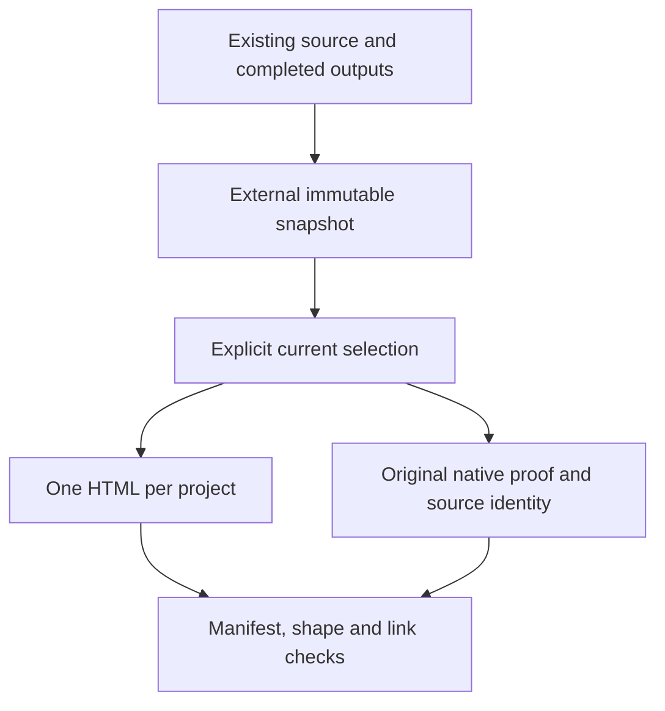

# Bounded publication and immutable external history

Baseline: source checkpoint `6232c00`. This review changes maintenance tooling,
governance and documentation. It adds no runtime feature, product E2E scenario
or emulator. G-014 and F-011 retain their independent open scopes.

## D-008: Separate selected current artifacts from execution history

- Owner: artifact publication, immutable collection and documentation governance.
- Priority: 90, from impact/risk/urgency 90/90/90.
- Baseline quality: 59, from correctness/verification/clarity 60/45/70.
- Observation: the live checkout contained 44 report collections and 14 Atlas
  captures: 6,876 generated files, 196,583,138 bytes. Existing guides explicitly
  allowed every historical/failed bundle in the live runs trees. Neither a
  current-selection limit nor a publication-layout check existed. There was no
  release directory or release JAR/ZIP payload in the inspected live tree.
- Consequence: original failures, fixtures, helper scripts and old render
  captures occupied the same visible publication area as selected reader output.
  Collection integrity was governed, but a growing live archive remained legal.
- Correction: retain one selected standalone HTML per project under
  artifacts/atlas/current and an explicit minimal original proof set under
  artifacts/reports/current. A publication.json inventory binds all current
  files and entry documents. Full history moves together to a caller-selected
  external snapshot, preserving bytes, relative dependencies and original
  indexes. Snapshot IDs and inventory digests identify history; source commands
  contain no fixed author-machine location.
- Governance: extend existing collector component tests with valid source-only
  and published layouts, then reject duplicates, orphan content, changed or
  missing files, links, escaping paths, extra HTMLs and legacy/build/temp/release
  folders. ARTIFACT-PUBLICATION reports the observed path, meaning, owner, repair
  and focused recheck. Validation is read only. Existing Java fixtures protect
  source/resource ownership while excluding only root generated current data.
- Acceptance: verify the complete before/archive inventory; preserve all
  original test verdicts and source identities; validate the staged/current
  selection and local links; pass the focused maintenance and Java governance
  selections; preserve 21 English/Romanian README pairs and unchanged executable
  examples. Record actual before/after counts and original evidence locations.
- Proof boundary: current means selected publication, not latest HEAD. The
  retained Atlas snapshots keep their captured source identities. Copying or
  moving their HTML does not regenerate a project analysis. Original native
  XML/TAP/source manifests remain immutable; selected proof and fresh layout
  checks have separate scopes.
- State: IN PROGRESS. Archive identity, final layout, focused tests and edition
  synchronization must pass before closure.

Arrows show preservation and publication. They do not represent a new product
flow or a new execution of retained tests. A historical failed selection remains
failed after relocation.

## Recovery and future updates

Prepare a complete replacement in external staging. Archive the previous
selection before retiring its live paths. Validate resolved move targets against
the intended workspace, reject links and concurrent changes, and preserve the
before/archive manifest. Keep an explicit recovery record if publication fails;
do not delete history to force a clean result.

Run the read-only publication checker after every selection update. Original
run collection remains supported in external history. A separately authorized
release process owns release qualification; archive collection and source
governance cannot infer it from a directory name or build artifact.
