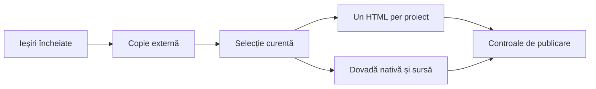

# Publicare delimitată și istoric extern imuabil

Arie istorică: F-011 era deschis în această revizie capturată. Corecția ulterioară
a componentei și acceptanța curentă sunt în [F-011](Behavior_And_Negative_Cases.md#f-011);
aceasta nu rerulează și nu redenumește dovezile anterioare de produs/Atlas.

Referință inițială: reperul sursă `6232c00`. Această revizie modifică instrumentele de întreținere,
guvernanța și documentația. Nu adaugă funcționalități de execuție, scenarii E2E de produs
sau emulatoare. G-014 aparține domeniului extern J1 capturat; F-011 este acum verificat.

## D-008: Separarea artefactelor curente selectate de istoricul execuțiilor

- Responsabil: publicarea artefactelor, colectarea imuabilă și guvernanța documentației.
- Prioritate: 90, din impact/risc/urgență 90/90/90.
- Calitate inițială: 59, din corectitudine/verificare/claritate 60/45/70.
- Observație: copia de lucru live conținea 44 de colecții de rapoarte și 14 capturi Atlas:
  6,876 de fișiere generate, 196,583,138 de octeți. Ghidurile existente permiteau explicit
  fiecare pachet istoric/eșuat în arborii de rulări live. Nu exista nici o
  limită pentru selecția curentă, nici o verificare a structurii de publicare. Nu exista
  niciun director de livrare și niciun JAR/ZIP de livrare în arborele live inspectat.
- Consecință: eșecurile originale, fixture-urile, scripturile auxiliare și capturile
  vechi de randare ocupau aceeași zonă vizibilă de publicare ca rezultatele selectate pentru cititor.
  Integritatea colecțiilor era guvernată, dar creșterea arhivei live rămânea permisă.
- Corecție: păstrarea unui singur HTML autonom selectat per proiect sub
  artifacts/atlas/current și a unui set minim explicit de dovezi originale sub
  artifacts/reports/current. Un inventar publication.json leagă toate fișierele curente
  și documentele de intrare. Istoricul complet este mutat împreună într-un instantaneu
  extern selectat de apelant, păstrând octeții, dependențele relative și indicii
  originali. ID-urile instantaneelor și rezumatele criptografice ale inventarului identifică istoricul; comenzile sursă
  nu conțin nicio locație fixă de pe calculatorul autorului.
- Guvernanță: extinderea testelor de componentă existente ale colectorului cu structuri valide, exclusiv de surse
  și de publicare, apoi respingerea duplicatelor, conținutului orfan, fișierelor schimbate sau
  lipsă, legăturilor, căilor care ies din domeniul permis, HTML-urilor suplimentare și directoarelor moștenite/de compilare/temporare/de livrare.
  ARTIFACT-PUBLICATION raportează calea observată, semnificația, responsabilul, remedierea
  și reverificarea focalizată. Validarea este doar în citire. Fixture-urile Java existente protejează
  proprietatea surselor/resurselor, excluzând numai datele curente generate din rădăcină.
- Acceptanță: verificarea inventarului complet anterior/din arhivă; păstrarea tuturor
  verdictelor originale ale testelor și identităților surselor; validarea selecției din pregătire/curente
  și a legăturilor locale; trecerea selecțiilor focalizate de întreținere și guvernanță Java;
  păstrarea celor 21 de perechi README engleză/română și a exemplelor executabile
  neschimbate. Înregistrarea numerelor efective înainte/după și a locațiilor dovezilor originale.
- Limita dovezii: curent înseamnă publicația selectată, nu cel mai recent HEAD.
  Instantaneele Atlas păstrate își mențin identitățile surselor capturate. Copierea sau
  mutarea HTML-urilor lor nu regenerează analiza unui proiect. Manifestele native originale
  XML/TAP/sursă rămân imuabile; dovada selectată și verificările noi ale structurii
  au domenii separate.
- Stare: CLOSED pentru acest domeniu delimitat de publicare. Calitate livrată: 94, din
  corectitudine/verificare/claritate 95/95/90. Cele două constatări independente existente
  rămân în afara acestei închideri.

Legendă: relații și limita dovezii

Săgețile indică păstrarea și publicarea. Nu reprezintă un flux nou de
produs sau o nouă execuție a testelor păstrate. O selecție istorică eșuată rămâne
eșuată după relocare.

## Recuperare și actualizări viitoare

Pregătiți o înlocuire completă într-o zonă externă de pregătire. Arhivați selecția precedentă
înainte de a-i retrage căile live. Validați destinațiile rezolvate ale mutărilor față de
spațiul de lucru dorit, respingeți legăturile și schimbările concurente și păstrați
manifestul anterior/din arhivă. Păstrați o înregistrare explicită de recuperare dacă publicarea eșuează;
nu ștergeți istoricul pentru a forța un rezultat curat.

Rulați verificatorul de publicare doar în citire după fiecare actualizare a selecției. Colectarea originală
a rulărilor rămâne disponibilă în istoricul extern. Un proces de livrare autorizat separat
deține calificarea livrării; colectarea arhivei și guvernanța surselor
nu o pot deduce din numele unui director sau dintr-un artefact de compilare.

## Livrare verificată și evaluare

Publicația live generată a scăzut de la 6,876 de fișiere / 196,583,138 de octeți
la 26 de fișiere / 19,622,111 de octeți, plus cele patru ghiduri pentru artefacte deținute de Git.
Hash-urile HTML originale ale ambelor proiecte sunt neschimbate. Manifestul curent leagă
2 documente de lectură Atlas, 19 înregistrări native de dovezi/surse și patru documente de intrare.
Toate cele 6,876 de fișiere generate originale au fost verificate înainte și după cele două
mutări ale istoricului extern pe același volum. Niciun fișier original nu a fost șters sau rescris.
ID-ul instantaneului extern este `20261125-organization-01`; SHA-256 al inventarului său
original este `f80981c482dab162877180c8b368ac4b113ddd80ab10e060bf40991b15f0e2a8`.

Selecția focalizată de guvernanță Java existentă a trecut 211 teste per ediție,
cu zero eșecuri, erori sau omiteri. Include arhitectura framework-ului,
documentația și scanarea surselor Java. Selecția de componente pentru colectare/publicare
a trecut 20 de teste cu un raportor TAP explicit și hash-uri înghețate ale surselor.
Patru documente de intrare generate au fost verificate folosind legăturile lor relative live
finale. Douăzeci și una de perechi README își păstrează ierarhia guvernată și
exemplele executabile comune.

Prima captură Node a trecut efectiv toate cele 20 de teste, dar utilitarul său extern de acceptanță
aștepta TAP, în timp ce Node a selectat raportorul spec implicit. Acel utilitar
a raportat eșecul calificării capturii. Rezultatul original și înregistrarea codului de ieșire
rămân păstrate; a doua încercare a selectat explicit TAP și a trecut atât
execuția, cât și calificarea capturii. Nicio aserțiune de test nu a fost slăbită.

Rezultatele Java și Node noi sunt separate de selecțiile istorice păstrate de 232/232 de cazuri Java
și 138 de cazuri Node. Ambele documente de lectură Atlas își păstrează
reviziile originale ale proiectelor capturate; această reorganizare nu este o nouă
analiză a HEAD-urilor lor ulterioare. Rulările istorice eșuate complete, capturile surselor,
observațiile de randare și dependențele relative rămân împreună în afara copiei live.

| Axă de evaluare | Referință inițială (1-100) | Livrat (1-100) | Limita dovezilor |
|---|---:|---:|---|
| Corectitudine | 60 | 95 | Octeți originali/din arhivă identici, structuri curente declarate și căi utile de respingere |
| Verificare | 45 | 95 | 20 de cazuri de componentă, 211/211 cazuri Java, identități noi ale surselor și legături live de intrare |
| Claritate | 70 | 90 | Diagrame de proprietate pe două niveluri, puncte de intrare explicite pentru cititor, istoric extern și reguli de recuperare |
| Calitate ponderată | 59 | 94 | Grila de feedback existentă; numai domeniul delimitat al publicării artefactelor |

Aceste note reprezintă o evaluare redactată a organizării livrate și a
dovezilor sale. Nu implică acoperire completă la execuție, calificarea livrării sau o
notă de maturitate actualizată pentru vreunul dintre proiectele capturate. La acel reper F-011 era deschis; închiderea curentă este legată mai sus. G-014 este o observație externă păstrată.

Prima verificare finală a documentației a respins un rezumat al livrării D-008 introdus
în tabelul numeric al referinței inițiale din ambele ediții (DOC-FEEDBACK-SCHEMA). Jurnalul său
original de eșec și captura exactă a surselor rămân dovezi externe. Mutarea
numai a acelui rezumat în tabelul corecțiilor verificate păstrează componentele inițiale
90/90/90 și 60/45/70. Controlul existent a detectat eroarea
înaintea sincronizării finale; schema și aserțiunile sale au fost păstrate.
