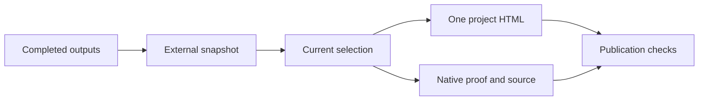

# Bounded publication and immutable external history

Historical scope: F-011 was open in this captured review. Its later owned
component correction and current acceptance are recorded in [F-011](Behavior_And_Negative_Cases.md#f-011);
this does not rerun or relabel the older product/Atlas evidence.

Baseline: source checkpoint `6232c00`. This review changes maintenance tooling,
governance and documentation. It adds no runtime feature, product E2E scenario
or emulator. G-014 belongs to its external captured J1 scope; F-011 is now verified.

## D-008: Separate selected current artifacts from execution history

- Owner: artifact publication, immutable collection and documentation governance.
- Priority: 90, from impact/risk/urgency 90/90/90.
- Baseline quality: 59, from correctness/verification/clarity 60/45/70.
- Observation: the live checkout contained 44 report collections and 14 Atlas
  captures: 6,876 generated files, 196,583,138 bytes. Existing guides explicitly
  allowed every historical/failed bundle in the live runs trees. Neither a
  current-selection limit nor a publication-layout check existed. There was no
  release directory or release JAR/ZIP payload in the inspected live tree.
- Consequence: original failures, fixtures, helper scripts and old render
  captures occupied the same visible publication area as selected reader output.
  Collection integrity was governed, but a growing live archive remained legal.
- Correction: retain one selected standalone HTML per project under
  artifacts/atlas/current and an explicit minimal original proof set under
  artifacts/reports/current. A publication.json inventory binds all current
  files and entry documents. Full history moves together to a caller-selected
  external snapshot, preserving bytes, relative dependencies and original
  indexes. Snapshot IDs and inventory digests identify history; source commands
  contain no fixed author-machine location.
- Governance: extend existing collector component tests with valid source-only
  and published layouts, then reject duplicates, orphan content, changed or
  missing files, links, escaping paths, extra HTMLs and legacy/build/temp/release
  folders. ARTIFACT-PUBLICATION reports the observed path, meaning, owner, repair
  and focused recheck. Validation is read only. Existing Java fixtures protect
  source/resource ownership while excluding only root generated current data.
- Acceptance: verify the complete before/archive inventory; preserve all
  original test verdicts and source identities; validate the staged/current
  selection and local links; pass the focused maintenance and Java governance
  selections; preserve 21 English/Romanian README pairs and unchanged executable
  examples. Record actual before/after counts and original evidence locations.
- Proof boundary: current means selected publication, not latest HEAD. The
  retained Atlas snapshots keep their captured source identities. Copying or
  moving their HTML does not regenerate a project analysis. Original native
  XML/TAP/source manifests remain immutable; selected proof and fresh layout
  checks have separate scopes.
- State: CLOSED for this bounded publication scope. Delivered quality: 94, from
  correctness/verification/clarity 95/95/90. The two existing independent open
  findings remain outside this closure.

Legend: relationships and proof boundary

Arrows show preservation and publication. They do not represent a new product
flow or a new execution of retained tests. A historical failed selection remains
failed after relocation.

## Recovery and future updates

Prepare a complete replacement in external staging. Archive the previous
selection before retiring its live paths. Validate resolved move targets against
the intended workspace, reject links and concurrent changes, and preserve the
before/archive manifest. Keep an explicit recovery record if publication fails;
do not delete history to force a clean result.

Run the read-only publication checker after every selection update. Original
run collection remains supported in external history. A separately authorized
release process owns release qualification; archive collection and source
governance cannot infer it from a directory name or build artifact.

## Verified delivery and assessment

The live generated publication decreased from 6,876 files / 196,583,138 bytes
to 26 files / 19,622,111 bytes, plus the four Git-owned artifact guides.
Both original project HTML hashes are unchanged. The current manifest binds
2 Atlas readers, 19 native proof/source records and four entry documents.
All 6,876 original generated files were verified before and after the two
same-volume external history moves. No original file was deleted or rewritten.
The external snapshot ID is `20261125-organization-01`; its original inventory
SHA-256 is `f80981c482dab162877180c8b368ac4b113ddd80ab10e060bf40991b15f0e2a8`.

The focused existing Java governance selection passed 211 tests per edition,
with zero failures, errors or skips. It includes framework architecture,
documentation and Java source scanning. The collector/publication component
selection passed 20 tests with an explicit TAP reporter and frozen source
hashes. Four generated entry documents were checked using their final live
relative links. Twenty-one README pairs retain their governed hierarchy and
shared executable examples.

The first Node capture actually passed all 20 tests, but its external acceptance
helper expected TAP while Node selected its default spec reporter. That helper
reported a failed capture qualification. The original output and exit receipt
remain preserved; the second attempt explicitly selected TAP and passed both
execution and capture qualification. No test assertion was weakened.

Fresh Java and Node results are separate from the retained 232/232-case Java
and 138-case Node historical selections. Both Atlas readers retain their
original captured project revisions; this organization change is not a new
analysis of their later HEADs. Complete historical failed runs, source captures,
render observations and relative dependencies remain together outside live.

| Assessment axis | Baseline (1-100) | Delivered (1-100) | Evidence boundary |
|---|---:|---:|---|
| Correctness | 60 | 95 | Exact original/archive bytes, declared current shapes and useful rejection paths |
| Verification | 45 | 95 | 20 component cases, 211/211 Java cases, fresh source identities and live entry links |
| Clarity | 70 | 90 | Two-tier ownership diagrams, explicit reader entry points, external history and recovery rules |
| Weighted quality | 59 | 94 | Existing feedback rubric; bounded artifact-publication scope only |

These scores are an authored review of the delivered organization and its
proof. They do not imply full runtime coverage, release qualification or an
updated maturity score for either captured project. At that checkpoint F-011 was open; its current closure is linked above. G-014 is a retained external observation.

The first final-documentation check rejected a delivered D-008 summary inserted
into the numeric baseline table in both editions (DOC-FEEDBACK-SCHEMA). Its
original failed log and exact source capture remain external evidence. Moving
only that summary to the verified-corrections table preserves the original
90/90/90 and 60/45/70 baseline components. The existing guard caught the error
before final synchronization; its schema and assertions were retained.
